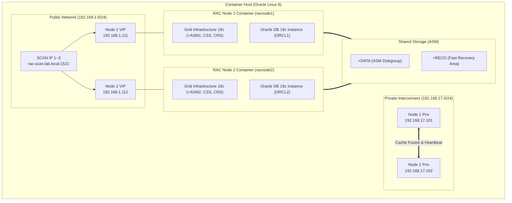

# Oracle Real Application Clusters (RAC) 19c on Containers 완벽 가이드

> **참조 공식 리포지토리**: [oracle/docker-images - OracleDatabase/RAC](https://github.com/oracle/docker-images/tree/main/OracleDatabase/RAC)  
> **대상 버전**: Oracle Database 19c (19.3.0 / 19.x Release Update)  
> **운영체제 환경**: Oracle Linux 8 (권장) / Podman & Docker Enterprise

---

## 1. 아키텍처 개요

Oracle RAC 19c on Container 환경은 고가용성(HA)과 확장성을 컨테이너 기반으로 제공합니다. 
운영 환경과 동일한 2-노드 RAC 구성을 위해 **Grid Infrastructure 19c (Clusterware + ASM)**와 **Oracle Database 19c EE**가 다중 네트워크 및 공유 스토리지 위에 배포됩니다.



---

## 2. 호스트 사전 요구사항 (Host Preparation)

운영 및 실습 환경 호스트에서 Oracle 19c RAC 컨테이너를 정상 구동하기 위해 아래 커널 및 리소스 파라미터가 설정되어야 합니다. (이 작업은 Chapter 1의 Ansible 플레이북으로 자동화할 수 있습니다.)

### 2.1 커널 파라미터 (`/etc/sysctl.conf`)

```ini
# Oracle 19c RAC 필수 커널 파라미터
fs.file-max = 6815744
kernel.sem = 250 32000 100 128
kernel.shmmni = 4096
kernel.shmall = 1073741824
kernel.shmmax = 4398046511104
kernel.panic_on_oops = 1
net.core.rmem_default = 262144
net.core.rmem_max = 4194304
net.core.wmem_default = 262144
net.core.wmem_max = 1048576
net.ipv4.conf.all.rp_filter = 2
net.ipv4.conf.default.rp_filter = 2
fs.aio-max-nr = 1048576
```

적용 명령:
```bash
sudo sysctl -p
```

### 2.2 리소스 제한 (`/etc/security/limits.conf`)

```text
oracle   soft   nofile    1024
oracle   hard   nofile    65536
oracle   soft   nproc     16384
oracle   hard   nproc     16384
oracle   soft   stack     10240
oracle   hard   stack     32768
oracle   soft   memlock   134217728
oracle   hard   memlock   134217728

grid     soft   nofile    1024
grid     hard   nofile    65536
grid     soft   nproc     16384
grid     hard   nproc     16384
grid     soft   stack     10240
grid     hard   stack     32768
grid     soft   memlock   134217728
grid     hard   memlock   134217728
```

---

## 3. 네트워크 설계 (Network Architecture)

Oracle RAC는 최소 2개 이상의 독립된 네트워크 인터페이스를 요구합니다.

| 인터페이스 구분 | 서브넷 예시 | 용도 | 매핑 호스트명 예시 |
|---|---|---|---|
| **Public Network** | `192.168.1.0/24` | 클라이언트 DB 접속, 노드 관리 | `racnode1`, `racnode2` |
| **Virtual IP (VIP)** | `192.168.1.0/24` | 페일오버 및 빠른 장애 감지용 VIP | `racnode1-vip` (`192.168.1.111`), `racnode2-vip` (`192.168.1.112`) |
| **SCAN IP (3개)** | `192.168.1.0/24` | 클러스터 단일 접근 엔드포인트 | `rac-scan.lab.local` (`192.168.1.121~123`) |
| **Private Interconnect 1** | `192.168.17.0/24` | Cache Fusion(블록 전송), Cluster Heartbeat | `racnode1-priv1`, `racnode2-priv1` |
| **Private Interconnect 2 (선택)** | `192.168.18.0/24` | 인터커넥트 HA 이중화 | `racnode1-priv2`, `racnode2-priv2` |

---

## 4. 스토리지 및 ASM 구성 (Storage & ASM)

RAC 노드들은 공유 스토리지를 통해 ASM 디스크 그룹을 공유해야 합니다.

1. **블록 디바이스 방식 (SAN / iSCSI)**:
   - 디바이스 경로: `/dev/asm-disk1`, `/dev/asm-disk2`
   - 소유권: `grid:asmadmin` (권한 `0660`)
2. **NFS 공유 스토리지 방식**:
   - Direct NFS (dNFS) 활성화
   - 마운트 옵션: `rw,bg,hard,nointr,rsize=32768,wsize=32768,tcp,vers=3,timeo=600,actimeo=0`

---

## 5. Oracle RAC 19c 컨테이너 이미지 빌드 절차

Oracle 공식 정책상 Oracle Database 소프트웨어 바이너리는 사전 다운로드가 필요합니다.

### 5.1 바이너리 다운로드
[Oracle Technology Network (OTN)](https://www.oracle.com/database/technologies/oracle19c-linux-downloads.html)에서 다음 2개 파일을 다운로드하여 `dockerfiles/19.3.0/` 경로에 배치합니다:
- `LINUX.X64_193000_grid_home.zip`
- `LINUX.X64_193000_db_home.zip`

### 5.2 빌드 스크립트 실행

```bash
# Oracle 공식 레포지토리 복제
git clone https://github.com/oracle/docker-images.git
cd docker-images/OracleDatabase/RAC/OracleRealApplicationClusters/dockerfiles

# Oracle Linux 8 베이스 이미지로 19.3.0 RAC 이미지 빌드
./buildContainerImage.sh -v 19.3.0 -o '--build-arg BASE_OL_IMAGE=oraclelinux:8'
```

빌드가 완료되면 `oracle/database-rac:19.3.0` 이미지가 로컬 Docker/Podman 레지스트리에 생성됩니다.

---

## 6. RAC 19c 클러스터 실행 단계

### Step 1. 공유 네트워크 생성
```bash
docker network create --driver bridge --subnet=192.168.1.0/24 rac_public_net
docker network create --driver bridge --subnet=192.168.17.0/24 rac_private_net
```

### Step 2. RAC Node 1 기동 (최초 클러스터 생성)
```bash
docker run -d --name racnode1 \
  --hostname racnode1 \
  --net rac_public_net --ip 192.168.1.101 \
  --cap-add=SYS_NICE --cap-add=SYS_RESOURCE --cap-add=NET_ADMIN \
  --device=/dev/asm-disk1:/dev/asm-disk1 \
  --device=/dev/asm-disk2:/dev/asm-disk2 \
  -e INVENTORY=/u01/app/oraInventory \
  -e DB_NAME=ORCL \
  -e DB_UNIQUE_NAME=ORCL_LAB \
  -e ORACLE_SID=ORCL1 \
  -e SCAN_NAME=rac-scan.lab.local \
  -e SCAN_PORT=1521 \
  -e CLUSTER_NAME=rac-cluster-lab \
  -e OP_TYPE=INSTALL \
  oracle/database-rac:19.3.0

# Node 1에 Private Network 추가 연결
docker network connect --ip 192.168.17.101 rac_private_net racnode1
```

### Step 3. RAC Node 2 기동 (클러스터 노드 추가)
```bash
docker run -d --name racnode2 \
  --hostname racnode2 \
  --net rac_public_net --ip 192.168.1.102 \
  --cap-add=SYS_NICE --cap-add=SYS_RESOURCE --cap-add=NET_ADMIN \
  --device=/dev/asm-disk1:/dev/asm-disk1 \
  --device=/dev/asm-disk2:/dev/asm-disk2 \
  -e INVENTORY=/u01/app/oraInventory \
  -e DB_NAME=ORCL \
  -e DB_UNIQUE_NAME=ORCL_LAB \
  -e ORACLE_SID=ORCL2 \
  -e EXISTING_CLS_NODE=racnode1 \
  -e OP_TYPE=ADDNODE \
  oracle/database-rac:19.3.0

# Node 2에 Private Network 추가 연결
docker network connect --ip 192.168.17.102 rac_private_net racnode2
```

---

## 7. RAC 클러스터 상태 검증 명령어 (DBA 필수)

컨테이너 접속 후 다음 명령어로 클러스터 및 데이터베이스 정상 여부를 검증합니다:

```bash
# 1. Grid Infrastructure 클러스터 리소스 전체 상태 확인
su - grid -c "crsctl stat res -t"

# 2. 클러스터 노드 활성화 상태 확인
su - grid -c "olsnodes -n -i -s -t"

# 3. 데이터베이스 인스턴스 전체 상태 확인
su - oracle -c "srvctl status database -d ORCL"

# 4. 리스너 및 SCAN 리스너 상태 확인
su - grid -c "srvctl status scan_listener"
su - grid -c "srvctl status listener"

# 5. ASM 디스크 그룹 마운트 상태 확인
su - grid -c "asmcmd lsdg"
```

---

## 8. Ansible을 통한 자동화 연계

Chapter 1에서 구성한 Ansible 실습 환경을 통해 다음 작업들을 원클릭으로 자동화할 수 있습니다:
1. **사전 준비 자동화**: 노드 OS 커널 파라미터, 패키지, 사용자/그룹 일괄 구성 (`03_oracle_19c_precheck.yml`)
2. **디렉토리 표준화**: `/u01/app/oracle`, `/u01/app/19c/grid` 생성 및 권한 부여 (`02_setup_oracle_env.yml`)
3. **정기 점검 및 상태 리포트**: 앤서블을 통한 다중 RAC 노드의 CRS/DB 상태 일괄 수집 및 리포팅
