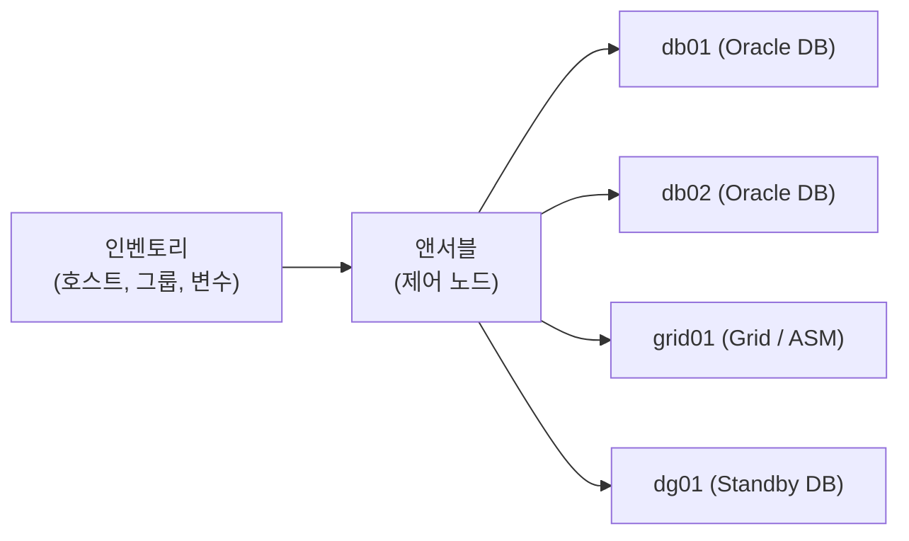
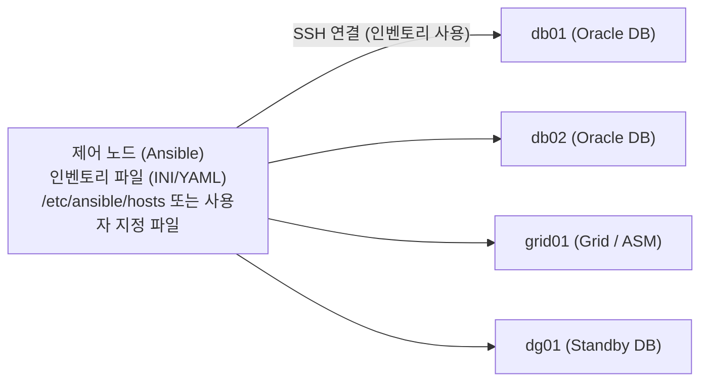
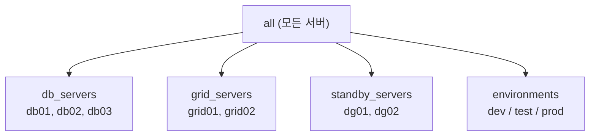
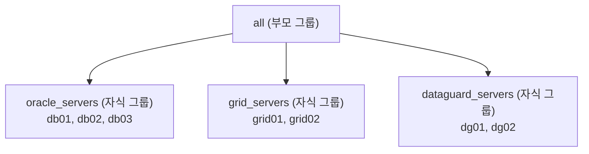
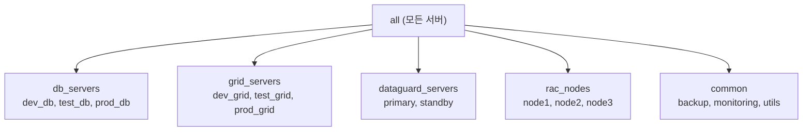
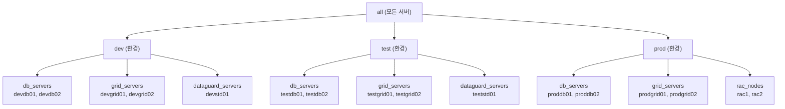

# Ansible 인벤토리 설계: 오라클 DBA 환경을 위한 서버 조직화

> **조판 규격**: 본문·제목·표·캡션·영문 용어는 `Noto Sans KR`(제목 Bold), 코드 블록은 `DejaVu Sans Mono`를 적용합니다.

## 개요

앤서블(Ansible)이 어떤 서버를, 어떻게 관리할지 알려 주는 지도가 **인벤토리(Inventory)** 입니다. 인벤토리를 잘 설계하면 서버가 늘어나도 플레이북(Playbook)을 고치지 않고 자동화를 확장할 수 있습니다.

오라클 DBA(Database Administrator) 환경에는 데이터베이스 서버, 그리드(Grid)/ASM 서버, 데이터 가드(Data Guard) 서버, RAC 노드가 함께 존재하고, 서버마다 DEV, TEST, PROD 환경도 나뉩니다. 이 장의 목표는 이런 서버를 정돈된 구조로 정리하고, 운영 환경에도 쓸 수 있는 인벤토리를 만드는 것입니다.

이 장에서는 다음 내용을 학습합니다.

- 앤서블 인벤토리의 기본 개념
- INI와 YAML 형식의 정적 인벤토리(Static Inventory) 설계
- 호스트(Host), 그룹(Group), 환경(Environment)의 조직화
- 호스트 변수(Host Variable)와 그룹 변수(Group Variable) 활용
- 운영 환경 수준의 오라클 DBA 인벤토리 설계
- 인벤토리 검증, 문제 해결, 모범 사례

> 💡 **노트(Note)**: 오라클 환경의 여러 서버(DB, Grid, ASM, Data Guard, RAC)를 구조적으로 관리하면 확장 가능하고 반복 가능한 자동화를 구현할 수 있습니다.

---

## 1. 앤서블 인벤토리 기초

### 1.1 인벤토리란

인벤토리는 앤서블이 작업을 실행할 관리 노드(Managed Node, 서버)의 목록을 정의한 파일입니다. 어느 서버에 접속할지, 어떻게 접속할지(IP, 호스트명, 사용자 등)를 앤서블에 알려 줍니다.

- 정적 파일(INI 또는 YAML) 또는 동적 인벤토리(Dynamic Inventory, 클라우드나 CMDB 등에서 생성)로 구성할 수 있습니다.
- 플레이북, 애드혹(Ad-hoc) 명령, 자동화 프로젝트 등 모든 앤서블 작업의 기반입니다.
- 오라클 DBA에게는 데이터베이스 서버, 그리드 서버, ASM 서버, 데이터 가드 서버 등을 체계적으로 관리하는 수단이 됩니다.



인벤토리는 앤서블에 어떤 서버를 관리할지, 그리고 어떻게 접속할지 알려 주는 지도입니다.

### 1.2 인벤토리의 구성 요소

| 구성 요소 | 설명 |
|---|---|
| 호스트(Hosts) | 서버 목록(IP 또는 호스트명) |
| 그룹(Groups) | 서버의 논리적 묶음(예: `db_servers`, `grid_servers`) |
| 변수(Variables) | 호스트 또는 그룹 수준의 설정값 |
| 접속 정보(Connection details) | 사용자, SSH 키, 포트 등 |
| 인벤토리 형식(Inventory format) | INI(단순) 또는 YAML(권장) |

### 1.3 인벤토리 사용의 이점

- 모든 서버의 목록을 한곳에서 관리합니다.
- 그룹으로 서버를 정리합니다.
- 변수로 설정을 재사용합니다.
- 여러 환경(DEV, TEST, PROD)의 관리를 단순화합니다.
- 플레이북을 더 유연하고 재사용 가능하게 만듭니다.
- 인프라가 커져도 쉽게 확장합니다.
- 여러 데이터베이스와 환경에 걸친 오라클 DBA 자동화에 필수입니다.

### 1.4 간단한 인벤토리 예시

**INI 형식**

```ini
[db_servers]
db01 ansible_host=192.168.1.101
db02 ansible_host=192.168.1.102

[grid_servers]
grid01 ansible_host=192.168.1.103

[standby]
dg01 ansible_host=192.168.1.104
```

1. `[group_name]`으로 그룹을 정의합니다.
2. 각 그룹 아래에 호스트를 추가합니다.
3. 접속 파라미터(예: `ansible_host`)를 지정합니다.

**YAML 형식**

```yaml
all:
  children:
    db_servers:
      hosts:
        db01:
          ansible_host: 192.168.1.101
        db02:
          ansible_host: 192.168.1.102
    grid_servers:
      hosts:
        grid01:
          ansible_host: 192.168.1.103
    standby:
      hosts:
        dg01:
          ansible_host: 192.168.1.104
```

YAML은 구조적이고 더 강력하며, 중첩 그룹을 지원하고, 큰 환경과 복잡한 구성에서 유지 관리가 쉽습니다.

### 1.5 인벤토리 파일 위치

```bash
[oracle@ansible-dba ~]$ ls -l /etc/ansible/hosts
-rw-r--r-- 1 root root 342 Aug 25 10:30 /etc/ansible/hosts

# 기본 인벤토리 위치
/etc/ansible/hosts
```

플레이북이나 애드혹 명령을 실행할 때 `-i` 옵션으로 사용자 지정 인벤토리 파일을 지정할 수도 있습니다.

### 1.6 핵심 정리

- 인벤토리는 관리 노드를 정의합니다.
- 정적(INI/YAML) 또는 동적으로 구성할 수 있습니다.
- 그룹으로 호스트를 정리하고, 호스트·그룹 변수를 지원합니다.
- 모든 앤서블 자동화의 기반입니다.

---

## 2. 정적 인벤토리 아키텍처

### 2.1 정적 인벤토리란

정적 인벤토리는 관리 노드 목록을 담은 단순한 텍스트 파일로, 사용자가 직접 유지 관리합니다. INI 또는 YAML 형식을 사용하며, 소규모에서 중규모 환경과 실습(Lab) 환경에 적합합니다. 이해하기 쉬워 앤서블 자동화를 시작하기에 좋고, 오라클 DBA 환경에서 데이터베이스 서버, 그리드 서버, ASM 서버 등을 관리하는 데 널리 쓰입니다.



### 2.2 정적 인벤토리를 쓰는 이유

| 이유 | 상세 |
|---|---|
| 단순함 | 만들고 이해하기 쉽습니다. |
| 수동 제어 | 어떤 서버를 추가할지 직접 결정합니다. |
| 외부 의존성 없음 | CMDB나 클라우드 연동이 필요 없습니다. |
| 오라클 DBA 환경에 적합 | 랩, DEV, TEST, 소규모 운영 환경에 이상적입니다. |
| INI/YAML 지원 | 유연한 형식을 선택할 수 있습니다. |

### 2.3 정적 인벤토리와 동적 인벤토리 비교

| 항목 | 정적 인벤토리 | 동적 인벤토리 |
|---|---|---|
| 원천(Source) | 수동 파일(INI/YAML) | 외부 소스(클라우드, CMDB 등)에서 생성 |
| 유지 관리 | 수동 | 자동 |
| 복잡도 | 단순 | 더 복잡 |
| 적합한 환경 | 소규모~중규모 | 대규모, 동적 환경 |
| 사용 사례 | 랩, DEV, TEST, 오라클 DBA 구성 | 클라우드, 대규모 인프라, 오토스케일링 |

### 2.4 인벤토리 파일 위치와 사용자 지정 파일

```bash
# 기본 인벤토리 파일 위치
/etc/ansible/hosts

# 사용자 지정 인벤토리 파일 사용
ansible-playbook -i /home/oracle/inventory.ini playbook.yml
```

### 2.5 개념적 구조

인벤토리 파일(INI/YAML)은 그룹, 호스트, 변수로 구성됩니다.

| 요소 | 예시 |
|---|---|
| 그룹(Groups) | `db_servers`, `grid_servers`, `asm_servers`, `dataguard`, `environments` |
| 호스트(Hosts) | `db01`, `db02`, `grid01`, `dg01` |
| 변수(Variables) | 호스트 변수, 그룹 변수, 접속 정보, 사용자 지정 파라미터 |

### 2.6 오라클 DBA 환경의 구성 예

| 분류 | 서버 |
|---|---|
| 데이터베이스 서버 | db01, db02, db03 |
| 그리드/ASM 서버 | grid01, grid02 |
| 데이터 가드 서버 | primary(prod), standby(dr) |
| 환경 | DEV, TEST, PROD |

### 2.7 핵심 정리

- 정적 인벤토리는 수동으로 유지 관리하는 파일입니다.
- INI와 YAML 형식을 지원하며, 호스트·그룹·변수를 정의합니다.
- 랩, DEV, TEST, 소규모 운영 환경에 적합합니다.
- 플레이북 실행의 기반을 제공합니다.

---

## 3. 인벤토리 파일 형식: INI와 YAML

앤서블은 여러 인벤토리 파일 형식을 지원하며, 가장 많이 쓰이는 형식은 **INI**(단순하고 사용하기 쉬움)와 **YAML**(더 구조적이고 강력함)입니다. 두 형식 모두 호스트, 그룹, 변수를 정의할 수 있고, 환경의 규모와 복잡도에 따라 선택하면 됩니다. 오라클 DBA 자동화에서는 두 형식 모두 널리 사용됩니다.

### 3.1 INI 형식

INI는 단순한 텍스트 기반 형식입니다. 만들고 이해하기 쉽고, 섹션(Section)으로 그룹을 표현하며, 호스트 또는 그룹 수준에서 변수를 정의할 수 있습니다. 소규모~중규모 환경과 전통적인 구성에서 가장 흔히 쓰입니다.

**기본 예시**

```ini
[db_servers]
db01 ansible_host=192.168.1.101
db02 ansible_host=192.168.1.102

[grid_servers]
grid01 ansible_host=192.168.1.103

[standby]
dg01 ansible_host=192.168.1.104
```

**변수 포함 예시**

```ini
[db_servers]
db01 ansible_host=192.168.1.101 \
     ansible_user=oracle \
     ansible_port=22

[db_servers:vars]
oracle_base=/u01/app/oracle
oracle_home=/u01/app/oracle/product/19c
db_domain=example.com
```

`[group:vars]` 섹션에서 정의한 변수는 해당 그룹의 모든 호스트에 적용됩니다.

### 3.2 YAML 형식

YAML은 구조적이고 계층적인 형식입니다. 복잡한 환경에서 가독성이 더 좋고, 중첩 그룹과 변수를 지원하며, 대규모·운영 환경에 권장됩니다.

**기본 예시**

```yaml
all:
  children:
    db_servers:
      hosts:
        db01:
          ansible_host: 192.168.1.101
        db02:
          ansible_host: 192.168.1.102
    grid_servers:
      hosts:
        grid01:
          ansible_host: 192.168.1.103
```

YAML은 들여쓰기를 사용하고, 모든 그룹과 호스트를 계층적으로 정의합니다.

**변수 포함 예시**

```yaml
all:
  children:
    db_servers:
      hosts:
        db01:
          ansible_host: 192.168.1.101
        db02:
          ansible_host: 192.168.1.102
      vars:
        oracle_base: /u01/app/oracle
        oracle_home: /u01/app/oracle/product/19c
        db_domain: example.com
```

변수는 그룹 아래 `vars`에 정의하며, 호스트 수준에서도 정의할 수 있습니다.

### 3.3 INI와 YAML 비교

| 항목 | INI 형식 | YAML 형식 |
|---|---|---|
| 구조 | 단순, 텍스트 기반 | 계층적, 구조적 |
| 가독성 | 소규모 구성에 적합 | 더 읽기 쉬움 |
| 복잡도 | 제한적 | 중첩 그룹 지원 |
| 변수 | 기본 지원 | 고급 지원 |
| 적합한 환경 | 랩/소규모 환경 | 대규모/운영 환경 |
| 사용 사례 | 빠른 구성 | 오라클 DBA 자동화에 권장 |

---

## 4. 호스트와 호스트명

### 4.1 호스트란

호스트는 인벤토리 파일에 정의된 관리 노드(서버)입니다. IP 주소 또는 호스트명으로 지정할 수 있고, 앤서블은 SSH로 호스트에 접속합니다. 각 호스트는 앤서블이 모듈과 플레이북을 실행하는 대상 서버를 나타냅니다. 오라클 DBA 환경에서 호스트는 데이터베이스 서버, 그리드 서버, ASM 서버, 스탠바이 서버 등이 됩니다.

### 4.2 호스트명과 IP 주소

| 항목 | 호스트명 | IP 주소 |
|---|---|---|
| 형식 | 읽기 쉬운 이름(예: `db01.example.com`) | 숫자 주소(예: `192.168.1.101`) |
| 기억하기 쉬움 | 예 | 아니요 |
| 시간에 따른 변화 | 보통 안정적 | 바뀔 수 있음 |
| 권장 여부 | 예(운영 환경) | 사용 가능(주로 랩) |

### 4.3 호스트 정의 방법

**INI 형식**

```ini
[db_servers]
db01 ansible_host=192.168.1.101
db02 ansible_host=192.168.1.102

[grid_servers]
grid01 ansible_host=192.168.1.103

[standby]
dg01 ansible_host=192.168.1.104
```

- 한 줄이 호스트 하나를 나타냅니다.
- 호스트명 또는 IP 주소를 사용할 수 있습니다.
- 짧은 호스트명을 유지하면서 IP로 접속하려면 `ansible_host`를 사용합니다.

**YAML 형식**

```yaml
all:
  children:
    db_servers:
      hosts:
        db01:
          ansible_host: 192.168.1.101
        db02:
          ansible_host: 192.168.1.102
    grid_servers:
      hosts:
        grid01:
          ansible_host: 192.168.1.103
```

### 4.4 호스트 항목 예시

| 예시 | 설명 |
|---|---|
| `db01` | 단순 호스트명(DNS 사용) |
| `db01.example.com` | 정규화된 도메인 이름(FQDN) |
| `192.168.1.101` | IP 주소 |
| `db01 ansible_host=192.168.1.101` | 짧은 호스트명 + 접속용 IP |
| `db01 ansible_host=192.168.1.101 ansible_user=oracle` | 호스트명 + 추가 변수 |

### 4.5 오라클 DBA 호스트 예시

| 분류 | 호스트 |
|---|---|
| 데이터베이스 서버 | db01(DEV), db02(TEST), db03(PROD) |
| 그리드/ASM 서버 | grid01, grid02 |
| 데이터 가드 서버 | primary01(PROD), standby01(DR) |

### 4.6 모범 사례

- 운영 환경에서는 IP 주소 대신 호스트명을 사용합니다.
- DNS 이름 해석이 구성되어 있는지 확인합니다.
- 일관된 명명 규칙(예: `db01`, `db02`, `grid01`)을 사용합니다.
- 그룹으로 인벤토리를 정돈합니다.
- 필요하면 호스트별 변수를 정의합니다.
- `ansible` 명령으로 호스트 접속을 테스트합니다.
- 의미 있고 설명적인 호스트명을 사용합니다.

---

## 5. 그룹과 그룹 조직화

### 5.1 그룹이란

그룹은 인벤토리의 호스트를 논리적으로 정리하는 방법입니다. 여러 서버를 하나의 단위로 관리할 수 있어, 개별 호스트 대신 그룹을 대상으로 명령이나 플레이북을 실행할 수 있습니다. DB 서버, Grid 서버, ASM 서버, Data Guard 서버 등을 다루는 환경에 유용합니다.

### 5.2 그룹 사용의 이점

- 기능이나 역할에 따라 서버를 정리합니다.
- 여러 서버에 명령/플레이북을 한 번에 실행합니다.
- 인벤토리 관리를 단순화합니다.
- 그룹 변수로 공통 설정을 적용합니다.
- 대규모 환경으로 쉽게 확장합니다.
- 오라클 DBA 자동화(DB, Grid, ASM, Data Guard 등)에 유용합니다.



### 5.3 INI 형식으로 그룹 정의

```ini
[db_servers]
db01 ansible_host=192.168.1.101
db02 ansible_host=192.168.1.102
db03 ansible_host=192.168.1.103

[grid_servers]
grid01 ansible_host=192.168.1.201
grid02 ansible_host=192.168.1.202

[standby_servers]
dg01 ansible_host=192.168.1.301
dg02 ansible_host=192.168.1.302
```

### 5.4 YAML 형식으로 그룹 정의

```yaml
all:
  children:
    db_servers:
      hosts:
        db01:
          ansible_host: 192.168.1.101
        db02:
          ansible_host: 192.168.1.102
    grid_servers:
      hosts:
        grid01:
          ansible_host: 192.168.1.201
        grid02:
          ansible_host: 192.168.1.202
```

1. 그룹은 `children` 아래에 정의합니다.
2. 각 그룹에는 `hosts`가 있습니다.
3. 그룹 또는 호스트 수준에서 변수를 추가할 수 있습니다.
4. YAML이 더 구조적이고 읽기 쉽습니다.

### 5.5 오라클 DBA의 일반적인 그룹화 전략

| 그룹 이름 | 용도 |
|---|---|
| `db_servers` | 오라클 데이터베이스 서버 |
| `grid_servers` | Grid Infrastructure / ASM 서버 |
| `standby_servers` | Data Guard 스탠바이 서버 |
| `rac_nodes` | RAC 노드 |
| `environments` | DEV, TEST, PROD 구분 |
| `regions` | 데이터센터 또는 지역 기반 그룹화 |
| `os_type` | OEL 7, OEL 8, OEL 9 서버 |
| `function_based` | 백업, 모니터링, 패치 등 |

### 5.6 그룹 대상 명령 실행

```bash
# 모든 DB 서버에서 명령 실행
ansible db_servers -m ping

# Grid 서버에서 명령 실행
ansible grid_servers -m shell -a "hostname"

# 스탠바이 서버에서 플레이북 실행
ansible-playbook -i inventory.ini dg_check.yml -l standby_servers
```

### 5.7 핵심 정리

- 그룹은 여러 호스트를 정리하고, 그룹 단위로 명령과 플레이북을 실행할 수 있습니다.
- INI와 YAML 형식을 모두 지원합니다.
- DEV, TEST, PROD 같은 환경 분리에 도움이 됩니다.
- 공통 설정은 그룹 변수로 정의할 수 있습니다.
- 인벤토리를 확장하기 쉽게 만들고 유지 관리를 돕습니다.

---

## 6. 부모 그룹과 자식 그룹

부모(Parent) 그룹과 자식(Child) 그룹을 쓰면 인벤토리에 **계층 구조**를 만들 수 있습니다. 자식 그룹은 부모 그룹의 하위 그룹이며, 부모 그룹은 여러 자식 그룹을 포함할 수 있습니다. DB, Grid, ASM, Data Guard, DEV, TEST, PROD 등으로 이루어진 대규모 환경을 정리할 때 유용하며, 부모 그룹을 대상으로 명령을 실행하면 모든 자식 그룹과 호스트가 대상이 됩니다.



### 6.1 INI 형식 예시

```ini
[oracle_servers]
db01 ansible_host=192.168.1.101
db02 ansible_host=192.168.1.102

[grid_servers]
grid01 ansible_host=192.168.1.201
grid02 ansible_host=192.168.1.202

[dataguard_servers]
dg01 ansible_host=192.168.1.301
dg02 ansible_host=192.168.1.302

[all:children]
oracle_servers
grid_servers
dataguard_servers
```

- 자식 그룹을 호스트와 함께 개별적으로 정의합니다.
- `[all:children]`으로 부모-자식 관계를 만듭니다.
- 부모 그룹 `all`은 모든 자식 그룹을 포함합니다.
- 원하는 사용자 정의 부모 그룹을 만들 수 있습니다.

### 6.2 YAML 형식 예시

```yaml
all:
  children:
    oracle_servers:
      hosts:
        db01:
          ansible_host: 192.168.1.101
        db02:
          ansible_host: 192.168.1.102
    grid_servers:
      hosts:
        grid01:
          ansible_host: 192.168.1.201
        grid02:
          ansible_host: 192.168.1.202
    dataguard_servers:
      hosts:
        dg01:
          ansible_host: 192.168.1.301
        dg02:
          ansible_host: 192.168.1.302
```

YAML은 들여쓰기로 계층을 표현하며, 자식 그룹은 `children` 아래에 정의하고 각 자식 그룹이 자기 호스트를 가집니다.

### 6.3 부모·자식 그룹 대상 명령

| 명령 | 설명 |
|---|---|
| `ansible all -m ping` | 모든 호스트(모든 자식 그룹 포함)에서 실행 |
| `ansible oracle_servers -m ping` | DB 서버에서만 실행 |
| `ansible grid_servers -m shell -a "hostname"` | Grid 서버에서 실행 |
| `ansible dataguard_servers -m ping` | Data Guard 서버에서 실행 |

### 6.4 여러 부모 그룹을 활용한 고급 예시

```ini
[db_servers]
db01
db02

[grid_servers]
grid01
grid02

[dataguard_servers]
dg01
dg02

[oracle_infrastructure:children]
db_servers
grid_servers
dataguard_servers
```

1. 사용자 정의 부모 그룹(`oracle_infrastructure`)을 만듭니다.
2. 그 아래 여러 자식 그룹을 추가합니다.
3. 오라클 스택 전체(DB + Grid + Data Guard)에 명령을 실행할 때 유용합니다.
4. 환경별(dev, test, prod) 부모 그룹을 따로 만들 수도 있습니다.

### 6.5 핵심 정리

- 부모·자식 그룹으로 계층형 인벤토리를 만듭니다.
- 복잡한 오라클 환경을 정리하는 데 유용합니다.
- 부모 또는 자식 수준에서 명령과 플레이북을 실행할 수 있습니다.
- INI와 YAML 형식 모두에서 지원됩니다.
- 인벤토리를 관리하고 확장하기 쉽게 합니다.

---

## 7. 호스트 변수

호스트 변수는 인벤토리의 **특정 호스트**에 정의하는 변수입니다. 같은 변수가 그룹과 호스트 양쪽에 정의되어 있으면 호스트 변수가 그룹 변수를 **덮어씁니다(override)**. `db_name`, `ora_home`, `instance_name`처럼 서버마다 설정이 다른 오라클 DBA 자동화에서 자주 사용합니다.

예를 들어 `db01`에는 다음 변수가 있을 수 있습니다.

| 변수 | 값 |
|---|---|
| `db_name` | `orcl` |
| `ora_home` | `/u01/app/oracle/product/19c` |
| `instance_name` | `orcl1` |
| `listener_port` | `1521` |

### 7.1 주요 특징

- 개별 호스트에 대해 정의합니다.
- 그룹 변수와 `all` 변수를 덮어씁니다.
- 호스트별 구성에 유용합니다.
- 인벤토리 파일 또는 별도의 `host_vars` 파일에서 정의할 수 있습니다.
- 사용자 정의 변수(오라클 또는 OS 관련)를 지원합니다.
- 환경 내 서버 간 차이를 관리하는 데 도움이 됩니다.

### 7.2 INI 형식

```ini
[db_servers]
db01 ansible_host=192.168.1.101 \
     db_name=orcl \
     ora_home=/u01/app/oracle/product/19c \
     instance_name=orcl1 \
     listener_port=1521

db02 ansible_host=192.168.1.102 \
     db_name=prod \
     ora_home=/u01/app/oracle/product/19c \
     instance_name=prod1 \
     listener_port=1521
```

1. 변수는 호스트명 뒤에 `key=value` 형태로 추가합니다.
2. 여러 변수는 역슬래시(`\`)로 이어서 씁니다.
3. 호스트마다 다른 변수 값을 가질 수 있습니다.

### 7.3 YAML 형식

```yaml
all:
  hosts:
    db01:
      ansible_host: 192.168.1.101
      db_name: orcl
      ora_home: /u01/app/oracle/product/19c
      instance_name: orcl1
      listener_port: 1521
    db02:
      ansible_host: 192.168.1.102
      db_name: prod
      ora_home: /u01/app/oracle/product/19c
      instance_name: prod1
      listener_port: 1521
```

YAML에서는 각 호스트 아래에 변수를 정의하며, 더 읽기 쉽고 구조적입니다.

### 7.4 플레이북에서 호스트 변수 사용

```yaml
---
- name: Display Oracle Details
  hosts: db_servers
  gather_facts: no
  tasks:
    - name: Show Oracle configuration
      ansible.builtin.debug:
        msg:
          - "Host: {{ inventory_hostname }}"
          - "DB Name: {{ db_name }}"
          - "Oracle Home: {{ ora_home }}"
          - "Instance: {{ instance_name }}"
          - "Listener Port: {{ listener_port }}"
```

`{{ variable_name }}` 형태로 호스트 변수를 직접 사용합니다. 플레이북에서 다시 정의할 필요가 없고, 각 호스트는 자기 변수 값을 사용합니다.

**실행 결과**

```text
PLAY [Display Oracle Details] ************************
TASK [Show Oracle configuration] *********************
ok: [db01] => {
    "msg": [
        "Host: db01",
        "DB Name: orcl",
        "Oracle Home: /u01/app/oracle/product/19c",
        "Instance: orcl1",
        "Listener Port: 1521"
    ]
}
ok: [db02] => {
    "msg": [
        "Host: db02",
        "DB Name: prod",
        "Oracle Home: /u01/app/oracle/product/19c",
        "Instance: prod1",
        "Listener Port: 1521"
    ]
}
```

### 7.5 오라클 DBA 활용 변수

| 변수 | 설명 | 예시 값 |
|---|---|---|
| `db_name` | 데이터베이스 이름 | `orcl` / `prod` |
| `ora_home` | 오라클 홈 경로 | `/u01/app/oracle/product/19c` |
| `instance_name` | 인스턴스 이름 | `orcl1` / `prod1` |
| `listener_port` | 리스너 포트 | `1521` |
| `asm_home` | 그리드 홈 경로(ASM용) | `/u01/app/19c/grid` |
| `web_port` | 사용자 정의 애플리케이션 포트 | `7001` |
| `server_role` | 서버 역할 | `primary` / `standby` |
| `environment` | 환경 유형 | `DEV` / `TEST` / `PROD` |

### 7.6 모범 사례

- 의미 있는 변수 이름을 사용합니다.
- 호스트별 변수만 정의합니다(공통 변수는 그룹 변수에 둡니다).
- 값을 일관되고 이해하기 쉽게 유지합니다.
- 대규모 환경에서는 YAML 형식을 사용합니다.
- 필요하면 민감한 값은 앤서블 볼트(Ansible Vault)에 저장합니다.
- 호스트별로 사용하는 변수를 문서화합니다.
- 테스트 플레이북을 실행해 변수를 검증합니다.
- 모든 변수에 표준 명명 규칙을 따릅니다.

---

## 8. 그룹 변수

그룹 변수는 인벤토리의 **그룹 수준**에서 정의하며, 해당 그룹의 모든 호스트에 적용됩니다. 오라클 홈, 베이스 디렉터리, 환경 변수 같은 공통 설정에 유용하고, INI와 YAML 모두에서 정의할 수 있습니다. 호스트 변수는 같은 변수가 양쪽에 있으면 그룹 변수를 덮어씁니다.

### 8.1 주요 이점

- 여러 호스트에 공통 설정을 적용합니다.
- 인벤토리의 중복을 줄입니다.
- 관리와 유지 보수가 쉬워집니다.
- 환경별 구성(DEV, TEST, PROD)에 유용합니다.
- INI와 YAML 형식을 모두 지원합니다.
- 복잡한 변수(리스트, 딕셔너리)를 정의할 수 있습니다.
- 오라클 DBA 자동화에 널리 사용됩니다.

### 8.2 INI 형식

```ini
[db_servers:vars]
oracle_base=/u01/app/oracle
oracle_home=/u01/app/oracle/product/19c
db_user=oracle
db_group=oinstall
instance_name=orcl
listener_port=1521
environment=PROD
backup_dir=/backup/oracle
rman_retention=7
```

변수는 `[group_name:vars]` 아래에 정의하며, 그룹의 모든 호스트가 이 변수를 상속합니다.

### 8.3 YAML 형식

아래는 `all.children` 아래에 놓이는 그룹 정의의 일부입니다.

```yaml
db_servers:
  vars:
    oracle_base: /u01/app/oracle
    oracle_home: /u01/app/oracle/product/19c
    db_user: oracle
    db_group: oinstall
    instance_name: orcl
    listener_port: 1521
    environment: PROD
    backup_dir: /backup/oracle
    rman_retention: 7
```

### 8.4 플레이북에서 그룹 변수 사용

```yaml
---
- name: Display Group Variables
  hosts: db_servers
  gather_facts: no
  tasks:
    - name: Show Oracle configuration
      ansible.builtin.debug:
        msg:
          - "Oracle Home: {{ oracle_home }}"
          - "Oracle Base: {{ oracle_base }}"
          - "Instance: {{ instance_name }}"
          - "Environment: {{ environment }}"
```

그룹의 모든 호스트가 같은 변수를 사용하며, 호스트 변수와 함께 사용할 수도 있습니다.

**실행 결과**

```text
PLAY [Display Group Variables] ***********************
TASK [Show Oracle configuration] *********************
ok: [db01] => {
    "msg": [
        "Oracle Home: /u01/app/oracle/product/19c",
        "Oracle Base: /u01/app/oracle",
        "Instance: orcl",
        "Environment: PROD"
    ]
}
ok: [db02] => {
    "msg": [
        "Oracle Home: /u01/app/oracle/product/19c",
        "Oracle Base: /u01/app/oracle",
        "Instance: orcl",
        "Environment: PROD"
    ]
}
```

### 8.5 오라클 DBA 그룹 변수 활용 사례

| 활용 사례 | 그룹 변수 예시 |
|---|---|
| 데이터베이스 서버(`db_servers`) | `oracle_home`, `oracle_base`, `instance_name`, `listener_port` |
| Grid/ASM 서버(`grid_servers`) | `grid_home`, `asm_home`, `user`, `group` |
| Data Guard 서버(`dataguard_servers`) | `role=standby`, `primary_db_name`, `standby_db_name` |
| 환경별 그룹(dev/test/prod) | `environment`, `backup_dir`, `rman_retention` |
| RAC 노드(`rac_nodes`) | `cluster_name`, `node_list_scan_name` |
| 공통 설정(`all`) | `ansible_user`, `ansible_ssh_common_args` |

### 8.6 모범 사례

- 의미 있고 일관된 변수 이름을 사용합니다.
- 공통 변수는 그룹 수준에 둡니다.
- 가독성을 위해 YAML 형식을 사용합니다(권장).
- 환경과 기능(DB, Grid, ASM)별로 그룹을 정리합니다.
- 필요할 때만 호스트 수준에서 덮어씁니다.
- 모든 그룹 변수를 문서화합니다.
- 민감한 변수(비밀번호, 키)에는 앤서블 볼트를 사용합니다.
- 테스트 플레이북을 실행해 그룹 변수를 검증합니다.

> ⚠️ **주의(Caution)**: 7장의 호스트 변수 예시는 오라클 홈을 `ora_home`으로, 이 장의 그룹 변수 예시는 `oracle_home`으로 표기합니다. 같은 값을 가리켜도 변수 이름이 다르면 서로 덮어쓰지 않으므로, 실무에서는 하나의 명명 규칙으로 통일하십시오.

---

## 9. 오라클 DBA 인벤토리 설계

실제 업무에서는 여러 유형의 오라클 서버를 앤서블로 관리합니다. 적절한 인벤토리 구조를 설계해야 관리가 쉽고 확장이 가능해집니다. 서버를 역할과 환경에 따라 나누고, 그룹·호스트 변수·그룹 변수를 효과적으로 활용하며, 인벤토리를 단순하고 정돈된 상태로 유지합니다.

| 유형 | 환경/구성 |
|---|---|
| 데이터베이스 서버 | DEV, TEST, PROD |
| Grid / ASM 서버 | DEV, TEST, PROD |
| Data Guard 서버 | PRIMARY, STANDBY |
| RAC 노드 | NODE1, NODE2, NODE3 |

### 9.1 권장 그룹 구조



### 9.2 완성형 인벤토리 예시(INI)

```ini
[all:vars]
ansible_user=oracle
ansible_ssh_private_key_file=~/.ssh/oracle_key

[db_servers]
db01 ansible_host=192.168.1.101 db_name=orcl env=DEV
db02 ansible_host=192.168.1.102 db_name=prod env=PROD
db03 ansible_host=192.168.1.103 db_name=test env=TEST

[grid_servers]
grid01 ansible_host=192.168.1.201
grid02 ansible_host=192.168.1.202

[dataguard_servers]
dg01 ansible_host=192.168.1.301 role=primary
dg02 ansible_host=192.168.1.302 role=standby

[rac_nodes]
rac1 ansible_host=192.168.1.401
rac2 ansible_host=192.168.1.402
rac3 ansible_host=192.168.1.403
```

- 서버를 역할에 따라 그룹화합니다.
- 각 호스트에 관련 변수를 둡니다.
- 환경에 맞게 그룹을 더 추가할 수 있습니다.
- 일관된 명명 규칙을 사용합니다.

### 9.3 완성형 인벤토리 예시(YAML)

```yaml
all:
  vars:
    ansible_user: oracle
    ansible_ssh_private_key_file: ~/.ssh/oracle_key

db_servers:
  hosts:
    db01:
      ansible_host: 192.168.1.101
      db_name: orcl
      env: DEV
    db02:
      ansible_host: 192.168.1.102
      db_name: prod
      env: PROD
    db03:
      ansible_host: 192.168.1.103
      db_name: test
      env: TEST

grid_servers:
  hosts:
    grid01:
      ansible_host: 192.168.1.201
    grid02:
      ansible_host: 192.168.1.202
```

> 💡 **노트(Note)**: 이 YAML 예시는 지면 관계상 일부 그룹만 보여 줍니다. 실제 파일에서는 12장처럼 `all` 아래 `children`으로 그룹을 구성하십시오.

### 9.4 인벤토리 파일 구조

```text
ansible/
├── inventory/
│   ├── inventory.ini
│   └── inventory.yml
├── group_vars/
│   ├── db_servers.yml
│   ├── grid_servers.yml
│   ├── dataguard_servers.yml
│   ├── rac_nodes.yml
│   └── common.yml
└── host_vars/
    ├── db01.yml
    ├── db02.yml
    └── ...
```

- 인벤토리 파일을 전용 디렉터리에 둡니다.
- 공통 설정은 `group_vars`를 사용합니다.
- 호스트별 설정은 `host_vars`를 사용합니다.
- 유지 관리와 버전 관리(Git)가 쉽습니다.
- INI와 YAML 형식을 모두 지원합니다.

### 9.5 그룹 변수 예시(`group_vars/db_servers.yml`)

```yaml
---
oracle_base: /u01/app/oracle
oracle_home: /u01/app/oracle/product/19c
db_port: 1521
db_user: oracle
oracle_env: true
backup_dir: /backup/oracle
monitoring: true
patching: true
maintenance_window: "Sun 02:00-04:00"
roles: ["dba", "backup", "monitoring"]
```

### 9.6 호스트 변수 예시

```yaml
---
db_name: orcl
instance_name: orcl1
listener_port: 1521
server_role: primary
environment: DEV
disk_group: DATA
custom_param: value1
```

### 9.7 핵심 정리

- 오라클 환경의 역할에 따라 인벤토리를 설계합니다.
- 의미 있는 그룹명과 호스트명을 사용합니다.
- 공통 변수는 `group_vars`에, 서버별 설정은 `host_vars`에 둡니다.
- INI와 YAML 형식을 모두 지원합니다.
- 인벤토리를 확장하기 쉽고 유지 관리하기 쉽게 만듭니다.
- 일관된 명명 규칙과 디렉터리 구조를 따릅니다.
- 인벤토리 파일에는 버전 관리(Git)를 사용합니다.

---

## 10. 인벤토리 명령과 검증

인벤토리를 검증하면 인벤토리가 올바르고 오류가 없는지 확인할 수 있습니다. 플레이북 실행 중 발생할 실패를 예방하고, 누락된 호스트, 잘못된 그룹, 문법 문제를 찾는 데 도움이 됩니다. DB, Grid, ASM, RAC 노드가 있는 대규모 오라클 환경에서 특히 중요하므로, **플레이북을 실행하기 전에 검증**하십시오.

### 10.1 기본 인벤토리 명령

| 명령 | 설명 |
|---|---|
| `ansible-inventory -i inventory.ini --list` | 파싱된 인벤토리를 JSON 형식으로 표시 |
| `ansible-inventory -i inventory.yml --list` | 파싱된 YAML 인벤토리를 JSON 형식으로 표시 |
| `ansible-inventory -i inventory.ini --graph` | 인벤토리를 트리/그래프 보기로 표시 |
| `ansible-inventory -i inventory.ini --host <hostname>` | 특정 호스트의 변수 표시 |
| `ansible all --list-hosts -i inventory.ini` | 앤서블이 인식하는 모든 호스트 나열 |
| `ansible <group> --list-hosts -i inventory.ini` | 특정 그룹의 호스트 나열 |

### 10.2 인벤토리 전체 확인(`--list`)

```json
[oracle@ansible ~]$ ansible-inventory -i inventory.ini --list
{
    "_meta": {
        "hostvars": {
            "db01": {
                "ansible_host": "192.168.1.101"
            },
            "db02": {
                "ansible_host": "192.168.1.102"
            }
        }
    },
    "all": {
        "children": ["db_servers", "grid_servers"]
    }
}
```

완전한 인벤토리를 JSON으로 보여 주며, 모든 그룹·호스트·변수를 확인하고 문법과 구조를 검증할 수 있습니다. INI와 YAML 모두에서 동작합니다.

### 10.3 트리 구조 확인(`--graph`)

```text
[oracle@ansible ~]$ ansible-inventory -i inventory.ini --graph
@all:
  |--@db_servers:
  |  |--db01
  |  |--db02
  |  |--db03
  |--@grid_servers:
  |  |--grid01
  |  |--grid02
  |--@dataguard_servers:
  |  |--dg01
  |  |--dg02
  |--@rac_nodes:
  |  |--rac1
  |  |--rac2
  |  |--rac3
```

그룹 계층(부모/자식)을 검증하고, 모든 호스트가 보이는지 빠르게 확인할 수 있습니다.

### 10.4 특정 호스트 확인(`--host`)

```json
[oracle@ansible ~]$ ansible-inventory -i inventory.ini --host db01
{
    "ansible_host": "192.168.1.101",
    "db_name": "orcl",
    "oracle_home": "/u01/app/oracle/product/19c",
    "instance_name": "orcl1",
    "listener_port": "1521",
    "environment": "PROD"
}
```

특정 호스트에 정의된 모든 변수를 보여 주므로, 호스트 수준 변수 검증과 디버깅에 유용합니다.

### 10.5 그룹의 호스트 나열(`--list-hosts`)

```text
[oracle@ansible ~]$ ansible db_servers --list-hosts -i inventory.ini
  hosts (3):
    db01
    db02
    db03

[oracle@ansible ~]$ ansible grid_servers --list-hosts -i inventory.ini
  hosts (2):
    grid01
    grid02
```

플레이북을 실행하기 전에 그룹 구성원이 올바른지 확인합니다.

### 10.6 핑 테스트로 인벤토리 점검

```text
[oracle@ansible ~]$ ansible all -i inventory.ini -m ping
db01 | SUCCESS => {
    "changed": false,
    "ping": "pong"
}
db02 | SUCCESS => {
    "changed": false,
    "ping": "pong"
}
grid01 | SUCCESS => {
    "changed": false,
    "ping": "pong"
}
```

모든 호스트에서 `ping` 모듈을 실행해 연결과 SSH 접근을 확인하고, 인벤토리가 제대로 동작하는지 점검합니다. 실제 플레이북을 실행하기 전에 항상 수행하십시오.

### 10.7 검증 명령 요약

| 명령 | 목적 |
|---|---|
| `ansible-inventory -i inventory --list` | 전체 인벤토리를 JSON으로 표시 |
| `ansible-inventory -i inventory --graph` | 인벤토리 트리 보기 |
| `ansible-inventory -i inventory --host <host>` | 특정 호스트의 변수 표시 |
| `ansible all --list-hosts -i inventory` | 모든 호스트 나열 |
| `ansible <group> --list-hosts -i inventory` | 그룹의 호스트 나열 |
| `ansible all -i inventory -m ping` | 모든 호스트 연결 테스트 |
| `ansible <group> -i inventory -m ping` | 특정 그룹 연결 테스트 |
| `ansible-inventory -i inventory --export` | 인벤토리를 JSON으로 내보내기(디버깅용) |

---

## 11. 인벤토리 문제 해결과 모범 사례

### 11.1 자주 발생하는 인벤토리 문제

| 문제 | 증상 | 가능한 원인 |
|---|---|---|
| 호스트를 찾을 수 없음 | `ERROR! no hosts matched` | 잘못된 호스트명 또는 그룹명 |
| 변수를 찾을 수 없음 | 변수가 정의되지 않음 | 올바른 범위에 변수가 정의되지 않음 |
| 그룹을 찾을 수 없음 | 그룹명을 찾을 수 없음 | 그룹명 오타 또는 잘못된 들여쓰기 |
| SSH 연결 실패 | `UNREACHABLE` | 네트워크, SSH, 방화벽 또는 잘못된 `ansible_user` |
| YAML 문법 오류 | YAML 파싱 오류 | YAML 파일의 들여쓰기 또는 형식 문제 |
| 잘못된 인벤토리 파일 | 예상하지 못한 호스트 | 잘못된 `-i` 파일 또는 여러 인벤토리 파일 사용 |

### 11.2 `no hosts matched` 오류

```text
[oracle@ansible ~]$ ansible db_servers -m ping

ERROR! no hosts matched: db_servers
```

**해결 순서**

1. 인벤토리 파일의 그룹명 철자를 확인합니다.
2. 올바른 인벤토리 파일을 사용하고 있는지 확인합니다(`-i`).
3. `--list-hosts`를 실행해 그룹의 호스트를 확인합니다.
4. 들여쓰기 문제(YAML)를 확인합니다.

### 11.3 변수가 정의되지 않은 경우

```text
[oracle@ansible ~]$ ansible db01 -m debug -a "var=ora_home"

ERROR! 'ora_home' is undefined
```

**해결 순서**

1. `host_vars` 또는 `group_vars`에 변수가 정의되어 있는지 확인합니다.
2. 변수명(철자와 대소문자)이 올바른지 확인합니다.
3. 올바른 인벤토리 파일을 사용하는지 확인합니다.
4. `ansible-inventory --host <hostname>`으로 모든 변수를 확인합니다.

### 11.4 SSH 연결 문제

```text
[oracle@ansible ~]$ ansible db01 -m ping

db01 | UNREACHABLE! => {
    "msg": "Failed to connect to the host via ssh: Permission denied (publickey,password)."
}
```

**해결 순서**

1. 호스트에 도달 가능한지 확인합니다(ping, SSH).
2. 올바른 `ansible_user`인지 확인합니다.
3. SSH 키가 구성되어 있고 인가되었는지 확인합니다.
4. 방화벽과 네트워크 연결을 확인합니다.

### 11.5 YAML 인벤토리 문제 해결

잘못된 예(들여쓰기 오류)와 올바른 예를 비교합니다.

```yaml
# 잘못된 예: 호스트 변수의 들여쓰기가 맞지 않음
all:
  hosts:
    db01:
    ansible_host: 192.168.1.101
    ora_home: /u01/app/oracle
```

```yaml
# 올바른 예
all:
  hosts:
    db01:
      ansible_host: 192.168.1.101
      ora_home: /u01/app/oracle
```

- 올바른 들여쓰기(공백 2칸)를 사용합니다.
- 플레이북을 실행하기 전에 YAML 문법을 검증합니다.
- `ansible-inventory -i inventory.yml --list`로 파싱 결과를 확인합니다.
- YAML은 대소문자를 구분합니다.

### 11.6 유용한 문제 해결 명령

| 명령 | 목적 |
|---|---|
| `ansible-inventory -i inventory.ini --list` | 전체 인벤토리를 JSON으로 표시 |
| `ansible-inventory -i inventory.yml --graph` | 인벤토리 트리 구조 표시 |
| `ansible-inventory -i inventory.ini --host db01` | 특정 호스트의 변수 표시 |
| `ansible all --list-hosts -i inventory.ini` | 앤서블이 인식하는 모든 호스트 나열 |
| `ansible db_servers --list-hosts -i inventory.ini` | 특정 그룹의 호스트 나열 |
| `ansible all -m ping -i inventory.ini` | 모든 호스트 연결 테스트 |
| `ansible db01 -m debug -a "var=ansible_host"` | 특정 변수 값 확인 |
| `ansible-config dump \| grep INVENTORY` | 기본 인벤토리 설정 확인 |

### 11.7 인벤토리 모범 사례

- 명확하고 의미 있는 호스트·그룹 이름을 사용합니다.
- 일관된 명명 규칙(예: `db01`, `db02`)을 따릅니다.
- 환경(DEV, TEST, PROD)별로 인벤토리를 정리합니다.
- 호스트별 변수는 `host_vars`에 둡니다.
- 공통 변수는 `group_vars`에 둡니다.
- 복잡한 환경에서는 YAML 형식을 사용합니다.
- 플레이북을 실행하기 전에 `ansible-inventory`로 인벤토리를 검증합니다.
- 인벤토리 구조와 변수 사용을 문서화합니다.
- 인벤토리 파일에는 버전 관리(Git)를 사용합니다.
- 민감한 데이터(비밀번호, 키)는 앤서블 볼트에 보관합니다.

### 11.8 빠른 문제 해결 체크리스트

| 점검 항목 | 확인 |
|---|:---:|
| 올바른 인벤토리 파일을 사용했는가(`-i`) | ☐ |
| 호스트명이 올바르고 도달 가능한가 | ☐ |
| 그룹명이 올바른가 | ☐ |
| YAML/INI 문법이 올바른가 | ☐ |
| 변수가 올바른 범위에 정의되어 있는가 | ☐ |
| SSH 연결(키 기반)이 동작하는가 | ☐ |
| 올바른 `ansible_user`가 설정되어 있는가 | ☐ |
| 방화벽이나 네트워크 문제가 없는가 | ☐ |
| `ansible-inventory`로 검증했는가 | ☐ |
| `ansible all -m ping`으로 테스트했는가 | ☐ |

---

## 12. 마스터 프로젝트: 운영 환경 수준의 오라클 DBA 인벤토리

### 12.1 프로젝트 목표

- 오라클 DBA 환경을 위한 완전한 운영 환경 수준(Production-style)의 앤서블 인벤토리를 만듭니다.
- 여러 서버 유형(Database, Grid/ASM, Data Guard, RAC 노드)을 포함합니다.
- 그룹, 부모/자식 그룹, 호스트 변수, 그룹 변수를 활용합니다.
- 환경(DEV, TEST, PROD)별로 정리합니다.
- 모범 사례와 확장 가능한 구조를 따릅니다.
- 앤서블 명령으로 인벤토리를 검증합니다.

**목표**: 실제 오라클 DBA 자동화에 쓸 수 있는, 깔끔하고 구조적이며 운영 환경에 준비된 인벤토리를 만드는 것입니다.

### 12.2 프로젝트 인벤토리 구조



### 12.3 완성형 인벤토리(INI)

```ini
[all:children]
dev
test
prod

[dev:children]
db_servers
grid_servers
dataguard_servers

[prod:children]
db_servers
grid_servers
rac_nodes

[db_servers]
devdb01   ansible_host=192.168.1.101 db_name=devdb   env=DEV
testdb01  ansible_host=192.168.1.102 db_name=testdb  env=TEST
proddb01  ansible_host=192.168.1.103 db_name=proddb  env=PROD

[grid_servers]
devgrid01   ansible_host=192.168.1.201
testgrid01  ansible_host=192.168.1.202
prodgrid01  ansible_host=192.168.1.203

[rac_nodes]
rac1 ansible_host=192.168.1.301
rac2 ansible_host=192.168.1.302

[dataguard_servers]
devstd01   ansible_host=192.168.1.401 role=standby
teststd01  ansible_host=192.168.1.402 role=standby
```

1. 환경별로 조직화합니다.
2. 서버 유형별로 그룹을 둡니다.
3. 호스트별 변수를 정의합니다.
4. 관리하고 확장하기 쉽습니다.
5. 실제 오라클 DBA 환경에 적합합니다.

> ⚠️ **주의(Caution)**: 원본의 INI 예시에는 `[test:children]` 정의가 없습니다. 위 구조도처럼 TEST 환경을 `all`의 자식 그룹으로 쓰려면 별도로 정의해야 합니다. 실습 단계에서 보완합니다.

### 12.4 완성형 인벤토리(YAML)

```yaml
all:
  children:
    dev:
      children:
        db_servers:
          hosts:
            devdb01:
              ansible_host: 192.168.1.101
              db_name: devdb
              env: DEV
        grid_servers:
          hosts:
            devgrid01:
              ansible_host: 192.168.1.201
        dataguard_servers:
          hosts:
            devstd01:
              ansible_host: 192.168.1.401
              role: standby
    prod:
      children:
        db_servers:
          hosts:
            proddb01:
              ansible_host: 192.168.1.103
              db_name: proddb
              env: PROD
        grid_servers:
          hosts:
            prodgrid01:
              ansible_host: 192.168.1.203
        rac_nodes:
          hosts:
            rac1:
              ansible_host: 192.168.1.301
            rac2:
              ansible_host: 192.168.1.302
```

- 중첩 그룹과 변수를 지원합니다.
- 읽고 유지 관리하기 쉽습니다.
- 대규모 오라클 환경에 권장됩니다.
- 호스트 변수와 공통 설정을 포함할 수 있습니다.

### 12.5 그룹 변수 구성(`group_vars/`)

```text
group_vars/
├── all.yml
├── dev.yml
├── test.yml
├── prod.yml
├── db_servers.yml
├── grid_servers.yml
├── rac_nodes.yml
└── dataguard_servers.yml
```

```yaml
# group_vars/db_servers.yml
oracle_base: /u01/app/oracle
oracle_home: /u01/app/oracle/product/19c
oracle_user: oracle
listener_port: 1521
environment: DB
backup_dir: /backup/oracle
monitoring: true
patching: true
```

### 12.6 호스트 변수 구성(`host_vars/`)

```text
host_vars/
├── devdb01.yml
├── testdb01.yml
└── proddb01.yml
```

```yaml
# host_vars/proddb01.yml
db_name: proddb
oracle_sid: PRODB1
instance_name: proddb1
role: primary
asm_diskgroup: DATA
backup_retention: 7
custom_param: value1
```

### 12.7 완성된 인벤토리 검증

```text
[oracle@ansible ~]$ ansible-inventory -i inventory.yml --list
{
    "_meta": {
        "hostvars": {
            "devdb01": { ... },
            "proddb01": { ... },
            "rac1": { ... },
        }
    },
}

[oracle@ansible ~]$ ansible all -i inventory.yml -m ping
proddb01 | SUCCESS => {"changed": false, "ping": "pong"}
```

- 인벤토리 구조를 검증합니다.
- 모든 호스트가 보이는지 확인합니다.
- `ping`으로 연결을 테스트합니다.
- 변수가 올바르게 로드되었는지 확인합니다.

### 12.8 최종 산출물과 기대 효과

**최종 산출물**

- 완성된 인벤토리 파일(INI 및 YAML)
- 환경(DEV, TEST, PROD)별로 정리된 구조
- 호스트 변수와 그룹 변수
- 앤서블 명령으로 검증된 인벤토리
- 실제 오라클 DBA 자동화에 쓸 준비가 된 상태

**기대 효과**

- 확장 가능하고 유지 관리하기 쉽습니다.
- 단일 인스턴스, RAC, Data Guard 환경에서 사용할 수 있습니다.
- 수작업을 줄입니다.
- 환경별 플레이북을 실행하기 쉽습니다.
- 업계 모범 사례를 따릅니다.

---

## 실습 및 활용 시나리오 (Hands-on Scenario)

**시나리오**: DEV, TEST, PROD 세 환경에 걸친 오라클 서버를 하나의 인벤토리로 정리하고, 환경별로 명령을 실행해 봅니다.

### 실습 1. 디렉터리 준비

```bash
mkdir -p ~/ansible/{inventory,group_vars,host_vars}
cd ~/ansible
```

### 실습 2. 인벤토리 작성

12.3절의 INI 인벤토리를 `inventory/inventory.ini`로 저장합니다. 이어서 TEST 환경을 `all`의 자식 그룹으로 쓸 수 있도록 `[test:children]` 정의를 보완합니다.

```ini
[test:children]
db_servers
grid_servers
dataguard_servers
```

> ⚠️ **주의(Caution)**: 12.3절 예시는 `db_servers`가 DEV, TEST, PROD 서버를 모두 담고 있고 여러 환경 그룹의 자식으로 쓰입니다. 환경별로 호스트를 엄격히 나누려면 호스트를 환경별 그룹으로 분리해야 하는지 검토하고, 실습 후 `--graph` 결과로 확인하십시오.

### 실습 3. 그룹 변수와 호스트 변수 작성

12.5절과 12.6절의 파일을 각각 `group_vars/db_servers.yml`, `host_vars/proddb01.yml`로 저장합니다.

### 실습 4. 구조와 호스트 검증

```bash
ansible-inventory -i inventory/inventory.ini --graph
ansible-inventory -i inventory/inventory.ini --list
ansible-inventory -i inventory/inventory.ini --host proddb01
ansible all --list-hosts -i inventory/inventory.ini
ansible db_servers --list-hosts -i inventory/inventory.ini
```

`--graph`로 그룹 계층이 설계대로 나오는지, `--host`로 `proddb01`의 변수가 올바른지 확인합니다.

### 실습 5. 연결 테스트

```bash
ansible all -i inventory/inventory.ini -m ping
ansible grid_servers -i inventory/inventory.ini -m shell -a "hostname"
```

### 실습 6. 문제 해결 연습

일부러 그룹명을 틀리게 입력해 `no hosts matched` 오류를 재현하고, 11.2절의 해결 순서대로 원인을 찾아 보십시오.

```bash
ansible db_server -m ping -i inventory/inventory.ini
ansible db_servers --list-hosts -i inventory/inventory.ini
```

### 실습 7. YAML로 변환

같은 구조를 12.4절의 YAML 형식으로 `inventory/inventory.yml`에 작성한 뒤, 두 형식의 결과가 같은지 비교합니다.

```bash
ansible-inventory -i inventory/inventory.yml --list
ansible all -i inventory/inventory.yml -m ping
```

### 확인 체크리스트

11.8절의 체크리스트를 따라 인벤토리 파일, 그룹명, 문법, 변수 범위, SSH 연결을 점검한 뒤 실제 자동화에 적용하십시오.

> 💡 **노트(Note)**: 인벤토리 파일은 Git으로 버전 관리하고, 비밀번호나 키 같은 민감한 값은 앤서블 볼트에 보관하십시오.
