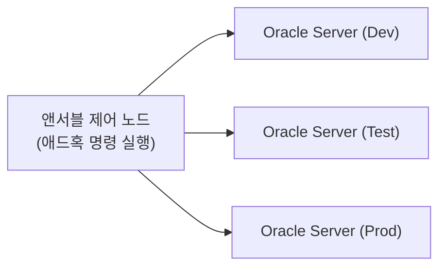

# Ansible 애드혹 명령: 오라클 DBA의 서버 운영 작업 자동화

> **조판 규격**: 본문·제목·표·캡션·영문 용어는 `Noto Sans KR`(제목 Bold), 코드 블록은 `DejaVu Sans Mono`를 적용합니다.

## 개요

데이터베이스 서버의 접속 확인, 디렉터리 생성, 리스너 시작처럼 한 번이면 끝나는 작업까지 플레이북(Playbook)으로 작성하면 오히려 번거롭습니다. 이럴 때 쓰는 도구가 애드혹(Ad-hoc) 명령입니다. 한 줄 명령으로 여러 서버에 같은 작업을 즉시 실행할 수 있어, 오라클 DBA의 일상 운영과 문제 해결에 특히 유용합니다.

이 장에서는 다음 내용을 학습합니다.

- 애드혹 명령의 기본 개념과 명령 구조(문법)
- `ping`, `command`, `shell`, `file`, `copy`, `package`, `service`, `user`/`group` 모듈
- 오라클 DBA 활용 사례(홈·버전 확인, DB·리스너 제어, ASM·데이터 가드 점검, SQL 실행)
- 마스터 프로젝트: 애드혹 명령으로 오라클 서버 운영 수행



> 💡 **노트(Note)**: 애드혹 명령은 빠른 작업과 점검에 적합합니다. 정기적으로 반복하거나 복잡한 작업은 나중에 플레이북으로 전환하십시오.

---

## 1. 애드혹 명령 기초

### 1.1 애드혹 명령이란

애드혹 명령은 플레이북을 작성하지 않고 원격 서버에서 빠르게 작업을 수행하는 한 줄짜리 앤서블 명령입니다.

- 일회성 작업을 실행합니다.
- 플레이북이 필요 없습니다.
- 간단하고 빠르게 사용할 수 있습니다.
- 테스트와 문제 해결에 유용합니다.
- 작고 즉각적인 자동화 작업에 적합합니다.

### 1.2 애드혹 명령과 플레이북 비교

| 항목 | 애드혹 명령 | 플레이북 |
|---|---|---|
| 용도 | 일회성 작업 | 복잡한 다단계 작업 |
| 문법 | 한 줄 | YAML 파일 |
| 적합한 작업 | 빠른 작업, 테스트, 문제 해결 | 반복 가능한 복잡한 자동화 |
| 학습 곡선 | 쉬움 | 보통 |
| 재사용성 | 재사용 불가 | 재사용 가능 |
| 사용 시점 | 작고 즉각적인 작업 | 운영 자동화 |

### 1.3 동작 방식

애드혹 명령은 `ansible <hosts> -m <module> -a "<arguments>"` 형태로 실행합니다. 제어 노드(Control Node)가 SSH로 관리 노드(Managed Node, 오라클/리눅스 서버)에 접속하며, 에이전트는 필요 없습니다.

| 구성 요소 | 설명 |
|---|---|
| 인벤토리(Inventory) | 대상 서버(호스트 또는 그룹)를 정의합니다. |
| 모듈(Module) | 특정 기능(예: ping, command, file, package)을 수행합니다. |
| 인자(Arguments) | 모듈에 전달하는 입력값입니다. |
| SSH | 대상 서버에 안전하게 접속합니다. |
| 사용자(User) | 보통 적절한 사용자(예: oracle 또는 root)로 실행합니다. |

### 1.4 호스트 패턴

| 호스트 패턴 | 설명 |
|---|---|
| `all` | 인벤토리의 모든 서버에서 실행 |
| `web` | 특정 그룹(예: web)에서 실행 |
| `db01` | 특정 호스트에서 실행 |
| `db*` | `db`로 시작하는 모든 호스트 |
| `dev:&db` | dev 그룹과 db 그룹에 모두 속한 호스트 |
| `dev:!test` | dev 그룹에서 test 그룹을 제외한 호스트 |
| `db01,db02` | 여러 특정 호스트 |

### 1.5 오라클 DBA에게 주는 이점

- 서버 연결 상태를 빠르게 확인합니다.
- 플레이북 없이 오라클 서버를 관리합니다.
- 데이터베이스 서버 헬스 체크(Health Check)에 유용합니다.
- 문제 해결에 도움이 됩니다.
- 파일, 패키지, 서비스 같은 일상적인 OS 수준 작업을 수행합니다.
- 여러 서버를 빠르게 검증합니다.
- 일상 DBA 운영 시간을 절약합니다.

**실무 활용 예**: 모든 오라클 서버의 연결 확인, 호스트명·OS 버전·커널 버전 확인, 오라클 디렉터리와 권한 확인, 리스너 상태 확인, 데이터베이스 프로세스 확인, 디스크·메모리 점검, 플레이북을 만들기 전 명령 테스트

---

## 2. 애드혹 명령 구조와 문법

### 2.1 기본 문법

```bash
ansible <host_pattern> -m <module> -a "<arguments>"
```

| 구성 요소 | 필수 | 설명 | 예시 |
|---|:---:|---|---|
| `ansible` | 예 | 애드혹 명령을 실행하는 명령 | `ansible` |
| 호스트 패턴 | 예 | 인벤토리의 대상 서버 | `all`, `db01`, `web`, `dev:&db` |
| `-m` (모듈) | 예 | 작업을 수행할 모듈 | `-m ping` |
| `-a` (인자) | 아니요* | 모듈에 전달할 인자 | `-a "hostname"` |
| `-i` (인벤토리) | 아니요 | 인벤토리 파일 지정(기본값이 아닐 때) | `-i /etc/ansible/inventory.ini` |
| `-u` (사용자) | 아니요 | 접속할 원격 사용자 | `-u oracle` |
| `-b` (become) | 아니요 | sudo 권한으로 실행 | `-b` (또는 `--become`) |
| `-v` (verbose) | 아니요 | 더 많은 출력 표시 | `-v`, `-vv`, `-vvv` |

\* `ping`처럼 인자가 필요 없는 모듈은 `-a`를 생략합니다.

### 2.2 전체 옵션을 사용한 명령 구조

```bash
ansible <host_pattern> -i <inventory> -m <module> -a "<arguments>" -u <user> -b -v
```

### 2.3 예시와 해설

```bash
ansible db01 -m command -a "hostname" -u oracle -b -v
```

이 명령은 `command` 모듈로 `hostname` 명령을 실행하며, 대상은 `db01`입니다. 사용자 `oracle`로 접속하고, sudo 권한을 사용하며, 상세 출력을 표시합니다.

### 2.4 다양한 문법 변형

| 사용 사례 | 명령 |
|---|---|
| 모든 서버에서 실행 | `ansible all -m ping` |
| 그룹에서 실행 | `ansible db_servers -m ping` |
| 특정 호스트에서 실행 | `ansible db01 -m ping` |
| 사용자 지정 인벤토리 사용 | `ansible all -i /etc/ansible/inventory.ini -m ping` |
| 특정 사용자로 실행 | `ansible all -m ping -u oracle` |
| sudo로 실행 | `ansible all -m command -a "hostname" -b` |
| 출력 상세도 증가 | `ansible all -m ping -v` |
| 최대 상세도 | `ansible all -m ping -vvv` |
| 인자 없이 실행 | `ansible all -m ping` |
| 셸 명령 실행 | `ansible all -m shell -a "df -h"` |

### 2.5 모듈별 문법

| 모듈 | 문법 | 용도 |
|---|---|---|
| `ping` | `-m ping` | 연결 확인 |
| `command` | `-m command -a "<cmd>"` | 명령 실행 |
| `shell` | `-m shell -a "<cmd>"` | 셸 명령 실행 |
| `file` | `-m file -a "<params>"` | 파일/디렉터리 관리 |
| `copy` | `-m copy -a "<params>"` | 원격 서버로 파일 복사 |
| `package` | `-m package -a "<params>"` | 패키지 설치/삭제 |
| `service` | `-m service -a "<params>"` | 서비스 관리 |
| `user` | `-m user -a "<params>"` | 사용자 관리 |
| `group` | `-m group -a "<params>"` | 그룹 관리 |

### 2.6 오라클 DBA 전용 문법 예시

```bash
# 오라클 홈 확인
ansible db_servers -m command -a "echo $ORACLE_HOME"

# 오라클 프로세스 확인
ansible db_servers -m shell -a "ps -ef | grep ora_pmon"

# 리스너 상태 확인
ansible db_servers -m shell -a "lsnrctl status"

# 오라클 마운트의 디스크 공간 확인
ansible db_servers -m shell -a "df -h /u01"
```

> ⚠️ **주의(Caution)**: 오라클 홈 확인 예시는 슬라이드 원문을 그대로 실었습니다. 다만 4장에서 설명하듯 `command` 모듈은 셸을 쓰지 않으므로, 환경 변수를 펼쳐 쓰려면 `shell` 모듈을 사용하는 것이 안전합니다.

### 2.7 핵심 정리

- 구조를 이해합니다: `ansible <hosts> -m <module> -a "<args>"`
- 작업에 맞는 모듈을 사용합니다.
- `ping`, `hostname` 같은 간단한 명령부터 시작합니다.
- 인벤토리 그룹으로 여러 서버를 대상으로 지정합니다.
- 오라클 환경에서는 필요에 따라 `-b`와 `-u`를 추가합니다.

---

## 3. ping 모듈 사용

`ping` 모듈은 제어 노드와 대상 서버 사이의 연결을 확인하는 앤서블 내장 모듈입니다. SSH 연결을 검증하며 인자가 필요 없고, 인벤토리와 그룹 테스트에 유용합니다. 다른 명령을 실행하기 전 초기 검증에 이상적입니다.

앤서블은 SSH로 작은 ping 요청을 대상 서버에 보내고, 서버에 도달할 수 있고 인증이 성공하면 `pong`을 반환합니다.

```bash
ansible all -m ping
```

### 3.1 성공 출력

```json
db01 | SUCCESS => {
    "ansible_facts": {
        "discovered_interpreter_python": "/usr/bin/python3"
    },
    "changed": false,
    "ping": "pong"
}
```

서버에 도달할 수 있으며 정상 동작함을 의미합니다.

### 3.2 도달 불가 출력

```json
db02 | UNREACHABLE! => {
    "changed": false,
    "msg": "Failed to connect to the host via ssh: Permission denied (publickey,password).",
    "unreachable": true
}
```

서버에 도달할 수 없다는 뜻입니다. SSH, 사용자, 네트워크를 확인하십시오.

### 3.3 특정 호스트와 그룹 대상 실행

| 사용 사례 | 명령 | 설명 |
|---|---|---|
| 모든 서버 | `ansible all -m ping` | 인벤토리의 모든 서버에서 실행 |
| 특정 호스트 | `ansible db01 -m ping` | 단일 호스트에서 실행 |
| 서버 그룹 | `ansible db_servers -m ping` | 그룹(예: db_servers)에서 실행 |
| 여러 그룹 | `ansible "dev:test" -m ping` | dev와 test 그룹에서 실행 |
| 그룹 제외 | `ansible all:!test -m ping` | test 그룹을 제외한 모든 곳에서 실행 |

### 3.4 기억할 점

- `ping` 모듈은 연결만 확인하며 다른 명령을 실행하지 않습니다.
- SSH를 사용하므로 SSH가 올바르게 구성되어야 합니다.
- 서버에 도달할 수 있으면 `pong`을 반환하고, 연결에 실패하면 `UNREACHABLE`을 반환합니다.
- 자동화 전에 인벤토리와 서버 접근을 테스트하는 데 유용합니다.
- 개별 호스트, 그룹, 여러 그룹에서 동작하며 추가 인자가 필요 없습니다.
- 항상 `ping`을 먼저 실행해 연결을 검증하십시오.

### 3.5 오라클 DBA 활용 사례

- 자동화 작업 전에 모든 오라클 데이터베이스 서버의 연결을 확인합니다.
- Grid/ASM 서버의 SSH 접근을 검증합니다.
- Data Guard, RAC, 스탠바이 서버의 연결을 확인합니다.
- 도달 불가 서버를 빠르게 찾아 네트워크 또는 SSH 문제를 해결합니다.

---

## 4. command 모듈

`command` 모듈은 셸(Shell)을 사용하지 않고 원격 서버에서 명령 하나를 실행합니다. `shell` 모듈보다 안전하며, 파이프나 리디렉션 같은 셸 기능이 필요 없는 단순한 OS 명령에 권장됩니다.

### 4.1 command와 shell 모듈 비교

| 항목 | command 모듈 | shell 모듈 |
|---|:---:|:---:|
| 셸 사용 | 아니요 | 예 |
| 셸 기능(`\|`, `>`, `&&`) 지원 | 아니요 | 예 |
| 더 안전함 | 예 | 아니요 |
| 적합한 명령 | 단순한 명령 | 복잡한 명령 |
| 예시 | `ansible all -m command -a "hostname"` | `ansible all -m shell -a "hostname \| grep db"` |

### 4.2 기본 문법

```bash
ansible <host_pattern> -m command -a "<command>"
```

### 4.3 자주 쓰는 예시

| 사용 사례 | 명령 | 목적 |
|---|---|---|
| 호스트명 확인 | `ansible all -m command -a "hostname"` | 서버 호스트명 표시 |
| OS 버전 확인 | `ansible all -m command -a "cat /etc/os-release"` | OS 정보 표시 |
| 가동 시간 확인 | `ansible all -m command -a "uptime"` | 서버 가동 시간 표시 |
| 디스크 공간 확인 | `ansible all -m command -a "df -h"` | 파일 시스템 사용량 표시 |
| 메모리 확인 | `ansible all -m command -a "free -m"` | 메모리 사용량 표시 |
| 프로세스 목록 | `ansible all -m command -a "ps -ef"` | 실행 중인 프로세스 나열 |
| 오라클 사용자 확인 | `ansible all -m command -a "id oracle"` | 오라클 사용자 검증 |
| 디렉터리 확인 | `ansible all -m command -a "ls -l /u01"` | 오라클 디렉터리 내용 나열 |

### 4.4 출력 예시

**성공**

```json
db01 | SUCCESS => {
    "changed": false,
    "stdout": "db01",
    "stderr": "",
    "rc": 0
}
```

명령이 성공적으로 실행되었고 출력은 `stdout` 필드로 반환됩니다.

**오류**

```json
db02 | FAILED! => {
    "changed": false,
    "msg": "[Errno 2] No such file or directory: b'/invalid/path'",
    "rc": 2
}
```

명령이 실패했습니다. 경로, 권한, 명령 문법을 확인하십시오.

### 4.5 중요한 점

- `command` 모듈은 셸을 사용하지 않습니다.
- 파이프, 리디렉션, 여러 명령이 필요하면 `shell` 모듈을 사용합니다.
- `command` 모듈이 더 안전합니다.
- 항상 `stdout`, `stderr`, 반환 코드(`rc`)를 확인합니다.
- 단순한 OS 점검과 검증에는 `command` 모듈을 사용하는 것이 모범 사례입니다.
- 자동화 작업 전에 오라클 환경을 검증하는 데 유용합니다.

### 4.6 오라클 DBA 활용 사례

- 오라클 데이터베이스 서버 정보(호스트명, OS 버전, 커널 버전) 확인
- 오라클 디렉터리(`/u01`, `/u02`, `/d01`) 검증
- 오라클 사용자와 그룹 상세 정보 확인
- 시스템 리소스 정보(CPU, 메모리, 디스크) 수집
- 실행 중인 오라클 프로세스 확인
- 플레이북 실행 전 환경 검증

---

## 5. shell 모듈

`shell` 모듈은 원격 서버에서 셸 명령을 실행합니다. `command` 모듈보다 강력해 파이프(`|`), 리디렉션(`>`), 환경 변수, 여러 명령을 지원합니다. `command` 모듈로 충분하지 않을 때 사용합니다.

### 5.1 shell과 command 모듈 비교

| 항목 | shell 모듈 | command 모듈 |
|---|:---:|:---:|
| 셸 사용 | 예 | 아니요 |
| 파이프 지원 | 예 | 아니요 |
| 리디렉션(`>`, `>>`) 지원 | 예 | 아니요 |
| 여러 명령 지원 | 예 | 아니요 |
| 더 강력함 | 예 | 아니요 |
| 보안 | 덜 안전 | 더 안전 |
| 적합한 명령 | 복잡한 명령 | 단순한 명령 |
| 예시 | `ansible all -m shell -a "df -h \| grep /u01"` | `ansible all -m command -a "df -h"` |

### 5.2 기본 문법

```bash
ansible <host_pattern> -m shell -a "<shell_command>"
```

### 5.3 자주 쓰는 예시

| 사용 사례 | 명령 | 목적 |
|---|---|---|
| 디스크 공간 확인 | `ansible all -m shell -a "df -h"` | 파일 시스템 사용량 |
| 메모리 확인 | `ansible all -m shell -a "free -m"` | 메모리 사용량 |
| 오라클 프로세스 확인 | `ansible db_servers -m shell -a "ps -ef \| grep ora_pmon"` | 오라클 프로세스 검증 |
| 리스너 상태 확인 | `ansible all -m shell -a "lsnrctl status"` | 리스너 상태 |
| 파이프 사용 | `ansible all -m shell -a "df -h \| grep /u01"` | 파이프로 출력 필터링 |
| 여러 명령 | `ansible all -m shell -a "pwd && ls -l"` | 여러 명령 실행 |
| 출력 리디렉션 | `ansible all -m shell -a "du -sh /u01 > /tmp/u01_size.txt"` | 출력을 파일에 저장 |
| 환경 변수 사용 | `ansible all -m shell -a "echo $ORACLE_HOME"` | 환경 변수 접근 |

### 5.4 출력 예시

**오라클 프로세스 확인**

```text
ansible db01 -m shell -a "ps -ef | grep ora_pmon"
db01 | CHANGED | rc=0 >>
oracle   12345   1  0 Sep26 ?   00:00:00 ora_pmon_PROD
oracle   23456   1  0 Sep26 ?   00:00:00 ora_pmon_TEST
```

**디스크 공간 확인**

```text
ansible all -m shell -a "df -h | grep /u01"
db01 | CHANGED | rc=0 >>
/dev/mapper/u01   100G   45G   55G   45% /u01
```

### 5.5 기억할 점

- 파이프, 리디렉션, 여러 명령이 필요하면 `shell` 모듈을 사용합니다.
- `command` 모듈보다 강력합니다.
- 셸 명령의 따옴표(Quoting) 처리에 주의합니다.
- 꼭 필요할 때만 `shell` 모듈을 사용합니다(`command` 모듈이 더 안전합니다).
- 오라클 환경 검증과 문제 해결에 유용합니다.
- 출력의 반환 코드(`rc`)를 항상 확인합니다.
- 원격 서버에서 스크립트를 실행하는 데도 쓸 수 있습니다.
- 디스크 점검, 프로세스 검증, 로그 분석 같은 DBA 작업에 이상적입니다.

### 5.6 오라클 DBA 활용 사례

- `/u01`, `/u02`, `/backup`의 디스크 공간 확인
- `lsnrctl`로 리스너 상태 확인
- 오라클 인스턴스 상태 확인(`ps -ef | grep ora_`)
- 알림 로그(Alert Log) 끝부분 수집(`tail -100 alert_<sid>.log`)
- 필요할 때 셸로 SQL*Plus 명령 실행
- 오라클용 디렉터리 생성과 권한 설정

---

## 6. file 모듈

`file` 모듈은 원격 서버의 파일, 디렉터리, 권한, 소유권, 링크, 파일 속성을 관리합니다. 멱등성(Idempotent)이 있어 여러 번 실행해도 안전합니다.

### 6.1 file 모듈 파라미터

| 파라미터 | 설명 | 예시 |
|---|---|---|
| `path` | 파일 또는 디렉터리 경로 | `/u01/app/oracle` |
| `state` | present, absent, directory, file, link 등 | `state=directory` |
| `mode` | 파일 권한 | `mode=755` |
| `owner` | 파일/디렉터리 소유자 | `owner=oracle` |
| `group` | 파일/디렉터리 그룹 | `group=oinstall` |
| `recurse` | 하위 디렉터리에 적용 | `recurse=yes` |
| `src` | 원본 경로(링크용) | `src=/u01/app/oracle` |
| `dest` | 대상 경로(링크용) | `dest=/opt/oracle` |
| `force` | 강제 생성(링크용) | `force=yes` |

### 6.2 기본 문법

```bash
ansible <host_pattern> -m file -a "key=value key=value"
```

### 6.3 주요 작업 예시

| 사용 사례 | 명령 | 설명 |
|---|---|---|
| 디렉터리 생성 | `ansible all -m file -a "path=/u01/testdir state=directory mode=755 owner=oracle group=oinstall"` | 권한을 지정해 디렉터리 생성 |
| 파일 생성 | `ansible all -m file -a "path=/u01/testfile state=touch mode=644 owner=oracle group=oinstall"` | 빈 파일 생성 |
| 파일 삭제 | `ansible all -m file -a "path=/u01/testfile state=absent"` | 파일 제거 |
| 디렉터리 삭제 | `ansible all -m file -a "path=/u01/testdir state=absent"` | 디렉터리 제거 |
| 권한 설정 | `ansible all -m file -a "path=/u01/testdir mode=750"` | 권한 변경 |
| 소유자/그룹 변경 | `ansible all -m file -a "path=/u01/testdir owner=oracle group=oinstall"` | 소유자와 그룹 변경 |
| 심볼릭 링크 생성 | `ansible all -m file -a "src=/u01/app/oracle dest=/opt/oracle state=link force=yes"` | 심볼릭 링크 생성 |

### 6.4 예시: 오라클 디렉터리 생성

```bash
ansible db_servers -m file -a "path=/u01/app/oracle/admin state=directory mode=755 owner=oracle group=oinstall"
```

```json
db01 | CHANGED => {
    "changed": true,
    "path": "/u01/app/oracle/admin",
    "state": "directory"
}
```

### 6.5 예시: 심볼릭 링크 생성

```bash
ansible db_servers -m file -a "src=/u01/app/oracle dest=/opt/oracle state=link force=yes"
```

```json
db01 | CHANGED => {
    "changed": true,
    "dest": "/opt/oracle",
    "src": "/u01/app/oracle",
    "state": "link"
}
```

### 6.6 예시: 디렉터리 삭제

```bash
ansible db_servers -m file -a "path=/u01/old_dir state=absent"
```

```json
db01 | CHANGED => {
    "changed": true,
    "path": "/u01/old_dir",
    "state": "absent"
}
```

> ⚠️ **주의(Caution)**: `state=absent`는 대상을 실제로 삭제합니다. 경로를 반드시 확인하고, 먼저 한 서버에서 테스트하십시오.

### 6.7 핵심 정리

- `file` 모듈은 파일과 디렉터리를 관리합니다.
- 생성, 삭제, 권한, 소유권, 링크를 지원합니다.
- 주요 상태는 present, absent, directory, file, link입니다.
- 오라클 디렉터리 관리와 환경 설정에 유용합니다.
- 권한과 소유권을 항상 올바르게 설정합니다.
- 멱등성이 있어 여러 번 실행해도 안전합니다.

### 6.8 오라클 DBA 활용 사례

- 오라클 Base, Home, admin 디렉터리 생성
- 오라클 디렉터리의 올바른 권한 설정
- 오라클 홈용 심볼릭 링크 생성(예: `/opt/oracle -> /u01/app/oracle`)
- 정리 작업 중 오래된 디렉터리 제거
- 데이터 파일, 로그, 백업의 소유권과 권한 보장

---

## 7. copy 모듈

`copy` 모듈은 앤서블 제어 노드의 파일을 원격 서버로 복사합니다. 권한, 소유자, 그룹을 설정하고 기존 파일의 백업도 만들 수 있습니다.

### 7.1 copy 모듈 파라미터

| 파라미터 | 설명 | 예시 |
|---|---|---|
| `src` | 제어 노드의 원본 파일 경로 | `src=/home/oracle/script.sql` |
| `dest` | 원격 서버의 대상 경로 | `dest=/u01/scripts/` |
| `mode` | 파일 권한 | `mode=755` |
| `owner` | 파일 소유자 | `owner=oracle` |
| `group` | 파일 그룹 | `group=oinstall` |
| `backup` | 기존 파일 백업 생성 | `backup=yes` |
| `content` | 텍스트를 직접 내용으로 추가 | `content="Hello"` |
| `force` | 파일이 있으면 덮어쓰기 | `force=yes` |

### 7.2 기본 문법

```bash
ansible <host_pattern> -m copy \
    -a "src=<source_file> dest=<destination> mode=<mode> owner=<owner> group=<group>"
```

### 7.3 자주 쓰는 예시

| 사용 사례 | 명령 | 설명 |
|---|---|---|
| 파일 복사 | `ansible all -m copy -a "src=/home/oracle/script.sql dest=/u01/scripts/script.sql"` | 원격 서버로 script.sql 복사 |
| 권한 설정 | `ansible all -m copy -a "src=script.sh dest=/u01/script.sh mode=755"` | 권한을 지정해 복사 |
| 소유자·그룹 설정 | `ansible all -m copy -a "src=script.sh dest=/u01/script.sh owner=oracle group=oinstall"` | 소유자·그룹을 지정해 복사 |
| 기존 파일 백업 | `ansible all -m copy -a "src=tnsnames.ora dest=/etc/tnsnames.ora backup=yes"` | 기존 파일 백업 생성 |
| 여러 파일 복사(와일드카드) | `ansible all -m copy -a "src=*.sql dest=/u01/sql/ mode=755"` | 모든 SQL 파일 복사 |
| 내용 직접 지정 | `ansible all -m copy -a "content='Hello Oracle' dest=/u01/hello.txt"` | 인라인 내용으로 파일 생성 |

### 7.4 출력 예시

**복사 성공**

```json
db01 | CHANGED => {
    "changed": true,
    "checksum": "a1b2c3d4....",
    "dest": "/u01/scripts/script.sql",
    "gid": 54321,
    "group": "oinstall",
    "mode": "0755",
    "owner": "oracle",
    "size": 1024,
    "src": "/home/oracle/script.sql"
}
```

**기존 파일이 있어 백업이 생성된 경우**

```json
db01 | CHANGED => {
    "changed": true,
    "backup_file": "/etc/tnsnames.ora.20250926@101530~",
    "dest": "/etc/tnsnames.ora",
    "mode": "0644",
    "owner": "oracle",
    "group": "oinstall"
}
```

### 7.5 핵심 정리

- `copy` 모듈은 제어 노드의 파일을 원격 서버로 복사합니다.
- 권한, 소유자, 그룹, 백업, 인라인 내용을 지원합니다.
- 기존 파일을 보존하려면 `backup=yes`를 사용합니다.
- 오라클 스크립트, 설정 파일, 환경 파일 배포에 유용합니다.
- 와일드카드로 여러 파일을 복사할 수 있습니다.
- 대상 경로와 권한을 항상 확인합니다.

### 7.6 오라클 DBA 활용 사례

- 오라클 SQL 스크립트를 원격 서버로 복사(`/u01/scripts`)
- `listener.ora`, `tnsnames.ora` 파일 배포
- RMAN 스크립트, 백업 스크립트, 유지 보수 스크립트 복사
- 데이터베이스 헬스 체크용 사용자 지정 모니터링 스크립트 배포
- 오라클 사용자의 환경 파일(`.bash_profile`, `.bashrc`) 복사

> ⚠️ **주의(Caution)**: 와일드카드(`src=*.sql`) 예시는 슬라이드 원문 그대로입니다. 실제 환경에서는 한 서버에서 먼저 테스트해 여러 파일이 의도대로 복사되는지 확인하십시오.

---

## 8. package 모듈

`package` 모듈은 원격 서버의 소프트웨어 패키지를 설치, 삭제, 업데이트하고 관리합니다. 서로 다른 리눅스 배포판(yum, dnf, apt 등)에서 같은 방식으로 동작합니다.

### 8.1 package 모듈 파라미터

| 파라미터 | 설명 | 예시 |
|---|---|---|
| `name` | 패키지 이름 | `name=httpd` |
| `state` | 패키지 상태(present, absent, latest) | `state=present` |
| `use` | 패키지 관리자 자동 감지(yum/dnf/apt) | `use=auto` |
| `update_cache` | 설치 전 저장소 캐시 갱신 | `update_cache=yes` |
| `enablerepo` | 특정 저장소 활성화 | `enablerepo=ol8_appstream` |
| `disable_gpg_check` | GPG 검사 비활성화 | `disable_gpg_check=yes` |

### 8.2 기본 문법

```bash
ansible <host_pattern> -m package \
    -a "name=<package_name> state=<state> [other_parameters]"
```

### 8.3 자주 쓰는 예시

| 사용 사례 | 명령 | 설명 |
|---|---|---|
| 패키지 설치 | `ansible all -m package -a "name=httpd state=present"` | httpd 패키지 설치 |
| 패키지 삭제 | `ansible all -m package -a "name=httpd state=absent"` | httpd 패키지 삭제 |
| 패키지 업데이트 | `ansible all -m package -a "name=httpd state=latest"` | httpd를 최신 버전으로 업데이트 |
| 여러 패키지 설치 | `ansible all -m package -a "name='[httpd, git]' state=present"` | 여러 패키지 설치 |
| 저장소 캐시 갱신 후 설치 | `ansible all -m package -a "name=oracleasm-support state=present update_cache=yes"` | 캐시 갱신 후 패키지 설치 |
| 특정 저장소 사용 | `ansible all -m package -a "name=oracle-rdbms-server-19c state=present enablerepo=ol8_appstream"` | 특정 저장소에서 설치 |

### 8.4 출력 예시

**패키지 설치**

```json
db01 | CHANGED => {
    "changed": true,
    "name": "httpd",
    "state": "present",
    "version": "2.4.37-62.module+el8.10.0+2151+8976af66",
    "rc": 0
}
```

**패키지 삭제**

```json
db02 | CHANGED => {
    "changed": true,
    "name": "httpd",
    "state": "absent",
    "rc": 0
}
```

### 8.5 핵심 정리

- `package` 모듈은 여러 리눅스 배포판에서 동작합니다.
- 패키지를 설치, 삭제, 업데이트, 관리하는 데 사용합니다.
- 한 명령으로 여러 패키지를 처리할 수 있습니다.
- `update_cache=yes`로 저장소 캐시를 갱신할 수 있습니다.
- 설치는 `state=present`, 삭제는 `state=absent`, 업데이트는 `state=latest`를 사용합니다.
- 특정 저장소를 활성화할 수 있습니다.
- 오라클 환경의 OS 패키지 관리 자동화에 필수입니다.

### 8.6 오라클 DBA 활용 사례

- 오라클에 필요한 OS 패키지 설치(`oracleasm-support`, `smartmontools` 등)
- 오라클 클라이언트 패키지 설치(`instantclient`)
- 보안 패치를 위한 OS 패키지 업데이트
- 불필요한 패키지 삭제
- 오라클 설치나 패치 전에 필요한 패키지가 설치되어 있는지 확인

---

## 9. service 모듈

`service` 모듈은 원격 서버의 서비스를 관리합니다. systemd 또는 init을 사용하는 여러 리눅스 배포판에서 서비스를 시작, 중지, 재시작하거나 활성화/비활성화할 수 있습니다.

### 9.1 service 모듈 파라미터

| 파라미터 | 설명 | 예시 |
|---|---|---|
| `name` | 서비스 이름 | `name=oracle-listener` |
| `state` | 원하는 상태(start, stop, restart, reloaded) | `state=started` |
| `enabled` | 부팅 시 서비스 활성화/비활성화 | `enabled=yes` |
| `pattern` | 구형 init 시스템에서 서비스 프로세스를 찾는 데 사용 | `pattern=tnslsnr` |
| `sleep` | 서비스 상태를 확인하기 전 대기 시간 | `sleep=10` |

### 9.2 기본 문법

```bash
ansible <host_pattern> -m service \
    -a "name=<service_name> state=<state> enabled=<yes|no>"
```

### 9.3 자주 쓰는 예시

| 사용 사례 | 명령 | 설명 |
|---|---|---|
| 서비스 시작 | `ansible all -m service -a "name=oracle-listener state=started"` | 서비스 시작 |
| 서비스 중지 | `ansible all -m service -a "name=oracle-listener state=stopped"` | 서비스 중지 |
| 서비스 재시작 | `ansible all -m service -a "name=oracle-listener state=restarted"` | 서비스 재시작 |
| 부팅 시 활성화 | `ansible all -m service -a "name=oracle-listener state=started enabled=yes"` | 시작하고 부팅 시 활성화 |
| 부팅 시 비활성화 | `ansible all -m service -a "name=oracle-listener state=stopped enabled=no"` | 중지하고 부팅 시 비활성화 |
| 서비스 상태 확인 | `ansible all -m service -a "name=oracle-listener state=started"` | 서비스가 실행 중인지 확인 |

### 9.4 출력 예시

**서비스 시작**

```json
db01 | CHANGED => {
    "changed": true,
    "name": "oracle-listener",
    "state": "started",
    "enabled": true,
    "status": {
        "ActiveState": "active",
        "SubState": "running"
    }
}
```

**상태 확인(이미 실행 중)**

```json
db01 | SUCCESS => {
    "changed": false,
    "name": "oracle-listener",
    "state": "started",
    "status": {
        "ActiveState": "active",
        "SubState": "running",
        "MainPID": 12345
    }
}
```

`changed`가 `false`이면 서비스가 이미 원하는 상태였다는 뜻입니다. 멱등성 덕분에 같은 명령을 반복해도 안전합니다.

### 9.5 핵심 정리

- `service` 모듈은 원격 서버의 서비스를 관리합니다.
- 서비스를 시작, 중지, 재시작, 활성화, 비활성화할 수 있습니다.
- systemd와 구형 init 시스템에서 동작합니다.
- 주요 파라미터는 `name`, `state`, `enabled`입니다.
- 오라클 리스너와 데이터베이스 서비스 관리에 유용합니다.
- 작업 후에는 항상 서비스 상태를 확인합니다.
- 애드혹 명령과 플레이북 모두에서 사용할 수 있습니다.

### 9.6 오라클 DBA 활용 사례

- 오라클 리스너 서비스(`tnslsnr`) 시작/중지/재시작
- 오라클 데이터베이스 서비스(`oracle.service`) 시작/중지
- 서버 재부팅 시 서비스(리스너, 에이전트 등) 자동 시작 설정
- 패치 전후의 오라클 서비스 상태 확인
- 헬스 체크의 일부로 필수 서비스가 실행 중인지 확인

---

## 10. 애드혹 명령으로 사용자와 그룹 관리

`user`와 `group` 모듈은 원격 서버의 사용자와 그룹을 생성, 삭제, 관리합니다. 사용자 비밀번호 설정, 그룹 구성원 관리, 홈 디렉터리와 셸 지정이 가능해 오라클 및 리눅스 관리에 유용합니다.

### 10.1 user 모듈 파라미터

| 파라미터 | 설명 | 예시 |
|---|---|---|
| `name` | 사용자 이름 | `name=oracle` |
| `state` | present 또는 absent | `state=present` |
| `uid` | 사용자 ID | `uid=54321` |
| `group` | 기본 그룹 | `group=oinstall` |
| `groups` | 보조 그룹 | `groups=dba,oper` |
| `home` | 홈 디렉터리 | `home=/u01/app/oracle` |
| `shell` | 로그인 셸 | `shell=/bin/bash` |
| `password` | 암호화된 비밀번호 | `password='{{ "pass" \| password_hash("sha512") }}'` |
| `create_home` | 홈 디렉터리 생성 | `create_home=yes` |
| `remove` | 홈 디렉터리 삭제 | `remove=yes` |

### 10.2 group 모듈 파라미터

| 파라미터 | 설명 | 예시 |
|---|---|---|
| `name` | 그룹 이름 | `name=dba` |
| `state` | present 또는 absent | `state=present` |
| `gid` | 그룹 ID | `gid=54321` |
| `system` | 시스템 그룹 생성 | `system=yes` |

### 10.3 기본 문법

```bash
ansible <host_pattern> -m user \
    -a "name=<username> state=<state> [options]"
```

### 10.4 사용 예시

**사용자 생성**

```bash
ansible all -m user -a "name=oracle state=present \
uid=54321 group=oinstall \
home=/u01/app/oracle shell=/bin/bash create_home=yes"
```

**그룹 생성**

```bash
ansible all -m group -a "name=dba state=present gid=54321"
```

**기존 그룹에 사용자 추가**

```bash
ansible all -m user -a "name=oracle groups=dba append=yes"
```

**사용자 비밀번호 설정**

```bash
ansible all -m user -a "name=oracle \
password='{{ "Oracle@123" | password_hash("sha512") }}'"
```

**사용자 잠금과 해제**

```bash
# 잠금
ansible all -m user -a "name=oracle state=present password_lock=yes"

# 잠금 해제
ansible all -m user -a "name=oracle state=present password_lock=no"
```

> ⚠️ **주의(Caution)**: 슬라이드의 비밀번호 예시는 설명용 평문 값입니다. 실제 운영에서는 비밀번호를 명령 줄에 직접 쓰지 말고 앤서블 볼트(Ansible Vault) 등 별도 수단으로 보호하십시오.

### 10.5 핵심 정리

- `user` 모듈은 사용자 계정을, `group` 모듈은 그룹을 관리합니다.
- 사용자를 생성, 삭제, 수정, 잠금/해제할 수 있습니다.
- 홈 디렉터리, 그룹, 셸, 비밀번호를 설정할 수 있습니다.
- 그룹은 별도로 생성하고 관리할 수 있습니다.
- 오라클 소프트웨어 설치와 유지 관리에 유용합니다.
- 애드혹 명령과 플레이북 모두에서 사용할 수 있습니다.
- 오라클 환경의 보안과 표준화에 필수입니다.

### 10.6 오라클 DBA 활용 사례

- 오라클 소프트웨어 사용자(oracle, grid) 생성
- OS 그룹(oinstall, dba, oper, asmadmin) 생성
- 사용자를 여러 그룹에 추가
- 오라클 사용자의 홈 디렉터리, 셸, 권한 설정
- 설치·설정용 사용자 비밀번호 설정 또는 재설정
- 보안을 위한 사용자 계정 잠금/해제
- 오라클 환경 설정의 일부로 사용자·그룹 생성 자동화

---

## 11. 오라클 DBA 애드혹 자동화 활용 사례

애드혹 명령으로 플레이북을 만들지 않고도 원격 서버에서 일반적인 오라클 DBA 작업을 빠르게 수행할 수 있습니다. 일상 관리, 문제 해결, 유지 보수에 도움이 됩니다.

### 11.1 일반적인 활용 사례

| 사용 사례 | 설명 |
|---|---|
| 오라클 홈 확인 | 오라클 홈, 버전, 환경 변수 검증 |
| 데이터베이스 상태 확인 | 데이터베이스 실행 여부 확인 |
| 리스너 상태 확인 | 리스너 상태와 포트 확인 |
| 데이터베이스 시작/중지 | 오라클 데이터베이스 시작 또는 중지 |
| 리스너 시작/중지 | 리스너 서비스 시작 또는 중지 |
| ASM 상태 확인 | ASM 인스턴스 상태 확인 |
| 데이터 가드 상태 확인 | Primary/Standby 역할과 적용 상태 확인 |
| 오라클 파일 관리 | 오라클 파일 생성, 복사, 권한 설정 |
| 알림 로그 확인 | 알림 로그 파일의 마지막 줄 확인 |
| SQL 명령 실행 | SQL*Plus 명령을 원격으로 실행 |
| 사용자·디렉터리 설정 | 오라클 사용자와 디렉터리 생성 |

### 11.2 오라클 홈과 버전 확인

```bash
ansible all -m command -a "echo $ORACLE_HOME"
/u01/app/oracle/product/19.0.0/dbhome_1

ansible all -m command -a "$ORACLE_HOME/bin/sqlplus -v"
SQL*Plus: Release 19.0.0.0.0 - Production
```

### 11.3 데이터베이스와 리스너 상태 확인

```bash
ansible all -m command -a "ps -ef | grep pmon" \
    --limit db_servers --become
oracle   12345   1  0 10:00 ?   00:00:00 ora_pmon_PROD

ansible all -m command -a "lsnrctl status" \
    --limit db_servers --become
LSNRCTL for Linux: Version 19.0.0.0.0
Listener (DESCRIPTION=(ADDRESS=(PROTOCOL=tcp) ...
```

### 11.4 데이터베이스 시작과 중지

```bash
# 데이터베이스 시작
ansible all -m command -a "sqlplus -s / as sysdba <<EOF
startup
exit
EOF" --become --limit db_servers

# 데이터베이스 중지
ansible all -m command -a "sqlplus -s / as sysdba <<EOF
shutdown immediate
exit
EOF" --become --limit db_servers
```

### 11.5 리스너 시작과 중지

```bash
# 리스너 시작
ansible all -m command -a "lsnrctl start" --become --limit db_servers

# 리스너 중지
ansible all -m command -a "lsnrctl stop" --become --limit db_servers
```

### 11.6 ASM과 데이터 가드 상태 확인

```bash
# ASM 인스턴스 상태 확인
ansible all -m command -a "ps -ef | grep asm_pmon" \
    --limit asm_servers --become

# 데이터 가드 상태 확인
ansible all -m command -a "dgmgrl -silent / 'show configuration;'" \
    --become --limit db_servers
```

### 11.7 오라클 파일과 권한 관리

```bash
# 디렉터리 생성
ansible all -m file -a "path=/u01/backup \
state=directory owner=oracle group=oinstall \
mode=775" --become

# 파일 복사
ansible all -m copy -a "src=/tmp/init.ora \
dest=/u01/app/oracle/ mode=644 owner=oracle \
group=oinstall" --become
```

### 11.8 SQL 원격 실행

```bash
ansible all -m command -a "sqlplus -s / as sysdba <<EOF
select name, open_mode from v\$database;
exit
EOF" --become --limit db_servers
```

```text
NAME        OPEN_MODE
----------- ----------------
PROD        READ WRITE
```

> ⚠️ **주의(Caution)**: 11.2~11.8의 예시는 슬라이드 원문을 따라 `command` 모듈로 표기했습니다. 그러나 4장과 5장에서 본 것처럼 `command` 모듈은 파이프(`|`), 히어 도큐먼트(`<<EOF`), 환경 변수 확장을 지원하지 않습니다. 이런 명령은 `-m shell`로 실행하는 것이 맞으며, 실습 전에 `shell` 모듈로 바꿔 한 서버에서 먼저 검증하십시오. 특히 데이터베이스 시작·중지는 운영 서버에서 신중하게 실행해야 합니다. 또한 11.4와 11.8의 SQL 블록은 슬라이드의 이스케이프 문자 표기가 불분명해 읽기 쉽게 다시 정리한 것입니다.

### 11.9 그 밖의 활용 사례

- 알림 로그 확인(`tail`/`grep`)
- 오라클 소프트웨어 사용자 생성
- 사용자를 그룹(dba, oper)에 추가
- 오라클 디렉터리에 권한 설정
- RMAN 백업 스크립트 실행
- 오라클 트레이스/알림 로그에서 텍스트 검색

### 11.10 핵심 정리

- 애드혹 명령은 빠른 오라클 DBA 작업에 유용합니다.
- 데이터베이스, 리스너, ASM, 데이터 가드 상태를 확인하고 관리할 수 있습니다.
- 파일 관리와 권한 설정에 도움이 됩니다.
- SQL 명령을 원격으로 실행할 수 있습니다.
- 환경 설정과 문제 해결에 유용합니다.
- 일상 DBA 업무 시간을 절약합니다.
- 정기 작업은 나중에 플레이북으로 전환할 수 있습니다.

---

## 12. 마스터 프로젝트: 애드혹 명령으로 오라클 서버 운영

### 12.1 프로젝트 개요

이 마스터 프로젝트에서는 애드혹 명령으로 일반적인 오라클 서버 운영 작업을 자동화합니다. `ping`, `command`, `shell`, `file`, `copy`, `package`, `service`, `user`, `group` 모듈을 모두 조합해 원격 오라클 서버에서 실제 DBA 작업을 수행합니다.

수행 작업은 다음과 같습니다.

- 서버 연결 확인
- 필수 패키지 설치
- 오라클 사용자와 그룹 생성
- 오라클 디렉터리 생성
- 오라클 소프트웨어 파일 복사
- 권한 설정
- 오라클 리스너와 데이터베이스 시작/중지
- 헬스 체크 수행
- 요약 보고서 생성

### 12.2 대상 환경

| 구성 요소 | 상세 |
|---|---|
| 제어 노드 | 앤서블이 설치된 리눅스 |
| 관리 노드 | 오라클 서버(db01, db02 등) |
| 인증 | SSH 키 기반(권장) 또는 비밀번호 |
| 오라클 소프트웨어 | Oracle 19c(예시) |
| OS | Oracle Linux 8/9 |
| 다루는 작업 | 사용자/그룹, 디렉터리, 파일, 패키지, 서비스, 오라클 리스너, 오라클 데이터베이스 |
| 사용 모듈 | ping, command, shell, file, copy, package, service, user, group |

### 12.3 프로젝트 폴더 구조(선택 사항)

```text
oracle-ansible-adhoc-project/
├── scripts/
│   ├── install_packages.sh
│   ├── create_directories.sh
│   └── health_check.sh
├── files/
│   └── oracle_software.zip
└── reports/
    └── server_health_report.txt
```

애드혹 명령을 사용하지만, 정리를 위해 스크립트와 파일을 이렇게 관리할 수 있습니다.

### 12.4 단계 1: 서버 연결 확인

```bash
ansible all -m ping
```

```json
db01 | SUCCESS => {
    "changed": false,
    "ping": "pong"
}
db02 | SUCCESS => {
    "changed": false,
    "ping": "pong"
}
```

모든 서버에 도달할 수 있으면 다음 단계로 진행합니다.

### 12.5 단계 2: 오라클 사용자, 디렉터리, 패키지 구성

```bash
# 오라클 그룹 생성
ansible all -m group -a "name=oinstall state=present"

# 오라클 사용자 생성
ansible all -m user -a "name=oracle group=oinstall \
shell=/bin/bash create_home=yes"

# 오라클 디렉터리 생성
ansible all -m file -a "path=/u01/app/oracle \
state=directory owner=oracle group=oinstall mode=775"

# 필수 패키지 설치
ansible all -m package -a "name=libaio state=present"
```

### 12.6 단계 3: 파일 복사와 권한 설정

```bash
# 오라클 소프트웨어를 원격 서버로 복사
ansible all -m copy -a "src=./files/oracle_software.zip \
dest=/u01/app/oracle/oracle_software.zip \
owner=oracle group=oinstall mode=664"

# 권한 설정
ansible all -m file -a "path=/u01/app/oracle \
recurse=yes owner=oracle group=oinstall mode=775"
```

### 12.7 단계 4: 오라클 서비스 관리

```bash
# 리스너 시작
ansible all -m command -a "lsnrctl start"

# 데이터베이스 시작
ansible all -m command -a "sqlplus -s / as sysdba <<EOF
startup
exit
EOF"
```

### 12.8 단계 5: 헬스 체크와 보고서 생성

```bash
# 데이터베이스 상태 확인
ansible all -m command -a "sqlplus -s / as sysdba <<EOF
select instance_name, status from v\$instance;
exit
EOF"

# 출력을 보고서 파일에 저장(제어 노드에서)
ansible all -m command -a "sqlplus -s / as sysdba <<EOF
select name, open_mode from v\$database;
exit
EOF" > reports/server_health_report.txt
```

> ⚠️ **주의(Caution)**: 11장과 마찬가지로, 단계 4와 5의 `command` 모듈 예시는 히어 도큐먼트를 쓰므로 실제로는 `shell` 모듈로 바꿔 실행해야 합니다. 또한 `> reports/server_health_report.txt`는 제어 노드의 셸이 앤서블 출력을 파일로 저장하는 것이며, 원격 서버에 저장되는 것이 아닙니다.

### 12.9 프로젝트 활용 사례

- 오라클 서버 설정과 구성을 자동화합니다.
- 필수 OS 패키지를 설치합니다.
- 오라클 사용자와 그룹을 만듭니다.
- 디렉터리를 만들고 권한을 설정합니다.
- 오라클 소프트웨어 파일을 복사합니다.
- 오라클 리스너와 데이터베이스를 시작/중지합니다.
- 헬스 체크를 수행하고 보고서를 생성합니다.
- 환경 설정, 패치, 유지 보수에 유용합니다.
- 수작업을 줄이고 서버 간 일관성을 보장합니다.

### 12.10 핵심 정리

- 애드혹 명령으로 오라클 서버 운영 전체를 자동화할 수 있습니다.
- 여러 모듈(ping, command, shell, file, copy, package, service, user, group)을 조합합니다.
- 환경 설정, 유지 보수, 문제 해결에 유용합니다.
- 시간을 절약하고 수작업 오류를 줄입니다.
- 여러 서버(dev, test, prod)로 확장할 수 있습니다.
- 인프라를 효율적으로 관리하는 오라클 DBA의 필수 기술입니다.
- 이 명령들을 나중에 고급 자동화를 위한 플레이북으로 전환할 수 있습니다.
- 실제 DBA 자동화 시나리오를 만드는 데 도움이 됩니다.

---

## 실습 및 활용 시나리오 (Hands-on Scenario)

**시나리오**: `db01`, `db02` 두 서버에 오라클 실행 환경을 처음부터 구성하고, 상태를 점검한 뒤 보고서를 만듭니다. 모든 작업을 애드혹 명령으로 수행합니다.

### 실습 1. 프로젝트 폴더 준비

```bash
mkdir -p oracle-ansible-adhoc-project/{scripts,files,reports}
cd oracle-ansible-adhoc-project
```

### 실습 2. 연결과 기본 정보 확인

```bash
ansible all -m ping
ansible all -m command -a "hostname"
ansible all -m command -a "cat /etc/os-release"
ansible all -m command -a "df -h"
```

모든 서버가 `SUCCESS`를 반환하는지 확인합니다. 하나라도 `UNREACHABLE`이면 3장의 안내대로 SSH, 사용자, 네트워크를 먼저 점검합니다.

### 실습 3. 오라클 실행 환경 구성

12.5절의 명령을 순서대로 실행합니다. 그룹을 먼저 만들고, 사용자와 디렉터리, 패키지 순으로 진행합니다. 각 명령은 멱등성이 있으므로 한 번 더 실행해 `changed`가 `false`로 바뀌는지 확인해 보십시오.

### 실습 4. 파일 배포와 권한 설정

12.6절의 `copy`와 `file` 명령을 실행하고, 결과를 검증합니다.

```bash
ansible all -m command -a "ls -l /u01/app/oracle"
ansible all -m command -a "id oracle"
```

### 실습 5. 서비스 제어

1. 한 대(`db01`)에서만 리스너 시작 명령을 실행합니다.
2. `shell` 모듈로 `lsnrctl status`를 실행해 상태를 확인합니다.
3. 정상이라면 나머지 서버에도 같은 명령을 적용합니다.

```bash
ansible db01 -m shell -a "lsnrctl start"
ansible db01 -m shell -a "lsnrctl status"
```

> ⚠️ **주의(Caution)**: 데이터베이스 시작·중지는 서비스에 직접 영향을 줍니다. 항상 개발·테스트 서버에서 먼저 연습하고, `--limit`로 대상을 좁혀 실행하십시오.

### 실습 6. 헬스 체크와 보고서

12.8절의 헬스 체크 명령을 `shell` 모듈로 바꿔 실행하고, 결과를 `reports/server_health_report.txt`에 저장한 뒤 내용을 확인합니다.

```bash
cat reports/server_health_report.txt
```

### 실습 7. 플레이북 전환 구상

실습 3~6에서 사용한 명령 중 반복해서 쓰는 것을 골라 목록으로 정리합니다. 이 목록이 다음 학습 단계에서 플레이북으로 옮길 작업 후보가 됩니다.

> 💡 **노트(Note)**: 애드혹 명령은 일회성 작업에 적합하고 재사용이 안 되므로, 반복되는 작업은 플레이북으로 전환해 관리하는 것이 좋습니다.
