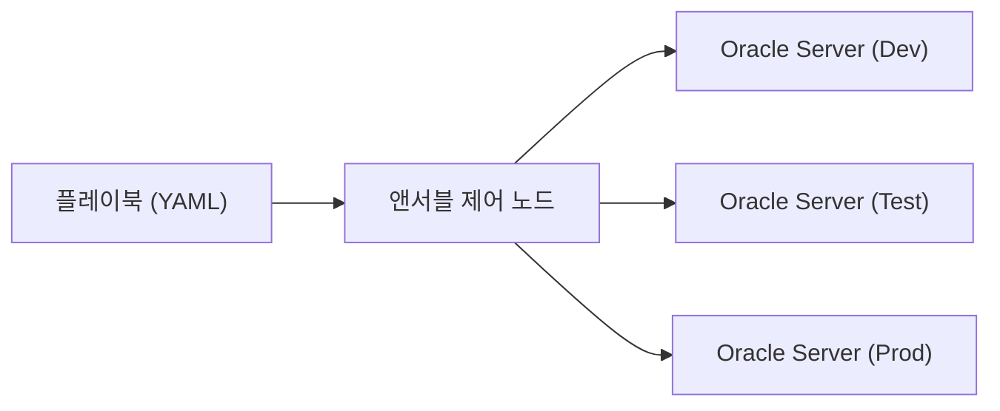
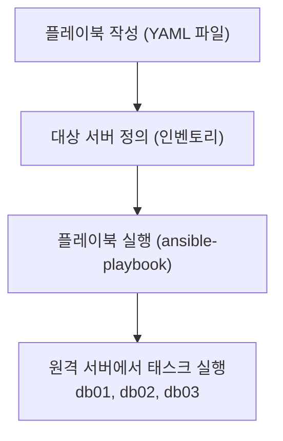
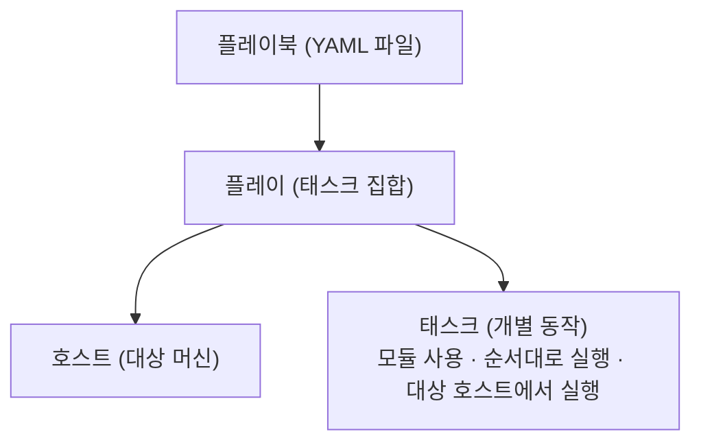
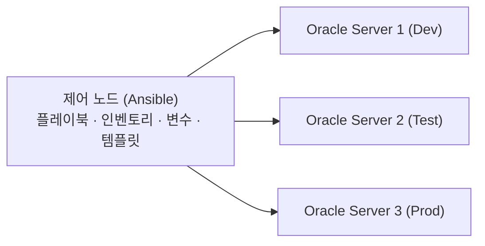

# Ansible 플레이북: 구조화된 자동화로 오라클 DBA 운영 다루기

> **조판 규격**: 본문·제목·표·캡션·영문 용어는 `Noto Sans KR`(제목 Bold), 코드 블록은 `DejaVu Sans Mono`를 적용합니다.

## 개요

애드혹(Ad-hoc) 명령은 일회성 작업에 편리하지만, 같은 작업을 반복하거나 여러 단계를 조합해야 할 때는 한계가 있습니다. 플레이북(Playbook)은 이 한계를 넘기 위한 도구입니다. 여러 작업을 YAML 파일 하나에 구조화해 두면, 개발(Dev), 테스트(Test), 운영(Prod) 서버에 같은 절차를 일관되게 적용할 수 있습니다.



이 장에서는 다음 내용을 학습합니다.

- 플레이북의 기본 개념과 구조, YAML 문법
- 플레이(Play), 호스트(Host), 태스크(Task)의 관계
- 플레이북에서 모듈 사용하기
- 변수(Variable), `register`, 조건문(`when`), 반복문(`loop`)
- 핸들러(Handler)와 알림(Notify)
- 오라클 DBA 운영 작업 자동화(DB·리스너 시작/중지, 상태 확인, SQL 실행, 파일 복사, 디렉터리 생성)
- 플레이북 실행, 검증, 문제 해결
- 마스터 프로젝트: 오라클 서버 운영 자동화 플레이북

**실무 활용 예**: 데이터베이스·리스너 시작/중지, 설정 파일 배포, 디렉터리 생성과 권한 설정, 필수 패키지 설치, 헬스 체크(Health Check)와 SQL 스크립트 실행, 오라클 사용자·그룹 관리, 서비스 관리, 패치 사전·사후 점검, 다중 서버(Dev/Test/Prod) 운영

> 💡 **노트(Note)**: 플레이북은 자동화를 반복 가능하게 만들고, 변수로 유연성을 높이며, 조건문과 반복문으로 확장성을 확보하고, 핸들러로 불필요한 실행을 막아 줍니다.

---

## 1. 플레이북 기초

### 1.1 플레이북이란

앤서블 플레이북은 원격 서버의 구성, 관리, 운영 작업을 자동화하기 위한 지시 사항(플레이와 태스크)을 담은 YAML 파일입니다.

- 단순한 YAML 형식으로 작성합니다.
- 원격 호스트에서 실행할 태스크를 정의합니다.
- 앤서블 모듈(Module)을 사용합니다.
- 버전 관리(Git)를 할 수 있습니다.
- 변수, 조건문, 반복문, 핸들러를 지원합니다.
- 재사용과 유지 보수가 쉽습니다.
- 기업 환경의 자동화에 이상적입니다.

### 1.2 플레이북과 애드혹 명령 비교

| 항목 | 애드혹 명령 | 플레이북 |
|---|---|---|
| 용도 | 일회성/빠른 작업 | 구조화되고 재사용 가능한 자동화 |
| 문법 | 한 줄 명령 | YAML 파일(여러 태스크) |
| 복잡도 | 단순 | 복잡한 로직 지원 |
| 재사용성 | 재사용 불가 | 재사용 및 유지 보수 가능 |
| 적합한 작업 | 빠른 점검, 문제 해결 | 정기 운영, 운영 환경 자동화 |
| 버전 관리 | 어려움 | Git에 저장 가능 |
| 사용 사례 | 단일 작업 실행 | 여러 태스크, 조건 로직, 반복문, 핸들러 |

### 1.3 기본 플레이북 예시

```yaml
---
- name: Check server information
  hosts: all
  become: yes
  tasks:
    - name: Display hostname
      ansible.builtin.command: hostname
      register: host_info

    - name: Show output
      ansible.builtin.debug:
        var: host_info.stdout
```

모든 서버에서 명령 하나를 실행하는 간단한 플레이북입니다.

### 1.4 실행 흐름



### 1.5 플레이북의 핵심 구성 요소

| 구성 요소 | 설명 |
|---|---|
| 플레이(Play) | 대상 호스트에서 실행할 태스크의 집합 |
| 호스트(Hosts) | 대상 머신(인벤토리 기준) |
| 태스크(Tasks) | 수행할 개별 작업 |
| 모듈(Modules) | 작업을 수행하는 내장 기능(command, file, service 등) |
| 변수(Variables) | 재사용할 값을 저장 |
| 핸들러(Handlers) | 알림(Notify)에 의해 실행되는 태스크 |
| YAML | 플레이북을 작성하는 형식 |

### 1.6 오라클 DBA의 일반적인 활용 사례

- 오라클 서버에 필수 OS 패키지 설치
- 오라클 사용자와 그룹 생성
- 오라클 디렉터리 생성과 권한 설정
- 오라클 소프트웨어 파일 복사
- 오라클 리스너와 데이터베이스 시작/중지
- 헬스 체크 스크립트 실행
- 서비스와 프로세스 관리
- 정기 운영 작업 수행
- 여러 서버의 환경 설정 자동화

### 1.7 권장 파일 구조

```text
ansible-oracle/
├── inventory/
│   ├── hosts
│   ├── group_vars/
│   └── host_vars/
├── playbooks/
│   └── oracle_server_setup.yml
├── files/
│   └── server_scripts/
├── templates/
└── README.md
```

플레이북, 변수, 파일을 체계적으로 정리하면 유지 보수가 쉬워집니다.

### 1.8 핵심 정리

- 플레이북은 YAML 형식으로 작성합니다.
- 플레이북은 플레이, 호스트, 태스크를 포함합니다.
- 앤서블 모듈로 작업을 수행합니다.
- 재사용과 유지 보수가 쉽고 Git에 저장할 수 있습니다.
- 정기적인 DBA 운영 자동화에 적합합니다.
- 복잡한 작업에서는 애드혹 명령보다 강력합니다.
- 변수, 조건문, 반복문, 핸들러를 지원합니다.
- 기업 수준 자동화의 기반이 됩니다.

---

## 2. 플레이북 구조와 YAML 문법

플레이북은 YAML 형식으로 작성합니다. 하나의 플레이북에는 하나 이상의 플레이가 있고, 각 플레이는 대상 호스트에서 실행할 태스크의 집합을 담고 있습니다.

### 2.1 기본 YAML 문법 규칙

| 규칙 | 예시 | 설명 |
|---|---|---|
| 키: 값(Key: Value) | `name: Install package` | 키와 값을 정의 |
| 리스트(대시) | `- item1`<br>`- item2` | 태스크, 호스트, 패키지 등 여러 항목에 사용 |
| 들여쓰기 | (공백 2칸) | YAML에서 들여쓰기는 중요함 |
| 주석 | `# This is a comment` | 설명 추가 |
| 문자열 | `name: "Oracle"` | 특수 문자가 있는 문자열에는 따옴표 사용 |
| 불리언 | `state: present` | 일반적인 값: present/absent |
| 여러 줄 | `\|` 다음에 여러 줄 텍스트 | 긴 텍스트나 스크립트에 사용 |

### 2.2 최소 플레이북 구조

```yaml
---
- name: My First Playbook
  hosts: all
  become: yes
  tasks:
    - name: Run a simple command
      ansible.builtin.command: hostname
```

### 2.3 여러 태스크가 있는 플레이북

하나의 플레이 아래에 여러 태스크를 정의할 수 있습니다.

```yaml
---
- name: Basic Server Setup
  hosts: all
  become: yes
  tasks:
    - name: Check hostname
      ansible.builtin.command: hostname
      register: host_info

    - name: Display hostname
      ansible.builtin.debug:
        var: host_info.stdout
```

### 2.4 여러 플레이가 있는 플레이북

플레이북 하나에 여러 플레이를 두어, 호스트나 그룹에 따라 서로 다른 작업을 실행할 수 있습니다.

```yaml
---
- name: Play 1 - Run on all servers
  hosts: all
  become: yes
  tasks:
    - name: Check uptime
      ansible.builtin.command: uptime

- name: Play 2 - Run on specific group
  hosts: dbservers
  become: yes
  tasks:
    - name: Check disk space
      ansible.builtin.command: df -h
```

### 2.5 플레이북의 주요 YAML 요소

| 요소 | 문법 예시 | 목적 |
|---|---|---|
| 플레이 | `- name: Play Name` | 태스크 집합 정의 |
| 호스트 | `hosts: all` | 대상 서버 또는 그룹 |
| become | `become: yes` | 상승된 권한(sudo)으로 실행 |
| 태스크 | `tasks:` | 실행할 태스크 목록 |
| 태스크 이름 | `- name: Task Name` | 태스크 이름 |
| 모듈 | `ansible.builtin.command:` | 작업에 사용하는 모듈 |
| 파라미터 | `cmd: hostname` | 모듈 파라미터 |
| 변수 | `vars:` | 변수 정의와 사용 |
| 핸들러 | `handlers:` | 알림에 의해 실행되는 태스크 |

### 2.6 파일 위치와 실행

```text
ansible-project/
├── inventory/
│   └── hosts
├── playbooks/
│   └── first_playbook.yml
└── ansible.cfg
```

플레이북은 `.yml` 확장자로 저장하고 다음처럼 실행합니다.

```bash
ansible-playbook playbooks/first_playbook.yml
```

> ⚠️ **주의(Caution)**: YAML에서는 들여쓰기가 문법의 일부입니다. 들여쓰기가 틀리면 플레이북이 실행되지 않으므로, 공백 2칸을 일관되게 사용하십시오.

### 2.7 핵심 정리

- 플레이북은 YAML 형식으로 작성하며 하나 이상의 플레이를 포함합니다.
- 각 플레이에는 태스크 집합이 있습니다.
- YAML 문법과 들여쓰기가 중요합니다.
- 특정 호스트나 그룹을 대상으로 지정할 수 있습니다.
- 여러 태스크와 여러 플레이를 정의할 수 있습니다.
- 플레이북은 모듈로 작업을 수행하며, 재사용과 유지 보수가 가능한 기업용 자동화에 적합합니다.

---

## 3. 플레이, 호스트, 태스크

플레이북은 하나 이상의 플레이로 구성됩니다. 각 플레이는 대상 호스트에서 태스크 집합을 실행하고, 태스크는 앤서블 모듈로 수행할 동작을 정의합니다.



- **플레이**: 호스트에서 실행할 태스크의 집합
- **호스트**: 인벤토리의 대상 머신 또는 그룹
- **태스크**: 수행할 개별 작업
- 플레이는 위에서 아래로 순서대로 실행됩니다.
- 각 태스크는 앤서블 모듈 하나를 사용합니다.

### 3.1 기본 플레이 구조

```yaml
---
- name: My First Play
  hosts: all
  become: yes
  tasks:
    - name: Display a message
      ansible.builtin.debug:
        msg: "Hello from Ansible!"
```

| 섹션 | 예시 | 설명 |
|---|---|---|
| `name` | `My First Play` | 플레이 이름(식별용) |
| `hosts` | `all` | 인벤토리의 대상 호스트 또는 그룹 |
| `become` | `yes` | 상승된 권한(sudo)으로 태스크 실행 |
| `tasks` | `- name: ...` | 실행할 태스크 목록 |
| `ansible.builtin.debug` | 모듈 이름 | 작업을 수행하는 모듈 |
| `msg` | `"Hello..."` | 모듈의 파라미터 |

### 3.2 서로 다른 호스트를 대상으로 하는 플레이

```yaml
---
- name: Run task on specific host group
  hosts: dbservers
  become: yes
  tasks:
    - name: Check uptime
      ansible.builtin.command: uptime

- name: Run task on a single host
  hosts: db01
  become: yes
  tasks:
    - name: Check disk space
      ansible.builtin.command: df -h
```

### 3.3 한 플레이의 여러 태스크

플레이 하나에 여러 태스크를 둘 수 있으며, 태스크는 위에서 아래로 순서대로 실행됩니다.

```yaml
---
- name: Oracle Server Basic Checks
  hosts: oracle
  become: yes
  tasks:
    - name: Check hostname
      ansible.builtin.command: hostname
      register: host_info

    - name: Display hostname
      ansible.builtin.debug:
        var: host_info.stdout

    - name: Check disk space
      ansible.builtin.command: df -h
```

### 3.4 오라클 DBA 실무 예시: 리스너 상태 확인

```yaml
---
- name: Oracle Listener Status Check
  hosts: oracle
  become: yes
  tasks:
    - name: Check listener status
      ansible.builtin.command: lsnrctl status
      register: listener_result

    - name: Display listener status
      ansible.builtin.debug:
        var: listener_result.stdout_lines
```

### 3.5 핵심 정리

- 플레이북은 하나 이상의 플레이를 포함합니다.
- 각 플레이는 대상 호스트에서 태스크 집합을 실행합니다.
- 호스트는 단일 서버이거나 인벤토리의 그룹일 수 있습니다.
- 태스크는 수행할 개별 동작을 정의하며 앤서블 모듈을 사용합니다.
- 한 플레이에 여러 태스크를 정의할 수 있고, 작성한 순서대로 실행됩니다.
- 오라클 DBA 운영 작업 자동화에 이상적입니다.

> ⚠️ **주의(Caution)**: 슬라이드 예시에는 `dbservers`(밑줄 없음)와 `oracle` 같은 그룹명이 쓰입니다. 앞선 인벤토리 장에서는 `db_servers`처럼 밑줄이 있는 그룹명을 썼습니다. 플레이의 `hosts:` 값은 인벤토리에 정의된 그룹명과 정확히 일치해야 하므로, 실습할 때 본인의 인벤토리에 맞춰 바꿔 쓰십시오.

---

## 4. 플레이북에서 모듈 사용

모듈은 플레이북에서 특정 작업을 수행하는 내장 기능입니다. 복잡한 스크립트 없이 서버, 파일, 패키지, 서비스, 사용자 등을 관리할 수 있습니다. 내장 모듈이 풍부하고, 사용하기 쉬우며, 멱등성(Idempotent)이 있어 여러 번 실행해도 안전합니다.

### 4.1 DBA가 자주 쓰는 모듈

| 모듈 | 용도 |
|---|---|
| `command` | 원격 호스트에서 명령 실행 |
| `shell` | 셸을 통해 명령 실행 |
| `file` | 파일과 디렉터리 생성·삭제·관리 |
| `copy` | 원격 호스트로 파일 복사 |
| `package` | OS 패키지 설치·관리 |
| `service` | 서비스 시작·중지·관리 |
| `user` | 사용자와 그룹 생성·관리 |
| `template` | 템플릿으로 설정 파일 배포 |
| `lineinfile` | 설정 파일의 특정 줄 관리 |
| `stat` | 파일 또는 디렉터리 상태 확인 |
| `unarchive` | 압축 파일 해제 |
| `yum`/`dnf` | 오라클 리눅스에서 패키지 관리 |

### 4.2 command 모듈

`command` 모듈은 셸을 사용하지 않고 명령을 실행하므로 단순한 명령에 더 안전합니다.

```yaml
---
- name: Check hostname
  hosts: all
  become: yes
  tasks:
    - name: Run hostname command
      ansible.builtin.command: hostname
      register: result

    - name: Display output
      ansible.builtin.debug:
        var: result.stdout
```

### 4.3 shell 모듈

`shell` 모듈은 셸을 통해 명령을 실행하므로 파이프, 리디렉션 같은 셸 기능을 지원합니다.

```yaml
---
- name: Check Oracle version
  hosts: dbservers
  become: yes
  tasks:
    - name: Run Oracle version command
      ansible.builtin.shell: |
        $ORACLE_HOME/bin/sqlplus -V
      register: ver

    - name: Display version
      ansible.builtin.debug:
        var: ver.stdout
```

### 4.4 file 모듈

```yaml
---
- name: Create Oracle directory
  hosts: dbservers
  become: yes
  tasks:
    - name: Create directory
      ansible.builtin.file:
        path: /u01/app/oracle/admin
        state: directory
        owner: oracle
        group: oinstall
        mode: '0755'
```

### 4.5 package 모듈

`package` 모듈은 yum, dnf 등 여러 패키지 관리자와 함께 동작합니다.

```yaml
---
- name: Install required packages
  hosts: dbservers
  become: yes
  tasks:
    - name: Install packages using dnf
      ansible.builtin.package:
        name:
          - oracle-database-preinstall-19c
          - unzip
        state: present
```

### 4.6 service 모듈

```yaml
- name: Start and enable listener
  hosts: dbservers
  become: yes
  tasks:
    - name: Start listener service
      ansible.builtin.service:
        name: oracle-listener
        state: started
        enabled: yes
```

### 4.7 핵심 정리

- 앤서블 모듈은 플레이북에서 특정 작업을 수행합니다.
- 모듈은 자동화를 단순하고 일관되게 만듭니다.
- `command`와 `shell`은 명령을 실행합니다.
- `file` 모듈은 파일과 디렉터리를, `package` 모듈은 OS 패키지를, `service` 모듈은 서비스를 관리합니다.
- `user` 모듈은 사용자와 그룹을 관리합니다.
- `template`, `lineinfile` 등의 모듈은 설정 관리에 도움이 됩니다.

---

## 5. 플레이북의 변수

변수를 사용하면 값을 저장해 플레이북에서 재사용할 수 있습니다. 값을 하드코딩(Hardcoding)하는 대신 변수로 정의하면 플레이북이 유연해지고, 재사용과 유지 보수가 쉬워집니다. 경로, 사용자 이름, 버전 같은 값을 저장하고, 개발/테스트/운영 환경별로 덮어쓸 수 있습니다.

### 5.1 변수를 정의하는 방법

| 방법 | 예시 | 범위/용도 |
|---|---|---|
| 인라인 변수(Inline) | `vars:`<br>`  db_name: orcl` | 플레이북에 직접 정의 |
| 변수 파일 | `vars_files:`<br>`  - vars.yml` | 별도 파일에 변수 저장 |
| 인벤토리 변수 | `[dbservers]`<br>`db01 db_name=orcl` | 인벤토리 파일에 정의 |
| 추가 변수(Extra Vars) | `ansible-playbook play.yml -e "db_name=orcl"` | 실행 시 명령줄에서 전달 |
| 팩트(Facts) | `ansible_facts` | 시스템 팩트가 자동으로 제공됨 |
| 등록 변수(Registered) | `register: result` | 명령 출력을 변수에 저장 |

### 5.2 인라인 변수

`vars` 아래에 정의한 변수는 플레이의 모든 태스크에서 사용할 수 있습니다.

```yaml
---
- name: Example with inline variables
  hosts: dbservers
  become: yes
  vars:
    oracle_home: /u01/app/oracle/product/19c
    db_name: orcl
  tasks:
    - name: Display variables
      ansible.builtin.debug:
        msg: "Database: {{ db_name }}
              Oracle Home: {{ oracle_home }}"
```

### 5.3 변수 파일

```text
ansible-oracle/
├── playbooks/
│   └── db_setup.yml
├── vars/
│   └── db_vars.yml
└── inventory/
```

```yaml
# vars/db_vars.yml
oracle_home: /u01/app/oracle/product/19c
db_name: orcl
db_port: 1521
os_user: oracle
os_group: oinstall
```

```yaml
# playbooks/db_setup.yml
---
- name: Example using variables file
  hosts: dbservers
  vars_files:
    - ../vars/db_vars.yml
  tasks:
    - name: Display DB name
      ansible.builtin.debug:
        msg: "Database: {{ db_name }}"
```

### 5.4 인벤토리 변수

```ini
# inventory/hosts
[dbservers]
db01 oracle_home=/u01/app/oracle/product/19c \
     db_name=orcl
db02 oracle_home=/u01/app/oracle/product/19c \
     db_name=proddb
```

인벤토리에 직접 변수를 정의하면 호스트마다 다른 값을 지정할 수 있습니다.

### 5.5 추가 변수(명령줄)

```bash
ansible-playbook playbooks/db_setup.yml \
    -e "db_name=testdb oracle_home=/u01/app/oracle/product/19c"
```

실행 시점에 값을 덮어쓸 수 있고, 일회성 실행이나 환경(dev/test/prod)별 전환에 적합합니다.

### 5.6 등록 변수

등록 변수는 태스크의 출력을 저장해 이후 태스크에서 사용합니다.

```yaml
---
- name: Check listener status
  hosts: dbservers
  tasks:
    - name: Run lsnrctl
      ansible.builtin.shell: lsnrctl status
      register: lsnr_result

    - name: Display output
      ansible.builtin.debug:
        var: lsnr_result.stdout_lines
```

### 5.7 핵심 정리

- 변수는 플레이북을 유연하고 재사용 가능하게 만듭니다.
- 인라인, 파일, 인벤토리, 추가 변수 등 여러 방법으로 정의할 수 있습니다.
- 하드코딩을 피하고, 환경별로 덮어쓸 수 있습니다.
- 등록 변수는 명령 출력을 저장합니다.
- 모듈, 조건문, 반복문과 결합하면 강력한 자동화를 만들 수 있습니다.

---

## 6. register로 결과 캡처

`register` 키워드는 태스크의 출력(결과)을 변수에 저장합니다. 등록된 변수는 이후 태스크에서 조건 로직, 디버깅, 반복문, 보고에 사용할 수 있고, 모듈의 종류와 관계없이 쓸 수 있어 DBA 자동화와 검증에 매우 유용합니다.

### 6.1 등록 변수의 구조

| 속성 | 설명 | 예시 |
|---|---|---|
| `stdout` | 명령의 표준 출력 | `"Database is open"` |
| `stderr` | 표준 오류 출력 | `""`(오류 없으면 비어 있음) |
| `rc` | 반환 코드(0 = 성공) | `0` |
| `stdout_lines` | 출력을 줄 단위 리스트로 표현 | `["line1", "line2"]` |
| `stderr_lines` | 오류 출력을 리스트로 표현 | `[]` |
| `changed` | 태스크가 변경을 일으켰는지 여부 | `true` / `false` |
| `failed` | 태스크 실패 여부 | `true` / `false` |
| `msg` | 추가 메시지 | `"Command executed successfully"` |
| `ansible_facts` | 수집된 팩트(해당되는 경우) | `{ ... }` |

### 6.2 기본 예시: 출력 등록

```yaml
- name: Check Oracle database status
  hosts: dbservers
  tasks:
    - name: Run SQL to check database status
      ansible.builtin.shell: "sqlplus -s / as sysdba
        <<< 'select status from v$instance;'"
      register: db_status

    - name: Display output
      ansible.builtin.debug:
        var: db_status.stdout
```

태스크의 출력이 변수 `db_status`에 저장됩니다.

### 6.3 등록 변수 전체 보기

`debug`에 `var: <변수>`를 지정하면 `stdout`, `rc` 등 모든 세부 정보를 볼 수 있습니다.

```yaml
- name: Run command and view full result
  hosts: dbservers
  tasks:
    - name: Check Oracle listener status
      ansible.builtin.shell: lsnrctl status
      register: listener_result

    - name: Show complete registered variable
      ansible.builtin.debug:
        var: listener_result
```

### 6.4 조건문에서 등록 변수 사용

```yaml
- name: Check if database is open
  hosts: dbservers
  tasks:
    - name: Get database status
      ansible.builtin.shell: "sqlplus -s / as sysdba
        <<< 'select status from v$instance;'"
      register: db_status

    - name: Display message if open
      ansible.builtin.debug:
        msg: "Database is OPEN"
      when: "'OPEN' in db_status.stdout"
```

### 6.5 반복문에서 등록 변수 사용

반복문과 함께 사용하면 등록 변수에 항목별 출력이 담긴 `results` 리스트가 생깁니다.

```yaml
- name: Check multiple directories
  hosts: dbservers
  vars:
    dirss:
      - /u01/app/oracle
      - /u02/backup
      - /u03/logs
  tasks:
    - name: Check directory existence
      ansible.builtin.shell: "ls -ld {{ item }}"
      register: dir_check
      loop: "{{ dirs }}"

    - name: Display results
      ansible.builtin.debug:
        msg: "{{ item.item }} => {{ item.rc }}"
      loop: "{{ dir_check.results }}"
```

> ⚠️ **주의(Caution)**: 슬라이드 원문의 변수 정의는 `dirss`로, 사용하는 곳은 `dirs`로 적혀 있어 철자가 서로 다릅니다. 위 코드는 원문을 그대로 실었으므로 그대로 실행하면 변수가 정의되지 않았다는 오류가 납니다. 실습에서는 `dirs`로 통일하십시오.

### 6.6 실무 예시: 리스너 확인 후 조치

```yaml
- name: Check listener and start if not running
  hosts: dbservers
  tasks:
    - name: Check listener status
      ansible.builtin.shell: lsnrctl status
      register: listener_result
      ignore_errors: yes

    - name: Start listener if not running
      ansible.builtin.shell: lsnrctl start
      when: "listener_result.rc != 0"
```

명령 출력을 캡처해 시정 조치를 취합니다. 첫 태스크가 실패해도 플레이가 중단되지 않도록 `ignore_errors: yes`를 사용한 점에 주목하십시오.

### 6.7 핵심 정리

- `register`는 태스크의 출력을 변수에 저장합니다.
- 등록 변수에는 `stdout`, `stderr`, `rc` 등이 담깁니다.
- `debug`로 전체 등록 변수를 확인할 수 있습니다.
- 조건문(`when`)에서 의사 결정에 사용합니다.
- 어떤 앤서블 모듈과도 함께 쓸 수 있습니다.
- 반복문에서는 결과가 리스트(`results`)로 저장됩니다.
- 검증과 자동화 로직에 유용하며, 실제 오라클 DBA 자동화에 필수입니다.

---

## 7. when으로 조건부 실행

`when` 키워드는 조건이 참일 때만 태스크를 실행합니다. 시스템 상태, 변수 값, 명령 결과, 환경 조건에 따라 태스크를 실행하게 해 플레이북을 더 똑똑하고 유연하게 만듭니다.

### 7.1 기본 `when` 조건 문법

| 문법 | 설명 |
|---|---|
| `when: condition` | 조건이 참이면 태스크 실행 |
| `when: variable == value` | 변수가 값과 일치하는지 확인 |
| `when: variable != value` | 변수가 값과 다른지 확인 |
| `when: variable is defined` | 변수가 정의되어 있는지 확인 |
| `when: variable is not defined` | 변수가 정의되어 있지 않은지 확인 |
| `when: result.rc == 0` | 명령이 성공하면 실행 |
| `when: ansible_facts['os_family'] == 'RedHat'` | 시스템 팩트에 따라 실행 |
| `when: var1 and var2` | AND로 여러 조건 사용 |
| `when: var1 or var2` | OR로 여러 조건 사용 |
| `when: not var1` | 조건이 거짓이면 실행 |

### 7.2 변수 값에 따라 태스크 실행

```yaml
---
- name: Install package on RedHat systems
  hosts: dbservers
  become: yes
  vars:
    pkg_name: htop
  tasks:
    - name: Install htop package
      ansible.builtin.package:
        name: "{{ pkg_name }}"
        state: present
      when: ansible_facts['os_family'] == 'RedHat'
```

이 태스크는 RedHat 계열 시스템에서만 실행됩니다.

### 7.3 명령 결과를 `when`으로 확인

```yaml
---
- name: Check if listener is running
  hosts: dbservers
  become: yes
  tasks:
    - name: Check listener status
      ansible.builtin.shell: lsnrctl status
      register: lsnr_result
      ignore_errors: yes

    - name: Start listener if not running
      ansible.builtin.shell: lsnrctl start
      when: lsnr_result.rc != 0
```

두 번째 태스크는 첫 번째 명령이 실패했을 때(`rc != 0`)만 실행됩니다.

### 7.4 여러 조건 사용

```yaml
---
- name: Run task with multiple conditions
  hosts: dbservers
  become: yes
  vars:
    db_env: prod
    install_tools: true
  tasks:
    - name: Install monitoring tools
      ansible.builtin.package:
        name: sysstat
        state: present
      when: db_env == 'prod' and install_tools
```

두 조건이 모두 참일 때만 태스크가 실행됩니다.

### 7.5 등록 변수와 `when`

```yaml
---
- name: Check if directory exists
  hosts: dbservers
  become: yes
  tasks:
    - name: Check directory
      ansible.builtin.stat:
        path: /u01/app/oracle/admin
      register: dir_check

    - name: Create directory if not exists
      ansible.builtin.file:
        path: /u01/app/oracle/admin
        state: directory
        mode: '0755'
      when: not dir_check.stat.exists
```

디렉터리가 없을 때만 생성합니다.

### 7.6 자주 쓰는 조건식

| 조건 | 설명 |
|---|---|
| `var == 'prod'` | 변수가 값과 같은지 확인 |
| `var != 'prod'` | 변수가 값과 다른지 확인 |
| `var is defined` | 변수가 정의되어 있는지 확인 |
| `var is not defined` | 변수가 정의되어 있지 않은지 확인 |
| `result.rc == 0` | 명령이 성공했는지 확인 |
| `result.rc != 0` | 명령이 실패했는지 확인 |
| `ansible_facts['os_family'] == 'RedHat'` | OS 계열 확인 |
| `var1 and var2` | 두 조건이 모두 참 |
| `var1 or var2` | 둘 중 하나 이상이 참 |
| `not var1` | 조건이 거짓이어야 함 |

### 7.7 핵심 정리

- `when` 조건은 조건이 참일 때만 태스크를 실행합니다.
- 변수, 팩트, 등록 결과, 논리식을 사용할 수 있습니다.
- 불필요한 태스크 실행을 피할 수 있습니다.
- 여러 조건(and, or, not)을 지원합니다.
- 환경별 DBA 자동화에 유용합니다.
- 명령 결과, 파일 존재 여부, 서비스 상태 등을 확인할 수 있습니다.
- 어떤 앤서블 모듈과도 함께 쓸 수 있고, 효율적이고 똑똑한 플레이북 작성에 필수입니다.

---

## 8. 플레이북의 반복문

반복문을 사용하면 서로 다른 값으로 태스크를 여러 번 실행할 수 있습니다. 같은 태스크를 여러 번 쓰는 대신 반복문으로 플레이북을 더 짧고 깔끔하고 효율적으로 만듭니다. 여러 데이터베이스, 사용자, 디렉터리를 다루는 DBA 자동화에 유용합니다.

### 8.1 반복문 유형

| 반복문 유형 | 문법 | 설명 | 적합한 용도 |
|---|---|---|---|
| `loop` | `loop:`<br>`- item1`<br>`- item2` | 최신 반복문 문법(권장) | 일반적인 용도 |
| `with_items` | `with_items:`<br>`- item1` | 이전 문법(여전히 동작) | 레거시 플레이북 |
| `with_list` | `with_list:`<br>`- item1` | 명시적 리스트 형식 | 단순 리스트 |
| `with_dict` | `with_dict:`<br>`key: value` | 키-값 쌍 반복 | 구성 관리 |
| `with_sequence` | `with_sequence:`<br>`start=1 end=5` | 숫자 시퀀스 생성 | 여러 리소스 생성 |
| `with_fileglob` | `with_fileglob:`<br>`"*.sql"` | 패턴에 맞는 파일 반복 | 여러 스크립트 파일 |

### 8.2 기본 반복문 예시

```yaml
- name: Create multiple directories
  hosts: dbservers
  become: yes
  tasks:
    - name: Create directories using loop
      ansible.builtin.file:
        path: "{{ item }}"
        state: directory
        mode: '0755'
      loop:
        - /u01/app/oracle
        - /u02/backup
        - /u03/logs
```

### 8.3 사용자 리스트 반복(오라클 예시)

```yaml
- name: Create multiple Oracle users
  hosts: dbservers
  become: yes
  vars:
    oracle_users:
      - hr
      - appuser
      - reporting
  tasks:
    - name: Create Oracle users
      ansible.builtin.shell: |
        sqlplus / as sysdba <<EOF
        create user {{ item }} identified by Welcome123;
        grant connect, resource to {{ item }};
        EOF
      loop: "{{ oracle_users }}"
```

> ⚠️ **주의(Caution)**: 슬라이드 예시는 비밀번호를 평문으로 적었습니다. 실습용 값으로만 이해하고, 실제 환경에서는 비밀번호를 플레이북에 직접 적지 마십시오.

### 8.4 딕셔너리 반복(키-값 쌍)

`with_dict` 또는 `dict2items`로 키-값 쌍을 반복합니다.

```yaml
- name: Configure multiple database parameters
  hosts: dbservers
  become: yes
  vars:
    db_parameters:
      processes: 300
      sessions: 400
      open_cursors: 1000
  tasks:
    - name: Set database parameters
      ansible.builtin.shell: |
        sqlplus / as sysdba <<EOF
        alter system set {{ item.key }}={{ item.value }}
        scope=both;
        EOF
      loop: "{{ db_parameters | dict2items }}"
```

### 8.5 시퀀스 반복(여러 파일/숫자)

```yaml
- name: Create multiple log files
  hosts: dbservers
  become: yes
  tasks:
    - name: Create log files with sequence
      ansible.builtin.file:
        path: "/tmp/log{{ item }}.log"
        state: touch
        mode: '0644'
      loop: "{{ range(1, 6) | list }}"
```

`range(1, 6)`은 1부터 5까지의 숫자를 만듭니다.

### 8.6 파일 반복(Fileglob)

```yaml
- name: Execute multiple SQL files
  hosts: dbservers
  become: yes
  tasks:
    - name: Run all SQL files from directory
      ansible.builtin.shell: |
        sqlplus / as sysdba @{{ item }}
      loop: "{{ query('fileglob', '/u01/scripts/*.sql') }}"
```

### 8.7 핵심 정리

- 반복문은 서로 다른 값으로 태스크를 여러 번 실행합니다.
- `loop`(권장) 또는 이전 반복문(`with_items` 등)을 사용합니다.
- 리스트, 딕셔너리, 시퀀스, 파일에 쓸 수 있습니다.
- 반복 코드를 줄이고 플레이북 유지 보수를 쉽게 합니다.
- 사용자, 디렉터리, 파일, 파라미터 생성 같은 DBA 작업에 이상적입니다.
- `file`, `shell`, `command` 같은 모듈과 결합할 수 있고, 변수와 조건문과도 함께 쓸 수 있습니다.

---

## 9. 핸들러와 알림

핸들러는 다른 태스크가 알림(Notify)을 보낼 때만 실행되는 특별한 태스크입니다. 서비스 재시작이나 설정 다시 읽기처럼, **변경이 일어났을 때만** 수행할 동작에 주로 쓰입니다.


- 알림을 받았을 때만 실행됩니다.
- 불필요한 실행을 피합니다.
- 서비스 재시작, 리로드(Reload), 재시작(Restart)에 사용합니다.
- 태스크가 변경(changed)을 보고할 때만 트리거됩니다.
- 플레이북을 효율적이고 멱등하게 유지합니다.
- 오라클 리스너, 데이터베이스 등에 흔히 쓰입니다.

**핵심 포인트**

- 핸들러는 알림을 보낸 태스크가 변경을 보고할 때만 실행됩니다.
- 여러 태스크가 같은 핸들러에 알림을 보낼 수 있습니다.
- 핸들러는 플레이의 모든 태스크가 끝난 뒤 마지막에 실행됩니다.
- 리스너, 데이터베이스, httpd 등 서비스 재시작에 유용합니다.

### 9.1 핸들러 기본 문법

핸들러는 플레이북의 `handlers` 섹션에 정의합니다.

```yaml
---
handlers:
  - name: Restart Oracle Listener
    ansible.builtin.service:
      name: lsnrctl
      state: restarted
```

### 9.2 notify가 있는 태스크

```yaml
---
- name: Update listener.ora file
  hosts: dbservers
  become: yes
  tasks:
    - name: Copy listener.ora file
      ansible.builtin.copy:
        src: files/listener.ora
        dest: /u01/app/oracle/product/19c/network/admin/listener.ora
      notify: Restart Oracle Listener

  handlers:
    - name: Restart Oracle Listener
      ansible.builtin.service:
        name: lsnrctl
        state: restarted
```

태스크가 파일을 복사하고 핸들러에 알립니다. 파일이 실제로 바뀐 경우에만 핸들러가 실행됩니다.

### 9.3 여러 태스크가 같은 핸들러에 알림

```yaml
- name: Configure multiple files
  hosts: dbservers
  become: yes
  tasks:
    - name: Copy listener.ora
      ansible.builtin.copy:
        src: files/listener.ora
        dest: /u01/app/oracle/network/admin/listener.ora
      notify: Restart Oracle Listener

    - name: Copy tnsnames.ora
      ansible.builtin.copy:
        src: files/tnsnames.ora
        dest: /u01/app/oracle/network/admin/tnsnames.ora
      notify: Restart Oracle Listener

  handlers:
    - name: Restart Oracle Listener
      ansible.builtin.service:
        name: lsnrctl
        state: restarted
```

핸들러는 둘 중 하나라도 변경이 있으면 플레이 끝에 한 번만 실행됩니다.

### 9.4 오라클 데이터베이스용 핸들러

```yaml
- name: Restart Oracle Database if parameter file changed
  hosts: dbservers
  become: yes
  tasks:
    - name: Copy spfile
      ansible.builtin.copy:
        src: files/spfile.ora
        dest: /u01/app/oracle/product/19c/dbs/spfile.ora
      notify: Restart Oracle Database

  handlers:
    - name: Restart Oracle Database
      ansible.builtin.shell: |
        export ORACLE_HOME=/u01/app/oracle/product/19c
        $ORACLE_HOME/bin/sqlplus -s / as sysdba <<EOF
        shutdown immediate;
        startup;
        EOF
      args:
        executable: /bin/bash
```

핸들러로 데이터베이스 재시작, 리로드, 사용자 지정 SQL 명령 같은 작업을 수행할 수 있습니다.

> ⚠️ **주의(Caution)**: 슬라이드 예시는 핸들러의 서비스 이름으로 `lsnrctl`을 사용합니다. 그러나 `lsnrctl`은 리스너 제어 명령이며, 환경에 따라 시스템 서비스 이름과 다를 수 있습니다. 4장의 `service` 모듈 예시는 `oracle-listener`를 사용했으므로, 자신의 환경에서 실제로 등록된 서비스 이름을 확인해 맞춰 쓰십시오. 데이터베이스 재시작 핸들러는 서비스 중단을 일으키므로 운영 환경에서는 특히 신중하게 적용하십시오.

### 9.5 핸들러의 일반적인 활용 사례

- 오라클 리스너 재시작(`lsnrctl`)
- 오라클 데이터베이스 재시작
- httpd / nginx 리로드
- 사용자 지정 스크립트나 서비스 재시작
- 설정 파일 새로 고침
- 패치, 설치, 유지 보수 플레이북에서 사용

### 9.6 핵심 정리

- 핸들러는 태스크가 알림을 보낼 때만 실행됩니다.
- 불필요한 태스크 실행을 피하게 해 줍니다.
- 여러 태스크가 같은 핸들러에 알림을 보낼 수 있습니다.
- 핸들러는 플레이 끝에 실행됩니다.
- 서비스(리스너, 데이터베이스 등) 재시작에 흔히 사용됩니다.
- 플레이북을 효율적이고 멱등하며 유지 보수하기 쉽게 만듭니다.
- 앤서블을 사용한 실제 DBA 자동화에 필수입니다.

---

## 10. 플레이북으로 오라클 DBA 운영 수행

앤서블 플레이북으로 여러 서버에서 일반적인 오라클 DBA 운영 작업을 자동화하면, 정기 작업을 일관되고 반복 가능하며 오류 없이 처리할 수 있습니다. 자동화할 수 있는 작업은 다음과 같습니다.

- 오라클 데이터베이스 시작/중지
- 오라클 리스너 시작/중지
- 데이터베이스 상태 확인
- 디렉터리 생성과 권한 설정
- 설정 파일(tnsnames.ora, spfile 등) 복사
- SQL/SQL*Plus 명령 실행
- 여러 서버에 걸친 DBA 자동화

### 10.1 데이터베이스 시작/중지 (`start_stop_db.yml`)

SQL*Plus로 데이터베이스를 시작합니다. 중지하려면 `db_action`을 `stop`으로 바꿔 종료(shutdown) 작업을 수행하게 합니다.

```yaml
---
- name: Start or stop Oracle database
  hosts: dbservers
  become: yes
  vars:
    db_action: start   # start or stop
    oracle_home: /u01/app/oracle/product/19c/dbhome_1
    sid: ORCL
  tasks:
    - name: Start database
      ansible.builtin.shell: |
        . {{ oracle_home }}/bin/oraenv <<< {{ sid }}
        sqlplus -s / as sysdba <<EOF
        startup;
        EOF
      when: db_action == 'start'
```

> 💡 **노트(Note)**: 슬라이드에는 시작(`start`) 태스크만 나와 있습니다. 중지(`stop`)를 지원하려면 `db_action == 'stop'` 조건의 태스크를 같은 방식으로 추가해야 합니다.

### 10.2 리스너 시작/중지 (`listener_control.yml`)

```yaml
---
- name: Start or stop Oracle listener
  hosts: dbservers
  become: yes
  vars:
    listener_action: start   # start or stop
    oracle_home: /u01/app/oracle/product/19c/dbhome_1
  tasks:
    - name: Control Oracle listener
      ansible.builtin.shell: |
        . {{ oracle_home }}/bin/oraenv <<< +ASM
        lsnrctl {{ listener_action }}
      register: listener_result

    - name: Display output
      ansible.builtin.debug:
        var: listener_result.stdout
```

### 10.3 데이터베이스 상태 확인 (`check_db_status.yml`)

데이터베이스가 OPEN, MOUNTED, NOMOUNT 중 어느 상태인지 확인합니다.

```yaml
---
- name: Check Oracle database status
  hosts: dbservers
  become: yes
  vars:
    oracle_home: /u01/app/oracle/product/19c/dbhome_1
    sid: ORCL
  tasks:
    - name: Check database open mode
      ansible.builtin.shell: |
        . {{ oracle_home }}/bin/oraenv <<< {{ sid }}
        sqlplus -s / as sysdba <<EOF
        set heading off feedback off
        select name, open_mode from v\$database;
        EOF
      register: db_status

    - name: Display database status
      ansible.builtin.debug:
        msg: "Database Status: {{ db_status.stdout }}"
```

### 10.4 플레이북으로 SQL 실행 (`run_sql.yml`)

```yaml
---
- name: Run SQL command on Oracle database
  hosts: dbservers
  become: yes
  vars:
    oracle_home: /u01/app/oracle/product/19c/dbhome_1
    sid: ORCL
    sql_file: /home/oracle/scripts/check_tablespace.sql
  tasks:
    - name: Execute SQL file
      ansible.builtin.shell: |
        . {{ oracle_home }}/bin/oraenv <<< {{ sid }}
        sqlplus -s / as sysdba @{{ sql_file }}
      register: sql_result

    - name: Display output
      ansible.builtin.debug:
        var: sql_result.stdout
```

### 10.5 오라클 설정 파일 복사 (`copy_tnsnames.yml`)

```yaml
---
- name: Copy tnsnames.ora to remote servers
  hosts: dbservers
  tasks:
    - name: Copy tnsnames.ora file
      ansible.builtin.copy:
        src: files/tnsnames.ora
        dest: /u01/app/oracle/product/19c/dbhome_1/network/admin/
        owner: oracle
        group: oinstall
        mode: '0644'

    - name: Restart listener if file changed
      ansible.builtin.shell: |
        /u01/app/oracle/product/19c/dbhome_1/bin/lsnrctl reload
      when: ansible_facts['os_family'] == 'RedHat'
```

> ⚠️ **주의(Caution)**: 슬라이드의 두 번째 태스크 이름은 "Restart listener if file changed"(파일이 바뀌면 리스너 재시작)이지만, 실제 조건은 OS 계열이 RedHat인지만 확인합니다. 즉, 파일이 바뀌었는지와 무관하게 RedHat 서버에서는 매번 실행됩니다. 파일이 바뀐 경우에만 실행하려면 9장의 방식대로 `notify`와 핸들러로 바꾸는 것이 좋습니다.

### 10.6 권한이 있는 디렉터리 생성 (`create_dirs.yml`)

```yaml
---
- name: Create Oracle directories
  hosts: dbservers
  become: yes
  tasks:
    - name: Create Oracle base directory
      ansible.builtin.file:
        path: /u01/app/oracle
        state: directory
        owner: oracle
        group: oinstall
        mode: '0755'
```

### 10.7 핵심 정리

- 앤서블은 일반적인 오라클 DBA 운영을 자동화할 수 있습니다.
- 플레이북으로 데이터베이스와 리스너를 시작/중지합니다.
- 데이터베이스 상태를 확인하고 SQL 명령을 실행할 수 있습니다.
- 여러 서버에 설정 파일을 복사할 수 있습니다.
- 올바른 권한으로 디렉터리를 생성하는 데 유용합니다.
- 여러 서버(dev/test/prod)에서 동작합니다.
- 수작업과 사람의 오류를 줄입니다.
- 실제 오라클 DBA 자동화에 필수입니다.

---

## 11. 플레이북 실행, 검증, 문제 해결

### 11.1 실행 방법

플레이북은 요구 사항에 따라 여러 방식으로 실행할 수 있습니다.

- 일반 실행
- 사용자 지정 인벤토리 사용
- 추가 변수 전달
- 태그로 특정 태스크만 실행
- 실행 전 문법 검사
- 체크 모드(드라이 런, Dry Run)로 실행
- 디버깅을 위한 출력 상세도 증가

### 11.2 기본 실행 (`run_playbook.yml`)

```bash
# 플레이북 일반 실행
ansible-playbook run_playbook.yml

# 특정 인벤토리 파일 사용
ansible-playbook -i hosts.ini run_playbook.yml

# 추가 변수 전달
ansible-playbook run_playbook.yml \
    -e "db_name=test db_port=1521"

# 특정 태그 실행
ansible-playbook run_playbook.yml --tags "db_setup"

# 체크 모드(드라이 런)로 실행
ansible-playbook run_playbook.yml --check
```

### 11.3 문법 검사

실행 전에 문법 검사로 오류를 찾습니다.

```bash
# 실행 전 문법 확인
ansible-playbook --syntax-check run_playbook.yml

# YAML 구조 검증 (ansible-lint가 설치된 경우)
ansible-lint run_playbook.yml

# 인벤토리 파일 확인
ansible-inventory -i hosts.ini --list
```

### 11.4 체크 모드로 드라이 런

체크 모드는 실제로 실행하지 않고 어떤 변경이 일어날지 보여 줍니다.

```bash
# 체크 모드로 실행 (변경 없음)
ansible-playbook run_playbook.yml --check

# diff와 함께 사용해 변경 내용 확인
ansible-playbook run_playbook.yml --check --diff

# 특정 태그를 체크 모드로 실행
ansible-playbook run_playbook.yml --check --tags "db"
```

### 11.5 디버깅을 위한 상세 출력

| 수준 | 명령 |
|---|---|
| 기본 출력(최소) | `ansible-playbook run_playbook.yml` |
| 더 상세한 출력 | `ansible-playbook -v run_playbook.yml` |
| 한층 더 상세 | `ansible-playbook -vv run_playbook.yml` |
| 전체 디버그 출력 | `ansible-playbook -vvv run_playbook.yml` |
| 연결 디버깅 | `ANSIBLE_DEBUG=1 ansible-playbook -vvv run_playbook.yml` |

### 11.6 자주 발생하는 오류와 해결

| 오류 메시지 | 가능한 원인 | 해결 |
|---|---|---|
| `ERROR! Syntax Error` | YAML 문법 문제 | 들여쓰기와 문법 확인 |
| `ERROR! Host not found` | 인벤토리 문제 | 인벤토리 파일과 호스트명 확인 |
| `Permission denied` | SSH 인증 문제 | SSH 키와 사용자 권한 확인 |
| `Module not found` | 모듈 이름 오류 | 올바른 모듈 이름 사용 또는 앤서블 업데이트 |
| `Failed to connect` | 네트워크/방화벽 문제 | 연결, 포트, 방화벽 확인 |
| `Task failed` | 원격 호스트에서 명령 실패 | 오류 메시지를 확인하고 `-vvv`로 실행 |

### 11.7 유용한 문제 해결 명령

```bash
# 핑으로 연결 확인
ansible all -m ping

# 특정 모듈 테스트
ansible dbservers -m shell -a "ls -l"

# 인벤토리 상세 정보 확인
ansible-inventory -i hosts.ini --graph

# 애드혹 명령으로 단일 태스크 실행
ansible dbservers -m command -a "ps -ef | grep ora"

# 변수 값 테스트
ansible dbservers -m debug -a "msg={{ db_name }}"
```

> ⚠️ **주의(Caution)**: 위 `ps -ef | grep ora` 예시는 슬라이드 원문 그대로입니다. 파이프(`|`)는 `command` 모듈에서 동작하지 않으므로, 애드혹 명령으로 실행할 때는 `-m shell`을 사용하십시오.

### 11.8 핵심 정리

- `ansible-playbook` 명령으로 플레이북을 실행합니다.
- 인벤토리, 태그, 추가 변수 등 다양한 옵션을 사용합니다.
- 실행 전에 항상 문법을 검사합니다.
- 체크 모드(`--check`, `--diff`)로 드라이 런을 수행합니다.
- 상세 출력(`-v`, `-vv`, `-vvv`)으로 자세한 정보를 확인합니다.
- 흔한 오류와 해결 방법을 이해하고, 유용한 디버깅 명령으로 문제를 해결합니다.
- 신뢰할 수 있는 운영 수준의 플레이북을 작성하는 데 도움이 됩니다.

---

## 12. 마스터 프로젝트: 오라클 서버 운영 자동화 플레이북

### 12.1 프로젝트 개요

이 마지막 프로젝트에서는 일반적인 오라클 서버 운영을 자동화하는 완전한 앤서블 플레이북을 만듭니다. 이 플레이북은 여러 서버에 걸쳐 정기 DBA 작업을 일관되고 반복 가능하며 오류 없이 수행하게 해 줍니다.

수행 작업은 다음과 같습니다.

- 데이터베이스와 리스너 시작/중지
- 데이터베이스 상태 확인
- 디렉터리 생성
- 설정 파일 복사
- SQL 명령 실행
- 권한 관리
- 보고서 수집
- 여러 서버와 환경에서 동작

### 12.2 프로젝트 아키텍처



수행 작업은 DB 시작/중지, 상태 확인, 디렉터리 생성, 파일 복사, SQL 명령 실행, 권한 설정, 보고서 생성입니다.

### 12.3 인벤토리 파일 (`hosts.ini`)

여러 오라클 서버를 환경별 변수와 함께 인벤토리에 정의합니다.

```ini
[dev]
db01 ansible_host=192.168.56.101 oracle_home=/u01/app/oracle/prod

[test]
db02 ansible_host=192.168.56.102 oracle_home=/u01/app/oracle/test

[prod]
db03 ansible_host=192.168.56.103 oracle_home=/u01/app/oracle/prod
```

### 12.4 메인 플레이북 구조 (`oracle_dba_operations.yml`)

메인 플레이북은 여러 롤(Role)을 호출해 서로 다른 DBA 작업을 수행합니다.

```yaml
---
- name: Automated Oracle Server Operations
  hosts: all
  become: yes
  vars:
    oracle_user: oracle
    oracle_group: oinstall
  roles:
    - create_directories
    - copy_files
    - start_db
    - check_status
    - run_sql
    - generate_reports
```

### 12.5 예시 태스크: 데이터베이스 시작 (`tasks/start_db.yml`)

SQL*Plus로 오라클 데이터베이스를 시작하고 출력을 `register`로 캡처합니다.

```yaml
---
- name: Start Oracle database
  become_user: oracle
  shell: |
    export ORACLE_HOME={{ oracle_home }}
    export ORACLE_SID={{ oracle_sid }}
    sqlplus -s / as sysdba <<EOF
    startup;
    EOF
  register: start_db_result
  changed_when: "'ORACLE instance started' in start_db_result.stdout"
```

### 12.6 예시 태스크: 데이터베이스 상태 확인 (`tasks/check_status.yml`)

데이터베이스가 OPEN 상태인지 확인하고, 아니면 실패 처리합니다.

```yaml
---
- name: Check database status
  become_user: oracle
  shell: |
    export ORACLE_HOME={{ oracle_home }}
    export ORACLE_SID={{ oracle_sid }}
    sqlplus -s / as sysdba <<EOF
    set heading off feedback off
    select status from v\$instance;
    EOF
  register: db_status
  changed_when: false
  failed_when: "'OPEN' not in db_status.stdout"
```

### 12.7 예시 태스크: 보고서 생성 (`tasks/generate_report.yml`)

SQL 스크립트를 실행하고 출력을 서버의 보고서 파일에 저장합니다.

```yaml
---
- name: Generate database size report
  become_user: oracle
  shell: |
    export ORACLE_HOME={{ oracle_home }}
    export ORACLE_SID={{ oracle_sid }}
    sqlplus @/home/oracle/scripts/db_size.sql
  register: report_result
  changed_when: false

- name: Save report to file
  copy:
    content: "{{ report_result.stdout }}"
    dest: /u01/reports/db_size_{{ inventory_hostname }}.txt
```

### 12.8 구현 시 유의할 점

> ⚠️ **주의(Caution)**: 슬라이드 12의 예시에는 그대로 실행하기 전에 보완해야 할 부분이 있습니다.
>
> 1. 태스크가 `oracle_sid` 변수를 사용하지만, 메인 플레이북과 인벤토리에는 `oracle_sid`가 정의되어 있지 않습니다. 인벤토리, `group_vars`, `host_vars` 중 한 곳에 정의해야 합니다.
> 2. 태스크가 `shell`, `copy`를 짧은 이름으로 쓰고 있습니다. 앞선 장의 방식에 맞추려면 `ansible.builtin.shell`, `ansible.builtin.copy`로 통일하십시오.
> 3. `/u01/reports` 디렉터리가 서버에 미리 있어야 보고서를 저장할 수 있습니다. 저장 전에 `file` 모듈로 디렉터리를 만드는 태스크를 앞에 두는 것이 안전합니다.
> 4. 메인 플레이북의 롤 이름은 `generate_reports`이지만 태스크 파일 이름은 `generate_report.yml`입니다. 롤 디렉터리 구조와 이름이 일치하는지 확인하십시오.
> 5. 인벤토리의 `oracle_home` 값(`/u01/app/oracle/prod` 등)은 앞선 장에서 쓴 `/u01/app/oracle/product/19c`와 형태가 다릅니다. 본인 환경의 실제 경로로 바꿔 사용하십시오.

### 12.9 핵심 정리

- 오라클 서버 운영을 자동화하는 완전한 프로젝트입니다.
- 여러 서버(dev/test/prod)에서 동작합니다.
- 인벤토리, 변수, 롤, 모범 사례를 사용합니다.
- 시작/중지, 상태 확인, 파일 복사, SQL 실행, 보고서를 자동화합니다.
- 모듈식이며 재사용 가능한 플레이북 구조입니다.
- 수작업과 사람의 오류를 줄입니다.
- 백업, 패치, 모니터링 같은 롤을 더 추가해 확장할 수 있습니다.
- 실제 오라클 DBA에게 바로 쓸 수 있는 플레이북 구조입니다.

---

## 실습 및 활용 시나리오 (Hands-on Scenario)

**시나리오**: `dev`, `test`, `prod` 세 서버에서 오라클 환경 점검과 보고서 생성을 플레이북으로 자동화합니다. 위험한 작업(시작/중지)은 개발 서버에서 먼저 연습합니다.

### 실습 1. 프로젝트 구조 준비

```bash
mkdir -p ansible-oracle/{inventory,playbooks,vars,files,templates}
cd ansible-oracle
```

12.3절의 인벤토리를 `inventory/hosts.ini`로 저장하고, 각 호스트에 `oracle_sid`를 추가합니다.

```ini
[dev]
db01 ansible_host=192.168.56.101 oracle_home=/u01/app/oracle/prod oracle_sid=ORCL
```

### 실습 2. 연결과 문법 확인

```bash
ansible all -i inventory/hosts.ini -m ping
ansible-inventory -i inventory/hosts.ini --graph
```

### 실습 3. 첫 플레이북: 환경 점검

3장의 서버 기본 점검 플레이북(호스트명, 디스크 공간, 리스너 상태)을 `playbooks/oracle_checks.yml`로 저장하고 다음 순서로 실행합니다.

```bash
ansible-playbook -i inventory/hosts.ini --syntax-check playbooks/oracle_checks.yml
ansible-playbook -i inventory/hosts.ini --check playbooks/oracle_checks.yml
ansible-playbook -i inventory/hosts.ini playbooks/oracle_checks.yml
```

### 실습 4. 변수와 `register`, `when` 적용

1. 오라클 홈과 SID를 변수로 분리합니다(`vars/db_vars.yml`).
2. 6장의 리스너 확인 후 조치 플레이북에 `ignore_errors`와 `when: listener_result.rc != 0`을 적용합니다.
3. 7장의 `stat` 모듈로 디렉터리가 없을 때만 만드는 태스크를 추가합니다.

### 실습 5. 반복문으로 디렉터리 생성

8장의 반복문으로 `/u01/app/oracle`, `/u02/backup`, `/u03/logs`를 한 번에 만듭니다. 변수 이름 철자(`dirs`)를 일관되게 확인하십시오.

### 실습 6. 핸들러로 설정 변경 반영

9장의 방식으로 `tnsnames.ora`를 복사하고, 파일이 바뀔 때만 리스너를 다시 읽도록 핸들러를 구성합니다. 같은 플레이북을 두 번 실행해 두 번째에는 핸들러가 실행되지 않는지 확인합니다.

### 실습 7. 마스터 프로젝트 구성과 실행

12.8절의 보완 사항을 반영해 롤(`create_directories`, `check_status`, `generate_reports` 등)을 구성한 뒤, 개발 서버 한 대에 먼저 실행합니다.

```bash
ansible-playbook -i inventory/hosts.ini playbooks/oracle_dba_operations.yml --limit dev --check --diff
ansible-playbook -i inventory/hosts.ini playbooks/oracle_dba_operations.yml --limit dev
```

문제가 있으면 `-vvv`로 다시 실행하고 11.6절의 오류 표에서 원인을 찾습니다.

> ⚠️ **주의(Caution)**: 데이터베이스 시작·중지와 재시작은 서비스에 직접 영향을 줍니다. 운영(prod) 서버에는 개발·테스트 서버에서 충분히 검증한 뒤에 적용하십시오.

### 확장 과제

- 백업, 패치, 모니터링 롤 추가
- 환경(dev/test/prod)별 변수 파일 분리
- 플레이북을 Git으로 버전 관리

> 💡 **노트(Note)**: 이 장의 플레이북 구조는 이후 백업, 패치, 모니터링 자동화로 확장하는 기반이 됩니다.
