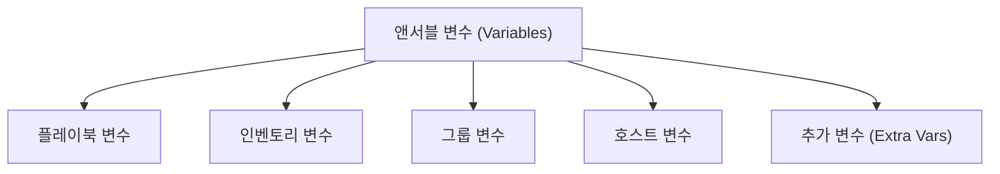
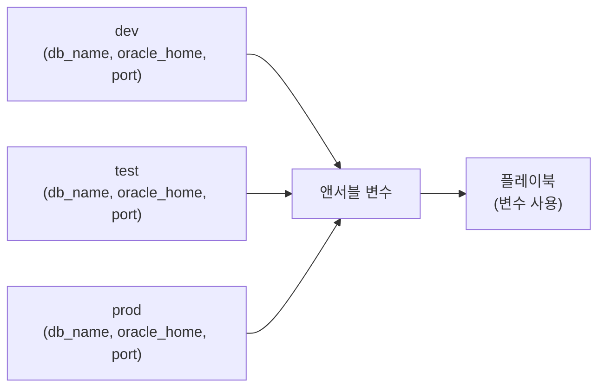
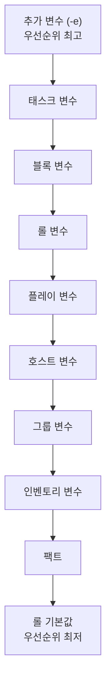
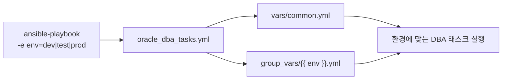

# Ansible 변수: 환경에 맞게 움직이는 오라클 DBA 자동화

> **조판 규격**: 본문·제목·표·캡션·영문 용어는 `Noto Sans KR`(제목 Bold), 코드 블록은 `DejaVu Sans Mono`를 적용합니다.

## 개요

개발(Dev), 테스트(Test), 운영(Prod) 서버는 데이터베이스 이름, 오라클 홈(Oracle Home) 경로, 리스너 포트, 백업 위치가 서로 다릅니다. 이 값을 플레이북(Playbook)에 직접 적어 두면 환경마다 플레이북을 새로 만들어야 합니다. 변수(Variable)는 값을 한곳에 저장해 두고 필요한 곳에서 꺼내 쓰게 해, 하나의 플레이북으로 여러 환경을 다루게 해 줍니다.



이 장에서는 다음 내용을 학습합니다.

- 앤서블 변수의 개념과 필요성
- 변수 명명 규칙과 문법
- 플레이북, 호스트, 그룹, 인벤토리에서 변수 정의하기
- `vars_files`로 변수를 외부 파일로 분리하기
- 명령줄 변수(`--extra-vars`)
- 변수 우선순위(Precedence)와 범위(Scope)
- 오라클 DBA 활용 사례
- 변수 검증, 문제 해결, 모범 사례
- 마스터 프로젝트: 변수를 활용한 환경 인식(Environment-aware) 오라클 DBA 자동화

**오라클 DBA의 대표적인 변수 활용 사례**: 오라클 홈 경로, 데이터베이스 이름(`DB_NAME`), 리스너 포트, 오라클 사용자 자격 증명, 환경별 설정

> 💡 **노트(Note)**: 변수를 쓰면 값을 하드코딩(Hardcoding)하지 않고, 구성을 재사용하며, 여러 환경을 관리하고, 플레이북을 동적이고 유연하게 만들어 오라클 DBA 자동화를 단순하게 할 수 있습니다.

---

## 1. 앤서블 변수 기초

### 1.1 변수란

앤서블 변수는 값을 저장해 플레이북, 인벤토리, 태스크(Task)에서 재사용하게 합니다. 자동화를 유연하고, 동적이며, 환경에 맞게 만들어 주므로 오라클 DBA에게 매우 유용합니다.

- 변수는 `name: value` 같은 키-값(Key-Value) 쌍입니다.
- 데이터베이스 이름, 오라클 홈, 포트 같은 값을 저장하는 데 씁니다.
- 값은 태스크, 플레이북, 인벤토리 전반에서 사용할 수 있습니다.
- 하드코딩을 피하고 플레이북을 재사용 가능하게 합니다.
- 환경(Dev, Test, Prod)마다 다른 값을 사용할 수 있습니다.



### 1.2 변수 예시

**1) 단순 변수**

```yaml
---
- hosts: all
  vars:
    db_name: ORCL
    port: 1521
```

**2) 태스크에서 변수 사용**

```yaml
---
- hosts: all
  vars:
    db_name: ORCL
  tasks:
    - name: Show database name
      debug:
        msg: "Database name is {{ db_name }}"
```

**3) 오라클 홈 변수**

```yaml
---
- hosts: all
  vars:
    oracle_home: /u01/app/oracle/product/19.0.0/dbhome_1
  tasks:
    - name: Display Oracle home
      debug:
        msg: "Oracle home is {{ oracle_home }}"
```

### 1.3 오라클 DBA에게 주는 이점

| 이점 | 설명 |
|---|---|
| 하드코딩 방지 | 환경마다 플레이북을 바꿀 필요가 없습니다. |
| 플레이북 재사용 | 같은 플레이북을 Dev, Test, Prod에 사용할 수 있습니다. |
| 환경별 값 | 오라클 환경마다 다른 값을 사용합니다. |
| 쉬운 유지 보수 | 한곳에서 값을 바꾸면 플레이북 전체에 반영됩니다. |
| DBA 자동화에 이상적 | DB 이름, 오라클 홈, 리스너 포트, 백업 위치 등에 사용합니다. |

### 1.4 자주 쓰는 오라클 DBA 변수

| 변수 | 설명 |
|---|---|
| `db_name` | 오라클 데이터베이스 이름 |
| `oracle_home` | 오라클 홈 경로 |
| `listener_port` | 리스너 포트 번호 |
| `asm_diskgroup` | ASM 디스크 그룹 이름 |
| `backup_dir` | RMAN 백업 위치 |
| `env` | 환경(dev/test/prod) |

### 1.5 핵심 정리

- 변수는 값을 저장해 플레이북을 동적으로 만듭니다.
- 여러 오라클 환경을 관리하는 데 도움이 됩니다.
- 하드코딩을 피하고 유지 보수성을 높입니다.
- 깔끔하고 재사용 가능하며 운영 환경에 적합한 플레이북에 필수입니다.

---

## 2. 변수 명명 규칙과 문법

앤서블 변수에는 지켜야 할 명명 규칙과 문법이 있습니다. 올바르고 일관된 변수 이름은 깔끔하고 읽기 쉬우며 오류 없는 플레이북을 만드는 데 도움이 됩니다.

### 2.1 변수 명명 규칙

1. 영문자(a–z, A–Z), 숫자(0–9), 밑줄(`_`)을 사용합니다.
2. 반드시 영문자로 시작해야 합니다.
3. 대소문자를 구분합니다(`my_var`과 `My_Var`는 서로 다릅니다).
4. 의미 있는 이름을 사용합니다.
5. 특수 문자(`-`, 공백, `.` 등)를 피합니다.
6. 소문자와 밑줄 조합을 사용합니다(권장).

### 2.2 YAML에서의 변수 문법

변수는 YAML에서 `variable_name: value` 형식으로 정의합니다.

```yaml
---
vars:
  db_name: ORCL
  oracle_home: /u01/app/oracle/product/19.0.0/dbhome_1
  listener_port: 1521
  is_rac: false
```

### 2.3 태스크에서 변수 사용

변수는 이중 중괄호 `{{ }}`로 참조합니다.

```yaml
---
- name: Display database name
  hosts: all
  vars:
    db_name: ORCL
  tasks:
    - name: Show DB name
      debug:
        msg: "Database name is {{ db_name }}"
```

### 2.4 올바른 변수 이름

```yaml
---
vars:
  db_name: ORCL                      # valid
  oracle_home: /u01/app/oracle       # valid
  listener_port: 1521                # valid
  backup_dir: /backup                # valid
  is_rac: true                       # valid
  env: prod                          # valid
  db_version: "19c"                  # valid
```

### 2.5 올바르지 않은 변수 이름

```yaml
---
vars:
  1db_name: ORCL     # cannot start with number
  db-name: ORCL      # hyphen not allowed
  db name: ORCL      # space not allowed
  db.name: ORCL      # dot not allowed
  db@name: ORCL      # special character not allowed
  DB_NAME: ORCL      # uppercase allowed but avoid
  dbName: ORCL       # camelCase allowed but avoid
```

| 구분 | 이름 | 이유 |
|---|---|---|
| 사용할 수 없음 | `1db_name` | 숫자로 시작할 수 없음 |
| 사용할 수 없음 | `db-name` | 하이픈 불가 |
| 사용할 수 없음 | `db name` | 공백 불가 |
| 사용할 수 없음 | `db.name` | 점 불가 |
| 사용할 수 없음 | `db@name` | 특수 문자 불가 |
| 허용되지만 피함 | `DB_NAME` | 대문자는 허용되지만 피하는 것이 좋음 |
| 허용되지만 피함 | `dbName` | 카멜 케이스(camelCase)는 허용되지만 피하는 것이 좋음 |

### 2.6 모범 사례

- 소문자와 밑줄을 사용합니다.
- 의미 있고 설명적인 이름을 사용합니다.
- 환경 전반에서 일관된 이름을 유지합니다.
- 예약된 키워드(`host`, `group` 등)를 피합니다.
- 환경별 값에는 변수를 사용합니다.
- YAML 문법을 올바르게 따릅니다.

### 2.7 핵심 정리

올바른 명명 규칙과 문법을 지키면 오류를 피하고, 플레이북을 깔끔하고 읽기 쉽고 유지 보수하기 쉽게 만들 수 있습니다.

---

## 3. 플레이북에서 변수 정의

플레이북 안에서 `vars` 섹션으로 변수를 직접 정의할 수 있습니다. 이 변수는 태스크에서 사용할 수 있어 플레이북을 동적이고 재사용 가능하게 만듭니다.

### 3.1 문법

1. 플레이 수준에서 `vars` 섹션을 사용합니다.
2. 키-값 쌍을 정의합니다.
3. 의미 있는 변수 이름을 사용합니다.
4. 태스크에서 `{{ variable_name }}`으로 변수를 사용합니다.
5. 여러 변수를 정의할 수 있습니다.

### 3.2 간단한 예시 (`playbook.yml`)

```yaml
---
- name: Define and use variables in playbook
  hosts: all
  vars:
    db_name: ORCL
    oracle_home: /u01/app/oracle/product/19.0.0/dbhome_1
    listener_port: 1521
    backup_dir: /backup
  tasks:
    - name: Display database information
      debug:
        msg: "Database Name: {{ db_name }}"

    - name: Display Oracle home
      debug:
        msg: "Oracle Home: {{ oracle_home }}"
```

### 3.3 출력 예시

```text
PLAY [Define and use variables in playbook] **********

TASK [Display database information] ******************
ok: [localhost] => {
    "msg": "Database Name: ORCL"
}

TASK [Display Oracle home] ***************************
ok: [localhost] => {
    "msg": "Oracle Home: /u01/app/oracle/product/19.0.0/dbhome_1"
}
```

### 3.4 여러 변수 예시

```yaml
---
- name: Use multiple variables
  hosts: all
  vars:
    db_name: ORCL
    oracle_home: /u01/app/oracle/product/19.0.0/dbhome_1
    listener_port: 1521
    env: dev
    is_rac: false
  tasks:
    - name: Show all variables
      debug:
        msg: "DB: {{ db_name }}, Home: {{ oracle_home }},
              Port: {{ listener_port }}, Env: {{ env }}, RAC: {{ is_rac }}"
```

### 3.5 오라클 DBA 활용 사례

- 데이터베이스 이름, 오라클 홈, 리스너 포트 저장
- Dev, Test, Prod 환경별로 다른 값 사용
- 백업 위치 구성
- 스크립트에 파라미터 전달
- 여러 데이터베이스를 위한 재사용 가능한 플레이북

### 3.6 핵심 정리

- 플레이북에서 `vars` 섹션으로 변수를 정의합니다.
- 변수는 플레이북을 동적이고 재사용 가능하게 합니다.
- 의미 있는 이름을 사용하고, 단일 또는 여러 변수를 정의할 수 있습니다.
- 환경별 자동화에 필수입니다.

---

## 4. 호스트 변수

호스트 변수는 **특정 호스트**에 정의하는 변수입니다. 해당 호스트에만 적용되며 인벤토리 파일이나 별도의 호스트 변수 파일에서 정의할 수 있습니다. 데이터베이스 서버마다 구성이 다를 때 유용합니다.

### 4.1 동작 방식

1. 단일 호스트에 정의합니다.
2. 그룹 변수를 덮어씁니다(Override).
3. 서버마다 구성(오라클 홈, 포트 등)이 다를 때 유용합니다.
4. 인벤토리 파일 또는 `host_vars/` 디렉터리에서 정의할 수 있습니다.
5. RAC, 데이터 가드(Data Guard), 다중 데이터베이스 환경에서 흔히 사용합니다.

### 4.2 인벤토리에서 호스트 변수 정의 (`inventory/hosts.ini`)

```ini
[dbservers]
db1 ansible_host=192.168.1.10 \
    oracle_home=/u01/app/oracle/prod \
    db_name=PROD \
    listener_port=1521

db2 ansible_host=192.168.1.20 \
    oracle_home=/u01/app/oracle/test \
    db_name=TEST \
    listener_port=1521
```

### 4.3 host_vars 파일에서 정의 (`host_vars/db1.yml`)

```yaml
# host_vars/db1.yml
oracle_home: /u01/app/oracle/prod
db_name: PROD
listener_port: 1521
backup_dir: /backup/prod
env: prod
data_guard: true
```

### 4.4 플레이북에서 호스트 변수 사용 (`playbooks/host_demo.yml`)

```yaml
---
- name: Display host-specific Oracle information
  hosts: dbservers
  gather_facts: no
  tasks:
    - name: Show variables for each host
      debug:
        msg:
          - "Host: {{ inventory_hostname }}"
          - "DB Name: {{ db_name }}"
          - "Oracle Home: {{ oracle_home }}"
          - "Listener Port: {{ listener_port }}"
```

### 4.5 출력 예시 (`ansible-playbook host_demo.yml`)

```text
ok: [db1] => {
    "msg": [
        "Host: db1",
        "DB Name: PROD",
        "Oracle Home: /u01/app/oracle/prod",
        "Listener Port: 1521"
    ]
}
ok: [db2] => {
    "msg": [
        "Host: db2",
        "DB Name: TEST",
        "Oracle Home: /u01/app/oracle/test",
        "Listener Port: 1521"
    ]
}
```

같은 플레이북이어도 호스트마다 자기 변수 값을 사용합니다.

### 4.6 오라클 DBA 활용 사례

- 서버마다 다른 오라클 홈
- 서로 다른 데이터베이스 이름(PROD, TEST, DEV)
- 서로 다른 리스너 포트
- 서로 다른 백업 디렉터리
- 다중 노드 RAC 구성(node1, node2 등)
- 데이터 가드 프라이머리(Primary)와 스탠바이(Standby) 서버
- 환경별 자격 증명 또는 설정

### 4.7 핵심 정리

- 호스트 변수는 특정 호스트에만 적용됩니다.
- 인벤토리 또는 `host_vars/` 디렉터리에서 정의할 수 있습니다.
- 그룹 변수를 덮어씁니다.
- 구성이 서로 다른 서버에 유용하며, RAC·데이터 가드 등 다중 데이터베이스 환경에 필수입니다.

---

## 5. 그룹 변수

그룹 변수는 인벤토리의 **호스트 그룹**에 정의하는 변수입니다. 해당 그룹의 모든 호스트에 적용되며 플레이북과 태스크에서 사용할 수 있습니다.

### 5.1 그룹 변수를 쓰는 때

1. 여러 서버의 구성이 같을 때
2. 모든 호스트에 같은 변수를 반복해서 쓰지 않으려 할 때
3. 환경(Dev, Test, Prod)별 설정에 유용할 때
4. 인벤토리를 체계적이고 관리하기 쉽게 만들고 싶을 때

### 5.2 인벤토리 구조

```text
inventory/
├── group_vars/
│   ├── dbservers.yml
│   ├── rac.yml
│   ├── dev.yml
│   └── prod.yml
├── host_vars/
│   ├── db1.yml
│   └── db2.yml
└── inventory.ini
```

각 그룹은 `group_vars/` 디렉터리 안에 자기만의 YAML 파일을 가지며, 같은 그룹의 모든 호스트는 이 변수를 자동으로 상속합니다.

### 5.3 그룹 변수 파일 (`group_vars/dbservers.yml`)

```yaml
---
# Variables for all database servers
db_name: ORCL
oracle_home: /u01/app/oracle/product/19.0.0/dbhome_1
listener_port: 1521
backup_dir: /backup
is_rac: false
env: prod
db_version: "19c"
```

### 5.4 그룹이 있는 인벤토리 (`inventory.ini`)

```ini
[dbservers]
db1 ansible_host=192.168.1.10
db2 ansible_host=192.168.1.11

[rac]
rac1 ansible_host=192.168.1.20
rac2 ansible_host=192.168.1.21
```

### 5.5 플레이북에서 그룹 변수 사용

```yaml
---
- name: Show group variables
  hosts: dbservers
  gather_facts: no
  tasks:
    - name: Display database information
      debug:
        msg: |
          DB Name: {{ db_name }}
          Oracle Home: {{ oracle_home }}
          Listener Port: {{ listener_port }}
          Environment: {{ env }}
```

**출력 예시**

```text
ok: [db1] => {
    "msg": "DB Name: ORCL
            Oracle Home: /u01/app/oracle/product/19.0.0/dbhome_1
            Listener Port: 1521
            Environment: prod"
}
```

### 5.6 오라클 DBA 활용 사례

- 모든 DB 서버에 같은 오라클 홈
- 여러 데이터베이스에 공통 백업 위치
- 환경별(Dev/Test/Prod) 구성
- 설정이 같은 RAC 노드

### 5.7 핵심 정리

- 그룹 변수는 호스트 그룹에 대해 정의하며 `group_vars/` 디렉터리에 저장합니다.
- 그룹의 모든 호스트에 적용됩니다.
- 공통 구성 관리에 도움이 됩니다.
- 확장 가능하고 유지 보수하기 쉬운 앤서블 자동화에 필수입니다.

---

## 6. 인벤토리의 변수

인벤토리 파일에 호스트 또는 그룹 이름과 함께 변수를 직접 정의할 수 있습니다. 환경별 구성에 유용하고 플레이북을 단순하게 만듭니다.

### 6.1 인벤토리 변수란

1. 인벤토리 파일(`.ini` 형식)에 정의한 변수입니다.
2. 호스트별 또는 그룹별로 둘 수 있습니다.
3. 데이터베이스 이름, 오라클 홈, 리스너 포트, 백업 위치 등을 저장하는 데 씁니다.
4. 플레이북과 태스크에서 자동으로 사용할 수 있습니다.
5. 여러 환경(Dev, Test, Prod)을 관리하는 데 유용합니다.

### 6.2 인벤토리 파일 예시 (INI 형식)

```ini
[oracle]
db1 ansible_host=192.168.1.10 db_name=ORCL \
    oracle_home=/u01/app/oracle/product/19.0.0/dbhome_1 \
    listener_port=1521 env=prod is_rac=true

db2 ansible_host=192.168.1.11 db_name=TEST \
    oracle_home=/u01/app/oracle/product/19.0.0/dbhome_1 \
    listener_port=1521 env=test is_rac=false

[standby]
db3 ansible_host=192.168.1.12 db_name=STBY \
    oracle_home=/u01/app/oracle/product/19.0.0/dbhome_1 \
    listener_port=1521 env=dr is_rac=false
```

### 6.3 인벤토리의 그룹 변수

`[group:vars]` 아래에 정의한 변수는 해당 그룹의 모든 호스트에 적용됩니다.

```ini
[oracle:vars]
oracle_home=/u01/app/oracle/product/19.0.0/dbhome_1
listener_port=1521
backup_dir=/backup/oracle
env=prod
db_type=RAC

[standby:vars]
oracle_home=/u01/app/oracle/product/19.0.0/dbhome_1
backup_dir=/backup/dr
env=dr
db_type=SI
```

### 6.4 인벤토리의 호스트 변수

호스트 옆에 정의한 변수는 해당 호스트에만 적용됩니다.

```ini
[oracle]
db1 ansible_host=192.168.1.10 \
    db_name=ORCL \
    oracle_home=/u01/app/oracle/product/19.0.0/dbhome_1 \
    listener_port=1521 \
    backup_dir=/backup/prod \
    env=prod
```

### 6.5 플레이북에서 인벤토리 변수 사용

```yaml
---
- name: Display inventory variables
  hosts: oracle
  gather_facts: no
  tasks:
    - name: Show Oracle details
      debug:
        msg: |
          DB Name: {{ db_name }}
          Oracle Home: {{ oracle_home }}
          Listener Port: {{ listener_port }}
          Environment: {{ env }}
```

**출력 예시**

```text
ok: [db1] => {
    "msg": "
        DB Name: ORCL
        Oracle Home: /u01/app/oracle/product/19.0.0/dbhome_1
        Listener Port: 1521
        Environment: prod
    "
}
```

### 6.6 핵심 정리

- 인벤토리 변수는 호스트별 또는 그룹별로 둘 수 있습니다.
- 중요한 구성값을 저장하는 데 쓰입니다.
- 플레이북에서 자동으로 사용할 수 있습니다.
- 여러 환경을 쉽게 관리하게 하고, 플레이북을 단순하고 유지 보수하기 쉽게 합니다.

---

## 7. 변수 파일: vars_files

`vars_files` 키워드를 사용하면 외부 YAML 파일에서 변수를 불러올 수 있습니다. 플레이북을 깔끔하고 체계적으로 유지하고, 여러 플레이북에서 같은 변수를 재사용할 수 있습니다.

### 7.1 vars_files를 쓰는 이유

1. 변수를 플레이북 로직과 분리합니다.
2. 플레이북을 깔끔하고 읽기 쉽게 유지합니다.
3. 같은 변수 파일을 여러 플레이북에서 재사용합니다.
4. 환경별 구성을 관리합니다.
5. 크고 복잡한 자동화에 유용합니다.

### 7.2 프로젝트 구조

```text
ansible-project/
├── playbooks/
│   ├── db_info.yml
│   └── site.yml
├── vars/
│   ├── database.yml
│   ├── dev.yml
│   └── prod.yml
└── inventory/
    └── hosts.ini
```

변수 파일은 `vars/` 같은 별도 디렉터리에 모아 두면 정리하기 좋습니다.

### 7.3 변수 파일 예시 (`vars/database.yml`)

```yaml
# Oracle database variables
db_name: ORCL
oracle_home: /u01/app/oracle/product/19.0.0/dbhome_1
listener_port: 1521
backup_dir: /backup/orcl
env: dev
is_rac: false
```

### 7.4 플레이북에서 vars_files 사용 (`playbooks/db_info.yml`)

```yaml
---
- name: Load variables from external file
  hosts: oracle
  gather_facts: no
  vars_files:
    - ../vars/database.yml
  tasks:
    - name: Display database information
      debug:
        msg: |
          DB Name: {{ db_name }}
          Oracle Home: {{ oracle_home }}
          Listener Port: {{ listener_port }}
          Backup Dir: {{ backup_dir }}
          Environment: {{ env }}
```

### 7.5 여러 변수 파일 (`playbooks/site.yml`)

```yaml
---
- name: Use multiple variable files
  hosts: oracle
  gather_facts: no
  vars_files:
    - ../vars/common.yml
    - ../vars/{{ env }}.yml   # dev.yml or prod.yml
  tasks:
    - name: Show environment
      debug:
        msg: "Environment: {{ env }}, DB: {{ db_name }}"
```

> ⚠️ **주의(Caution)**: `vars_files` 경로에 쓰는 `{{ env }}`는 불러올 변수 파일 안에서 정의할 수 없습니다. 파일을 고르기 전에 값이 이미 정해져 있어야 하기 때문입니다. 10장과 12장처럼 `-e env=dev`로 실행 시점에 전달하거나, 인벤토리 등 다른 곳에서 정의해 두십시오.

### 7.6 환경별 변수 파일

**`vars/dev.yml`**

```yaml
db_name: ORCL
oracle_home: /u01/app/oracle/dev
listener_port: 1521
backup_dir: /backup/dev
env: dev
is_rac: false
```

**`vars/prod.yml`**

```yaml
db_name: PROD
oracle_home: /u01/app/oracle/prod
listener_port: 1521
backup_dir: /backup/prod
env: prod
is_rac: true
```

### 7.7 오라클 DBA 활용 사례

- Dev, Test, Prod 구성을 별도로 관리
- 오라클 홈, DB 이름, 포트, 백업 위치 저장
- 여러 플레이북에서 같은 변수 파일 재사용
- 민감한 설정과 환경별 설정을 체계적으로 관리
- 대규모 자동화 프로젝트의 유지 보수성 확보

### 7.8 핵심 정리

- `vars_files`는 외부 YAML 파일에서 변수를 불러옵니다.
- 플레이북을 깔끔하고 체계적으로 유지합니다.
- 여러 변수 파일을 사용할 수 있고 환경별 구성에 유용합니다.
- 실제 오라클 DBA 자동화에 필수입니다.

---

## 8. 명령줄 변수: `--extra-vars`

`--extra-vars`(또는 `-e`) 옵션을 사용하면 플레이북을 실행하면서 명령줄에서 변수를 전달할 수 있습니다. 이 변수는 플레이북, 인벤토리, 변수 파일에 정의된 값을 **덮어씁니다**(우선순위가 가장 높음).

### 8.1 문법

1. `-e` 또는 `--extra-vars`에 `key=value`를 사용합니다.
2. 변수 하나 또는 여러 개를 전달할 수 있습니다.
3. 값은 문자열, 숫자, 불리언이 될 수 있습니다.
4. 플레이북이나 파일을 수정하지 않고 동적으로 실행할 때 유용합니다.
5. 환경별 실행(Dev, Test, Prod)에 흔히 사용됩니다.

### 8.2 변수 하나 전달

```bash
[oracle@ansible ~]$ ansible-playbook db_info.yml \
      -e "db_name=PROD"
```

```text
ok: [oracle] => {
    "msg": "Database Name: PROD"
}
```

### 8.3 여러 변수 전달

```bash
[oracle@ansible ~]$ ansible-playbook db_info.yml \
    -e "db_name=TEST \
        oracle_home=/u01/app/oracle/product/19.0.0/dbhome_1 \
        backup_dir=/backup/test"
```

```text
ok: [oracle] => {
    "msg": "DB: TEST, Home: /u01/app/oracle/product/19.0.0/dbhome_1,
            Backup: /backup/test"
}
```

### 8.4 파일로 추가 변수 전달

`@`를 붙이면 JSON 또는 YAML 파일에서 추가 변수를 읽습니다.

```bash
[oracle@ansible ~]$ ansible-playbook db_info.yml \
    -e @vars.json
```

**`vars.json`**

```json
{
  "db_name": "PROD",
  "oracle_home": "/u01/app/oracle/prod",
  "backup_dir": "/backup/prod",
  "env": "prod"
}
```

**`vars.yml`**

```yaml
db_name: PROD
oracle_home: /u01/app/oracle/prod
backup_dir: /backup/prod
env: prod
```

### 8.5 플레이북에서 추가 변수 사용 (`playbooks/db_info.yml`)

```yaml
---
- name: Display variables passed from command line
  hosts: oracle
  gather_facts: no
  tasks:
    - name: Show Oracle configuration
      debug:
        msg: |
          DB Name: {{ db_name }}
          Oracle Home: {{ oracle_home }}
          Backup Dir: {{ backup_dir }}
          Environment: {{ env }}
```

### 8.6 오라클 DBA 활용 사례

- 같은 플레이북을 Dev, Test, Prod에 실행
- 데이터베이스 이름, 오라클 홈, 포트, 백업 위치 전달
- 자동화 스크립트와 CI/CD 파이프라인에서 사용
- 파일을 수정하지 않고 임시로 덮어쓰기
- 애드혹 실행과 테스트에 유용

### 8.7 핵심 정리

- `-e` 또는 `--extra-vars`로 명령줄에서 변수를 전달합니다.
- 변수를 하나 또는 여러 개 전달할 수 있습니다.
- `key=value`와 `@file`(JSON/YAML) 형식을 모두 지원합니다.
- 플레이북, 인벤토리, `vars_files`보다 우선순위가 높습니다.
- 환경별, 동적 실행에 매우 유용합니다.

---

## 9. 변수 우선순위와 범위

앤서블에는 정해진 **변수 우선순위**가 있습니다. 같은 변수가 여러 곳에 정의되어 있으면 우선순위가 높은 값이 사용됩니다. 우선순위를 이해하면 예상치 못한 결과를 피할 수 있습니다.

### 9.1 변수 우선순위 (높음 → 낮음)

| 순위 | 변수 종류 |
|:---:|---|
| 1 (가장 높음) | 추가 변수(`--extra-vars`) |
| 2 | 태스크 변수(`vars`) |
| 3 | 블록 변수 |
| 4 | 롤 변수(`vars`) |
| 5 | 플레이 변수(`vars`) |
| 6 | 호스트 변수 |
| 7 | 그룹 변수 |
| 8 | 인벤토리 변수 |
| 9 | 팩트(수집된 팩트) |
| 10 (가장 낮음) | 롤 기본값(Role defaults) |



> ⚠️ **주의(Caution)**: 이 순서는 슬라이드의 설명을 정리한 것입니다. 앤서블 공식 문서의 우선순위 표는 세부 항목이 더 많고, 팩트처럼 일부 항목의 위치가 다를 수 있습니다. 출간 전에 사용하는 앤서블 버전의 공식 문서로 확인하십시오.

### 9.2 예시: 여러 수준에 정의된 같은 변수

```text
ansible-project/
├── inventory/
│   └── hosts.ini
├── group_vars/
│   └── all.yml
├── host_vars/
│   └── db1.yml
└── playbooks/
    └── db_info.yml
```

| 위치 | 정의 | 값 |
|---|---|---|
| `inventory/hosts.ini` (인벤토리 변수) | `db1 ansible_host=192.168.1.10 oracle_home=/u01/app/oracle` | `/u01/app/oracle` |
| `group_vars/all.yml` (그룹 변수) | `oracle_home: /u01/app/oracle/group` | `/u01/app/oracle/group` |
| `host_vars/db1.yml` (호스트 변수) | `oracle_home: /u01/app/oracle/host` | `/u01/app/oracle/host` |
| `playbooks/db_info.yml` (플레이 변수) | `hosts: db1`, `vars: oracle_home: /u01/app/oracle/play` | `/u01/app/oracle/play` |
| 명령줄 (`--extra-vars`) | `-e "oracle_home=/u01/app/oracle/extra"` | `/u01/app/oracle/extra` |

**`-e`를 사용한 경우(우선순위 최고)**

```bash
[oracle@ansible ~]$ ansible-playbook db_info.yml \
    -e "oracle_home=/u01/app/oracle/extra"
```

```text
ok: [db1] => {
    "msg": "Oracle Home: /u01/app/oracle/extra"
}
```

**`-e` 없이 실행한 경우(플레이 변수 사용)**

```bash
[oracle@ansible ~]$ ansible-playbook db_info.yml
```

```text
ok: [db1] => {
    "msg": "Oracle Home: /u01/app/oracle/play"
}
```

### 9.3 변수 범위(Scope)

| 변수 종류 | 범위 / 적용 대상 |
|---|---|
| 추가 변수 | 전체 플레이북(모든 플레이, 모든 호스트) |
| 태스크 변수 | 해당 태스크만 |
| 블록 변수 | 해당 블록 안의 태스크 |
| 롤 변수 | 해당 롤 안의 태스크 |
| 플레이 변수 | 해당 플레이의 모든 태스크 |
| 호스트 변수 | 해당 호스트만 |
| 그룹 변수 | 해당 그룹의 모든 호스트 |
| 인벤토리 변수 | 인벤토리 파일에 정의 |
| 팩트 | 모든 호스트(시스템에서 수집) |
| 롤 기본값 | 우선순위 최저, 덮어쓸 수 있음 |

### 9.4 오라클 DBA 활용 사례

- Dev/Test/Prod 환경에 맞게 값 덮어쓰기
- 임시 변경에는 `--extra-vars` 사용
- 공통 값은 `group_vars/`에 보관
- 서버별 설정(예: 오라클 홈)은 `host_vars/` 사용
- 플레이북에 값을 하드코딩하지 않기

### 9.5 핵심 정리

- 앤서블은 정해진 변수 우선순위를 사용합니다.
- 추가 변수의 우선순위가 가장 높습니다.
- 변수는 플레이, 호스트, 그룹 등 여러 수준에 정의할 수 있습니다.
- 사용 사례에 맞는 수준을 선택하면 충돌과 예상치 못한 결과를 피할 수 있습니다.
- 환경을 인식하는 확장 가능한 자동화에 필수입니다.

---

## 10. 오라클 DBA 자동화에서 변수 활용

변수는 오라클 DBA 자동화를 유연하고, 재사용 가능하며, 환경을 인식하게 만듭니다. 데이터베이스 상세 정보, 오라클 홈, 리스너 포트, 백업 경로 등 DBA 관련 구성을 Dev, Test, Prod 환경에 걸쳐 변수로 다룰 수 있습니다.

### 10.1 자주 쓰는 오라클 DBA 변수

| 번호 | 변수 |
|:---:|---|
| 1 | 데이터베이스 이름(`db_name`, `db_unique_name`) |
| 2 | 오라클 홈(`oracle_home`) |
| 3 | 리스너 포트(`listener_port`) |
| 4 | 백업 위치(`backup_dir`) |
| 5 | 환경(`env`: dev/test/prod) |
| 6 | ASM / 데이터 가드 구성 |
| 7 | 자격 증명(앤서블 볼트 사용 권장) |
| 8 | 경로, 로그 위치, 스크립트 위치 |

### 10.2 오라클 DBA 환경용 변수 파일 (`vars/prod.yml`)

```yaml
# vars/prod.yml
db_name: PROD
db_unique_name: PROD_DG
oracle_home: /u01/app/oracle/product/19.0.0/dbhome_1
listener_port: 1521
oracle_sid: PROD
backup_dir: /backup/prod
asm_diskgroup: DATA
env: prod
is_rac: true
data_guard: true
```

### 10.3 오라클 변수를 사용하는 플레이북 (`playbooks/oracle_info.yml`)

```yaml
---
- name: Display Oracle database information
  hosts: oracle
  gather_facts: no
  vars_files:
    - ../vars/prod.yml
  tasks:
    - name: Show database details
      debug:
        msg: |
          DB Name: {{ db_name }}
          DB Unique Name: {{ db_unique_name }}
          Oracle Home: {{ oracle_home }}
          Listener Port: {{ listener_port }}
          Backup Directory: {{ backup_dir }}
          Environment: {{ env }}
```

### 10.4 DBA 태스크에서 변수 사용

```yaml
- name: Check listener status
  shell: lsnrctl status
  environment:
    ORACLE_HOME: "{{ oracle_home }}"
  register: listener_status
  changed_when: false

- name: Check database open mode
  shell: sqlplus -s / as sysdba <<EOF
    set heading off feedback off
    select open_mode from v$database;
    EOF
  register: db_mode
  changed_when: false

- name: Create backup directory
  file:
    path: "{{ backup_dir }}"
    state: directory
    owner: oracle
    group: oinstall
    mode: '0755'
```

> ⚠️ **주의(Caution)**: 슬라이드 예시의 SQL은 `v$database`로 적혀 있습니다. 셸의 히어 도큐먼트(`<<EOF`)에서는 `$database`가 셸 변수로 해석될 수 있으므로, 앞선 장의 예시처럼 `v\$database`로 이스케이프해야 의도대로 동작합니다. 실습할 때는 한 서버에서 먼저 확인하십시오.

### 10.5 환경별 실행

| 환경 | 변수 파일 | 예시 명령 |
|---|---|---|
| Dev | `vars/dev.yml` | `ansible-playbook -e env=dev` |
| Test | `vars/test.yml` | `ansible-playbook -e env=test` |
| Prod | `vars/prod.yml` | `ansible-playbook -e env=prod` |

### 10.6 오라클 DBA 활용 사례

- 여러 오라클 환경(Dev/Test/Prod) 관리
- 변수 파일만 달리해 공통 플레이북 사용
- 변수로 오라클 홈, 리스너, 백업, ASM, 데이터 가드 구성
- 환경별 점검과 유지 보수 태스크 실행
- 자동화를 재사용 가능하고 유지 보수하기 쉽게 만들기

### 10.7 핵심 정리

- 변수는 오라클 DBA 자동화에 필수입니다.
- 환경마다 별도 변수 파일을 사용합니다.
- 민감한 데이터는 앤서블 볼트에 보관합니다.
- DB 이름, 오라클 홈, 포트, 경로에 변수를 사용합니다.
- 같은 플레이북을 여러 환경에서 쓸 수 있어 확장 가능하고 유지 보수하기 쉬우며 안전한 자동화에 도움이 됩니다.

---

## 11. 변수 검증, 문제 해결, 모범 사례

올바른 검증, 문제 해결, 모범 사례는 변수가 정확하고 안전하게 동작하도록 돕습니다. 장애를 예방하고 오라클 DBA 자동화를 믿을 수 있고 유지 보수하기 쉽게 만듭니다.

### 11.1 변수 검증

1. 변수가 정의되어 있는지 확인합니다.
2. 변수 값을 검증합니다(예: 비어 있지 않음).
3. 검증에는 `assert` 모듈을 사용합니다.
4. 유효하지 않으면 사용자 지정 메시지와 함께 실패시킵니다.
5. `db_name`, `oracle_home`, `listener_port`, `backup_dir` 같은 필수 변수에 유용합니다.

### 11.2 예시: 필수 변수 검증 (`playbooks/validate_vars.yml`)

```yaml
---
- name: Validate required variables
  hosts: oracle
  gather_facts: no
  tasks:
    - name: Check if db_name is defined
      assert:
        that:
          - db_name is defined
          - db_name | length > 0
        fail_msg: "db_name is required. Please provide it."
        success_msg: "db_name is defined: {{ db_name }}"
```

### 11.3 변수 값 디버깅 (`playbooks/debug_vars.yml`)

```yaml
---
- name: Debug variable values
  hosts: oracle
  gather_facts: no
  tasks:
    - name: Show all important variables
      debug:
        msg:
          - "DB Name: {{ db_name }}"
          - "Oracle Home: {{ oracle_home }}"
          - "Listener Port: {{ listener_port }}"
          - "Backup Dir: {{ backup_dir }}"
          - "Environment: {{ env }}"
```

### 11.4 변수 문제 해결 순서

1. `debug` 모듈로 변수 값을 출력합니다.
2. 예상과 다른 값이 나오면 변수 우선순위를 확인합니다.
3. `vars_files`의 파일 경로가 올바른지 확인합니다.
4. 인벤토리, `group_vars`, `host_vars`가 로드되었는지 확인합니다.
5. 더 자세한 출력이 필요하면 `-vvv`를 사용합니다.

### 11.5 자주 발생하는 문제와 해결

| 문제 | 해결 |
|---|---|
| 변수가 정의되지 않음 | 철자, 파일 경로, 인벤토리 확인 |
| 예상과 다른 변수 값 | 우선순위 순서 확인 |
| `vars_files`가 로드되지 않음 | 올바른 파일 경로와 YAML 문법 확인 |
| 인벤토리 변수가 사용되지 않음 | 그룹/호스트 이름과 구조 확인 |
| 추가 변수가 동작하지 않음 | 문법 확인: `-e "key=value"` |
| 민감한 데이터 노출 | 앤서블 볼트로 암호화 |
| 빈 값 때문에 태스크 실패 | `assert`로 변수 검증 |

### 11.6 모범 사례

- 의미 있고 일관된 변수 이름을 사용합니다.
- 변수를 인벤토리, `group_vars`, `vars_files`에 체계적으로 정리합니다.
- 중요한 변수는 `assert`로 검증합니다.
- 환경별 변수 파일(dev, test, prod)을 사용합니다.
- 민감한 데이터는 앤서블 볼트에 저장합니다.
- 플레이북에 값을 하드코딩하지 않습니다.
- 적절한 곳에는 기본값을 사용합니다.
- 모든 변수를 주석으로 문서화합니다.
- 문제 해결에는 `debug`와 `-vvv`를 사용합니다.
- 일관된 디렉터리 구조를 따릅니다.

### 11.7 오라클 DBA 활용 사례

- `oracle_home` 같은 필수 입력값 검증
- 다중 환경 구성에서 변수 문제 해결
- 인벤토리와 변수 파일이 올바르게 로드되는지 확인
- 앤서블 볼트로 민감한 자격 증명 보호
- 믿을 수 있고 유지 보수하기 쉬운 오라클 DBA 자동화 플레이북 구축

### 11.8 핵심 정리

- 변수를 검증해 장애를 예방합니다.
- 문제 해결에는 `debug`를 사용합니다.
- 변수 우선순위 순서를 이해합니다.
- 모범 사례를 따라 안전하고 유지 보수하기 쉬운 자동화를 만듭니다.
- 운영 환경 수준의 오라클 DBA 자동화에 필수입니다.

---

## 12. 마스터 프로젝트: 변수를 활용한 환경 인식 오라클 DBA 자동화

### 12.1 프로젝트 목표

앤서블 변수로 환경을 인식하는 오라클 DBA 자동화를 만듭니다. 환경마다 다른 변수 파일과 인벤토리 구성을 사용해, 같은 플레이북이 Dev, Test, Prod 환경에서 동작하게 합니다. 이렇게 하면 자동화가 재사용 가능하고, 안전하며, 유지 보수하기 쉬워집니다.

1. 다중 환경 지원을 위해 변수를 사용합니다.
2. 환경별 설정을 별도 파일에 저장합니다.
3. 일반적인 오라클 DBA 태스크를 자동화합니다.
4. 환경 매핑에 인벤토리와 `group_vars`를 사용합니다.
5. 플레이북을 재사용 가능하고 유지 보수하기 쉽게 만듭니다.



### 12.2 프로젝트 구조

```text
ansible-oracle-project/
├── inventory/
│   └── hosts.ini
├── group_vars/
│   ├── dev.yml
│   ├── test.yml
│   └── prod.yml
├── vars/
│   └── common.yml
└── playbooks/
    └── oracle_dba_tasks.yml
```

환경마다 변수 파일을 분리하면 프로젝트가 체계적이고 확장 가능해집니다.

### 12.3 인벤토리 파일 (`inventory/hosts.ini`)

```ini
[dev]
devdb ansible_host=192.168.1.10
oracle_home=/u01/app/oracle/dev
listener_port=1521

[test]
testdb ansible_host=192.168.1.20
oracle_home=/u01/app/oracle/test
listener_port=1521

[prod]
proddb ansible_host=192.168.1.30
oracle_home=/u01/app/oracle/prod
listener_port=1521
```

> ⚠️ **주의(Caution)**: 슬라이드의 인벤토리는 `oracle_home`과 `listener_port`가 호스트 줄과 분리된 줄에 적혀 있습니다. INI 인벤토리에서 호스트 변수는 같은 줄(또는 `\`로 이어진 줄)에 있어야 호스트 변수가 되므로, 실제 파일에서는 4장의 형식처럼 한 호스트 줄에 이어서 쓰십시오.

### 12.4 그룹 변수 (`group_vars/dev.yml`)

```yaml
db_name: DEV
db_unique_name: DEV_DG
oracle_home: /u01/app/oracle/dev
listener_port: 1521
backup_dir: /backup/dev
env: dev
is_rac: false
data_guard: false
```

### 12.5 공통 변수 (`vars/common.yml`)

```yaml
dba_user: oracle
dba_group: oinstall
backup_base_dir: /backup
log_dir: /var/log/ansible
script_dir: /u01/scripts
notification_email: dba-team@company.com
check_disk_threshold: 80
check_session_threshold: 100
```

### 12.6 플레이북 (`playbooks/oracle_dba_tasks.yml`)

```yaml
---
- name: Environment-aware Oracle DBA automation
  hosts: all
  gather_facts: no
  vars_files:
    - ../vars/common.yml
    - ../group_vars/{{ env }}.yml
  tasks:
    - name: Display environment info
      debug:
        msg:
          - "Environment: {{ env }}"
          - "DB Name: {{ db_name }}"
          - "Oracle Home: {{ oracle_home }}"
```

### 12.7 태스크에서 변수 사용 (예시 태스크)

```yaml
- name: Check listener status
  shell: lsnrctl status
  register: listener_status

- name: Show listener output
  debug:
    msg: "{{ listener_status.stdout }}"
```

### 12.8 플레이북 실행

```bash
# Dev 환경 실행
ansible-playbook -i inventory/hosts.ini \
    playbooks/oracle_dba_tasks.yml -e env=dev

# Test 환경 실행
ansible-playbook -i inventory/hosts.ini \
    playbooks/oracle_dba_tasks.yml -e env=test

# Prod 환경 실행
ansible-playbook -i inventory/hosts.ini \
    playbooks/oracle_dba_tasks.yml -e env=prod
```

**예상 출력**

```text
TASK [Display environment info] *********************
ok: [devdb] => {
    "msg": [
        "Environment: dev",
        "DB Name: DEV",
        "Oracle Home: /u01/app/oracle/dev"
    ]
}
```

> ⚠️ **주의(Caution)**: 슬라이드의 플레이북은 `hosts: all`이므로, 위 명령은 `-e env=dev`만 줘도 `devdb`뿐 아니라 `testdb`, `proddb`에도 실행됩니다(변수는 dev 값으로 적용됨). 예상 출력처럼 해당 환경 서버에만 실행하려면 `--limit dev`(또는 `-l dev`)를 함께 지정하거나, 환경별 그룹을 대상으로 하도록 `hosts`를 조정하십시오. 특히 운영(prod) 서버에는 의도하지 않은 실행이 일어나지 않도록 주의하십시오.

### 12.9 활용 사례

- Dev, Test, Prod에 같은 자동화 실행
- 헬스 체크, 백업, 리스너 점검 자동화
- 환경별 경로와 설정 사용
- RAC/데이터 가드 구성 관리
- 모니터링과 알림 연동
- 더 많은 DBA 태스크로 쉽게 확장

### 12.10 핵심 정리

- 앤서블 변수로 환경 인식 오라클 DBA 자동화를 만들었습니다.
- 인벤토리, `group_vars`, `vars_files`를 사용했습니다.
- 하나의 플레이북이 여러 환경에서 동작합니다.
- 자동화를 재사용 가능하고, 안전하며, 체계적으로 유지합니다.
- 더 많은 DBA 작업으로 확장할 수 있습니다.
- 실제 운영 환경에 적합한 자동화의 기반입니다.

---

## 실습 및 활용 시나리오 (Hands-on Scenario)

**시나리오**: 하나의 플레이북으로 `dev`, `test`, `prod` 세 환경의 오라클 정보를 확인하고 점검합니다. 환경별 차이는 모두 인벤토리 변수, `group_vars`, `vars_files`로 처리합니다.

> 💡 **실습 환경 안내**:  
> 본 실습은 `chapter_4` 디렉터리의 Docker 기반 멀티 노드 환경(`ansible-control-ch4`, `devdb`, `testdb`, `proddb`)을 기반으로 구성되었습니다.  
> 제어 노드에 접속(`docker exec -it ansible-control-ch4 bash`)한 후 `/home/oracle/ansible-oracle-project` 디렉터리에서 아래 실습을 차례대로 수행합니다.

```text
ansible-oracle-project/
├── ansible.cfg
├── inventory/
│   └── hosts.ini
├── group_vars/
│   ├── dev.yml
│   ├── test.yml
│   └── prod.yml
├── vars/
│   └── common.yml
└── playbooks/
    ├── oracle_dba_tasks.yml       # 기본 환경 인식 플레이북
    ├── validate_vars.yml          # assert 기반 필수 변수 검증 플레이북
    └── debug_vars.yml             # 변수 디버깅 플레이북
```

---

### 실습 1. 프로젝트 구조 만들기

프로젝트에 필요한 디렉터리를 생성하고 이동합니다.

```bash
mkdir -p ansible-oracle-project/{inventory,group_vars,vars,playbooks}
cd ansible-oracle-project
```

`ansible.cfg` 설정 파일에는 기본 인벤토리 경로와 원격 계정(`oracle`)을 정의합니다.

```ini
[defaults]
inventory = inventory/hosts.ini
host_key_checking = False
remote_user = oracle
interpreter_python = auto_silent
```

---

### 실습 2. 인벤토리 작성 및 호스트 변수 검증

`inventory/hosts.ini` 파일에 각 환경별 호스트와 호스트 레벨 변수를 지정합니다.

```ini
[dev]
devdb ansible_host=devdb oracle_home=/u01/app/oracle/dev listener_port=1521

[test]
testdb ansible_host=testdb oracle_home=/u01/app/oracle/test listener_port=1521

[prod]
proddb ansible_host=proddb oracle_home=/u01/app/oracle/prod listener_port=1521
```

> 💡 **호스트명 매핑 팁**: Docker 컨테이너 환경에서는 Docker의 내장 DNS를 사용해 `ansible_host=devdb`(또는 IP `192.168.4.101`) 형식으로 지정하면 각 노드에 정상 접속할 수 있습니다.

#### 1) 인벤토리 그래프 확인
```bash
ansible-inventory -i inventory/hosts.ini --graph
```

**실제 실행 결과:**
```text
@all:
  |--@ungrouped:
  |--@dev:
  |  |--devdb
  |--@test:
  |  |--testdb
  |--@prod:
  |  |--proddb
```

#### 2) 호스트별 인식 변수 확인
```bash
ansible-inventory -i inventory/hosts.ini --host devdb
```

**실제 실행 결과:**
```json
{
    "ansible_host": "devdb",
    "backup_dir": "/backup/dev",
    "data_guard": false,
    "db_name": "DEV",
    "db_unique_name": "DEV_DG",
    "env": "dev",
    "is_rac": false,
    "listener_port": 1521,
    "oracle_home": "/u01/app/oracle/dev"
}
```

---

### 실습 3. 변수 파일 작성

환경별 그룹 변수(`group_vars/`)와 전역 공통 변수(`vars/common.yml`)를 작성합니다.

#### 1) `group_vars/dev.yml`
```yaml
db_name: DEV
db_unique_name: DEV_DG
oracle_home: /u01/app/oracle/dev
listener_port: 1521
backup_dir: /backup/dev
env: dev
is_rac: false
data_guard: false
```

#### 2) `group_vars/test.yml`
```yaml
db_name: TEST
db_unique_name: TEST_DG
oracle_home: /u01/app/oracle/test
listener_port: 1521
backup_dir: /backup/test
env: test
is_rac: false
data_guard: false
```

#### 3) `group_vars/prod.yml`
```yaml
db_name: PROD
db_unique_name: PROD_DG
oracle_home: /u01/app/oracle/prod
listener_port: 1521
oracle_sid: PROD
backup_dir: /backup/prod
asm_diskgroup: DATA
env: prod
is_rac: true
data_guard: true
```

#### 4) `vars/common.yml`
```yaml
dba_user: oracle
dba_group: oinstall
backup_base_dir: /backup
log_dir: /var/log/ansible
script_dir: /u01/scripts
notification_email: dba-team@company.com
check_disk_threshold: 80
check_session_threshold: 100
```

---

### 실습 4. 플레이북 작성과 문법 검증

환경 변수(`env`)를 인자로 받아 해당 환경의 변수 파일을 동적으로 로드하는 플레이북(`playbooks/oracle_dba_tasks.yml`)을 작성합니다.

```yaml
---
- name: Environment-aware Oracle DBA automation
  hosts: all
  gather_facts: no
  vars_files:
    - ../vars/common.yml
    - ../group_vars/{{ env }}.yml
  tasks:
    - name: Display environment info
      debug:
        msg:
          - "Environment: {{ env }}"
          - "DB Name: {{ db_name }}"
          - "Oracle Home: {{ oracle_home }}"
```

#### 1) 문법 검사 (Syntax Check)
```bash
ansible-playbook -i inventory/hosts.ini --syntax-check playbooks/oracle_dba_tasks.yml
```

**실제 실행 결과:**
```text
playbook: playbooks/oracle_dba_tasks.yml
```

#### 2) 개발(dev) 환경 실행
```bash
ansible-playbook -i inventory/hosts.ini playbooks/oracle_dba_tasks.yml -e env=dev --limit dev
```

**실제 실행 결과:**
```text
PLAY [Environment-aware Oracle DBA automation] *********************************

TASK [Display environment info] ************************************************
ok: [devdb] => {
    "msg": [
        "Environment: dev",
        "DB Name: DEV",
        "Oracle Home: /u01/app/oracle/dev"
    ]
}

PLAY RECAP *********************************************************************
devdb                      : ok=1    changed=0    unreachable=0    failed=0    skipped=0    rescued=0    ignored=0   
```

---

### 실습 5. `assert` 모듈을 통한 변수 검증

필수 변수(`db_name`, `oracle_home`)가 정의되어 있고 빈 값이 아닌지 사전에 확인하는 검증 플레이북(`playbooks/validate_vars.yml`)을 작성합니다.

```yaml
---
- name: Validate required variables
  hosts: all
  gather_facts: no
  vars_files:
    - ../vars/common.yml
    - ../group_vars/{{ env }}.yml
  tasks:
    - name: Check if db_name and oracle_home are defined
      assert:
        that:
          - db_name is defined
          - db_name | length > 0
          - oracle_home is defined
          - oracle_home | length > 0
        fail_msg: "Required variables (db_name, oracle_home) are missing or empty!"
        success_msg: "Variables validated: db_name={{ db_name }}, oracle_home={{ oracle_home }}"

    - name: Display environment info
      debug:
        msg:
          - "Environment: {{ env }}"
          - "DB Name: {{ db_name }}"
          - "Oracle Home: {{ oracle_home }}"
```

#### 1) 정상 검증 실행
```bash
ansible-playbook -i inventory/hosts.ini playbooks/validate_vars.yml -e env=dev --limit dev
```

**실제 실행 결과:**
```text
PLAY [Validate required variables] *********************************************

TASK [Check if db_name and oracle_home are defined] ****************************
ok: [devdb] => {
    "changed": false,
    "msg": "Variables validated: db_name=DEV, oracle_home=/u01/app/oracle/dev"
}

TASK [Display environment info] ************************************************
ok: [devdb] => {
    "msg": [
        "Environment: dev",
        "DB Name: DEV",
        "Oracle Home: /u01/app/oracle/dev"
    ]
}

PLAY RECAP *********************************************************************
devdb                      : ok=2    changed=0    unreachable=0    failed=0    skipped=0    rescued=0    ignored=0   
```

#### 2) 의도적 오류 테스트 (변수 미전달 또는 빈 값 전달)
명령행에서 `db_name`을 빈 문자열(`-e "db_name="`)로 덮어써서 검증 실패를 유도합니다.

```bash
ansible-playbook -i inventory/hosts.ini playbooks/validate_vars.yml -e env=dev -e "db_name=" --limit dev
```

**실제 실행 결과:**
```text
PLAY [Validate required variables] *********************************************

TASK [Check if db_name and oracle_home are defined] ****************************
fatal: [devdb]: FAILED! => {
    "assertion": "db_name | length > 0",
    "changed": false,
    "evaluated_to": false,
    "msg": "Required variables (db_name, oracle_home) are missing or empty!"
}

PLAY RECAP *********************************************************************
devdb                      : ok=0    changed=0    unreachable=0    failed=1    skipped=0    rescued=0    ignored=0   
```
> 💡 **검증의 효과**: 필수 변수가 누락된 상태에서 DB 중지나 패치 작업이 수행되지 않도록 플레이북 시작 단계에서 즉시 중단(Fail-Fast)시킬 수 있습니다.

---

### 실습 6. 환경별 실행과 변수 우선순위(Extra vars) 확인

#### 1) 테스트(test) 환경 실행
```bash
ansible-playbook -i inventory/hosts.ini playbooks/oracle_dba_tasks.yml -e env=test --limit test
```

**실제 실행 결과:**
```text
PLAY [Environment-aware Oracle DBA automation] *********************************

TASK [Display environment info] ************************************************
ok: [testdb] => {
    "msg": [
        "Environment: test",
        "DB Name: TEST",
        "Oracle Home: /u01/app/oracle/test"
    ]
}

PLAY RECAP *********************************************************************
testdb                     : ok=1    changed=0    unreachable=0    failed=0    skipped=0    rescued=0    ignored=0   
```

#### 2) 운영(prod) 환경 실행
```bash
ansible-playbook -i inventory/hosts.ini playbooks/oracle_dba_tasks.yml -e env=prod --limit prod
```

**실제 실행 결과:**
```text
PLAY [Environment-aware Oracle DBA automation] *********************************

TASK [Display environment info] ************************************************
ok: [proddb] => {
    "msg": [
        "Environment: prod",
        "DB Name: PROD",
        "Oracle Home: /u01/app/oracle/prod"
    ]
}

PLAY RECAP *********************************************************************
proddb                     : ok=1    changed=0    unreachable=0    failed=0    skipped=0    rescued=0    ignored=0   
```

#### 3) 추가 변수(Extra vars, `-e`) 최상위 우선순위 오버라이드 확인
명령행 옵션 `-e`로 `oracle_home` 경로를 전달하면 파일에 정의된 변수보다 최우선 적용됩니다.

```bash
ansible-playbook -i inventory/hosts.ini playbooks/oracle_dba_tasks.yml \
    -e env=dev -e "oracle_home=/u01/app/oracle/extra" --limit dev
```

**실제 실행 결과:**
```text
PLAY [Environment-aware Oracle DBA automation] *********************************

TASK [Display environment info] ************************************************
ok: [devdb] => {
    "msg": [
        "Environment: dev",
        "DB Name: DEV",
        "Oracle Home: /u01/app/oracle/extra"
    ]
}

PLAY RECAP *********************************************************************
devdb                      : ok=1    changed=0    unreachable=0    failed=0    skipped=0    rescued=0    ignored=0   
```
> `group_vars/dev.yml`의 `/u01/app/oracle/dev` 대신 `-e`로 넘긴 `/u01/app/oracle/extra`가 최종 적용되었음을 확인할 수 있습니다.

---

### 실습 7. 문제 해결 연습 (Error Handling & Troubleshooting)

#### 1) 존재하지 않는 환경(`staging`) 요청 시 에러 재현
```bash
ansible-playbook -i inventory/hosts.ini playbooks/oracle_dba_tasks.yml -e env=staging --limit dev
```

**실제 실행 결과:**
```text
PLAY [Environment-aware Oracle DBA automation] *********************************

TASK [Display environment info] ************************************************
fatal: [devdb]: FAILED! => {"msg": "The task includes an option with an undefined variable. The error was: 'db_name' is undefined. 'db_name' is undefined\n\nThe error appears to be in '/home/oracle/ansible-oracle-project/playbooks/oracle_dba_tasks.yml': line 9, column 7..."}

PLAY RECAP *********************************************************************
devdb                      : ok=0    changed=0    unreachable=0    failed=1    skipped=0    rescued=0    ignored=0   
```
* **원인 분석**: `../group_vars/staging.yml` 파일이 존재하지 않아 해당 파일의 변수가 로드되지 못했고, 태스크에서 참조하는 `db_name`이 정의되지 않아 `Variable undefined` 에러가 발생했습니다.

#### 2) 전체 변수 상세 디버깅 (`playbooks/debug_vars.yml`)
```yaml
---
- name: Debug variable values
  hosts: all
  gather_facts: no
  vars_files:
    - ../vars/common.yml
    - ../group_vars/{{ env }}.yml
  tasks:
    - name: Show all important variables
      debug:
        msg:
          - "DB Name: {{ db_name }}"
          - "DB Unique Name: {{ db_unique_name }}"
          - "Oracle Home: {{ oracle_home }}"
          - "Listener Port: {{ listener_port }}"
          - "Backup Dir: {{ backup_dir }}"
          - "Environment: {{ env }}"
          - "DBA User: {{ dba_user }}"
          - "DBA Group: {{ dba_group }}"
```

```bash
ansible-playbook -i inventory/hosts.ini playbooks/debug_vars.yml -e env=dev --limit dev
```

**실제 실행 결과:**
```text
PLAY [Debug variable values] ***************************************************

TASK [Show all important variables] ********************************************
ok: [devdb] => {
    "msg": [
        "DB Name: DEV",
        "DB Unique Name: DEV_DG",
        "Oracle Home: /u01/app/oracle/dev",
        "Listener Port: 1521",
        "Backup Dir: /backup/dev",
        "Environment: dev",
        "DBA User: oracle",
        "DBA Group: oinstall"
    ]
}

PLAY RECAP *********************************************************************
devdb                      : ok=1    changed=0    unreachable=0    failed=0    skipped=0    rescued=0    ignored=0   
```

---

> ⚠️ **주의(Caution)**:  
> 1. 플레이북의 대상이 `hosts: all`로 작성되어 있을 경우, `-e env=dev`만 주고 실행하면 모든 서버(`testdb`, `proddb`)에서 `dev` 환경의 변수를 읽어 작업이 수행될 위험이 있습니다.  
> 2. 따라서 특정 환경만 작업할 때는 반드시 `--limit dev` (또는 `-l dev`)를 함께 명시하거나, 플레이북의 `hosts: "{{ env }}"`와 같이 동적 그룹을 지정해야 합니다. 특히 운영(prod) 환경 작업 시에는 재차 확인하십시오.

### 확장 과제

- 백업, 리스너 점검 태스크를 추가하고 `backup_dir`, `check_disk_threshold` 변수 연동
- RAC 및 Data Guard 전용 변수 파일(`group_vars/rac.yml`, `group_vars/dataguard.yml`) 추가
- 오라클 SYS/SYSTEM 비밀번호 등 민감한 변수를 앤서블 볼트(`ansible-vault`)로 암호화 분리

> 💡 **노트(Note)**: 체계적으로 설계된 디렉터리(`group_vars/`, `vars/`) 및 변수 구조는 향후 앤서블 롤(Role) 및 대규모 오라클 인프라 자동화 구축 시 그대로 재사용됩니다.
