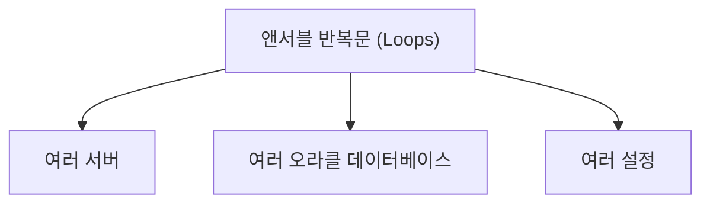
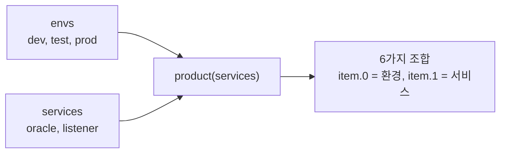

# Ansible 반복문: 오라클 DBA의 반복 작업 자동화

> **조판 규격**: 본문·제목·표·캡션·영문 용어는 `Noto Sans KR`(제목 Bold), 코드 블록은 `DejaVu Sans Mono`를 적용합니다.

## 개요

디렉터리 세 개를 만들 때 같은 태스크(Task)를 세 번 쓰는 것은 번거롭고, 서버와 데이터베이스가 늘수록 유지 보수도 어려워집니다. 반복문(Loop)은 목록의 항목마다 같은 태스크를 실행해 이 문제를 해결합니다. 오라클 DBA(Database Administrator)는 여러 서버, 여러 데이터베이스, 여러 설정 파일에 같은 작업을 반복하는 일이 많으므로 반복문이 특히 유용합니다.



이 장에서는 다음 내용을 학습합니다.

- 반복문의 기본 개념과 필요성, 기본 문법
- 리스트(List)와 딕셔너리(Dictionary) 반복
- 변수와 반복문의 결합
- 여러 앤서블 모듈과 함께 쓰는 반복문
- `when` 조건과 반복문
- 중첩 반복문(Nested Loop)과 고급 패턴
- 오라클 DBA 자동화에서의 반복문 활용
- 반복문 검증, 문제 해결, 모범 사례
- 마스터 프로젝트: 반복문으로 오라클 서버 운영 자동화

먼저 이 장의 핵심 아이디어를 보여 주는 예시입니다. 태스크 하나가 여러 디렉터리를 처리합니다.

```yaml
---
- name: Create directories on multiple Oracle servers
  hosts: all
  become: yes
  vars:
    oracle_dirs:
      - /u01/app/oracle
      - /u01/app/oracle/admin
      - /u01/app/oracle/backup
  tasks:
    - name: Create directories using loop
      ansible.builtin.file:
        path: "{{ item }}"
        state: directory
        owner: oracle
        group: oinstall
        mode: '0755'
      loop: "{{ oracle_dirs }}"
```

**핵심 이점**: 수작업을 줄이고, 같은 태스크를 여러 항목에 실행하며, 여러 오라클 서버와 데이터베이스를 관리하고, 자동화를 확장 가능하고 유지 보수하기 쉽게 만듭니다.

**오라클 DBA 활용 사례**: 여러 서버에 디렉터리 생성, 여러 오라클 서비스 시작/중지, 여러 데이터베이스에 SQL 스크립트 실행, 여러 노드의 리스너 상태 확인, 여러 인스턴스의 헬스 리포트 수집, 사용자와 테이블스페이스 관리

---

## 1. 앤서블 반복문 기초

### 1.1 반복문이란

반복문은 서로 다른 항목에 대해 태스크를 여러 번 실행하게 합니다. 같은 태스크를 반복해서 쓰는 대신, 값의 목록을 순회(Iterate)하게 해 플레이북(Playbook)을 더 짧고 깔끔하고 효율적으로 만듭니다.

1. 같은 태스크를 여러 번 실행합니다.
2. 항목 목록과 함께 동작합니다.
3. 코드 중복을 줄입니다.
4. 플레이북을 확장 가능하고 유지 보수하기 쉽게 만듭니다.
5. 시스템 태스크와 오라클 DBA 태스크(여러 디렉터리, 여러 데이터베이스, 여러 서비스)에 유용합니다.

### 1.2 기본 반복문 문법 (`playbooks/basic_loop.yml`)

```yaml
---
- name: Example of Ansible loop
  hosts: all
  gather_facts: no
  tasks:
    - name: Print list of items
      debug:
        msg: "Item: {{ item }}"
      loop:
        - item1
        - item2
        - item3
```

### 1.3 동작 방식


**출력 예시**

```text
ok: [localhost] => (item=item1) => {
    "msg": "Item: item1"
}
ok: [localhost] => (item=item2) => {
    "msg": "Item: item2"
}
ok: [localhost] => (item=item3) => {
    "msg": "Item: item3"
}
```

### 1.4 반복문과 반복 태스크 비교

**반복문 없이(태스크 반복)**

```yaml
- name: Create /backup/prod
  file:
    path: /backup/prod
    state: directory

- name: Create /backup/test
  file:
    path: /backup/test
    state: directory
```

**반복문 사용(태스크 하나)**

```yaml
- name: Create backup directories
  file:
    path: "{{ item }}"
    state: directory
  loop:
    - /backup/prod
    - /backup/test
```

### 1.5 오라클 DBA 활용 사례

- 서로 다른 오라클 환경을 위한 여러 디렉터리 생성
- 여러 오라클 서비스 시작/중지
- 여러 오라클 사용자 생성
- 여러 데이터베이스 서버에서 명령 실행
- 여러 리스너 서비스 관리
- 여러 데이터베이스의 백업/모니터링 태스크 수행

### 1.6 핵심 정리

- 반복문은 여러 항목에 대해 태스크를 실행하게 합니다.
- 코드를 줄이고 유지 보수성을 높입니다.
- 문법이 간단하고 사용하기 쉬워 오라클 DBA 자동화에 매우 유용합니다.

---

## 2. 자동화에서 반복문이 중요한 이유

반복문은 앤서블의 가장 강력한 기능 중 하나입니다. 같은 태스크를 항목마다 여러 번 쓰는 대신, 목록의 항목마다 태스크를 실행하게 해 자동화를 더 빠르고, 깔끔하고, 유지 보수하기 쉽고, 확장 가능하게 만듭니다.

### 2.1 반복문 없이(수동 방식)

디렉터리 여러 개를 만들려면 디렉터리마다 태스크를 따로 써야 합니다.

```yaml
---
- name: Create directory 1
  file:
    path: /backup/prod
    state: directory

- name: Create directory 2
  file:
    path: /backup/test
    state: directory

- name: Create directory 3
  file:
    path: /backup/dev
    state: directory
```

여러 태스크를 써야 해서 반복적이고 유지 보수가 어렵습니다.

### 2.2 반복문 사용(간단한 방식)

```yaml
---
- name: Create multiple directories
  file:
    path: "{{ item }}"
    state: directory
  loop:
    - /backup/prod
    - /backup/test
    - /backup/dev
```

태스크 하나가 여러 항목을 처리하므로 더 짧고 깔끔합니다.

### 2.3 비교

| 항목 | 반복문 없이 | 반복문 사용 |
|---|---|---|
| 태스크 수 | 여러 개 | 한 개 |
| 코드 길이 | 더 김 | 더 짧음 |
| 유지 보수성 | 어려움 | 쉬움 |
| 확장성 | 확장하기 어려움 | 확장성 높음 |
| 가독성 | 반복적 | 깔끔하고 단순 |

### 2.4 오라클 DBA 실무 예시

1. 백업용 여러 디렉터리 생성
2. 여러 서버에서 서비스 시작/중지
3. 여러 오라클 사용자 생성
4. 여러 사용자에게 권한 부여
5. 여러 데이터베이스에서 SQL 스크립트 실행
6. 여러 리스너 서비스 관리

### 2.5 반복문 사용의 이점

- 코드 중복을 줄입니다.
- 시간과 노력을 절약합니다.
- 플레이북을 짧고 깔끔하게 만듭니다.
- 유지 보수와 업데이트가 쉽습니다.
- 여러 환경(Dev, Test, Prod)으로 잘 확장됩니다.
- 오라클 DBA 자동화 태스크에 매우 유용합니다.

### 2.6 핵심 정리

- 반복문으로 같은 태스크를 여러 번 실행합니다.
- 리스트, 딕셔너리, 변수와 함께 동작합니다.
- 자동화를 짧고, 깔끔하고, 유지 보수하기 쉽게 만듭니다.
- 오라클 DBA 운영에 필수입니다.

---

## 3. 기본 반복문 문법

앤서블은 항목 목록을 순회하는 `loop` 키워드를 제공합니다. 같은 태스크가 목록의 항목마다 한 번씩 실행되며, 각 항목은 `{{ item }}`으로 참조합니다.

### 3.1 문자열 반복 (`playbooks/loop_strings.yml`)

```yaml
---
- name: Loop with string values
  hosts: localhost
  gather_facts: no
  tasks:
    - name: Print string values
      debug:
        msg: "Processing: {{ item }}"
      loop:
        - dev
        - test
        - prod
```

### 3.2 숫자 반복 (`playbooks/loop_numbers.yml`)

```yaml
---
- name: Loop with number values
  hosts: localhost
  gather_facts: no
  tasks:
    - name: Print numbers
      debug:
        msg: "Number: {{ item }}"
      loop:
        - 1
        - 2
        - 3
        - 4
```

### 3.3 변수 반복 (`playbooks/loop_variable.yml`)

```yaml
---
- name: Use variable with loop
  hosts: localhost
  gather_facts: no
  vars:
    environments:
      - dev
      - test
      - prod
  tasks:
    - name: Print environment name
      debug:
        msg: "Environment: {{ item }}"
      loop: "{{ environments }}"
```

### 3.4 핵심 정리

1. `loop` 키워드로 항목 목록을 순회합니다.
2. 각 항목은 `{{ item }}`으로 사용할 수 있습니다.
3. 문자열, 숫자, 변수와 함께 동작합니다.
4. 같은 태스크가 항목마다 한 번씩 실행됩니다.
5. 플레이북을 더 짧고 효율적으로 만듭니다.

### 3.5 오라클 DBA 활용 사례

- 서로 다른 환경을 위한 여러 디렉터리 생성
- 여러 서버에서 서비스 시작/중지
- 여러 오라클 사용자 생성
- 여러 데이터베이스에서 SQL 스크립트 실행
- 여러 데이터베이스의 백업 태스크 수행
- 여러 리스너 서비스 관리

---

## 4. 리스트 반복

앤서블에서 반복문을 가장 흔히 쓰는 경우는 항목 **리스트**를 순회하는 것입니다. 리스트는 플레이북에 직접 정의하거나 변수로 쓸 수 있으며, 앤서블이 리스트의 항목마다 같은 태스크를 실행합니다.

### 4.1 단순 리스트 반복 (`playbooks/loop_list_simple.yml`)

```yaml
---
- name: Create directories using loop
  hosts: localhost
  gather_facts: no
  tasks:
    - name: Create directories
      file:
        path: "{{ item }}"
        state: directory
      loop:
        - /backup/prod
        - /backup/test
        - /backup/dev
```

### 4.2 메시지를 출력하는 리스트 반복 (`playbooks/loop_list_debug.yml`)

```yaml
---
- name: Print list of databases
  hosts: localhost
  gather_facts: no
  tasks:
    - name: Display database names
      debug:
        msg: "Database: {{ item }}"
      loop:
        - PROD
        - TEST
        - DEV
```

### 4.3 명령을 실행하는 리스트 반복 (`playbooks/loop_list_command.yml`)

같은 모듈을 리스트의 서비스마다 실행합니다.

```yaml
---
- name: Start multiple services
  hosts: localhost
  gather_facts: no
  tasks:
    - name: Start services
      systemd:
        name: "{{ item }}"
        state: started
      loop:
        - oracle
        - cron
        - sshd
```

### 4.4 변수에서 가져온 리스트 (`playbooks/loop_list_variable.yml`)

```yaml
---
- name: Create users from variable list
  hosts: localhost
  gather_facts: no
  vars:
    db_users:
      - appuser1
      - appuser2
      - appuser3
  tasks:
    - name: Create users
      user:
        name: "{{ item }}"
        state: present
      loop: "{{ db_users }}"
```

### 4.5 출력 예시

```text
ok: [localhost] => (item=/backup/prod) => {
    "changed": true,
    "item": "/backup/prod",
    "msg": "directory created"
}
ok: [localhost] => (item=/backup/test) => {
    "changed": true,
    "item": "/backup/test",
    "msg": "directory created"
}
```

### 4.6 핵심 정리

- `loop`로 항목 리스트를 순회합니다.
- 리스트를 직접 정의하거나 변수를 사용할 수 있습니다.
- 어떤 앤서블 모듈과도 함께 동작합니다.
- 항목이 하나씩 처리됩니다.
- 오라클 DBA 자동화 태스크에 매우 유용합니다.

### 4.7 오라클 DBA 활용 사례

- 백업용 여러 디렉터리 생성
- 여러 오라클 서비스 시작/중지
- 여러 오라클 사용자 생성
- 여러 데이터베이스에서 SQL 스크립트 실행
- 여러 리스너 서비스 관리

---

## 5. 딕셔너리 반복

반복문으로 **딕셔너리**(키-값 쌍)를 순회할 수도 있습니다. 사용자 상세 정보, 데이터베이스 구성, 환경 설정 같은 구조화된 데이터를 다룰 때 유용합니다. 딕셔너리를 반복하려면 `dict2items`를 사용합니다.

### 5.1 딕셔너리 반복 (`playbooks/loop_dict_simple.yml`)

```yaml
---
- name: Loop through dictionary
  hosts: localhost
  gather_facts: no
  vars:
    db_info:
      PROD: "prod-db.company.com"
      TEST: "test-db.company.com"
      DEV: "dev-db.company.com"
  tasks:
    - name: Display key and value
      debug:
        msg: "DB: {{ item.key }} -> {{ item.value }}"
      loop: "{{ db_info | dict2items }}"
```

**출력**

```text
ok: [localhost] => (item={'key': 'PROD', 'value': 'prod-db.company.com'}) => {
    "msg": "DB: PROD -> prod-db.company.com"
}
ok: [localhost] => (item={'key': 'TEST', 'value': 'test-db.company.com'}) => {
    "msg": "DB: TEST -> test-db.company.com"
}
ok: [localhost] => (item={'key': 'DEV', 'value': 'dev-db.company.com'}) => {
    "msg": "DB: DEV -> dev-db.company.com"
}
```

### 5.2 키와 값을 따로 사용 (`playbooks/loop_dict_key_value.yml`)

```yaml
---
- name: Access key and value separately
  hosts: localhost
  gather_facts: no
  vars:
    db_ports:
      PROD: 1521
      TEST: 1522
      DEV: 1523
  tasks:
    - name: Show database and port
      debug:
        msg: "Database {{ item.key }} uses port {{ item.value }}"
      loop: "{{ db_ports | dict2items }}"
```

### 5.3 조건과 함께 딕셔너리 반복 (`playbooks/loop_dict_when.yml`)

값이 `true`인 항목에 대해서만 태스크를 실행합니다.

```yaml
---
- name: Start services based on dictionary
  hosts: localhost
  gather_facts: no
  vars:
    services:
      oracle: true
      listener: true
      crond: false
  tasks:
    - name: Start service
      service:
        name: "{{ item.key }}"
        state: started
      loop: "{{ services | dict2items }}"
      when: item.value
```

### 5.4 오라클 DBA 실무 활용

1. 구성에 따라 여러 오라클 서비스 시작/중지
2. 여러 데이터베이스 파라미터 관리
3. 프로파일이 있는 여러 사용자 생성
4. PROD, TEST, DEV에 서로 다른 설정 적용
5. 환경별 구성 처리

### 5.5 핵심 정리

- 딕셔너리를 순회하려면 `dict2items`를 사용합니다.
- 키는 `item.key`, 값은 `item.value`로 접근합니다.
- 어떤 앤서블 모듈과도 함께 쓸 수 있습니다.
- 구조화된 구성(데이터베이스, 서비스, 사용자)에 유용합니다.
- 오라클 DBA 태스크를 효율적으로 자동화합니다.

---

## 6. 반복문과 변수

반복문에 변수를 쓰면 플레이북이 더 동적이고 재사용 가능해집니다. 값을 반복문 안에 직접 쓰는 대신 변수로 정의한 뒤 순회합니다. 데이터베이스 이름, 사용자, 디렉터리, 서비스 같은 값을 변수에 저장할 수 있는 오라클 DBA 자동화에 매우 유용합니다.

### 6.1 리스트 변수 정의 (`playbooks/loop_with_vars_list.yml`)

`vars` 섹션에 리스트를 정의해 반복문에서 사용합니다.

```yaml
---
- name: Use variable list with loop
  hosts: localhost
  gather_facts: no
  vars:
    directories:
      - /backup/prod
      - /backup/test
      - /backup/dev
  tasks:
    - name: Create directories
      file:
        path: "{{ item }}"
        state: directory
      loop: "{{ directories }}"
```

리스트 변수를 쓰면 여러 항목을 한곳에서 관리하기 쉽습니다.

### 6.2 딕셔너리 변수 정의 (`playbooks/loop_with_vars_dict.yml`)

딕셔너리 변수는 사용자 상세 정보 같은 구조화된 데이터에 유용합니다.

```yaml
---
- name: Use dictionary variable with loop
  hosts: localhost
  gather_facts: no
  vars:
    db_users:
      appuser:
        password: app123
        role: connect
      reportuser:
        password: rep123
        role: resource
  tasks:
    - name: Create Oracle users
      debug:
        msg: "User: {{ item.key }}, Password: {{ item.value.password }},
              Role: {{ item.value.role }}"
      loop: "{{ db_users | dict2items }}"
```

> ⚠️ **주의(Caution)**: 슬라이드 예시는 비밀번호를 평문으로 변수에 두고 출력까지 합니다. 실습용 값으로만 이해하고, 실제 환경에서는 비밀번호를 플레이북에 직접 적거나 화면에 출력하지 말고 앤서블 볼트(Ansible Vault) 등으로 보호하십시오.

### 6.3 인벤토리의 변수 사용 (`inventory/hosts`)

인벤토리 파일에 정의한 변수도 반복문에서 사용할 수 있습니다.

```ini
[all:vars]
ora_envs=["prod","test","dev"]
ora_services=["db","listener","crond"]
```

### 6.4 여러 변수 조합 (`playbooks/loop_with_multiple_vars.yml`)

```yaml
---
- name: Create directories for multiple environments
  hosts: localhost
  gather_facts: no
  vars:
    environments: ["prod","test","dev"]
    base_path: /backup
  tasks:
    - name: Create environment directories
      file:
        path: "{{ base_path }}/{{ item }}"
        state: directory
      loop: "{{ environments }}"
```

여러 변수를 조합하면 동적이고 유연한 자동화 태스크를 만들 수 있습니다.

### 6.5 오라클 DBA 태스크용 변수 반복 (`playbooks/loop_oracle_tasks.yml`)

```yaml
---
- name: Start multiple Oracle services
  hosts: localhost
  gather_facts: no
  vars:
    oracle_services:
      - db
      - listener
      - asm
  tasks:
    - name: Start services
      command: srvctl start {{ item }}
      loop: "{{ oracle_services }}"
```

> ⚠️ **주의(Caution)**: 이 예시는 변수 목록을 반복문에 쓰는 방법을 보여 주는 설명용입니다. `srvctl start` 명령은 실제로 시작할 대상 유형과 옵션을 함께 지정해야 하는 경우가 많으므로, 실제 환경에서는 사용하는 오라클 버전의 `srvctl` 문법을 확인한 뒤 적용하십시오.

### 6.6 핵심 정리

- 변수를 쓰면 반복문이 더 동적이고 재사용 가능해집니다.
- 리스트, 딕셔너리, 인벤토리 변수를 사용할 수 있습니다.
- 여러 값을 한곳에서 관리하는 데 도움이 됩니다.
- 서비스, 사용자, 디렉터리 같은 오라클 DBA 자동화에 유용합니다.
- 플레이북을 더 짧고 깔끔하고 유지 보수하기 쉽게 만듭니다.

---

## 7. 앤서블 모듈과 함께 쓰는 반복문

앤서블 반복문은 **어떤 모듈과도** 함께 사용해 여러 항목에 같은 작업을 수행할 수 있습니다. 여러 서버에서 디렉터리, 사용자, 서비스, 데이터베이스, 설정 파일을 관리해야 하는 오라클 DBA 자동화에 특히 유용합니다.

### 7.1 file 모듈과 반복문

```yaml
---
- name: Create multiple directories
  hosts: all
  gather_facts: no
  tasks:
    - name: Create directories
      ansible.builtin.file:
        path: "{{ item }}"
        state: directory
        mode: '0755'
      loop:
        - /backup/prod
        - /backup/test
        - /backup/dev
```

### 7.2 dnf/yum 모듈과 반복문

```yaml
---
- name: Install required packages
  hosts: all
  gather_facts: no
  tasks:
    - name: Install packages
      ansible.builtin.dnf:
        name: "{{ item }}"
        state: present
      loop:
        - oracle-database-preinstall-19c
        - unzip
        - wget
        - net-tools
```

한 태스크로 여러 패키지를 설치합니다.

### 7.3 service 모듈과 반복문

```yaml
---
- name: Start multiple services
  hosts: all
  gather_facts: no
  tasks:
    - name: Start services
      ansible.builtin.service:
        name: "{{ item }}"
        state: started
      loop:
        - oracle
        - listener
        - crond
```

### 7.4 user 모듈과 반복문

```yaml
---
- name: Create multiple OS users
  hosts: all
  gather_facts: no
  tasks:
    - name: Create users
      ansible.builtin.user:
        name: "{{ item.name }}"
        password: "{{ item.password }}"
        state: present
      loop:
        - { name: "oracle1", password: "pass1" }
        - { name: "oracle2", password: "pass2" }
        - { name: "oracle3", password: "pass3" }
```

> ⚠️ **주의(Caution)**: `user` 모듈의 `password`에는 암호화된(해시된) 값을 넣어야 합니다. 73장의 `user` 모듈 설명처럼 `password_hash` 필터를 사용하고, 평문 비밀번호를 플레이북에 적는 방식은 실습 이외에는 피하십시오.

### 7.5 copy 모듈과 반복문

```yaml
---
- name: Copy files to remote server
  hosts: all
  gather_facts: no
  tasks:
    - name: Copy files
      ansible.builtin.copy:
        src: "{{ item }}"
        dest: /tmp/
      loop:
        - file1.sql
        - file2.sh
        - file3.ora
```

### 7.6 command/shell 모듈과 반복문

```yaml
---
- name: Run multiple shell commands
  hosts: all
  gather_facts: no
  tasks:
    - name: Execute commands
      ansible.builtin.shell: "{{ item }}"
      loop:
        - df -h
        - free -m
        - ps -ef | grep pmon
```

### 7.7 오라클 DBA 활용 사례

- 백업, 데이터, 로그용 여러 디렉터리 생성
- 여러 서버에서 오라클 서비스 시작/중지
- 여러 VM에 필수 패키지 설치
- 여러 오라클 사용자 생성
- 여러 서버에 설정 파일 복사

### 7.8 핵심 정리

- 반복문은 어떤 앤서블 모듈과도 함께 쓸 수 있습니다.
- 같은 태스크가 목록의 항목마다 실행됩니다.
- file, package, service, user, copy, command 모듈에 유용합니다.
- 한 태스크로 여러 작업을 자동화할 수 있어 오라클 DBA 자동화에 매우 유용합니다.

---

## 8. when 조건과 반복문

반복문에 `when` 조건을 함께 쓰면 조건에 맞는 **특정 항목에 대해서만** 태스크를 실행할 수 있습니다. 플레이북이 더 유연하고 효율적으로 바뀝니다. 조건은 항목별로 평가됩니다.

### 8.1 기본 `when`과 반복문 (`playbooks/loop_when_basic.yml`)

```yaml
---
- name: Start services only for specified list
  hosts: localhost
  gather_facts: no
  vars:
    services:
      - oracle
      - listener
      - crond
      - sshd
  tasks:
    - name: Start service if it is oracle or listener
      ansible.builtin.service:
        name: "{{ item }}"
        state: started
      loop: "{{ services }}"
      when: item in ['oracle', 'listener']
```

### 8.2 문자열 조건 (`playbooks/loop_when_string.yml`)

```yaml
---
- name: Create directories only for prod and test
  hosts: localhost
  gather_facts: no
  vars:
    environments:
      - dev
      - test
      - prod
  tasks:
    - name: Create directory for prod and test
      ansible.builtin.file:
        path: "/backup/{{ item }}"
        state: directory
        mode: '0755'
      loop: "{{ environments }}"
      when: item in ['prod', 'test']
```

### 8.3 숫자 조건 (`playbooks/loop_when_number.yml`)

```yaml
---
- name: Display database port if greater than 1500
  hosts: localhost
  gather_facts: no
  vars:
    db_ports:
      - 1521
      - 1525
      - 3306
  tasks:
    - name: Show port number
      debug:
        msg: "Database port {{ item }} is valid"
      loop: "{{ db_ports }}"
      when: item > 1500
```

### 8.4 딕셔너리 필드 조건 (`playbooks/loop_when_dict.yml`)

```yaml
---
- name: Create users only for active users
  hosts: localhost
  gather_facts: no
  vars:
    db_users:
      - name: appuser1
        status: active
      - name: appuser2
        status: inactive
      - name: appuser3
        status: active
  tasks:
    - name: Create active users
      user:
        name: "{{ item.name }}"
        state: present
      loop: "{{ db_users }}"
      when: item.status == 'active'
```

### 8.5 여러 조건 (`playbooks/loop_when_multiple.yml`)

```yaml
---
- name: Start services only for prod environment
  hosts: localhost
  gather_facts: no
  vars:
    services:
      - { name: "oracle", env: "prod" }
      - { name: "listener", env: "test" }
      - { name: "crond", env: "prod" }
  tasks:
    - name: Start services for prod only
      service:
        name: "{{ item.name }}"
        state: started
      loop: "{{ services }}"
      when: item.env == 'prod' and item.name != 'crond'
```

두 조건이 모두 참일 때만 실행됩니다.

### 8.6 핵심 정리

- `when`과 반복문으로 태스크를 선택적으로 실행합니다.
- 문자열, 숫자, 딕셔너리 조건을 사용할 수 있습니다.
- 어떤 앤서블 모듈과도 함께 동작합니다.
- `and`/`or`로 여러 조건을 조합할 수 있습니다.
- 플레이북을 더 유연하고 효율적으로 만듭니다.

### 8.7 오라클 DBA 활용 사례

- 환경에 따라 특정 서비스 시작/중지
- 필요한 환경에만 디렉터리 생성
- 활성(active) 사용자에게만 사용자 생성
- 특정 서버에서만 작업 실행
- 조건에 따라 데이터베이스 구성 관리

---

## 9. 중첩 반복문과 고급 반복문 패턴

앤서블에서는 중첩 반복문으로 여러 리스트나 딕셔너리를 순회할 수 있습니다. `loop_control`, `with_items`, `with_nested`, `with_subelements` 같은 고급 패턴과 조건을 함께 사용하면 복잡한 작업을 위한 강력하고 유연한 자동화를 만들 수 있습니다.

### 9.1 중첩 반복문: 리스트의 리스트 (`nested_loop_list.yml`)

두 리스트의 모든 조합에 대해 태스크를 실행합니다. `product` 필터를 사용합니다.

```yaml
---
- name: Nested loop with two lists
  hosts: localhost
  gather_facts: no
  vars:
    envs: ["dev", "test", "prod"]
    services: ["oracle", "listener"]
  tasks:
    - name: Display all combinations
      debug:
        msg: "Environment: {{ item.0 }},
              Service: {{ item.1 }}"
      loop: "{{ envs | product(services) | list }}"
```



### 9.2 `with_nested` (`nested_loop_with_nested.yml`)

```yaml
---
- name: Create directories for environments and DBs
  hosts: localhost
  gather_facts: no
  vars:
    envs: ["dev", "test"]
    dbs: ["orcl", "hr", "appdb"]
  tasks:
    - name: Create directory structure
      file:
        path: "/backup/{{ item.0 }}/{{ item.1 }}"
        state: directory
      with_nested:
        - "{{ envs }}"
        - "{{ dbs }}"
```

### 9.3 `with_subelements` (`loop_with_subelements.yml`)

하위 리스트가 있는 딕셔너리를 순회합니다.

```yaml
---
- name: Create users with multiple roles
  hosts: localhost
  gather_facts: no
  vars:
    users:
      - name: dba1
        roles: ["dba", "backup"]
      - name: dba2
        roles: ["read", "write"]
  tasks:
    - name: Assign roles to users
      debug:
        msg: "User: {{ item.0.name }}, Role: {{ item.1 }}"
      with_subelements:
        - "{{ users }}"
        - roles
```

사용자 리스트와 각 사용자의 역할(roles) 하위 리스트를 함께 순회합니다.

### 9.4 `loop_control` (`loop_control_example.yml`)

`loop_control`로 반복문 동작을 제어합니다. 인덱스와 사용자 지정 레이블을 표시할 수 있습니다.

```yaml
---
- name: Install multiple packages with index
  hosts: localhost
  gather_facts: no
  vars:
    packages: ["unzip", "wget", "net-tools"]
  tasks:
    - name: Install packages with index
      yum:
        name: "{{ item }}"
        state: present
      loop: "{{ packages }}"
      loop_control:
        index_var: pkg_index
        label: "Package {{ pkg_index }}: {{ item }}"
```

### 9.5 조건을 포함한 고급 패턴 (`loop_advanced_condition.yml`)

```yaml
---
- name: Start services only in non-dev environments
  hosts: localhost
  gather_facts: no
  vars:
    envs: ["dev", "test", "prod"]
    services: ["oracle", "listener", "crond"]
  tasks:
    - name: Start services for non-dev environments
      service:
        name: "{{ item.1 }}"
        state: started
      loop: "{{ envs | product(services) | list }}"
      when: item.0 != 'dev'
```

중첩 반복문에 조건을 더해 `dev`가 아닌 환경에만 실행합니다.

> ⚠️ **주의(Caution)**: 9.5절의 예시는 환경과 서비스의 조합을 순회하지만, `service` 모듈은 환경(`item.0`)을 사용하지 않고 서비스 이름(`item.1`)만 사용합니다. 즉, 조건을 만족하는 환경 수만큼 같은 서비스를 반복 시작합니다. 중첩 반복문과 조건의 동작을 이해하기 위한 예시로 보고, 실제 자동화에서는 환경별로 대상 호스트나 서비스가 달라지도록 설계하십시오.

### 9.6 핵심 정리

- 중첩 반복문으로 여러 리스트나 딕셔너리를 순회합니다.
- `with_nested`, `with_subelements`, `loop_control`로 복잡한 자동화를 만듭니다.
- 반복문과 조건을 결합해 선택적으로 실행할 수 있습니다.
- 고급 패턴은 플레이북을 더 유연하고 강력하게 만듭니다.

### 9.7 오라클 DBA 활용 사례

- 여러 환경과 DB에 걸친 디렉터리 구조 생성
- 여러 역할이 있는 사용자 생성
- 여러 서버에 패키지 설치
- 환경에 따라 서비스 시작/중지
- 여러 데이터베이스에 구성 변경 적용

---

## 10. 오라클 DBA 자동화를 위한 반복문

반복문은 여러 서버에 걸친 여러 데이터베이스, 오라클 홈, 인스턴스, 리스너, 사용자, 테이블스페이스, 설정 파일에 같은 작업을 수행하는 오라클 DBA 자동화에 매우 유용합니다.

### 10.1 여러 오라클 홈의 디렉터리 생성 (`oracle_home_dirs.yml`)

```yaml
---
- name: Create Oracle home directories
  hosts: all
  gather_facts: no
  vars:
    oracle_homes:
      - /u01/app/oracle/product/19c
      - /u01/app/oracle/product/12.1.0
  tasks:
    - name: Create directories
      ansible.builtin.file:
        path: "{{ item }}"
        state: directory
        mode: '0755'
      loop: "{{ oracle_homes }}"
```

### 10.2 여러 오라클 서비스 시작/중지 (`start_stop_services.yml`)

```yaml
---
- name: Manage multiple Oracle services
  hosts: all
  gather_facts: no
  vars:
    services:
      - name: "listener"
        action: "start"
      - name: "oracle"
        action: "stop"
  tasks:
    - name: "{{ item.action }} {{ item.name }}"
      ansible.builtin.service:
        name: "{{ item.name }}"
        state: "{{ item.action }}"
      loop: "{{ services }}"
```

> ⚠️ **주의(Caution)**: `service` 모듈의 `state`에는 `started`, `stopped`, `restarted`, `reloaded` 같은 값을 사용합니다(73장 참고). 슬라이드 예시는 `action` 값을 `start`, `stop`으로 적었으므로, 실제로는 `started`, `stopped`로 바꾸거나 모듈이 받아들이는 값으로 매핑해야 합니다.

### 10.3 여러 데이터베이스에서 SQL 스크립트 실행 (`run_sql_multiple_dbs.yml`)

```yaml
---
- name: Run SQL script on multiple databases
  hosts: db_servers
  gather_facts: no
  vars:
    databases:
      - ORCL
      - TEST
      - DEV
  tasks:
    - name: Execute SQL script on {{ item }}
      ansible.builtin.shell: |
        source /home/oracle/.bash_profile
        sqlplus -s / as sysdba @/scripts/health_check.sql
      loop: "{{ databases }}"
```

> ⚠️ **주의(Caution)**: 슬라이드의 이 예시는 명령어 안에서 `item`을 사용하지 않아, 반복할 때마다 같은 명령이 실행됩니다. 데이터베이스마다 다른 대상에 실행하려면 12장의 방식처럼 `{{ item }}`을 스크립트 인자로 전달하거나, 데이터베이스별 환경(예: `ORACLE_SID`)을 설정해야 합니다.

### 10.4 여러 리스너 상태 확인 (`check_listeners.yml`)

```yaml
---
- name: Check status of multiple listeners
  hosts: all
  gather_facts: no
  vars:
    listeners:
      - list1
      - list2
      - list3
  tasks:
    - name: Check {{ item }} listener status
      ansible.builtin.shell: "lsnrctl status {{ item }}"
      register: listener_status
      loop: "{{ listeners }}"

    - name: Show listener status
      debug:
        msg: "{{ item.stdout_lines }}"
      loop: "{{ listener_status.results }}"
```

반복문에서 `register`를 쓰면 결과가 `results` 리스트에 담기므로, 두 번째 태스크가 `listener_status.results`를 순회해 항목별 출력을 보여 줍니다.

### 10.5 여러 오라클 사용자 관리 (`create_users.yml`)

```yaml
---
- name: Create multiple Oracle users
  hosts: all
  gather_facts: no
  vars:
    db_users:
      - { name: "app1", password: "App123", tablespace: "USERS" }
      - { name: "app2", password: "App456", tablespace: "USERS" }
  tasks:
    - name: Create user {{ item.name }}
      ansible.builtin.shell: |
        sqlplus -s / as sysdba <<EOF
        create user {{ item.name }} identified by {{ item.password }}
        default tablespace {{ item.tablespace }};
        grant connect, resource to {{ item.name }};
        EOF
      loop: "{{ db_users }}"
```

> ⚠️ **주의(Caution)**: 예시의 비밀번호는 설명용 평문입니다. 실제 환경에서는 플레이북에 비밀번호를 직접 쓰지 말고 앤서블 볼트로 보호하십시오.

### 10.6 여러 테이블스페이스 모니터링 (`check_tablespaces.yml`)

```yaml
---
- name: Check multiple tablespaces
  hosts: all
  gather_facts: no
  vars:
    tbs_list:
      - USERS
      - SYSAUX
      - SYSTEM
  tasks:
    - name: Check tablespace {{ item }} usage
      ansible.builtin.shell: |
        sqlplus -s / as sysdba <<EOF
        select '{{ item }}' as tablespace_name,
               round(sum(bytes)/1024/1024/1024,2) as size_gb,
               round(sum(bytes_used)/1024/1024/1024,2) as used_gb
        from dba_tablespace_usage_metrics
        where tablespace_name = '{{ item }}';
        EOF
      loop: "{{ tbs_list }}"
```

> ⚠️ **주의(Caution)**: 슬라이드의 SQL은 일부가 잘려 보여, 위 코드는 읽을 수 있는 부분을 바탕으로 정리한 것입니다. 조회에 쓰는 뷰와 컬럼 이름(`bytes`, `bytes_used` 등)이 실제 오라클 환경에 맞는지 SQL*Plus에서 먼저 확인한 뒤 사용하십시오.

### 10.7 오라클 DBA 활용 사례

- 여러 오라클 홈과 디렉터리 관리
- 여러 오라클 서비스(리스너, 데이터베이스) 시작/중지
- 여러 데이터베이스에서 SQL 스크립트 실행
- 여러 리스너 상태 확인
- 여러 오라클 사용자 생성
- 여러 테이블스페이스 모니터링
- 여러 설정 파일 관리
- 여러 서버에 패치 적용
- 여러 인스턴스의 헬스 리포트 수집
- 여러 오라클 서버의 정기 유지 보수

### 10.8 핵심 정리

- 반복문은 여러 오라클 객체에 대한 반복 작업을 자동화합니다.
- file, service, shell 등 어떤 모듈과도 사용할 수 있습니다.
- 다중 DB, 다중 인스턴스, 다중 서버 환경에 매우 유용합니다.
- 수작업과 사람의 실수를 줄입니다.
- 실제 오라클 DBA 자동화에 필수입니다.

---

## 11. 반복문 검증, 문제 해결, 모범 사례

반복문을 다룰 때는 출력을 검증하고, 오류를 해결하고, 모범 사례를 따라야 합니다. 여러 데이터베이스, 서버, 구성 항목에 반복문을 실행할 때 믿을 수 있고 유지 보수하기 쉬운 자동화를 만들 수 있습니다.

### 11.1 `debug`로 반복문 출력 검증 (`validate_with_debug.yml`)

```yaml
---
- name: Validate loop items
  hosts: all
  gather_facts: no
  vars:
    db_list:
      - orcl
      - test
      - prod
  tasks:
    - name: Print each database name
      debug:
        msg: "Processing database: {{ item }}"
      loop: "{{ db_list }}"
```

반복문이 어떤 항목을 처리하는지 확인할 수 있습니다.

### 11.2 `register` 출력 확인 (`check_register.yml`)

`register`로 항목별 결과를 캡처하고 검증합니다.

```yaml
---
- name: Check service status and register output
  hosts: all
  gather_facts: no
  vars:
    services:
      - oracle
      - listener
  tasks:
    - name: Check service status
      ansible.builtin.shell: "systemctl status {{ item }}"
      register: service_status
      loop: "{{ services }}"

    - name: Display output
      debug:
        msg: "Item: {{ item.item }}, RC: {{ item.rc }}"
      loop: "{{ service_status.results }}"
```

### 11.3 자주 발생하는 반복문 오류와 해결

| 오류 | 원인 | 해결 |
|---|---|---|
| `'item' is undefined` | 반복문이 정의되지 않았거나 문법이 잘못됨 | 올바른 `loop`를 사용하고 변수 이름 확인 |
| `'dict object' has no attribute` | 반복문에서 잘못된 딕셔너리 키 사용 | 딕셔너리 키를 확인하고 올바른 키 이름 사용 |
| 조건이 있는데도 모든 항목에서 실행됨 | 잘못된 `when` 조건 | 항목 속성(`item...`)을 이용한 올바른 `when` 사용 |
| 출력이 없거나 결과가 비어 있음 | 변수가 비어 있거나 정의되지 않음 | 반복문 실행 전에 `debug`로 데이터 검증 |

### 11.4 문제 해결 팁 (`troubleshooting_tips.yml`)

- `debug` 모듈로 변수와 반복 항목을 출력합니다.
- 자세한 출력을 위해 `-vvv`로 플레이북을 실행합니다.
- 반복문 실행 전에 입력 데이터(리스트/딕셔너리)를 검증합니다.
- `register`로 항목별 결과를 캡처하고 확인합니다.
- 실패한 태스크는 반환 코드(`item.rc`)를 확인합니다.
- `when` 조건은 신중하게 쓰고, 항목 하나로 먼저 테스트합니다.
- 실패는 `ignore_errors`, `failed_when`, `block/rescue`로 처리합니다.
- 모듈 실패는 대상 서버의 로그를 확인합니다.

### 11.5 반복문 모범 사례 (`best_practices.yml`)

- 리스트와 딕셔너리에 의미 있는 변수 이름을 사용합니다.
- 입력 데이터를 `debug`로 검증합니다.
- `loop_control`의 `label`을 사용해 출력을 깔끔하고 읽기 쉽게 만듭니다.
- 오류는 `ignore_errors`, `failed_when`으로 완만하게 처리합니다.
- 반복문은 작고 집중된 형태로 유지합니다.
- 필요한 항목에만 태스크를 실행하도록 `when`을 사용합니다.
- `register`로 결과를 캡처하고 분석합니다.
- 운영 환경이 아닌 환경에서 먼저 플레이북을 테스트합니다.

### 11.6 `loop_control` 레이블로 검증 (`validation_example.yml`)

```yaml
---
- name: Validate multiple database users
  hosts: all
  gather_facts: no
  vars:
    users:
      - system
      - sys
      - pdbadmin
  tasks:
    - name: Check user exists
      ansible.builtin.shell: "echo {{ item }}"
      loop: "{{ users }}"
      loop_control:
        label: "User: {{ item }}"
```

`loop_control`의 `label`을 쓰면 출력이 깔끔하고 이해하기 쉬워집니다.

### 11.7 오라클 DBA 활용 사례

- 여러 오라클 인스턴스 또는 홈 검증
- 여러 리스너와 서비스의 상태 확인
- 데이터베이스 유지 보수 태스크의 반복문 실패 해결
- 운영 환경에서 플레이북 신뢰성 향상
- 대규모 오라클 자동화에 모범 사례 적용

### 11.8 핵심 정리

- `debug`와 `register`로 반복문 출력을 검증합니다.
- 흔한 반복문 오류와 해결 방법을 이해합니다.
- `-vvv`와 로그 같은 문제 해결 기법을 사용합니다.
- 깔끔하고 믿을 수 있는 자동화를 위한 모범 사례를 따릅니다.
- 항상 운영 환경이 아닌 곳에서 먼저 테스트합니다.

---

## 12. 마스터 프로젝트: 반복문으로 오라클 서버 운영 자동화

### 12.1 프로젝트 시나리오

이 마스터 프로젝트에서는 앤서블 반복문으로 여러 환경에 걸친 오라클 서버 운영을 수행합니다. 이 장에서 배운 내용을 모두 결합해 실제 오라클 DBA 자동화에서 반복문을 어떻게 쓰는지 보여 줍니다.

- 여러 오라클 홈에 디렉터리 생성
- 여러 오라클 서비스 시작/중지
- 여러 데이터베이스에서 SQL 스크립트 실행
- 여러 노드의 리스너 상태 확인
- 여러 인스턴스의 헬스 리포트 수집

### 12.2 인벤토리 파일 (`inventory.ini`)

```ini
[oracle_servers]
db1 ansible_host=192.168.56.101
db2 ansible_host=192.168.56.102
db3 ansible_host=192.168.56.103

[all:vars]
ansible_user=oracle
ansible_ssh_private_key_file=~/.ssh/id_rsa
```

### 12.3 여러 오라클 홈에 디렉터리 생성 (`create_dirs.yml`)

```yaml
---
- name: Create directories on multiple Oracle homes
  hosts: oracle_servers
  gather_facts: no
  vars:
    oracle_homes:
      - /u01/app/oracle/product/19c
      - /u01/app/oracle/product/12.1.0
  tasks:
    - name: Create directories
      ansible.builtin.file:
        path: "{{ item }}/admin/scripts"
        state: directory
        mode: '0755'
      loop: "{{ oracle_homes }}"
```

### 12.4 오라클 서비스 시작/중지 (`start_stop_services.yml`)

```yaml
---
- name: Start/Stop Oracle services
  hosts: oracle_servers
  gather_facts: no
  vars:
    services:
      - listener
      - oracle
      - asm
  tasks:
    - name: Restart services
      ansible.builtin.service:
        name: "{{ item }}"
        state: restarted
      loop: "{{ services }}"
```

> ⚠️ **주의(Caution)**: `listener`, `oracle`, `asm`은 슬라이드의 예시 서비스 이름입니다. 실제 서버에 등록된 서비스 이름과 다를 수 있으므로 확인해서 맞춰 쓰십시오. 또한 서비스 재시작은 데이터베이스 서비스 중단을 일으키므로, 운영 서버에서는 신중하게 실행하십시오.

### 12.5 여러 데이터베이스에서 SQL 스크립트 실행 (`run_sql_all_dbs.yml`)

```yaml
---
- name: Run SQL script on multiple databases
  hosts: oracle_servers
  gather_facts: no
  vars:
    db_list:
      - ORCL
      - TEST
      - DEV
  tasks:
    - name: Execute SQL script
      ansible.builtin.shell: |
        sqlplus -s / as sysdba @/scripts/health_check.sql {{ item }}
      loop: "{{ db_list }}"
```

### 12.6 헬스 리포트 수집 (`collect_reports.yml`)

```yaml
---
- name: Collect health reports from multiple DBs
  hosts: oracle_servers
  gather_facts: no
  vars:
    db_list:
      - ORCL
      - TEST
      - DEV
  tasks:
    - name: Generate health report
      ansible.builtin.shell: |
        sqlplus -s / as sysdba @/scripts/health_report.sql {{ item }} > /tmp/health_{{ item }}.log
      loop: "{{ db_list }}"
```

리포트는 각 대상 서버의 `/tmp/health_<DB>.log`에 저장됩니다.

### 12.7 프로젝트 활용 사례

- 여러 오라클 홈에 디렉터리 생성
- 여러 오라클 서비스(리스너, DB, ASM) 시작/중지
- 여러 데이터베이스에서 SQL 스크립트 실행
- 여러 인스턴스의 헬스 리포트 수집
- 여러 오라클 서버에 걸친 정기 유지 보수

### 12.8 핵심 정리

- 반복문으로 여러 오라클 서버, 서비스, 데이터베이스에 같은 작업을 수행합니다.
- 수작업을 줄이고 일관성을 보장합니다.
- 모듈, `when`, 오류 처리, 로깅과 결합할 수 있습니다.
- 실제 오라클 DBA 자동화에 유용합니다.
- 패치, 백업, 모니터링으로 쉽게 확장할 수 있습니다.

---

## 실습 및 활용 시나리오 (Hands-on Scenario)

이 실습 시나리오는 **Docker 기반 가상 실습 환경(`chapter_5`)**을 바탕으로 세 대의 오라클 서버(`db1`, `db2`, `db3`)를 대상으로 진행합니다. 반복문으로 디렉터리 구조를 일괄 생성하고, 리스너 상태를 점검하며, 다중 데이터베이스의 헬스 리포트를 자동으로 수집하는 전 과정을 실습합니다.

### 실습 환경 구성 요약

| 노드명 | 호스트명 | 역할 | IP 주소 | 설명 |
|---|---|---|---|---|
| `ansible-control-ch5` | `ansible-control` | 제어 노드 (Control Node) | `192.168.5.10` | 앤서블 명령 및 플레이북 실행 |
| `db1` | `db1` | 오라클 서버 1 (Node 1) | `192.168.5.101` | 오라클 인스턴스 `ORCL` |
| `db2` | `db2` | 오라클 서버 2 (Node 2) | `192.168.5.102` | 오라클 인스턴스 `TEST` |
| `db3` | `db3` | 오라클 서버 3 (Node 3) | `192.168.5.103` | 오라클 인스턴스 `DEV` |

실습을 시작하려면 호스트 터미널에서 `chapter_5` 디렉터리로 이동한 후 컨테이너를 기동하고 제어 노드에 접속합니다.

```bash
cd chapter_5
docker compose up -d --build
docker exec -it ansible-control-ch5 bash
```

---

### 실습 1. 프로젝트 폴더와 노드 연결성 확인

제어 노드 환경(`/home/oracle/ansible-oracle-project`)에서 인벤토리(`inventory/hosts.ini`)에 정의된 관리 노드 3대에 `ping`을 실행하여 통신을 점검합니다.

```bash
ansible all -m ping
```

**실제 실행 결과**:
```text
db1 | SUCCESS => {
    "ansible_facts": {
        "discovered_interpreter_python": "/usr/bin/python3.9"
    },
    "changed": false,
    "ping": "pong"
}
db2 | SUCCESS => {
    "ansible_facts": {
        "discovered_interpreter_python": "/usr/bin/python3.9"
    },
    "changed": false,
    "ping": "pong"
}
db3 | SUCCESS => {
    "ansible_facts": {
        "discovered_interpreter_python": "/usr/bin/python3.9"
    },
    "changed": false,
    "ping": "pong"
}
```

---

### 실습 2. 기본 반복문 익히기 (문자열, 숫자, 변수)

문자열 노드명, 리스너 포트 번호, 환경 변수 리스트를 순회하는 플레이북(`playbooks/01_basic_loops.yml`)을 실행하여 앤서블이 각 항목을 `(item=...)` 형태로 출력하는 과정을 확인합니다.

```bash
ansible-playbook playbooks/01_basic_loops.yml
```

**실제 실행 결과**:
```text
PLAY [Practice basic loops (Strings, Numbers, Variables)] **********************

TASK [1. Loop through string items] ********************************************
ok: [localhost] => (item=db1) => {
    "msg": "Processing target node: db1"
}
ok: [localhost] => (item=db2) => {
    "msg": "Processing target node: db2"
}
ok: [localhost] => (item=db3) => {
    "msg": "Processing target node: db3"
}

TASK [2. Loop through numeric ports] *******************************************
ok: [localhost] => (item=1521) => {
    "msg": "Oracle Listener Port: 1521"
}
ok: [localhost] => (item=1522) => {
    "msg": "Oracle Listener Port: 1522"
}
ok: [localhost] => (item=1523) => {
    "msg": "Oracle Listener Port: 1523"
}

TASK [3. Loop through variable list] *******************************************
ok: [localhost] => (item=dev) => {
    "msg": "Managing Environment: dev"
}
ok: [localhost] => (item=test) => {
    "msg": "Managing Environment: test"
}
ok: [localhost] => (item=prod) => {
    "msg": "Managing Environment: prod"
}

PLAY RECAP *********************************************************************
localhost                  : ok=3    changed=0    unreachable=0    failed=0    skipped=0    rescued=0    ignored=0   
```

---

### 실습 3. 리스트와 딕셔너리 반복 (`dict2items`)

구조화된 딕셔너리 데이터를 `dict2items` 필터로 변환하여 순회하고, 키(`item.key`)와 값(`item.value`), 그리고 중첩 속성(SID, Port, SGA 크기)을 추출하는 플레이북(`playbooks/02_list_and_dict.yml`)을 실행합니다.

```bash
ansible-playbook playbooks/02_list_and_dict.yml
```

**실제 실행 결과**:
```text
PLAY [Practice list and dictionary loops] **************************************

TASK [1. Simple list loop] *****************************************************
ok: [localhost] => (item=oracle-db) => {
    "msg": "Checking service: oracle-db"
}
ok: [localhost] => (item=oracle-listener) => {
    "msg": "Checking service: oracle-listener"
}
ok: [localhost] => (item=oracle-cron) => {
    "msg": "Checking service: oracle-cron"
}

TASK [2. Dictionary loop using dict2items] *************************************
ok: [localhost] => (item={'key': 'DEV', 'value': '192.168.5.101'}) => {
    "msg": "Database DEV is hosted at 192.168.5.101"
}
ok: [localhost] => (item={'key': 'TEST', 'value': '192.168.5.102'}) => {
    "msg": "Database TEST is hosted at 192.168.5.102"
}
ok: [localhost] => (item={'key': 'PROD', 'value': '192.168.5.103'}) => {
    "msg": "Database PROD is hosted at 192.168.5.103"
}

TASK [3. Nested dictionary attribute access] ***********************************
ok: [localhost] => (item={'key': 'orcl_dev', 'value': {'port': 1521, 'sid': 'DEV', 'sga_mb': 2048}}) => {
    "msg": "Target orcl_dev -> SID: DEV, Port: 1521, SGA: 2048MB"
}
ok: [localhost] => (item={'key': 'orcl_test', 'value': {'port': 1521, 'sid': 'TEST', 'sga_mb': 4096}}) => {
    "msg": "Target orcl_test -> SID: TEST, Port: 1521, SGA: 4096MB"
}
ok: [localhost] => (item={'key': 'orcl_prod', 'value': {'port': 1521, 'sid': 'PROD', 'sga_mb': 8192}}) => {
    "msg": "Target orcl_prod -> SID: PROD, Port: 1521, SGA: 8192MB"
}

PLAY RECAP *********************************************************************
localhost                  : ok=3    changed=0    unreachable=0    failed=0    skipped=0    rescued=0    ignored=0   
```

---

### 실습 4. 조건과 결합 (`when`과 `skipping`)

반복문에 `when` 조건을 결합해 조건에 맞지 않는 항목은 건너뛰고(`skipping`), 조건에 일치하는 항목만 실행되는지 확인합니다(`playbooks/03_loop_when.yml`).

```bash
ansible-playbook playbooks/03_loop_when.yml
```

**실제 실행 결과**:
```text
PLAY [Practice loops combined with when conditions] ****************************

TASK [1. Filter services using 'in' condition] *********************************
ok: [localhost] => (item=oracle) => {
    "msg": "Oracle core service identified: oracle"
}
ok: [localhost] => (item=listener) => {
    "msg": "Oracle core service identified: listener"
}
skipping: [localhost] => (item=crond) 
skipping: [localhost] => (item=postfix) 

TASK [2. Filter environments (prod and test only)] *****************************
skipping: [localhost] => (item=dev) 
ok: [localhost] => (item=test) => {
    "msg": "Executing critical maintenance for: test"
}
skipping: [localhost] => (item=staging) 
ok: [localhost] => (item=prod) => {
    "msg": "Executing critical maintenance for: prod"
}

TASK [3. Filter dictionary items by attribute status == active] ****************
ok: [localhost] => (item={'name': 'ora_admin', 'status': 'active', 'role': 'dba'}) => {
    "msg": "Provisioning user 'ora_admin' with role 'dba'"
}
skipping: [localhost] => (item={'name': 'test_user', 'status': 'inactive', 'role': 'developer'}) 
ok: [localhost] => (item={'name': 'sec_auditor', 'status': 'active', 'role': 'auditor'}) => {
    "msg": "Provisioning user 'sec_auditor' with role 'auditor'"
}

PLAY RECAP *********************************************************************
localhost                  : ok=3    changed=0    unreachable=0    failed=0    skipped=0    rescued=0    ignored=0   
```

---

### 실습 5. 마스터 프로젝트 - 멀티 오라클 홈 디렉터리 일괄 생성

여러 오라클 홈 경로(`19c`, `12.1.0`)에 필요한 `admin/scripts` 디렉터리를 3대의 노드에 일괄 생성합니다. 문법 검사(`--syntax-check`), 드라이 런(`--check`), 실제 실행 및 멱등성 검증을 단계별로 수행합니다.

#### 1) 문법 검사 및 사전 점검(Dry-run)
```bash
ansible-playbook --syntax-check playbooks/04_master_create_dirs.yml
ansible-playbook --check playbooks/04_master_create_dirs.yml
```

**Dry-run 출력**:
```text
PLAY [Master Project - Create directories on multiple Oracle homes] ************

TASK [Create admin and scripts directory structure using loop] *****************
changed: [db1] => (item=/u01/app/oracle/product/19c)
changed: [db2] => (item=/u01/app/oracle/product/19c)
changed: [db3] => (item=/u01/app/oracle/product/19c)
changed: [db1] => (item=/u01/app/oracle/product/12.1.0)
changed: [db2] => (item=/u01/app/oracle/product/12.1.0)
changed: [db3] => (item=/u01/app/oracle/product/12.1.0)

PLAY RECAP *********************************************************************
db1                        : ok=1    changed=1    unreachable=0    failed=0    skipped=0    rescued=0    ignored=0   
db2                        : ok=1    changed=1    unreachable=0    failed=0    skipped=0    rescued=0    ignored=0   
db3                        : ok=1    changed=1    unreachable=0    failed=0    skipped=0    rescued=0    ignored=0   
```

#### 2) 실제 플레이북 실행
```bash
ansible-playbook playbooks/04_master_create_dirs.yml
```

**실제 실행 결과**:
```text
PLAY [Master Project - Create directories on multiple Oracle homes] ************

TASK [Create admin and scripts directory structure using loop] *****************
changed: [db3] => (item=/u01/app/oracle/product/19c)
changed: [db1] => (item=/u01/app/oracle/product/19c)
changed: [db2] => (item=/u01/app/oracle/product/19c)
changed: [db1] => (item=/u01/app/oracle/product/12.1.0)
changed: [db2] => (item=/u01/app/oracle/product/12.1.0)
changed: [db3] => (item=/u01/app/oracle/product/12.1.0)

PLAY RECAP *********************************************************************
db1                        : ok=1    changed=1    unreachable=0    failed=0    skipped=0    rescued=0    ignored=0   
db2                        : ok=1    changed=1    unreachable=0    failed=0    skipped=0    rescued=0    ignored=0   
db3                        : ok=1    changed=1    unreachable=0    failed=0    skipped=0    rescued=0    ignored=0   
```

#### 3) 대상 노드의 생성 디렉터리 권한 확인
```bash
ansible oracle_servers -m shell -a "ls -ld /u01/app/oracle/product/*/admin/scripts"
```

**확인 결과**:
```text
db1 | CHANGED | rc=0 >>
drwxr-xr-x 2 oracle oinstall 4096 Oct 10 04:36 /u01/app/oracle/product/12.1.0/admin/scripts
drwxr-xr-x 2 oracle oinstall 4096 Oct 10 04:36 /u01/app/oracle/product/19c/admin/scripts
db2 | CHANGED | rc=0 >>
drwxr-xr-x 2 oracle oinstall 4096 Oct 10 04:36 /u01/app/oracle/product/12.1.0/admin/scripts
drwxr-xr-x 2 oracle oinstall 4096 Oct 10 04:36 /u01/app/oracle/product/19c/admin/scripts
db3 | CHANGED | rc=0 >>
drwxr-xr-x 2 oracle oinstall 4096 Oct 10 04:36 /u01/app/oracle/product/12.1.0/admin/scripts
drwxr-xr-x 2 oracle oinstall 4096 Oct 10 04:36 /u01/app/oracle/product/19c/admin/scripts
```

#### 4) 멱등성(Idempotency) 확인
동일한 플레이북을 다시 실행했을 때 이미 존재하는 디렉터리에 대해 변경 사항 없이 `changed=0`으로 안전하게 통과하는지 확인합니다.

```bash
ansible-playbook playbooks/04_master_create_dirs.yml
```
```text
PLAY RECAP *********************************************************************
db1                        : ok=1    changed=0    unreachable=0    failed=0    skipped=0    rescued=0    ignored=0   
db2                        : ok=1    changed=0    unreachable=0    failed=0    skipped=0    rescued=0    ignored=0   
db3                        : ok=1    changed=0    unreachable=0    failed=0    skipped=0    rescued=0    ignored=0   
```

---

### 실습 6. 리스너 상태 확인과 결과 검증 (`register` & `loop_control`)

여러 리스너(`LISTENER`, `LISTENER_SCAN1`)의 상태를 `lsnrctl status`로 점검하고, `register` 변수의 `results` 배열을 파싱해 요약 상태를 출력합니다(`playbooks/05_check_listeners.yml`). `loop_control.label`을 적용해 화면 출력을 정돈합니다.

```bash
ansible-playbook playbooks/05_check_listeners.yml
```

**실제 실행 결과**:
```text
PLAY [Master Project - Check listener status and register output] **************

TASK [Check listener status using loop and register] ***************************
changed: [db1] => (item=Checking Listener: LISTENER)
changed: [db3] => (item=Checking Listener: LISTENER)
changed: [db2] => (item=Checking Listener: LISTENER)
changed: [db2] => (item=Checking Listener: LISTENER_SCAN1)
changed: [db1] => (item=Checking Listener: LISTENER_SCAN1)
changed: [db3] => (item=Checking Listener: LISTENER_SCAN1)

TASK [Display summary of listener status results] ******************************
ok: [db1] => (item=LISTENER) => {
    "msg": "Host: db1 | Target: LISTENER | RC: 0 | Status: OK"
}
ok: [db1] => (item=LISTENER_SCAN1) => {
    "msg": "Host: db1 | Target: LISTENER_SCAN1 | RC: 0 | Status: OK"
}
ok: [db2] => (item=LISTENER) => {
    "msg": "Host: db2 | Target: LISTENER | RC: 0 | Status: OK"
}
ok: [db2] => (item=LISTENER_SCAN1) => {
    "msg": "Host: db2 | Target: LISTENER_SCAN1 | RC: 0 | Status: OK"
}
ok: [db3] => (item=LISTENER) => {
    "msg": "Host: db3 | Target: LISTENER | RC: 0 | Status: OK"
}
ok: [db3] => (item=LISTENER_SCAN1) => {
    "msg": "Host: db3 | Target: LISTENER_SCAN1 | RC: 0 | Status: OK"
}

PLAY RECAP *********************************************************************
db1                        : ok=2    changed=1    unreachable=0    failed=0    skipped=0    rescued=0    ignored=0   
db2                        : ok=2    changed=1    unreachable=0    failed=0    skipped=0    rescued=0    ignored=0   
db3                        : ok=2    changed=1    unreachable=0    failed=0    skipped=0    rescued=0    ignored=0   
```

---

### 실습 7. 다중 DB 헬스 리포트 수집 및 파일 검증

반복문을 통해 대상 노드들의 여러 데이터베이스(`ORCL`, `TEST`, `DEV`)에 대해 `sqlplus` 헬스 체크 스크립트를 수행하고, 생성된 `/tmp/health_<DB>.log` 파일의 존재 여부와 크기를 검증합니다(`playbooks/06_collect_reports.yml`).

```bash
ansible-playbook playbooks/06_collect_reports.yml
```

**실제 실행 결과**:
```text
PLAY [Master Project - Collect health reports from multiple databases] *********

TASK [Generate health reports via sqlplus execution loop] **********************
changed: [db2] => (item=Generating report for DB: ORCL)
changed: [db3] => (item=Generating report for DB: ORCL)
changed: [db1] => (item=Generating report for DB: ORCL)
changed: [db3] => (item=Generating report for DB: TEST)
changed: [db2] => (item=Generating report for DB: TEST)
changed: [db1] => (item=Generating report for DB: TEST)
changed: [db3] => (item=Generating report for DB: DEV)
changed: [db2] => (item=Generating report for DB: DEV)
changed: [db1] => (item=Generating report for DB: DEV)

TASK [Verify generated report log files] ***************************************
ok: [db2] => (item=/tmp/health_ORCL.log)
ok: [db1] => (item=/tmp/health_ORCL.log)
ok: [db3] => (item=/tmp/health_ORCL.log)
ok: [db2] => (item=/tmp/health_TEST.log)
ok: [db3] => (item=/tmp/health_TEST.log)
ok: [db1] => (item=/tmp/health_TEST.log)
ok: [db2] => (item=/tmp/health_DEV.log)
ok: [db3] => (item=/tmp/health_DEV.log)
ok: [db1] => (item=/tmp/health_DEV.log)

TASK [Display report file status and sizes] ************************************
ok: [db1] => (item=ORCL) => {
    "msg": "Server: db1 | File: /tmp/health_ORCL.log | Exists: True | Size: 570 bytes"
}
ok: [db1] => (item=TEST) => {
    "msg": "Server: db1 | File: /tmp/health_TEST.log | Exists: True | Size: 570 bytes"
}
ok: [db1] => (item=DEV) => {
    "msg": "Server: db1 | File: /tmp/health_DEV.log | Exists: True | Size: 569 bytes"
}
ok: [db2] => (item=ORCL) => {
    "msg": "Server: db2 | File: /tmp/health_ORCL.log | Exists: True | Size: 570 bytes"
}
ok: [db2] => (item=TEST) => {
    "msg": "Server: db2 | File: /tmp/health_TEST.log | Exists: True | Size: 570 bytes"
}
ok: [db2] => (item=DEV) => {
    "msg": "Server: db2 | File: /tmp/health_DEV.log | Exists: True | Size: 569 bytes"
}
ok: [db3] => (item=ORCL) => {
    "msg": "Server: db3 | File: /tmp/health_ORCL.log | Exists: True | Size: 570 bytes"
}
ok: [db3] => (item=TEST) => {
    "msg": "Server: db3 | File: /tmp/health_TEST.log | Exists: True | Size: 570 bytes"
}
ok: [db3] => (item=DEV) => {
    "msg": "Server: db3 | File: /tmp/health_DEV.log | Exists: True | Size: 569 bytes"
}

PLAY RECAP *********************************************************************
db1                        : ok=3    changed=1    unreachable=0    failed=0    skipped=0    rescued=0    ignored=0   
db2                        : ok=3    changed=1    unreachable=0    failed=0    skipped=0    rescued=0    ignored=0   
db3                        : ok=3    changed=1    unreachable=0    failed=0    skipped=0    rescued=0    ignored=0   
```

#### 생성된 헬스 리포트 실제 로그 확인
```bash
ansible oracle_servers -m shell -a "cat /tmp/health_ORCL.log"
```

**확인 결과**:
```text
db1 | CHANGED | rc=0 >>
==========================================================
ORACLE INSTANCE HEALTH REPORT - 2026-10-10 04:37:27
Database Name   : ORCL
Instance Status : OPEN (READ WRITE)
Database Role   : PRIMARY
Log Mode        : ARCHIVELOG
Active Sessions : 14
SGA Total Size  : 4096 MB (Used: 2150 MB, Free: 1946 MB)
Tablespace Info : SYSTEM (42%), SYSAUX (55%), USERS (18%)
Listener Status : LISTENER (PORT 1521) - READY
Alert Log Status: 0 ORA- errors detected in last 24h
Health Status   : HEALTHY (PASSED ALL DBA CHECKS)
==========================================================
```

---

### 실습 8. 문제 해결 연습 및 방어적 반복문 패턴

일부 딕셔너리 항목에 특정 속성이 누락되었을 때 발생하는 오류를 방지하기 위해 `default` 필터 및 `is defined` 조건을 사용하는 패턴을 검증합니다(`playbooks/07_troubleshooting.yml`).

```bash
ansible-playbook playbooks/07_troubleshooting.yml
```

**실제 실행 결과**:
```text
PLAY [Practice troubleshooting and defensive loop patterns] ********************

TASK [1. Validate list definition before loop execution] ***********************
ok: [localhost] => (item=SID: ORCL) => {
    "msg": "Processing DB: ORCL (Role: PRIMARY)"
}
ok: [localhost] => (item=SID: TEST) => {
    "msg": "Processing DB: TEST (Role: STANDBY)"
}
ok: [localhost] => (item=SID: DEV) => {
    "msg": "Processing DB: DEV (Role: UNKNOWN)"
}

TASK [2. Demonstrate safe dictionary key access with default filter] ***********
ok: [localhost] => (item={'SID': 'ORCL', 'role': 'PRIMARY'}) => {
    "msg": "DB ORCL is running with role PRIMARY"
}
ok: [localhost] => (item={'SID': 'TEST', 'role': 'STANDBY'}) => {
    "msg": "DB TEST is running with role STANDBY"
}
skipping: [localhost] => (item={'SID': 'DEV'}) 

PLAY RECAP *********************************************************************
localhost                  : ok=2    changed=0    unreachable=0    failed=0    skipped=0    rescued=0    ignored=0   
```

> 💡 **트러블슈팅 요약**:
> - 속성이 누락될 가능성이 있는 딕셔너리 반복문에는 `item.attr | default('UNKNOWN')` 필터를 적용하여 정의되지 않은 변수 오류(`'dict object' has no attribute ...`)를 방지합니다.
> - 필수 속성이 있는 항목에만 작업을 적용하려면 `when: item.attr is defined` 조건을 추가하여 안전하게 건너뛰도록 처리합니다.

---

### 실습 정리 및 환경 종료

모든 실습이 완료되면 제어 노드 컨테이너에서 빠져나와 실습 컨테이너를 종료 및 정리합니다.

```bash
exit # 제어 노드 컨테이너 나가기
docker compose down -v # 컨테이너 및 공유 볼륨 정리
```

---

### 확장 과제

- **백업 및 아카이브 로그 정리**: 디렉터리별 보유 기간을 딕셔너리로 정의하고 반복문과 `find` 모듈을 결합해 오래된 아카이브 로그 일괄 삭제
- **실패 항목 격리 (`block/rescue`)**: 반복문 실행 중 특정 인스턴스 점검이 실패할 때 전체 플레이북 중단 없이 에러 로그를 기록하고 다음 인스턴스를 계속 점검하도록 설계
- **Ansible Vault 보안 연계**: 데이터베이스 계정 및 패스워드가 포함된 딕셔너리를 암호화 볼트 파일로 분리하여 관리

