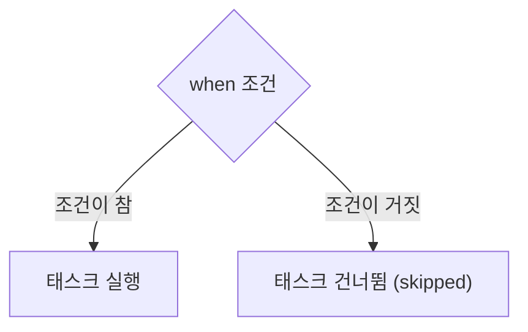
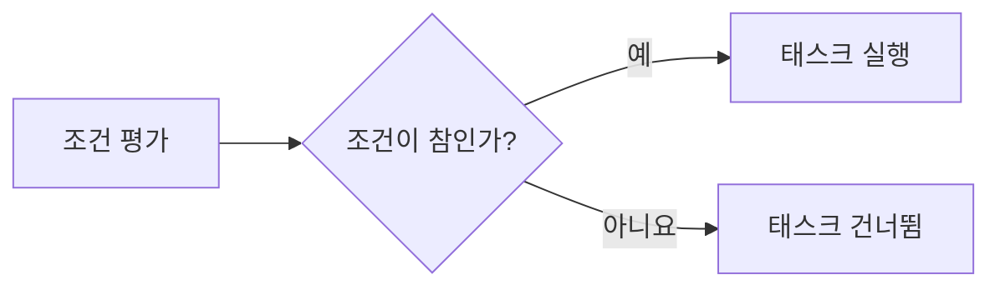
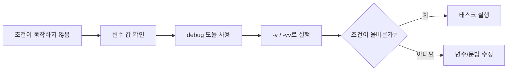
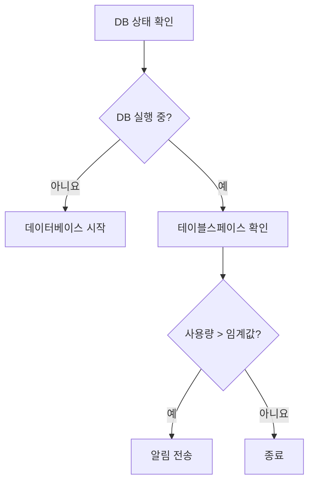

# Ansible 조건문: 필요할 때만 실행하는 오라클 DBA 자동화

> **조판 규격**: 본문·제목·표·캡션·영문 용어는 `Noto Sans KR`(제목 Bold), 코드 블록은 `DejaVu Sans Mono`를 적용합니다.

## 개요

리스너(Listener)가 이미 실행 중인데 다시 시작하거나, 오라클이 설치되지 않은 서버에서 오라클 전용 작업을 실행하면 불필요한 변경이나 오류가 생깁니다. 조건문(Condition)은 지정한 조건이 참일 때만 태스크(Task)를 실행하게 해, 자동화를 똑똑하고, 통제되며, 환경을 인식하는 방식으로 바꿔 줍니다.



이 장에서는 다음 내용을 학습합니다.

- 앤서블 조건문의 기본 개념과 필요성
- `when` 조건 문법
- 변수, 팩트(Facts), 문자열·숫자 비교를 이용한 조건
- 여러 조건 조합(`and`, `or`, `not`)
- 반복문, 등록 결과(Registered Results)와 함께 쓰는 조건
- 오라클 DBA 자동화를 위한 조건 활용
- 조건 검증, 문제 해결, 모범 사례
- 마스터 프로젝트: 조건에 따라 동작하는 오라클 서버 운영 자동화

**오라클 DBA 활용 사례**: 데이터베이스가 실행 중일 때만 태스크 실행, 리스너가 실행 중이 아니면 시작, 조건에 따른 ASM 작업, 특정 버전(예: 19c)에만 패치 실행, 테이블스페이스 사용량이 높으면 알림 전송, 역할(Primary/Standby)에 따른 데이터 가드 작업, 환경(dev/test/prod)별 SQL 스크립트 실행, 사용자·디렉터리·서비스의 조건부 관리

**핵심 이점**: 필요할 때만 태스크를 실행하고, 불필요한 작업을 줄이며, 자동화를 지능적으로 만들고, 같은 플레이북(Playbook)을 여러 서버에 적용할 수 있으며, 환경을 인식하는 오라클 자동화로 신뢰성과 확장성을 높이고 시간과 수작업을 절약합니다.

---

## 1. 앤서블 조건문 기초

### 1.1 조건문이란

앤서블 조건문은 특정 조건이 참일 때만 태스크를 실행하게 합니다. 플레이북을 지능적이고, 유연하고, 환경을 인식하도록 만들며, 주로 `when` 키워드와 함께 사용합니다. 조건이 참이면 태스크가 실행되고, 거짓이면 건너뜁니다.


### 1.2 문법 개요 (`condition_example.yml`)

```yaml
- name: Example of Ansible condition
  hosts: all
  gather_facts: yes

  tasks:
    - name: Run task only on Oracle servers
      ansible.builtin.debug:
        msg: "This is an Oracle server"
      when: oracle_installed | default(false)
```

**핵심 포인트**

1. `when` 키워드로 조건을 정의합니다.
2. 조건이 참이면 태스크가 실행됩니다.
3. 조건이 거짓이면 태스크를 건너뜁니다.
4. 조건에는 변수, 팩트, 등록 결과 등을 사용할 수 있습니다.

### 1.3 현실 세계의 비유

조건문은 행동하기 전에 확인하는 절차와 같습니다. 문이 열려 있으면 방에 들어가고, 닫혀 있으면 들어가지 않습니다. 앤서블도 조건을 확인하고, 조건이 참일 때만 태스크를 실행합니다.

### 1.4 조건문을 쓰는 곳

- 운영체제에 따라 태스크 실행(예: 오라클 리눅스에서만)
- 오라클이 설치된 경우에만 실행
- dev, test, prod 환경별로 다른 태스크 실행
- 필요하지 않은 태스크 건너뛰기(예: 서비스가 이미 실행 중)
- 오류를 처리하고 이전 결과에 따라 태스크 실행

### 1.5 오라클 DBA에게 주는 이점

- 환경별(dev/test/prod) 태스크 실행
- 불필요한 태스크 실행 방지
- 플레이북을 더 지능적이고 재사용 가능하게 만듦
- 서로 다른 서버 구성(RAC / 단일 인스턴스) 처리
- 자동화 신뢰성과 오류 처리 개선
- 수작업을 줄이고 플레이북을 확장 가능하게 만듦

---

## 2. 자동화에서 조건문이 중요한 이유

조건문은 플레이북을 똑똑하고 환경을 인식하게 만듭니다. 필요할 때만 올바른 태스크를 실행하고, 불필요한 실행을 피하며, 하나의 플레이북에서 여러 환경(dev/test/prod)을 처리하게 도와줍니다.

### 2.1 조건문이 없을 때(문제)

조건이 없으면 같은 태스크가 필요하지 않을 때도 모든 서버에서 매번 실행됩니다.

- 모든 서버에서 태스크가 불필요하게 실행됩니다.
- 오류나 원치 않는 변경이 생길 수 있습니다.
- 실제 환경에서 효율적이지 않습니다.

### 2.2 조건문이 있을 때(해결)

조건이 있으면 지정한 조건이 참일 때만 태스크가 실행됩니다. 예를 들어 DEV와 PROD 서버에서는 조건이 참이라 실행되고, TEST 서버에서는 조건이 거짓이라 건너뜁니다.

- 필요할 때만 태스크를 실행합니다.
- 더 많은 통제와 유연성을 제공합니다.
- 다중 환경 자동화를 지원합니다.
- 수작업을 줄이고 안전성을 높입니다.

### 2.3 오라클 DBA 실무 시나리오

1. 오라클이 설치되어 있지 않을 때만 설치 태스크 실행
2. 서비스가 실행 중이 아닐 때만 오라클 서비스 시작/중지
3. 디렉터리가 없을 때만 생성
4. dev/test/prod 환경에 따라 서로 다른 태스크 실행
5. OS별 태스크 실행(오라클 리눅스에서만)
6. RAC와 단일 인스턴스에 서로 다른 구성 관리

### 2.4 활용 예시 (`use_cases.yml`)

```yaml
- name: Start listener only if not running
  ansible.builtin.shell: lsnrctl status
  register: listener_status
  ignore_errors: yes

- name: Start listener
  ansible.builtin.shell: lsnrctl start
  when: listener_status.rc != 0
```

실시간 조건에 따라 태스크를 실행합니다.

### 2.5 핵심 정리

- 조건문은 자동화를 더 똑똑하게 만듭니다.
- 필요할 때만 태스크를 실행하게 합니다.
- 환경별 작업을 지원하고, 오류와 불필요한 변경을 방지합니다.
- 실제 오라클 DBA 자동화에 필수입니다.

---

## 3. when 조건 문법

`when` 키워드는 앤서블에서 조건을 정의하는 데 쓰입니다. 지정한 조건이 **참**으로 평가될 때만 태스크가 실행되고, 거짓이면 태스크를 건너뜁니다.

### 3.1 기본 문법 (`basic_syntax.yml`)

```yaml
- name: Install package if condition is true
  ansible.builtin.yum:
    name: vim
    state: present
  when: ansible_os_family == "OracleLinux"
```

> ⚠️ **주의(Caution)**: 슬라이드 예시는 `ansible_os_family == "OracleLinux"`로 조건을 씁니다. 그러나 5장의 팩트 표에서 보듯 오라클 리눅스의 `ansible_os_family` 값은 `RedHat`이고, `OracleLinux`는 `ansible_distribution`의 값입니다. 오라클 리눅스만 대상으로 하려면 `ansible_distribution == "OracleLinux"`를 사용하십시오. 이 장의 같은 형태 예시도 같은 방식으로 확인해야 합니다.

### 3.2 문법 설명

`when: <condition>`

- 태스크 수준에서 `when`을 사용합니다.
- 조건은 참 또는 거짓으로 평가되어야 합니다.
- 변수, 팩트, 등록 결과 등을 사용할 수 있습니다.
- 조건이 참이면 태스크가 실행되고, 거짓이면 건너뜁니다.

### 3.3 예시: 변수 값 확인 (`variable_example.yml`)

```yaml
- name: Install Oracle client if required
  ansible.builtin.yum:
    name: oracle-instantclient
    state: present
  when: install_client == true
```

`install_client`가 `true`일 때만 실행됩니다.

> ⚠️ **주의(Caution)**: 슬라이드의 이 예시에서는 조건의 변수 이름이 `instale_client`로 적혀 있어 철자가 `install_client`와 다릅니다. 위 코드는 올바른 이름(`install_client`)으로 바로잡았습니다.

### 3.4 예시: 팩트 값 확인 (`fact_example.yml`)

```yaml
- name: Run task only on 64-bit systems
  ansible.builtin.debug:
    msg: "This is a 64-bit system"
  when: ansible_architecture == "x86_64"
```

### 3.5 예시: OS 계열 확인 (`os_example.yml`)

```yaml
- name: Run Oracle specific task on Oracle Linux
  ansible.builtin.debug:
    msg: "Running on Oracle Linux"
  when: ansible_os_family == "OracleLinux"
```

> ⚠️ **주의(Caution)**: 3.1절의 주의 사항과 같이, 오라클 리눅스를 구분하려면 `ansible_distribution`을 사용하는 것이 정확합니다.

### 3.6 예시: 서비스 상태 확인 (`service_example.yml`)

```yaml
- name: Start listener if not running
  ansible.builtin.shell: lsnrctl start
  when: listener_status.rc != 0
```

### 3.7 시각적 흐름



### 3.8 핵심 정리

- `when` 키워드를 태스크 수준에서 사용합니다.
- 조건은 참 또는 거짓이어야 합니다.
- 변수, 팩트, 등록 결과를 사용할 수 있습니다.
- 조건이 참일 때만 태스크가 실행되며, 거짓이면 건너뜁니다.
- 실제 오라클 DBA 자동화에서 널리 사용됩니다.

---

## 4. 변수와 조건문

조건에 변수를 사용하면 플레이북이 유연하고, 재사용 가능하며, 환경을 인식하게 됩니다. 변수 조건이 참일 때만 태스크가 실행되므로 환경(dev/test/prod), 서버 유형, 오라클 전용 작업을 관리하는 데 유용합니다.

### 4.1 기본 예시: 변수 조건 (`variable_condition.yml`)

```yaml
- name: Install Oracle client if required
  ansible.builtin.yum:
    name: oracle-instantclient
    state: present
  when: install_client == true
```

### 4.2 변수 정의 (`vars_example.yml`)

```yaml
vars:
  install_client: true
  environment: "prod"
  db_version: "19c"
  os_family: "OracleLinux"
```

변수는 플레이북, `vars_files`, 인벤토리, 실행 시점(`--extra-vars`)에서 정의할 수 있습니다.

### 4.3 여러 변수 조건 (`multiple_vars.yml`)

```yaml
- name: Start listener on prod only
  ansible.builtin.shell: lsnrctl start
  when:
    - environment == "prod"
    - listener_required == true
```

리스트로 나열한 조건은 모두 참이어야 태스크가 실행됩니다.

### 4.4 조건에서 변수 사용

| 조건 유형 | 예시 | 설명 |
|---|---|---|
| 불리언 변수 | `when: install_client == true` | 변수가 참이면 실행 |
| 문자열 변수 | `when: environment == "prod"` | 특정 문자열 값일 때 실행 |
| 숫자 변수 | `when: db_port == 1521` | 특정 숫자일 때 실행 |
| 리스트 변수 | `when: inventory_hostname in oracle_servers` | 호스트가 리스트 변수에 있으면 실행 |

### 4.5 실무 예시: 오라클 DB 설정 (`oracle_setup.yml`)

```yaml
- name: Create Oracle directories for 19c
  ansible.builtin.file:
    path: /u01/app/oracle
    state: directory
    owner: oracle
    group: oinstall
    mode: '775'
  when:
    - oracle_home_required == true
    - db_version == "19c"
    - environment != "dev"
```

다음 세 조건이 모두 참일 때만 실행됩니다.

- `oracle_home_required`가 `true`
- `db_version`이 `19c`
- 환경이 `dev`가 아님

### 4.6 변수의 출처

- 플레이북 변수(`vars`)
- 변수 파일(`vars_files`)
- 인벤토리 변수
- 추가 변수(`--extra-vars`)
- 그룹/호스트 변수

### 4.7 핵심 정리

- 변수로 조건을 동적으로 만듭니다.
- 변수는 여러 방법으로 정의할 수 있습니다.
- 문자열, 숫자, 불리언, 리스트 변수를 지원합니다.
- 여러 변수 조건을 조합할 수 있습니다.
- 환경별 자동화에 유용하며 실제 오라클 DBA 시나리오에서 널리 쓰입니다.

---

## 5. 팩트와 조건문

팩트(Facts)는 대상 서버의 시스템 정보(OS, CPU, 메모리, 호스트명 등)를 앤서블이 자동으로 수집한 값입니다. 팩트를 조건에 쓰면 특정 시스템 요구 사항이 충족될 때만 태스크를 실행할 수 있습니다.

### 5.1 팩트란

팩트는 대상 시스템에 대한 정보를 담은 변수이며, 플레이북이 실행될 때 `setup` 모듈로 자동 수집됩니다. OS 정보, CPU 정보, 메모리 정보, 네트워크 정보 등이 포함됩니다.

### 5.2 사용 가능한 팩트 확인 (`view_facts.yml`)

```yaml
- name: View all gathered facts
  hosts: all
  gather_facts: yes
  tasks:
    - name: Print all facts
      ansible.builtin.debug:
        var: ansible_facts
```

### 5.3 자주 쓰는 팩트

| 팩트 이름 | 설명 | 예시 값 |
|---|---|---|
| `ansible_os_family` | 운영체제 계열 | RedHat |
| `ansible_distribution` | 배포판 이름 | OracleLinux |
| `ansible_distribution_version` | OS 버전 | 8.10 |
| `ansible_hostname` | 서버 호스트명 | dbserver1 |
| `ansible_architecture` | 시스템 아키텍처 | x86_64 |
| `ansible_memtotal_mb` | 전체 메모리(MB) | 8192 |
| `ansible_processor_vcpus` | CPU 코어 수 | 4 |
| `ansible_date_time` | 시스템 날짜와 시간 | 2026-01-01 ... |

### 5.4 예시: OS 팩트 조건 (`os_condition.yml`)

```yaml
- name: Install package only on Oracle Linux
  hosts: all
  gather_facts: yes
  tasks:
    - name: Install Oracle client
      ansible.builtin.yum:
        name: oracle-instantclient
        state: present
      when: ansible_os_family == "OracleLinux"
```

> ⚠️ **주의(Caution)**: 위 표에서 오라클 리눅스의 `ansible_os_family` 값은 `RedHat`입니다. 슬라이드의 이 예시는 `"OracleLinux"`와 비교하므로, 오라클 리눅스만 대상으로 하려면 `ansible_distribution == "OracleLinux"`를 사용하십시오.

### 5.5 예시: 메모리 팩트 조건 (`memory_condition.yml`)

```yaml
- name: Run task only if memory is greater than 4GB
  hosts: all
  gather_facts: yes
  tasks:
    - name: Create large directory
      ansible.builtin.file:
        path: /u01/large_dir
        state: directory
      when: ansible_memtotal_mb > 4096
```

### 5.6 오라클 DBA 활용 사례

- 오라클 리눅스에서만 오라클 설치 태스크 실행
- RAC 노드에서만 RAC 관련 태스크 실행
- 서버 호스트명이나 역할에 따라 태스크 실행
- 무거운 작업 전에 CPU/메모리 확인
- dev/test/prod 환경별로 다른 태스크 실행
- 시스템 아키텍처(x86_64)에 따라 태스크 건너뛰기 또는 실행

### 5.7 핵심 정리

- 팩트는 시스템 정보를 자동으로 제공합니다.
- `when` 조건에서 팩트를 쓰면 태스크를 선택적으로 실행할 수 있습니다.
- 흔한 팩트에는 OS, 호스트명, 메모리, CPU 등이 있습니다.
- 플레이북을 환경 인식형으로 만들며 실제 오라클 DBA 자동화에 매우 유용합니다.

---

## 6. 문자열과 숫자 조건

앤서블은 조건에서 문자열 값과 숫자 값을 비교하는 여러 연산자를 지원합니다. `when` 키워드와 함께 사용해 주어진 조건이 참일 때만 태스크를 실행합니다.

### 6.1 문자열 비교 연산자

| 연산자 | 설명 |
|---|---|
| `==` | 같음 |
| `!=` | 같지 않음 |
| `in` | 부분 문자열이 있는지 확인 |
| `not in` | 부분 문자열이 없는지 확인 |
| `startswith()` | 문자열이 주어진 값으로 시작하는지 확인 |
| `endswith()` | 문자열이 주어진 값으로 끝나는지 확인 |
| `lower()` | 비교를 위해 소문자로 변환 |
| `upper()` | 비교를 위해 대문자로 변환 |

### 6.2 문자열 조건 예시 (`string_example.yml`)

```yaml
- name: Run task if environment is prod
  ansible.builtin.debug:
    msg: "Running on production server"
  when: environment == "prod"

- name: Run task if hostname contains db
  ansible.builtin.debug:
    msg: "Database server found"
  when: "'db' in ansible_hostname"

- name: Run task if OS starts with Oracle
  ansible.builtin.debug:
    msg: "It is Oracle Linux"
  when: ansible_distribution.startswith("Oracle")
```

### 6.3 숫자 비교 연산자

| 연산자 | 설명 |
|---|---|
| `==` | 같음 |
| `!=` | 같지 않음 |
| `>` | 보다 큼 |
| `<` | 보다 작음 |
| `>=` | 크거나 같음 |
| `<=` | 작거나 같음 |

### 6.4 숫자 조건 예시 (`numeric_example.yml`)

```yaml
- name: Run task if memory is greater than 8GB
  ansible.builtin.debug:
    msg: "High memory server"
  when: ansible_memtotal_mb > 8192

- name: Run task if CPU cores are 4 or more
  ansible.builtin.debug:
    msg: "Multi-core server"
  when: ansible_processor_vcpus >= 4

- name: Run task if port number is 1521
  ansible.builtin.debug:
    msg: "Oracle port is configured"
  when: db_port == 1521
```

### 6.5 문자열과 숫자 조합 (`combined_example.yml`)

```yaml
- name: Run task for prod servers with high memory
  ansible.builtin.debug:
    msg: "Production server with high memory"
  when:
    - environment == "prod"
    - ansible_memtotal_mb > 8192
    - "'db' in ansible_hostname"
```

### 6.6 오라클 DBA 활용 사례

- 오라클 버전이 19c일 때만 태스크 실행
- 메모리가 8GB를 넘을 때만 메모리 관련 태스크 실행
- 특정 환경에서만 패치 태스크 실행
- 오라클 홈 경로에 `/u01`이 포함되어 있는지 확인
- 포트가 1521일 때만 리스너 태스크 실행

> 💡 **노트(Note)**: 숫자 비교에서는 값의 데이터 형식이 중요합니다. 변수가 문자열 `"1521"`로 전달되면 숫자 `1521`과 같지 않다고 평가될 수 있으므로, 11장의 데이터 형식 관련 안내를 함께 참고하십시오.

### 6.7 핵심 정리

- 텍스트 비교에는 문자열 연산자를, 숫자 비교에는 숫자 연산자를 사용합니다.
- 필요하면 문자열과 숫자 조건을 조합합니다.
- 환경, 버전, 리소스, 포트 점검에 유용합니다.
- `when` 키워드와 함께 태스크 수준에서 사용하며 오라클 DBA 자동화에서 널리 쓰입니다.

---

## 7. 여러 조건: and, or, not

논리 연산자 `and`, `or`, `not`으로 여러 조건을 조합할 수 있습니다. 필요한 모든 조건이 충족될 때만 태스크를 실행하는 강력하고 유연한 플레이북을 만들 수 있습니다.

### 7.1 논리 연산자 개요

| 연산자 | 의미 | 예시 | 결과 |
|---|---|---|---|
| `and` | 두 조건이 모두 참이어야 함 | A and B | A와 B가 모두 참이면 참 |
| `or` | 하나 이상이 참이어야 함 | A or B | A 또는 B가 참이면 참 |
| `not` | 조건을 반전함 | not A | A가 거짓이면 참 |

### 7.2 and 조건 (`and_condition.yml`)

```yaml
- name: Run task only if DB is running
  ansible.builtin.debug:
    msg: "Database is running in prod"
  when:
    - db_status == "up"
    - environment == "prod"
```

### 7.3 or 조건 (`or_condition.yml`)

```yaml
- name: Run task for dev or test environment
  ansible.builtin.debug:
    msg: "Running in non-prod environment"
  when: environment == "dev" or
        environment == "test"
```

### 7.4 not 조건 (`not_condition.yml`)

```yaml
- name: Stop service if not running
  ansible.builtin.service:
    name: oracle
    state: stopped
  when: not service_status == "running"
```

서비스가 실행 중이 아닐 때만 태스크가 실행됩니다.

### 7.5 and, or, not 조합 (`combined_condition.yml`)

```yaml
- name: Run task with complex condition
  ansible.builtin.debug:
    msg: "Running patching task"
  when:
    - (ansible_os_family == "OracleLinux" or
       ansible_os_family == "RedHat")
    - ansible_distribution_major_version|int >= 8
    - not is_rac
```

### 7.6 괄호로 복잡한 조건 제어 (`parentheses`)

괄호를 사용하면 복잡한 조건의 평가 순서를 제어할 수 있습니다.

```yaml
- name: Run task with parentheses
  ansible.builtin.debug:
    msg: "Valid environment and version"
  when: >
    (environment == "prod" or
     environment == "uat") and
    (db_version == "19c" or db_version == "21c")
```

### 7.7 실무 예시: 오라클 패치

```yaml
- name: Run OPatch if 19c or 21c and not RAC standby
  ansible.builtin.shell: ./run_opatch.sh
  when:
    - "{{ db_version in ['19c','21c'] }}"
    - role != 'standby'
    - is_rac == false
```

19c/21c의 프라이머리 또는 단일 인스턴스 데이터베이스에만 패치 태스크를 실행합니다.

> ⚠️ **주의(Caution)**: `when` 안에서는 `{{ }}`로 감싸지 않고 `db_version in ['19c','21c']`처럼 표현식을 직접 쓰는 것이 일반적입니다. 슬라이드 예시는 `{{ }}`를 사용하고 있으니, 사용하는 앤서블 버전에서 경고가 나오는지 확인하십시오.

### 7.8 핵심 정리

- 모든 조건이 참이어야 하면 `and`, 하나 이상이면 `or`를 사용합니다.
- 조건을 반전하려면 `not`을 사용합니다.
- 복잡한 조건에는 괄호로 순서를 제어합니다.
- 실제 시나리오에서 여러 조건을 조합합니다.
- 패치, 서비스 제어, 환경별 태스크 등 오라클 DBA 자동화에서 널리 쓰입니다.

---

## 8. 반복문과 조건문

반복문 안에서 조건을 쓰면 **특정 항목에 대해서만** 태스크를 실행할 수 있습니다. 서버, 데이터베이스, 파일, 서비스 등 조건에 맞는 대상에만 작업하고 싶을 때 매우 유용합니다.

### 8.1 기본 예시 (`basic_loop_condition.yml`)

```yaml
- name: Install packages only for required items
  ansible.builtin.yum:
    name: "{{ item }}"
    state: present
  loop:
    - oracle-instantclient
    - vim
    - net-tools
  when: item != "net-tools"
```

`net-tools`를 제외한 모든 패키지를 설치합니다.

### 8.2 여러 조건이 있는 반복문 (`multi_condition_loop.yml`)

```yaml
- name: Execute task for specific servers
  ansible.builtin.shell: echo "Running on {{ item }}"
  loop:
    - db01
    - db02
    - db03
  when:
    - item != "db03"
    - item is defined
```

모든 조건을 만족하는 항목에만 실행됩니다.

### 8.3 딕셔너리 항목 속성 (`dict_loop_condition.yml`)

```yaml
- name: Create directories only on prod servers
  ansible.builtin.file:
    path: "{{ item.path }}"
    state: directory
    mode: '0755'
  loop:
    - { path: "/u01/app", env: "prod" }
    - { path: "/u02/backup", env: "dev" }
    - { path: "/u03/data", env: "prod" }
  when: item.env == "prod"
```

`env`가 `prod`인 항목에만 디렉터리를 만듭니다.

### 8.4 등록 결과를 이용한 반복문 조건 (`register_loop_condition.yml`)

```yaml
- name: Check if directories exist
  ansible.builtin.stat:
    path: "{{ item }}"
  loop:
    - /u01/app
    - /u02/backup
  register: dir_status

- name: Create missing directories
  ansible.builtin.file:
    path: "{{ item.item }}"
    state: directory
  loop: "{{ dir_status.results }}"
  when: not item.stat.exists
```

먼저 디렉터리 상태를 항목별로 확인하고, 존재하지 않을 때만 만듭니다.

### 8.5 실무 예시: 오라클 DB 운영 (`oracle_loop_condition.yml`)

```yaml
- name: Start listener only on required nodes
  ansible.builtin.shell: lsnrctl start
  loop:
    - { host: "db01", role: "primary" }
    - { host: "db02", role: "standby" }
    - { host: "db03", role: "dev" }
  when: item.role in ["primary", "dev"]
```

프라이머리와 개발 노드에서만 리스너 시작을 실행합니다.

### 8.6 시각적 흐름


### 8.7 핵심 정리

- 반복문 안에서 `when`을 사용해 선택적으로 실행합니다.
- 서버, 데이터베이스, 파일, 패키지 등의 항목을 걸러낼 때 유용합니다.
- 단순 리스트, 딕셔너리, 등록 결과와 함께 동작합니다.
- `and`, `or`, `not`으로 여러 조건을 조합할 수 있습니다.
- RAC, 데이터 가드, 패치 등 오라클 DBA 자동화에서 널리 쓰입니다.

> 💡 **노트(Note)**: 8.5절의 예시는 `host` 값을 쓰지 않고 `lsnrctl start`를 실행하는 형태입니다. 호스트별로 다른 대상에 실행하려면 플레이의 `hosts` 설정이나 `--limit`을 함께 사용하십시오.

---

## 9. 등록 결과와 조건문

태스크의 출력을 `register`로 저장하고 `when` 조건에서 사용할 수 있습니다. 명령 출력, 반환 코드(Return Code), 출력 내 특정 텍스트를 기준으로 판단할 때 매우 유용합니다.

### 9.1 태스크 출력 등록 (`register_basic.yml`)

```yaml
- name: Check if Oracle is running
  ansible.builtin.shell: ps -ef | grep pmon
  register: pmon_check

- name: Show command output
  ansible.builtin.debug:
    var: pmon_check
```

### 9.2 반환 코드 기반 조건 (`return_code_condition.yml`)

```yaml
- name: Check if listener is running
  ansible.builtin.shell: lsnrctl status
  register: listener_check
  ignore_errors: yes

- name: Start listener if not running
  ansible.builtin.shell: lsnrctl start
  when: listener_check.rc != 0
```

반환 코드 `rc`가 0이면 성공이고 0이 아니면 실패입니다. 리스너가 실행 중이 아닐 때만 시작합니다.

### 9.3 출력 텍스트 기반 조건 (`output_text_condition.yml`)

```yaml
- name: Check if tablespace exists
  ansible.builtin.shell: |
    sqlplus -s / as sysdba <<EOF
    select tablespace_name from dba_tablespaces
    where tablespace_name = 'USERS';
    EOF
  register: tbs_check

- name: Create tablespace if not exists
  ansible.builtin.shell: ./create_tbs.sql
  when: "'USERS' not in tbs_check.stdout"
```

출력에 특정 텍스트가 없을 때만 태스크를 실행합니다.

### 9.4 실패 상태 기반 조건 (`failed_condition.yml`)

```yaml
- name: Check disk space
  ansible.builtin.shell: df -h /u01
  register: disk_check
  failed_when: false

- name: Alert if disk usage is high
  ansible.builtin.debug:
    msg: "Disk usage is high"
  when: disk_check.stderr != ""
        or disk_check.rc != 0
```

이전 태스크가 실패했거나 오류 메시지를 반환했을 때만 실행합니다.

### 9.5 여러 등록 결과 조합 (`multiple_register_condition.yml`)

```yaml
- name: Check memory usage
  ansible.builtin.shell: free -m
  register: memory_check

- name: Check CPU usage
  ansible.builtin.shell: top -bn1 | grep "Cpu(s)"
  register: cpu_check

- name: Alert if memory > 80% or CPU > 80%
  ansible.builtin.debug:
    msg: "High resource usage detected"
  when: memory_check.stdout is search("<memory_pattern>") or
        cpu_check.stdout is search("<cpu_pattern>")
```

> ⚠️ **주의(Caution)**: 슬라이드의 정규식은 일부가 판독되지 않아 `<memory_pattern>`, `<cpu_pattern>`으로 대신 적었습니다. 또한 슬라이드의 CPU 조건에는 `cpu_check_stdout`이라는 철자 오류가 있어 `cpu_check.stdout`으로 바로잡았습니다. `free -m`과 `top` 출력에서 사용률을 정규식으로 판정하는 방식은 정확하지 않을 수 있으므로, 설명용 구조로만 보고 실제 환경에서는 값을 수치로 추출해 비교하는 방식을 검토하십시오.

### 9.6 실무 예시: 오라클 홈 확인 (`oracle_home_condition.yml`)

```yaml
- name: Check if Oracle home exists
  ansible.builtin.stat:
    path: /u01/app/oracle/product/19c
  register: oracle_home_check

- name: Install patch only if home exists
  ansible.builtin.shell: ./apply_patch.sh
  when: oracle_home_check.stat.exists
```

### 9.7 시각적 흐름


### 9.8 핵심 정리

- `register`로 태스크의 출력을 저장합니다.
- 반환 코드(`rc`)로 성공 또는 실패를 확인합니다.
- `stdout`/`stderr`의 특정 텍스트를 검증합니다.
- 여러 등록 결과를 조합할 수 있습니다.
- 실제 오라클 DBA 자동화에 유용하며 플레이북을 지능적이고 의사 결정 기반으로 만듭니다.

---

## 10. 오라클 DBA 자동화를 위한 조건문

조건문은 데이터베이스 상태, ASM, 리스너, 데이터 가드 역할, 패치 수준, 기타 환경 점검 결과에 따라 필요할 때만 태스크를 실행하는 오라클 DBA 자동화에 매우 유용합니다.

> ⚠️ **주의(Caution)**: 이 장의 슬라이드 예시 중 여럿(리스너, ASM, 오라클 버전, 테이블스페이스 사용량, 패치 파일 존재)은 `when`에서 쓰는 변수를 **같은 태스크의 `register`** 로 등록하고 있습니다. 태스크는 `when`을 평가한 뒤에 실행되므로, 이 순서로는 조건에서 쓰는 변수가 아직 없어 오류가 날 수 있습니다. 실제로는 9장처럼 **먼저 확인 태스크를 실행해 결과를 등록하고, 그다음 태스크에서 그 결과를 조건에 쓰도록** 두 단계로 나누십시오. 아래 예시는 슬라이드 원문을 따르되, 10.2절에서 올바른 두 단계 예시를 함께 보입니다.

### 10.1 데이터베이스 상태에 따른 실행 (`db_status_condition.yml`)

```yaml
- name: Start database if it is not running
  hosts: dbservers
  tasks:
    - name: Start Oracle database
      ansible.builtin.shell: srvctl start database -d {{ db_name }}
      when: db_status.stdout != "OPEN"
```

데이터베이스가 OPEN이 아닐 때만 시작합니다. `db_status`는 이전 태스크에서 등록한 결과여야 합니다.

### 10.2 리스너 상태에 따른 실행 (`listener_condition.yml`)

```yaml
- name: Start listener if not running
  hosts: dbservers
  tasks:
    - name: Start listener
      ansible.builtin.shell: lsnrctl start
      when: listener_status.rc != 0
      register: listener_status
```

슬라이드 원문의 형태입니다. 같은 태스크에서 등록한 `listener_status`를 조건에 쓰므로, 아래처럼 두 단계로 바꾸는 것이 안전합니다.

```yaml
- name: Start listener if not running
  hosts: dbservers
  tasks:
    - name: Check listener status
      ansible.builtin.shell: lsnrctl status
      register: listener_status
      ignore_errors: yes

    - name: Start listener
      ansible.builtin.shell: lsnrctl start
      when: listener_status.rc != 0
```

### 10.3 ASM 상태에 따른 실행 (`asm_condition.yml`)

```yaml
- name: Check ASM instance status
  hosts: asmservers
  tasks:
    - name: Start ASM instance
      ansible.builtin.shell: srvctl start asm
      when: asm_status.stdout != "ASM is running"
      register: asm_status
```

ASM 인스턴스가 실행 중이 아닐 때만 시작합니다.

### 10.4 데이터 가드 역할에 따른 실행 (`dataguard_condition.yml`)

```yaml
- name: Run task only on primary
  hosts: dbservers
  tasks:
    - name: Perform backup on primary
      ansible.builtin.shell:
        /usr/local/bin/rman_backup.sh
      when: dg_role.stdout == "PRIMARY"
```

프라이머리 데이터베이스에서만 백업을 실행합니다.

### 10.5 오라클 버전에 따른 실행 (`version_condition.yml`)

```yaml
- name: Run patch task only for 19c
  hosts: dbservers
  tasks:
    - name: Apply 19c patch
      ansible.builtin.shell: /u01/patch/apply.sh
      when: oracle_version.stdout is search("19c")
      register: oracle_version
```

### 10.6 테이블스페이스 사용량에 따른 실행 (`tablespace_condition.yml`)

```yaml
- name: Check tablespace usage
  hosts: dbservers
  tasks:
    - name: Send alert if usage > 90%
      ansible.builtin.shell: /u01/scripts/check_ts.sh
      when: ts_usage.stdout | int > 90
      register: ts_usage
```

사용량이 90%를 넘을 때만 알림을 보냅니다.

### 10.7 파일/디렉터리 존재 여부에 따른 실행 (`file_condition.yml`)

```yaml
- name: Run task if patch file exists
  hosts: dbservers
  vars:
    patch_path: /u01/patch/p12345678
  tasks:
    - name: Apply patch
      ansible.builtin.shell: opatch apply
      when: patch_file.stat.exists
      register: patch_file
```

패치 파일이 있을 때만 패치를 적용합니다. 파일 존재 여부는 `stat` 모듈로 먼저 확인해 `patch_file`에 등록해야 합니다(9.6절 참고).

### 10.8 핵심 정리

- 필요할 때만 태스크를 실행하도록 조건을 사용합니다.
- 데이터베이스, 리스너, ASM, 데이터 가드, 패치, 테이블스페이스 모니터링에 유용합니다.
- 등록 결과, 변수, 팩트와 조합할 수 있습니다.
- 불필요한 태스크 실행을 피해 시간과 위험을 줄입니다.
- 단일 인스턴스와 RAC 환경 모두에서 동작하며 실제 오라클 DBA 자동화에서 널리 쓰입니다.

---

## 11. 조건 검증, 문제 해결, 모범 사례

조건을 쓰는 것만으로는 충분하지 않고, 검증하고, 문제를 해결하고, 모범 사례를 따라야 합니다. 조건을 테스트하고 디버깅하며 안정적인 운영 수준 플레이북을 작성하는 실용적인 방법을 다룹니다.

### 11.1 `debug`로 조건 검증 (`debug_condition.yml`)

```yaml
- name: Check variable value
  ansible.builtin.debug:
    msg: "Oracle SID is {{ oracle_sid }}"
  when: oracle_sid is defined

- name: Check condition result
  ansible.builtin.debug:
    msg: "Condition is true"
  when: oracle_sid == "PROD"
```

`debug` 모듈로 변수 값과 조건 결과를 출력할 수 있습니다.

### 11.2 상세 모드로 문제 해결

```bash
# 상세 출력으로 플레이북 실행
ansible-playbook site.yml -v

# 더 자세한 내용
ansible-playbook site.yml -vv

# 전체 디버그 정보
ansible-playbook site.yml -vvv

# 문법만 검사
ansible-playbook site.yml --syntax-check
```

`-v`, `-vv`, `-vvv`로 자세한 실행 로그를 보면 조건이 왜 그렇게 동작하는지 이해할 수 있습니다.

### 11.3 변수 값 확인 (`check_variables.yml`)

```yaml
- name: Display all variables
  ansible.builtin.debug:
    var: hostvars[inventory_hostname]

- name: Check specific variable
  ansible.builtin.debug:
    msg: "DB Role: {{ db_role }}"
  when: db_role is defined
```

`debug`나 `hostvars`로 변수를 항상 확인해 올바른 값인지 점검하십시오.

### 11.4 자주 발생하는 조건 오류

| 오류 | 해결 |
|---|---|
| 변수가 정의되지 않음 | `is defined` 점검 또는 기본값 설정 |
| 잘못된 변수 이름 | `debug` 모듈로 변수 이름 확인 |
| 잘못된 데이터 형식(문자열 vs 정수) | 문자열에는 따옴표, 적절한 비교 연산자 사용 |
| 조건이 항상 거짓 | 변수 값 확인 후 상세 모드 사용 |
| `when`의 문법 오류 | `--syntax-check`로 YAML 문법 검증 |

### 11.5 등록 결과로 조건 테스트 (`test_register.yml`)

```yaml
- name: Check listener status
  ansible.builtin.shell: lsnrctl status
  register: lsnr_output

- name: Debug output
  ansible.builtin.debug:
    var: lsnr_output.stdout

- name: Take action only if running
  ansible.builtin.debug:
    msg: "Listener is running"
  when: "'STATUS of the LISTENER' in lsnr_output.stdout"
```

등록한 출력은 항상 `debug`로 확인해, 실제로 무엇이 반환되는지 이해하십시오.

### 11.6 모범 사례

- 조건에 사용하기 전에 변수를 항상 검증합니다.
- 의미 있는 변수 이름과 일관된 명명 규칙을 사용합니다.
- 플레이북을 개발하는 동안 `debug` 태스크를 추가합니다.
- 비교에는 따옴표를 사용합니다.
- 실패를 피하려면 `is defined`와 `default` 필터를 사용합니다.
- 조건을 단순하고 읽기 쉽게 유지합니다.
- 운영 환경이 아닌 곳에서 먼저 플레이북을 테스트합니다.
- 문제 해결에는 상세 모드를 사용합니다.
- 적절한 오류 처리와 대체(Fallback) 로직을 추가합니다.

### 11.7 문제 해결 흐름



### 11.8 핵심 정리

- `debug`로 변수와 조건 결과를 검증합니다.
- 상세 모드로 자세히 문제를 해결합니다.
- 정의되지 않은 변수, 데이터 형식 문제 같은 흔한 오류를 확인합니다.
- 안정적이고 유지 보수하기 쉬운 플레이북을 위한 모범 사례를 따릅니다.
- 운영 환경이 아닌 곳에서 먼저 테스트합니다.

---

## 12. 마스터 프로젝트: 조건에 따라 동작하는 오라클 서버 운영 자동화

### 12.1 프로젝트 개요

이 마지막 프로젝트에서는 조건을 사용해 필요할 때만 오라클 서버 작업을 수행하는 완전한 앤서블 플레이북을 만듭니다. 데이터베이스 관리 태스크를 안전하고, 지능적이며, 효율적으로 자동화합니다.

### 12.2 프로젝트 구조

```text
oracle_conditional_project/
├── playbook.yml
├── inventory.ini
├── vars/
│   └── variables.yml
└── tasks/
    ├── check_db_status.yml
    ├── start_db.yml
    ├── stop_db.yml
    ├── check_tablespace.yml
    └── apply_patch.yml
```

모듈식 구조로 재사용하고 유지 보수하기 쉬운 플레이북을 만듭니다.

> ⚠️ **주의(Caution)**: 슬라이드의 구조도에는 `alert_tablespace.yml`이 없지만, 12.9절의 메인 플레이북은 이 파일을 불러옵니다. 실제 프로젝트에서는 `tasks/alert_tablespace.yml`도 함께 만드십시오. `stop_db.yml`은 구조도에만 있고 본문에 내용이 없으므로 필요한 경우 직접 작성해야 합니다.

### 12.3 인벤토리와 변수

**`inventory.ini`**

```ini
[dbservers]
db01 ansible_host=192.168.1.10
db02 ansible_host=192.168.1.11

[dbservers:vars]
ansible_user=oracle
ansible_python_interpreter=/usr/bin/python3
```

**`vars/variables.yml`**

```yaml
oracle_home: /u01/app/oracle/product/19c
db_name: ORCL
tablespace_threshold: 85
patch_file: /u01/patch/19c_patch.zip
apply_patch: true
perform_backup: true
```

### 12.4 데이터베이스 상태 확인 (`tasks/check_db_status.yml`)

```yaml
- name: Check database status
  ansible.builtin.shell: |
    . {{ oracle_home }}/bin/oraenv <<< {{ db_name }}
    sqlplus -s / as sysdba <<EOF
    set heading off feedback off
    select open_mode from v\$database;
    EOF
  register: db_status
  changed_when: false
```

현재 데이터베이스 상태를 가져와 등록 변수에 저장합니다.

> ⚠️ **주의(Caution)**: 슬라이드의 SQL은 `v$database`로 적혀 있습니다. 히어 도큐먼트에서는 앞선 장처럼 `v\$database`로 이스케이프해야 의도대로 동작합니다.

### 12.5 DB가 실행 중이 아니면 시작 (`tasks/start_db.yml`)

```yaml
- name: Start database if not running
  ansible.builtin.shell: |
    . {{ oracle_home }}/bin/oraenv <<< {{ db_name }}
    sqlplus -s / as sysdba <<EOF
    startup
    EOF
  when: db_status.stdout != "READ WRITE"
  register: start_db
  notify: Check DB status again
```

데이터베이스가 READ WRITE 상태가 아닐 때만 시작합니다.

> ⚠️ **주의(Caution)**: `notify: Check DB status again`은 같은 이름의 핸들러가 플레이에 정의되어 있어야 동작합니다. 슬라이드의 메인 플레이북에는 핸들러가 없으므로, 핸들러를 추가하거나 `notify`를 제거하십시오. 또한 `sqlplus` 출력에는 공백이나 줄바꿈이 포함될 수 있어 `!= "READ WRITE"` 같은 정확한 일치 비교가 어긋날 수 있습니다. `| trim` 필터 사용을 검토하십시오(제 판단입니다).

### 12.6 테이블스페이스 사용량 확인 (`tasks/check_tablespace.yml`)

```yaml
- name: Get tablespace usage
  ansible.builtin.shell: |
    . {{ oracle_home }}/bin/oraenv <<< {{ db_name }}
    sqlplus -s / as sysdba <<EOF
    set heading off feedback off
    select tablespace_name, round((1-(bytes_free/bytes_total))*100)
    from (select a.tablespace_name,
                 sum(a.bytes) bytes_total,
                 sum(a.bytes)-sum(nvl(b.bytes,0)) bytes_free
          from dba_data_files a left join dba_free_space b
            on a.file_id = b.file_id
          group by a.tablespace_name);
    EOF
  register: ts_usage
  changed_when: false
```

테이블스페이스 사용량을 확인하고 임계값을 넘는 항목이 있는지 식별합니다.

> ⚠️ **주의(Caution)**: 슬라이드의 SQL은 일부가 잘려 보여 읽을 수 있는 부분을 바탕으로 정리했습니다. 조인 조건과 사용량 계산식(`bytes_free` 등)이 실제 의도와 맞는지 SQL*Plus에서 먼저 검증한 뒤 사용하십시오.

### 12.7 사용량이 높으면 알림 전송 (`tasks/alert_tablespace.yml`)

```yaml
- name: Send alert for high tablespace usage
  ansible.builtin.shell: |
    echo "High tablespace usage detected:"
    echo "{{ ts_usage.stdout }}" | mail -s \
    "Oracle Alert - Tablespace Usage" dba-team@example.com
  when: ts_usage is defined and
        ("\n" in ts_usage.stdout) and
        (ts_usage.stdout | regex_search("[0-9]{2,3}"))
  changed_when: false
```

테이블스페이스 사용량이 정의된 임계값을 넘을 때만 알림 메일을 보내도록 설계한 태스크입니다.

> ⚠️ **주의(Caution)**: 슬라이드의 조건은 출력에 두세 자리 숫자가 있는지만 확인하며, `variables.yml`에 정의한 `tablespace_threshold`(85)와 비교하지 않습니다. 실제로는 사용량 숫자를 추출해 `tablespace_threshold`와 비교하도록 조건을 보강해야 임계값 기준으로 알림이 갑니다. 또한 `mail` 명령은 서버에 메일 설정이 되어 있어야 합니다.

### 12.8 필요하면 패치 적용 (`tasks/apply_patch.yml`)

```yaml
- name: Apply Oracle patch if requested
  ansible.builtin.unarchive:
    src: "{{ patch_file }}"
    dest: /u01/patch
    remote_src: yes
  when: apply_patch | bool
  register: patch_result
```

`apply_patch` 변수가 `true`일 때만 패치 파일을 처리합니다.

> ⚠️ **주의(Caution)**: 이 태스크는 패치 압축 파일을 지정한 위치에 풀기만 할 뿐, 실제 패치 도구(예: `opatch`) 실행은 포함하지 않습니다. 이름과 달리 "패치 적용"이 완료되는 것은 아니므로, 실제 패치 절차는 별도로 구성해야 합니다.

### 12.9 메인 플레이북 (`playbook.yml`)

```yaml
---
- name: Conditional Oracle Server Operations
  hosts: dbservers
  gather_facts: yes
  vars_files:
    - vars/variables.yml
  tasks:
    - import_tasks: tasks/check_db_status.yml
    - import_tasks: tasks/start_db.yml
    - import_tasks: tasks/check_tablespace.yml
    - import_tasks: tasks/alert_tablespace.yml
    - import_tasks: tasks/apply_patch.yml
```

### 12.10 프로젝트 실행 흐름



### 12.11 핵심 정리

- 오라클 DBA를 위한 실제 앤서블 프로젝트입니다.
- 필요할 때만 태스크를 실행하도록 조건을 사용합니다.
- 시작/중지, 모니터링, 알림, 패치를 자동화합니다.
- 모듈식이며 재사용 가능한 플레이북 구조입니다.
- 변수, 팩트, 등록 결과, 조건을 결합합니다.
- 안전하고 효율적이며 운영 환경에 적합한 자동화입니다.

---

## 실습 및 활용 시나리오 (Hands-on Scenario)

이 실습 시나리오는 **Docker 기반 가상 실습 환경(`chapter_6`)**을 바탕으로 두 대의 오라클 서버(`db01`, `db02`)를 대상으로 진행합니다. 데이터베이스 상태(`OPEN`, `MOUNTED`)에 따른 조건부 기동, 2단계 패턴을 활용한 리스너 상태 확인 및 자동 시작, 테이블스페이스 사용량 임계값 초과 시의 조건부 알림, 그리고 조건부 패치 적용을 단계별로 검증합니다.

### 실습 환경 구성 요약

| 노드명 | 호스트명 | 역할 | IP 주소 | 환경 설정 및 특징 |
|---|---|---|---|---|
| `ansible-control-ch6` | `ansible-control` | 제어 노드 (Control Node) | `192.168.6.10` | 앤서블 명령 및 플레이북 실행 머신 |
| `db01` | `db01` | 오라클 서버 1 (Node 1) | `192.168.6.101` | 인스턴스 `READ WRITE`, SYSAUX 사용량 88% (임계값 초과 대상) |
| `db02` | `db02` | 오라클 서버 2 (Node 2) | `192.168.6.102` | 인스턴스 `MOUNTED`(기동 대상), 리스너 중지 상태(시작 대상) |

실습을 시작하려면 호스트 터미널에서 `chapter_6` 디렉터리로 이동한 후 컨테이너를 기동하고 제어 노드에 접속합니다.

```bash
cd chapter_6
docker compose up -d --build
docker exec -it ansible-control-ch6 bash
```

---

### 실습 1. 프로젝트 폴더와 노드 연결성 확인

제어 노드 환경(`/home/oracle/ansible-oracle-project`)에서 인벤토리(`inventory.ini`)에 정의된 관리 노드 2대에 `ping`을 실행하여 연결을 점검합니다.

```bash
ansible dbservers -m ping
```

**실제 실행 결과**:
```text
db01 | SUCCESS => {
    "changed": false,
    "ping": "pong"
}
db02 | SUCCESS => {
    "changed": false,
    "ping": "pong"
}
```

---

### 실습 2. 조건문의 기본 동작 확인 (`when`과 `skipping`)

불리언 변수(`maintenance_mode`, `is_production`)를 바탕으로 조건이 참일 때 태스크가 실행되고, 거짓일 때 `skipping` 처리되는 과정을 확인합니다(`playbooks/01_basic_conditions.yml`).

```bash
ansible-playbook playbooks/01_basic_conditions.yml
```

**실제 실행 결과**:
```text
PLAY [Practice basic condition syntax and skipping] ****************************

TASK [1. Task executed when maintenance_mode is true] **************************
ok: [db01] => {
    "msg": "Executing pre-maintenance checks on db01"
}
ok: [db02] => {
    "msg": "Executing pre-maintenance checks on db02"
}

TASK [2. Task skipped when is_production is false] *****************************
skipping: [db01]
skipping: [db02]

PLAY RECAP *********************************************************************
db01                       : ok=1    changed=0    unreachable=0    failed=0    skipped=1    rescued=0    ignored=0   
db02                       : ok=1    changed=0    unreachable=0    failed=0    skipped=1    rescued=0    ignored=0   
```

---

### 실습 3. 변수와 팩트(Facts)로 조건 만들기

수집된 호스트 팩트(`ansible_distribution`, `ansible_memtotal_mb`)와 변수 조건을 조합해 OS 종류, 가용 메모리 기준, 호스트명 일치 여부에 따라 분기 실행합니다(`playbooks/02_facts_and_vars.yml`).

```bash
ansible-playbook playbooks/02_facts_and_vars.yml
```

**실제 실행 결과**:
```text
PLAY [Practice conditions with facts and variables] ****************************

TASK [Gathering Facts] *********************************************************
ok: [db02]
ok: [db01]

TASK [1. Verify OS Distribution is OracleLinux] ********************************
ok: [db01] => {
    "msg": "Verified Oracle Linux environment: OracleLinux 8.10"
}
ok: [db02] => {
    "msg": "Verified Oracle Linux environment: OracleLinux 8.10"
}

TASK [2. Check system memory threshold using ansible_facts] ********************
ok: [db01] => {
    "msg": "Server db01 has sufficient memory (7640 MB >= 2048 MB)"
}
ok: [db02] => {
    "msg": "Server db02 has sufficient memory (7640 MB >= 2048 MB)"
}

TASK [3. Conditional message based on hostname] ********************************
ok: [db01] => {
    "msg": "Primary DB Server Node 1 identified"
}
skipping: [db02]

PLAY RECAP *********************************************************************
db01                       : ok=4    changed=0    unreachable=0    failed=0    skipped=0    rescued=0    ignored=0   
db02                       : ok=3    changed=0    unreachable=0    failed=0    skipped=1    rescued=0    ignored=0   
```

---

### 실습 4. 두 단계 패턴으로 리스너 점검 (Check then Act)

1단계에서 `lsnrctl status`를 실행해 종료 코드(`rc`)를 등록(`register`)하고, 2단계에서 리스너가 중지된 노드(`rc != 0`)에 대해서만 `lsnrctl start`를 실행합니다(`playbooks/03_listener_conditional.yml`).

#### 1) 1차 실행 (미실행 노드 자동 기동)
```bash
ansible-playbook playbooks/03_listener_conditional.yml
```

**실제 실행 결과**:
```text
PLAY [Practice two-step pattern - Check and start listener conditionally] ******

TASK [1. Step 1 - Check current listener status] *******************************
ok: [db01]
fatal: [db02]: FAILED! => {"changed": false, "cmd": "lsnrctl status", "rc": 1, ...}
...ignoring

TASK [2. Step 2 - Start listener only if check failed (rc != 0)] ***************
skipping: [db01]
changed: [db02]

TASK [3. Report listener status action] ****************************************
ok: [db01] => {
    "msg": "Host: db01 | Initial Status: RUNNING | Action: Already running (Skipped start)"
}
ok: [db02] => {
    "msg": "Host: db02 | Initial Status: STOPPED | Action: Started Listener"
}

PLAY RECAP *********************************************************************
db01                       : ok=2    changed=0    unreachable=0    failed=0    skipped=1    rescued=0    ignored=0   
db02                       : ok=3    changed=1    unreachable=0    failed=0    skipped=0    rescued=0    ignored=1   
```

#### 2) 2차 실행 (멱등성 확인)
기동 태스크 실행 후 다시 플레이북을 실행하면 두 서버 모두 이미 실행 중이므로 시작 태스크가 건너뛰어집니다(`changed=0`).

```bash
ansible-playbook playbooks/03_listener_conditional.yml
```
```text
TASK [2. Step 2 - Start listener only if check failed (rc != 0)] ***************
skipping: [db01]
skipping: [db02]

PLAY RECAP *********************************************************************
db01                       : ok=2    changed=0    unreachable=0    failed=0    skipped=1    rescued=0    ignored=0   
db02                       : ok=2    changed=0    unreachable=0    failed=0    skipped=1    rescued=0    ignored=0   
```

---

### 실습 5. 반복문과 조건 결합 (`stat` 사전 점검 패턴)

디렉터리 목록을 `stat` 모듈로 순회하여 존재 여부를 확인하고, 존재하지 않는 디렉터리에 대해서만 `file` 모듈로 생성을 수행합니다(`playbooks/04_loop_with_conditions.yml`).

```bash
# 첫 번째 실행: 신규 디렉터리 생성 (changed=1)
ansible-playbook playbooks/04_loop_with_conditions.yml

# 두 번째 실행: 이미 존재하므로 전 항목 skipping 확인 (changed=0)
ansible-playbook playbooks/04_loop_with_conditions.yml
```

**두 번째 실행 결과**:
```text
TASK [2. Create directory only when it does not exist] *************************
skipping: [db01] => (item=/backup/data) 
skipping: [db01] => (item=/backup/archivelog) 
skipping: [db01] => (item=/u01/app/oracle/admin) 
skipping: [db02] => (item=/backup/data) 
skipping: [db02] => (item=/backup/archivelog) 
skipping: [db02] => (item=/u01/app/oracle/admin) 

PLAY RECAP *********************************************************************
db01                       : ok=1    changed=0    unreachable=0    failed=0    skipped=1    rescued=0    ignored=0   
db02                       : ok=1    changed=0    unreachable=0    failed=0    skipped=1    rescued=0    ignored=0   
```

---

### 실습 6. 마스터 프로젝트 점검 모드 및 사전 검증

모듈식 구조로 구성된 마스터 프로젝트 플레이북(`playbook.yml`)의 문법 검사와 점검 모드(`--check`)를 수행합니다.

```bash
ansible-playbook --syntax-check playbook.yml
ansible-playbook --check playbook.yml
```

**Dry-run 출력**:
```text
PLAY [Conditional Oracle Server Operations] ************************************

TASK [Gathering Facts] *********************************************************
ok: [db01]
ok: [db02]

TASK [Check database status] ***************************************************
skipping: [db01]
skipping: [db02]

TASK [Apply Oracle patch if requested] *****************************************
changed: [db02]
changed: [db01]

PLAY RECAP *********************************************************************
db01                       : ok=2    changed=1    unreachable=0    failed=0    skipped=4    rescued=0    ignored=0   
db02                       : ok=2    changed=1    unreachable=0    failed=0    skipped=4    rescued=0    ignored=0   
```

---

### 실습 7. 마스터 프로젝트 실행 및 조건 분기 검증

마스터 프로젝트를 실제로 실행하여 노드별 환경 차이에 따른 조건 분기를 검증합니다.

```bash
ansible-playbook playbook.yml
```

**실제 실행 결과**:
```text
PLAY [Conditional Oracle Server Operations] ************************************

TASK [Gathering Facts] *********************************************************
ok: [db01]
ok: [db02]

TASK [Check database status] ***************************************************
ok: [db02]
ok: [db01]

TASK [Start database if not running] *******************************************
skipping: [db01]
changed: [db02]

TASK [Get tablespace usage] ****************************************************
ok: [db01]
ok: [db02]

TASK [Send alert for high tablespace usage] ************************************
ok: [db01] => {
    "msg": "ALERT: High tablespace usage detected on db01 (Exceeding 85%)! Usage details: ['SYSTEM 65', 'SYSAUX 88', 'USERS 72']"
}
skipping: [db02]

TASK [Apply Oracle patch if requested] *****************************************
changed: [db02]
changed: [db01]

PLAY RECAP *********************************************************************
db01                       : ok=5    changed=1    unreachable=0    failed=0    skipped=1    rescued=0    ignored=0   
db02                       : ok=5    changed=2    unreachable=0    failed=0    skipped=1    rescued=0    ignored=0   
```

#### 조건 분기 핵심 검증 사항:
1. **DB 기동 분기 (`start_db.yml`)**:
   - `db01`은 이미 `READ WRITE`이므로 시작 태스크를 건너뜁니다(`skipping: [db01]`).
   - `db02`는 `MOUNTED` 상태이므로 시작 태스크가 실행되어 기동을 완료합니다(`changed: [db02]`).
2. **테이블스페이스 알림 분기 (`alert_tablespace.yml`)**:
   - `db01`은 SYSAUX 사용량이 88%로 임계값(85%)을 초과하여 알림 메시지가 출력됩니다(`ok: [db01]`).
   - `db02`는 모든 테이블스페이스 사용량이 85% 미만이므로 알림 태스크가 건너뛰어집니다(`skipping: [db02]`).
3. **패치 적용 분기 (`apply_patch.yml`)**:
   - `apply_patch: true` 조건에 따라 두 서버 모두 패치 아카이브가 안전하게 적용됩니다.

#### 멱등성 재검증 (2차 실행):
```bash
ansible-playbook playbook.yml
```
```text
TASK [Start database if not running] *******************************************
skipping: [db01]
skipping: [db02]

PLAY RECAP *********************************************************************
db01                       : ok=5    changed=0    unreachable=0    failed=0    skipped=1    rescued=0    ignored=0   
db02                       : ok=4    changed=0    unreachable=0    failed=0    skipped=2    rescued=0    ignored=0   
```
`db02`의 데이터베이스가 1차 실행에서 정상 기동되었으므로, 2차 실행에서는 두 서버 모두 `skipping` 처리되어 `changed=0`이 됩니다.

---

### 실습 8. 문제 해결 연습 및 방어적 조건문 패턴

정의되지 않은 변수를 조건문에서 직접 비교할 때 발생하는 오류를 방지하기 위해 `is defined` 조건과 `default` 필터를 적용하는 방어적 패턴을 검증합니다(`playbooks/05_troubleshooting.yml`).

```bash
ansible-playbook playbooks/05_troubleshooting.yml
```

**실제 실행 결과**:
```text
PLAY [Practice defensive condition patterns and troubleshooting] ***************

TASK [1. Defensive condition using is defined] *********************************
ok: [db01] => {
    "msg": "Role for db01 is PRIMARY"
}
skipping: [db02]

TASK [2. Defensive condition using default filter] *****************************
skipping: [db01]
ok: [db02] => {
    "msg": "Safe execution with fallback: STANDBY_FALLBACK"
}

PLAY RECAP *********************************************************************
db01                       : ok=1    changed=0    unreachable=0    failed=0    skipped=1    rescued=0    ignored=0   
db02                       : ok=1    changed=0    unreachable=0    failed=0    skipped=1    rescued=0    ignored=0   
```

> 💡 **트러블슈팅 요약**:
> - 변수가 특정 호스트에만 정의되어 있을 경우, `when: var_name is defined and var_name == '...'` 형태로 `is defined`를 먼저 점검해야 `'variable is undefined'` 에러를 방지할 수 있습니다.
> - 또는 `when: (var_name | default('DEFAULT_VAL')) == '...'`처럼 `default` 필터를 사용해 안전하게 대체 값을 적용할 수 있습니다.

---

### 실습 정리 및 환경 종료

모든 실습이 완료되면 제어 노드 컨테이너에서 빠져나와 컨테이너를 정리합니다.

```bash
exit # 제어 노드 컨테이너 나가기
docker compose down -v # 컨테이너 및 공유 볼륨 정리
```

---

### 확장 과제

- **Data Guard 역할 기반 백업**: `database_role == 'PRIMARY'`일 때만 RMAN 전체 백업을 수행하고, `STANDBY` 서버에서는 아카이브 로그 동기화만 확인
- **복합 조건 기반 OPatch 적용**: `oracle_version == '19c'` 및 `is_rac == false`인 단일 인스턴스에만 특정 RU 패치 적용
- **조건부 통계 정보 수집**: 야간 배치 작업 시 테이블스페이스 사용량이 70% 이상인 대용량 스키마에 대해서만 `DBMS_STATS` 일괄 수집

