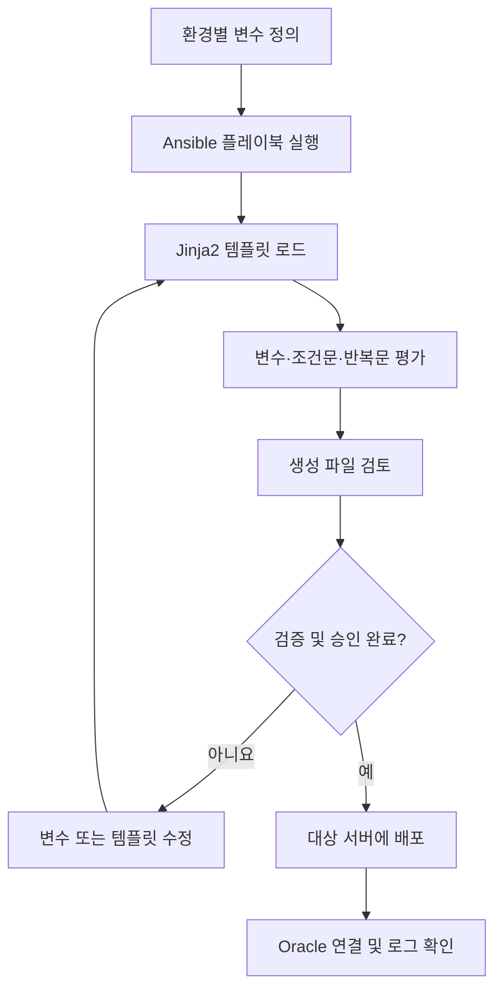

# Ansible for Oracle DBA: Jinja2 템플릿 실무

## 동적·재사용 가능한 Oracle 설정 파일 생성

Jinja2는 Ansible에서 템플릿을 처리할 때 사용하는 템플릿 엔진입니다. 변수, 조건문, 반복문을 활용하면 환경에 따라 달라지는 설정 파일을 일관된 방식으로 생성할 수 있습니다.

Oracle 데이터베이스 운영에서는 `listener.ora`, `tnsnames.ora`, `sqlnet.ora`, `init.ora` 등의 설정 파일과 사용자·테이블스페이스 생성 스크립트, Data Guard 구성 파일을 자동화하는 데 활용할 수 있습니다.

> 💡 **노트(Note)**: 이 장의 예제는 템플릿 문법과 자동화 패턴을 설명하기 위한 예시입니다. 실제 운영 환경에 적용하기 전에는 Oracle 버전, 네트워크 구성, 파일 경로, 권한 및 변경 관리 절차에 맞춰 검증해야 합니다.

## 1. Jinja2 템플릿을 사용하는 이유

서버나 환경마다 별도의 정적 설정 파일을 관리하면 중복이 늘어나고, 수정 누락이나 환경 간 설정 불일치가 발생하기 쉽습니다. 하나의 템플릿을 만들고 환경별 변수만 바꾸면 개발(dev), 테스트(test), 운영(prod) 환경에 맞는 파일을 생성할 수 있습니다.

| 정적 파일을 각각 관리하는 방식 | Jinja2 템플릿을 사용하는 방식 |
|---|---|
| 환경마다 파일을 따로 관리합니다. | 공통 템플릿과 환경별 변수를 분리합니다. |
| 수정 사항을 여러 파일에 반복 적용해야 합니다. | 템플릿을 한 번 수정해 여러 환경에 적용할 수 있습니다. |
| 수작업으로 인한 누락과 불일치가 발생할 수 있습니다. | 생성 절차를 표준화해 실수를 줄일 수 있습니다. |
| 동적인 값과 조건을 표현하기 어렵습니다. | 변수, 조건문, 반복문, 필터를 사용할 수 있습니다. |

Jinja2는 Oracle 리스너와 네트워크 설정뿐 아니라 초기화 파라미터, 사용자 생성, 테이블스페이스 구성, 모니터링 설정 및 운영 스크립트 생성에도 활용할 수 있습니다.

## 2. 템플릿 문법의 기본

Jinja2 템플릿에서는 변수 출력, 제어 구문, 주석에 서로 다른 구분 기호를 사용합니다.

| 문법 | 용도 | 예시 |
|---|---|---|
| `{{ ... }}` | 변수 또는 표현식의 결과 출력 | `{{ db_host }}` |
| `` | 조건문·반복문 등 제어 구문 | `` |
| `{# ... #}` | 템플릿 주석 | `{# 설명용 주석 #}` |

Ansible은 템플릿을 처리하면서 변수와 표현식을 평가하고 결과 파일을 생성합니다. 템플릿 주석은 일반적으로 최종 출력 파일에 포함되지 않습니다.

> ⚠️ **주의(Caution)**: 템플릿에서 변수 이름을 잘못 입력하거나 필요한 변수가 정의되지 않으면 렌더링이 실패하거나 의도하지 않은 결과가 나올 수 있습니다. 필수 변수와 기본값 정책을 명확히 정하고, 배포 전에 결과 파일을 검토하십시오.

## 3. Ansible 변수와 Jinja2 템플릿

템플릿은 플레이북, 인벤토리, 그룹 변수, 호스트 변수 또는 역할 기본값 등에서 정의한 변수를 사용할 수 있습니다. 변수의 실제 우선순위는 Ansible의 변수 우선순위 규칙에 따라 결정되므로, 아래 표는 변수를 둘 수 있는 대표적인 위치를 정리한 것입니다.

| 변수 정의 위치 | 일반적인 파일·경로 예시 | 사용 목적 |
|---|---|---|
| 플레이북 변수 | 플레이북의 `vars` | 특정 플레이북 실행에 필요한 값 |
| 인벤토리 변수 | 인벤토리 파일 | 인벤토리 대상에 관련된 값 |
| 그룹 변수 | `group_vars/prod.yml` | 같은 그룹에 속한 호스트의 공통 값 |
| 호스트 변수 | `host_vars/db01.yml` | 특정 호스트에만 적용할 값 |
| 역할 기본값 | `roles/<role_name>/defaults/main.yml` | 역할에서 사용할 기본값 |
| 역할 변수 | `roles/<role_name>/vars/main.yml` | 역할 내부에서 사용할 변수 |

다음은 그룹 변수 파일의 예시입니다.

```yaml
# group_vars/prod.yml
db_host: prod-db01
listener_port: 1521
db_name: ORCL
instance_name: orcl1
memory_target: 4096M
```

템플릿 파일 `templates/listener.ora.j2`에서는 변수를 다음과 같이 참조할 수 있습니다.

```jinja2
# listener.ora.j2
LISTENER =
  (DESCRIPTION_LIST =
    (DESCRIPTION =
      (ADDRESS = (PROTOCOL = TCP)
        (HOST = {{ db_host }})
        (PORT = {{ listener_port }}))
    )
  )
```

위 템플릿을 처리하면 `db_host`와 `listener_port`에 실제로 정의된 값이 출력됩니다. 예를 들어 호스트가 `prod-db01`이고 포트가 `1521`이면 해당 값이 결과 파일에 반영됩니다.

> ⚠️ **주의(Caution)**: 위 리스너 설정은 템플릿 변수 치환을 설명하기 위한 축약 예시입니다. 실제 `listener.ora`의 괄호 구조와 Oracle Net 설정 문법은 대상 환경의 요구 사항에 맞춰 확인해야 합니다. 원본 슬라이드의 일부 코드가 이미지에서 선명하게 판독되지 않아, 이 원고에서는 운영용 완성 설정으로 보증하지 않습니다.

### 3.1 템플릿을 실행하는 플레이북 예시

```yaml
- name: Generate listener.ora using template
  hosts: dbservers
  become: true
  vars:
    db_host: "{{ inventory_hostname }}"
    listener_port: 1521
  tasks:
    - name: Create listener configuration
      ansible.builtin.template:
        src: templates/listener.ora.j2
        dest: /u01/app/oracle/product/19c/network/admin/listener.ora
        owner: oracle
        group: oinstall
        mode: '0644'
```

이 예시는 `ansible.builtin.template` 모듈로 템플릿을 대상 호스트에 배포하는 기본 형태를 보여 줍니다. 실제 `dest`, 소유자, 그룹, 권한은 Oracle 홈과 운영 정책에 맞춰 조정해야 합니다.

> 💡 **노트(Note)**: 비밀번호, 토큰 등 민감한 값은 일반 변수 파일에 평문으로 저장하지 말고 Ansible Vault 등 승인된 비밀 관리 방식을 사용하십시오.

## 4. 조건문으로 환경별 설정 생성하기

조건문을 사용하면 변수 값에 따라 출력할 설정을 선택할 수 있습니다. 예를 들어 ADR 설정을 활성화한 경우에만 관련 항목을 출력할 수 있습니다.

```jinja2

ADR_BASE_LISTENER = {{ adr_base }}

```

`enable_adr`가 참이면 `ADR_BASE_LISTENER` 항목을 출력하고, 거짓이면 해당 항목을 출력하지 않습니다. `if`, `elif`, `else`, `endif` 구문을 조합하면 개발·테스트·운영 환경별로 다른 설정을 생성할 수 있습니다.

```jinja2

LOG_LEVEL = ERROR

LOG_LEVEL = INFO

LOG_LEVEL = DEBUG

```

| 구문 | 역할 |
|---|---|
| `` | 조건이 참일 때 블록을 실행합니다. |
| `` | 앞선 조건이 거짓일 때 추가 조건을 검사합니다. |
| `` | 앞선 조건이 모두 거짓일 때 실행합니다. |
| `` | 조건문 블록을 끝냅니다. |

중첩 조건문도 사용할 수 있지만, 조건이 많아지면 템플릿을 읽고 검증하기 어려워집니다. 가능한 경우 환경별 변수를 명확히 정의하고 조건의 수를 줄이십시오.

## 5. 반복문으로 여러 설정 항목 생성하기

반복문은 목록이나 사전 자료 구조의 항목을 차례로 처리할 때 사용합니다. 데이터베이스 연결 항목처럼 비슷한 구조가 반복되는 파일을 생성할 때 유용합니다.

```jinja2

{{ db.name }} =
  (DESCRIPTION =
    (ADDRESS = (PROTOCOL = TCP)
      (HOST = {{ db.host }})
      (PORT = {{ db.port }}))
    (CONNECT_DATA = (SERVICE_NAME = {{ db.service_name }}))
  )

```

위 예제는 `db_hosts` 목록의 각 항목에서 호스트, 포트, 서비스 이름을 읽어 반복적으로 출력하는 개념을 보여 줍니다. 실제 목록의 키와 템플릿의 변수 이름은 일치해야 합니다.

Jinja2는 반복문에서 현재 항목의 위치나 반복 횟수 등을 확인할 수 있는 `loop` 변수를 제공합니다.

| 표현식 | 의미 |
|---|---|
| `loop.index` | 현재 반복 번호(1부터 시작) |
| `loop.index0` | 현재 반복 인덱스(0부터 시작) |
| `loop.first` | 첫 번째 항목인지 나타냅니다. |
| `loop.last` | 마지막 항목인지 나타냅니다. |
| `loop.length` | 반복 대상 항목의 전체 개수 |
| `loop.revindex` | 끝에서부터 센 위치(1부터 시작) |
| `loop.revindex0` | 끝에서부터 센 인덱스(0부터 시작) |

> 💡 **노트(Note)**: 반복문 안에 조건문을 함께 사용하면 활성화된 데이터베이스만 출력하거나, 특정 환경에 해당하는 연결 항목만 생성할 수 있습니다. 다만 입력 자료의 누락·중복 여부도 별도로 검증해야 합니다.

## 6. 필터와 데이터 변환

필터는 템플릿에서 출력값을 특정 형식으로 변환하거나 기본값을 지정할 때 사용합니다. 원본 자료의 대소문자 변환, 문자열 정리, 기본값 처리 등은 템플릿의 가독성과 일관성을 높이는 데 도움이 됩니다.

필터 이름과 동작은 사용하는 Jinja2 및 Ansible 버전에서 확인해야 합니다. 특히 Ansible은 자체 필터를 추가하므로, 일반 Jinja2 문서의 필터가 모든 Ansible 환경에서 동일하게 제공된다고 가정해서는 안 됩니다.

> ⚠️ **주의(Caution)**: 필터를 사용해 출력 형식을 바꾸더라도 값의 의미나 유효성이 자동으로 보장되지는 않습니다. 포트 번호, 경로, 메모리 크기 등은 배포 전에 허용 범위와 형식을 검증하십시오.

## 7. Oracle 구성 파일 생성에 적용하기

Jinja2 템플릿은 다음과 같은 Oracle 운영 작업에 적용할 수 있습니다.

| 대상 | 자동화 예시 | 주요 입력값 예시 |
|---|---|---|
| `listener.ora` | 리스너 주소와 포트 생성 | 호스트 이름, 포트, ADR 경로 |
| `tnsnames.ora` | 여러 데이터베이스 연결 항목 생성 | 별칭, 호스트, 포트, 서비스 이름 |
| `sqlnet.ora` | Oracle Net 관련 설정 생성 | 인증·이름 확인 관련 정책 값 |
| `init.ora` | 초기화 파라미터 파일 생성 | 인스턴스별 파라미터 값 |
| Data Guard 구성 | 환경별 구성 파일 및 스크립트 생성 | 기본·대기 데이터베이스 정보 |
| 사용자·테이블스페이스 스크립트 | 반복되는 SQL 스크립트 생성 | 사용자명, 기본 테이블스페이스 등 |
| 운영·모니터링 스크립트 | 환경별 셸·SQL 스크립트 생성 | 경로, 임계값, 대상 인스턴스 |

`init.ora`와 서버 파라미터 파일(SPFILE)은 용도와 관리 방식이 다르므로, 템플릿으로 파일을 생성한다는 이유만으로 두 파일을 같은 방식으로 취급해서는 안 됩니다. 실제 적용 절차는 Oracle 버전과 파라미터 관리 정책을 따르십시오.

## 8. 역할(Role)과 템플릿 구성

Ansible 역할(Role)은 작업, 변수, 파일, 템플릿 등을 목적별로 묶어 재사용할 수 있게 합니다. 템플릿을 역할 내부에 배치하면 데이터베이스 서버가 늘어나더라도 공통 자동화 로직을 유지하기 쉽습니다.

일반적인 역할 디렉터리 구조는 다음과 같습니다.

```text
roles/
└── oracle_listener/
    ├── defaults/
    │   └── main.yml
    ├── tasks/
    │   └── main.yml
    ├── templates/
    │   └── listener.ora.j2
    └── vars/
        └── main.yml
```

- `defaults/main.yml`: 역할 기본값을 정의합니다.
- `tasks/main.yml`: 수행할 작업을 정의합니다.
- `templates/`: 템플릿 파일을 보관합니다.
- `vars/main.yml`: 역할 변수를 정의합니다. 변수 우선순위가 기본값보다 높을 수 있으므로 신중하게 사용합니다.

역할을 사용하면 템플릿, 변수 및 작업을 함께 관리할 수 있습니다. 다만 디렉터리 구조와 변수 우선순위는 실제 Ansible 프로젝트의 설계에 맞춰 일관되게 유지해야 합니다.

## 9. 개발·테스트·운영 환경 분리

환경별 설정은 템플릿 자체를 복제하기보다 환경 변수 파일을 분리해 관리하는 편이 유지보수에 유리합니다. 예를 들어 그룹별 변수 파일에서 호스트, 포트, 서비스 이름 등을 정의하고 동일한 템플릿을 재사용할 수 있습니다.

```text
inventory/
├── hosts.yml
└── group_vars/
    ├── dev.yml
    ├── test.yml
    └── prod.yml

playbook.yml
templates/
└── listener.ora.j2
```

```yaml
# group_vars/dev.yml
environment: dev
db_host: dev-db01
listener_port: 1523
```

```yaml
# group_vars/test.yml
environment: test
db_host: test-db01
listener_port: 1522
```

```yaml
# group_vars/prod.yml
environment: prod
db_host: prod-db01
listener_port: 1521
```

위 값은 구조를 설명하기 위한 예시입니다. 실제 포트, 호스트 이름, 서비스 이름은 해당 조직의 네트워크 및 데이터베이스 구성에 맞게 지정해야 합니다.

## 10. 템플릿 검증과 문제 해결

템플릿 자동화는 파일을 생성하는 데서 끝나지 않습니다. 문법 오류, 누락된 변수, 잘못된 출력 형식, 권한 문제를 배포 전에 확인해야 합니다.

### 권장 검증 절차

1. 필수 변수와 기본값을 확인합니다.
2. 플레이북의 문법과 작업 구성을 검사합니다.
3. 가능한 경우 체크 모드와 차이(diff) 출력을 활용해 변경 내용을 검토합니다.
4. 테스트 환경에서 템플릿을 렌더링하고 생성 결과를 확인합니다.
5. Oracle Net 설정 파일 등 대상 파일의 문법과 환경별 값을 점검합니다.
6. 승인된 변경 절차에 따라 운영 환경에 배포합니다.
7. 배포 후 연결 테스트와 관련 로그를 확인합니다.

| 점검 항목 | 확인할 내용 |
|---|---|
| 변수 정의 | 필수 변수가 모두 제공되는가? |
| 템플릿 문법 | `{{ ... }}` 및 `` 구문이 올바른가? |
| 환경별 값 | 개발·테스트·운영 값이 혼동되지 않았는가? |
| 파일 경로 | 대상 Oracle 홈과 네트워크 관리 디렉터리가 맞는가? |
| 권한 | 소유자·그룹·파일 모드가 운영 정책에 부합하는가? |
| 민감 정보 | 비밀 값이 저장소나 로그에 노출되지 않는가? |
| 변경 검증 | 생성된 파일의 차이를 검토하고 승인했는가? |
| 사후 확인 | 배포 후 리스너·연결 및 관련 로그를 확인했는가? |

> ⚠️ **주의(Caution)**: 체크 모드는 모든 템플릿 결과가 Oracle에서 유효하다는 사실까지 보증하지 않습니다. 생성된 파일을 별도로 검토하고, 운영 반영 전에 테스트 환경에서 기능 검증을 수행하십시오.

## 11. 종합 예제: 환경별 리스너 설정 생성

다음은 앞서 소개한 변수를 템플릿과 플레이북에 연결하는 축약 예제입니다. 실제 운영 파일로 사용하기 전에 Oracle Net 설정 형식과 경로를 검증해야 합니다.

`templates/listener.ora.j2`

```jinja2
# Example template: validate before production use
LISTENER =
  (DESCRIPTION_LIST =
    (DESCRIPTION =
      (ADDRESS =
        (PROTOCOL = TCP)
        (HOST = {{ db_host }})
        (PORT = {{ listener_port }})
      )
    )
  )

ADR_BASE_LISTENER = {{ adr_base }}

```

`group_vars/prod.yml`

```yaml
db_host: prod-db01
listener_port: 1521
enable_adr: true
adr_base: /u01/app/oracle
```

`playbook.yml`

```yaml
- name: Generate Oracle listener configuration
  hosts: dbservers
  become: true
  tasks:
    - name: Render listener template
      ansible.builtin.template:
        src: templates/listener.ora.j2
        dest: /path/to/oracle/network/admin/listener.ora
        owner: oracle
        group: oinstall
        mode: '0644'
```

이 예제에서 `/path/to/oracle/network/admin/listener.ora`는 자리표시자 경로입니다. 대상 시스템의 실제 경로로 바꾸어야 합니다. 또한 리스너 구성 파일의 정확한 문법은 설치 버전과 구성 방식에 따라 검증하십시오.

### 실행 흐름



## 12. 핵심 정리

- Jinja2는 Ansible에서 환경별 설정 파일을 동적으로 생성하는 데 사용합니다.
- `{{ ... }}`는 값을 출력하고, ``는 제어 구문을 표현하며, `{# ... #}`는 템플릿 주석을 표시합니다.
- 변수는 플레이북, 인벤토리, 그룹 변수, 호스트 변수, 역할 기본값 등에서 정의할 수 있습니다.
- 조건문은 환경이나 옵션에 따라 출력 내용을 선택하고, 반복문은 여러 연결 항목과 반복 구조를 생성합니다.
- 역할과 환경별 변수 파일을 분리하면 템플릿을 재사용하고 관리하기 쉽습니다.
- 운영 배포 전에는 변수, 파일 경로, 권한, 생성 결과, 민감 정보 및 Oracle 측 동작을 검증해야 합니다.

---

## 실습 및 활용 시나리오 (Hands-on Scenario)

이 실습 시나리오는 **Docker 기반 가상 실습 환경(`chapter_8`)**을 바탕으로 세 대의 오라클 서버(`devdb`, `testdb`, `proddb`)를 대상으로 진행합니다. 환경별(Dev/Test/Prod) 변수 분리, 조건문과 반복문, Jinja2 필터를 적용한 `listener.ora`, `tnsnames.ora`, `sqlnet.ora`, `init<SID>.ora` 자동 배포를 단계별로 검증합니다.

### 실습 환경 구성 요약

| 노드명 | 호스트명 | 환경 그룹 | IP 주소 | 주요 설정 및 템플릿 입력값 |
|---|---|---|---|---|
| `ansible-control-ch8` | `ansible-control` | 제어 노드 | `192.168.8.10` | 앤서블 명령 및 플레이북 실행 머신 |
| `devdb` | `devdb` | `dev` | `192.168.8.101` | 리스너 포트: 1523, ADR: 비활성, 로그: DEBUG, SGA: 2048M |
| `testdb` | `testdb` | `test` | `192.168.8.102` | 리스너 포트: 1522, ADR: 활성, 로그: INFO, SGA: 4096M |
| `proddb` | `proddb` | `prod` | `192.168.8.103` | 리스너 포트: 1521, ADR: 활성, 로그: ERROR, SGA: 8192M |

실습을 시작하려면 호스트 터미널에서 `chapter_8` 디렉터리로 이동한 후 컨테이너를 기동하고 제어 노드에 접속합니다.

```bash
cd chapter_8
docker compose up -d --build
docker exec -it ansible-control-ch8 bash
```

---

### 실습 1. 프로젝트 폴더와 노드 연결성 확인

제어 노드 환경(`/home/oracle/ansible-oracle-project`)에서 인벤토리(`inventory/hosts.ini`)에 정의된 관리 노드 3대에 `ping`을 실행하여 연결을 점검합니다.

```bash
ansible all -m ping
```

**실제 실행 결과**:
```text
devdb | SUCCESS => {
    "ansible_facts": {
        "discovered_interpreter_python": "/usr/bin/python3.9"
    },
    "changed": false,
    "ping": "pong"
}
testdb | SUCCESS => {
    "ansible_facts": {
        "discovered_interpreter_python": "/usr/bin/python3.9"
    },
    "changed": false,
    "ping": "pong"
}
proddb | SUCCESS => {
    "ansible_facts": {
        "discovered_interpreter_python": "/usr/bin/python3.9"
    },
    "changed": false,
    "ping": "pong"
}
```

---

### 실습 2. 기본 템플릿 렌더링 (`listener.ora.j2`)

템플릿 파일(`templates/listener.ora.j2`)에 정의된 변수 치환 구문을 통해 각 호스트 환경(`devdb`, `testdb`, `proddb`)에 맞는 리스너 설정 파일이 생성되는지 확인합니다(`playbooks/01_basic_template.yml`).

```bash
ansible-playbook playbooks/01_basic_template.yml
```

**실제 실행 결과**:
```text
PLAY [Practice basic Jinja2 template rendering] ********************************

TASK [Render basic listener configuration] *************************************
changed: [devdb]
changed: [testdb]
changed: [proddb]

TASK [Check rendered listener.ora content] *************************************
ok: [devdb]
ok: [testdb]
ok: [proddb]

TASK [Display rendered listener snippet] ***************************************
ok: [devdb] => {
    "msg": [
        "# ====================================================================",
        "# Oracle Listener Configuration Generated by Ansible (Jinja2)",
        "# Environment: DEV",
        "# Managed Host: devdb",
        "# ====================================================================",
        "",
        "LISTENER ="
    ]
}
ok: [testdb] => {
    "msg": [
        "# ====================================================================",
        "# Oracle Listener Configuration Generated by Ansible (Jinja2)",
        "# Environment: TEST",
        "# Managed Host: testdb",
        "# ====================================================================",
        "",
        "LISTENER ="
    ]
}
ok: [proddb] => {
    "msg": [
        "# ====================================================================",
        "# Oracle Listener Configuration Generated by Ansible (Jinja2)",
        "# Environment: PROD",
        "# Managed Host: proddb",
        "# ====================================================================",
        "",
        "LISTENER ="
    ]
}

PLAY RECAP *********************************************************************
devdb                      : ok=3    changed=1    unreachable=0    failed=0    skipped=0    rescued=0    ignored=0   
proddb                     : ok=3    changed=1    unreachable=0    failed=0    skipped=0    rescued=0    ignored=0   
testdb                     : ok=3    changed=1    unreachable=0    failed=0    skipped=0    rescued=0    ignored=0   
```

---

### 실습 3. 환경별 조건 분기 렌더링 (`if/elif/else`)

템플릿 내의 조건문을 통해 `dev` 환경은 ADR이 비활성화되고 로그 레벨이 `DEBUG`로, `test`는 `INFO`, `prod`는 `ERROR`로 차별화되어 생성되는지 검증합니다(`playbooks/02_conditional_template.yml`).

```bash
ansible-playbook playbooks/02_conditional_template.yml
```

**실제 실행 결과**:
```text
PLAY [Practice conditional rendering across environments] **********************

TASK [Ensure listener.ora is rendered with environment conditions] *************
ok: [devdb]
ok: [testdb]
ok: [proddb]

TASK [Fetch environment-specific configuration lines] **************************
ok: [devdb]
ok: [testdb]
ok: [proddb]

TASK [Display environment-specific conditional results] ************************
ok: [devdb] => {
    "msg": "Host: devdb (Env: []) -> ['# ADR is disabled for dev environment', 'LOG_LEVEL_LISTENER = DEBUG']"
}
ok: [testdb] => {
    "msg": "Host: testdb (Env: []) -> ['ADR_BASE_LISTENER = /u01/app/oracle', 'LOG_LEVEL_LISTENER = INFO']"
}
ok: [proddb] => {
    "msg": "Host: proddb (Env: []) -> ['ADR_BASE_LISTENER = /u01/app/oracle', 'LOG_LEVEL_LISTENER = ERROR']"
}

PLAY RECAP *********************************************************************
devdb                      : ok=3    changed=0    unreachable=0    failed=0    skipped=0    rescued=0    ignored=0   
proddb                     : ok=3    changed=0    unreachable=0    failed=0    skipped=0    rescued=0    ignored=0   
testdb                     : ok=3    changed=0    unreachable=0    failed=0    skipped=0    rescued=0    ignored=0   
```

---

### 실습 4. 반복문 기반 `tnsnames.ora` 생성 (`for` 루프와 `loop` 변수)

공통 데이터베이스 목록(`all_databases`)을 순회하며 `for` 루프와 `loop.index`, `loop.first` 변수를 활용해 `tnsnames.ora` 파일을 일괄 생성합니다(`playbooks/03_loop_tnsnames.yml`). `is_active: false`로 설정된 재해복구(DR) DB는 조건문에 의해 자동 제외됩니다.

```bash
ansible-playbook playbooks/03_loop_tnsnames.yml
```

**실제 실행 결과**:
```text
PLAY [Practice Jinja2 for-loop and loop control variables] *********************

TASK [Generate tnsnames.ora from database list] ********************************
changed: [devdb]
changed: [testdb]
changed: [proddb]

TASK [Verify generated tnsnames entries] ***************************************
ok: [devdb]
ok: [testdb]
ok: [proddb]

TASK [Display tnsnames generated aliases] **************************************
ok: [devdb] => {
    "msg": "Server: devdb -> Generated entries: ['# [Entry 1] DEVDB (Primary Target)', 'DEVDB =', '# [Entry 2] TESTDB', 'TESTDB =', '# [Entry 3] PRODDB', 'PRODDB =']"
}
ok: [testdb] => {
    "msg": "Server: testdb -> Generated entries: ['# [Entry 1] DEVDB (Primary Target)', 'DEVDB =', '# [Entry 2] TESTDB', 'TESTDB =', '# [Entry 3] PRODDB', 'PRODDB =']"
}
ok: [proddb] => {
    "msg": "Server: proddb -> Generated entries: ['# [Entry 1] DEVDB (Primary Target)', 'DEVDB =', '# [Entry 2] TESTDB', 'TESTDB =', '# [Entry 3] PRODDB', 'PRODDB =']"
}

PLAY RECAP *********************************************************************
devdb                      : ok=3    changed=1    unreachable=0    failed=0    skipped=0    rescued=0    ignored=0   
proddb                     : ok=3    changed=1    unreachable=0    failed=0    skipped=0    rescued=0    ignored=0   
testdb                     : ok=3    changed=1    unreachable=0    failed=0    skipped=0    rescued=0    ignored=0   
```

---

### 실습 5. 필터 활용 초기화 파라미터 파일(`pfile`) 생성

Jinja2 필터(`upper`, `lower`, `default`)를 활용해 인스턴스별 초기화 파라미터 파일(`init<SID>.ora`)을 `$ORACLE_HOME/dbs` 경로에 자동 배포합니다(`playbooks/04_filters_template.yml`).

```bash
ansible-playbook playbooks/04_filters_template.yml
```

**실제 실행 결과**:
```text
PLAY [Practice Jinja2 filters with Oracle initialization parameter file] *******

TASK [Ensure $ORACLE_HOME/dbs directory exists] ********************************
changed: [devdb]
changed: [testdb]
changed: [proddb]

TASK [Generate init<SID>.ora pfile using filters] ******************************
changed: [devdb]
changed: [testdb]
changed: [proddb]

TASK [Check generated pfile content] *******************************************
ok: [devdb]
ok: [testdb]
ok: [proddb]

TASK [Display pfile summary] ***************************************************
ok: [devdb] => {
    "msg": "Server devdb: ['# Initialization Parameter File (pfile) for DEVDB', 'db_name = \\'DEVDB\\'', 'instance_name = \\'devdb1\\'', 'sga_target = 2048M', 'processes = 150']"
}
ok: [testdb] => {
    "msg": "Server testdb: ['# Initialization Parameter File (pfile) for TESTDB', 'db_name = \\'TESTDB\\'', 'instance_name = \\'testdb1\\'', 'sga_target = 4096M', 'processes = 300']"
}
ok: [proddb] => {
    "msg": "Server proddb: ['# Initialization Parameter File (pfile) for PRODDB', 'db_name = \\'PRODDB\\'', 'instance_name = \\'proddb1\\'', 'sga_target = 8192M', 'processes = 600']"
}

PLAY RECAP *********************************************************************
devdb                      : ok=4    changed=2    unreachable=0    failed=0    skipped=0    rescued=0    ignored=0   
proddb                     : ok=4    changed=2    unreachable=0    failed=0    skipped=0    rescued=0    ignored=0   
testdb                     : ok=4    changed=2    unreachable=0    failed=0    skipped=0    rescued=0    ignored=0   
```

---

### 실습 6. 마스터 프로젝트 - 전체 Oracle Net 설정 일괄 배포

`listener.ora`, `tnsnames.ora`, `sqlnet.ora` 3대 네트워크 설정 파일을 모든 노드에 일괄 배포하고 차이점(diff)을 점검합니다(`playbooks/05_master_oracle_net.yml`).

#### 1) 점검 모드 및 변경점(diff) 확인
```bash
ansible-playbook --check --diff playbooks/05_master_oracle_net.yml
```

**Dry-run 출력 (sqlnet.ora 환경별 타임아웃 차이점 확인)**:
```text
TASK [3. Deploy sqlnet.ora] ****************************************************
--- before
+++ after: sqlnet.ora.j2
@@ -0,0 +1,10 @@
+NAMES.DIRECTORY_PATH = (TNSNAMES, EZCONNECT)
+SQLNET.EXPIRE_TIME = 10
+SQLNET.INBOUND_CONNECT_TIMEOUT = 60
+SQLNET.SEND_TIMEOUT = 30

changed: [proddb]
```

#### 2) 실제 플레이북 실행
```bash
ansible-playbook playbooks/05_master_oracle_net.yml
```

**실제 실행 결과**:
```text
PLAY [Master Project - Comprehensive Oracle Net Configuration Deployment] ******

TASK [1. Deploy listener.ora] **************************************************
ok: [devdb]
ok: [testdb]
ok: [proddb]

TASK [2. Deploy tnsnames.ora] **************************************************
ok: [devdb]
ok: [testdb]
ok: [proddb]

TASK [3. Deploy sqlnet.ora] ****************************************************
changed: [devdb]
changed: [testdb]
changed: [proddb]

TASK [4. Verify all Oracle Net configuration files] ****************************
ok: [devdb]
ok: [testdb]
ok: [proddb]

TASK [5. Display deployed configuration files] *********************************
ok: [devdb] => {
    "msg": "Server devdb: ['-rw-r--r-- 1 oracle oinstall 437 Oct 10 05:01 listener.ora', '-rw-r--r-- 1 oracle oinstall 326 Oct 10 05:03 sqlnet.ora', '-rw-r--r-- 1 oracle oinstall 884 Oct 10 05:02 tnsnames.ora']"
}
ok: [testdb] => {
    "msg": "Server testdb: ['-rw-r--r-- 1 oracle oinstall 437 Oct 10 05:01 listener.ora', '-rw-r--r-- 1 oracle oinstall 328 Oct 10 05:03 sqlnet.ora', '-rw-r--r-- 1 oracle oinstall 886 Oct 10 05:02 tnsnames.ora']"
}
ok: [proddb] => {
    "msg": "Server proddb: ['-rw-r--r-- 1 oracle oinstall 438 Oct 10 05:01 listener.ora', '-rw-r--r-- 1 oracle oinstall 352 Oct 10 05:03 sqlnet.ora', '-rw-r--r-- 1 oracle oinstall 886 Oct 10 05:02 tnsnames.ora']"
}

PLAY RECAP *********************************************************************
devdb                      : ok=5    changed=1    unreachable=0    failed=0    skipped=0    rescued=0    ignored=0   
proddb                     : ok=5    changed=1    unreachable=0    failed=0    skipped=0    rescued=0    ignored=0   
testdb                     : ok=5    changed=1    unreachable=0    failed=0    skipped=0    rescued=0    ignored=0   
```

---

### 실습 7. 템플릿 배포의 멱등성(Idempotency) 검증

동일한 마스터 플레이북을 변경 없이 재실행하여 템플릿의 내용이 이미 최신 상태일 때 `changed=0`으로 안전하게 통과하는지 확인합니다.

```bash
ansible-playbook playbooks/05_master_oracle_net.yml
```

**재실행 결과**:
```text
PLAY RECAP *********************************************************************
devdb                      : ok=5    changed=0    unreachable=0    failed=0    skipped=0    rescued=0    ignored=0   
proddb                     : ok=5    changed=0    unreachable=0    failed=0    skipped=0    rescued=0    ignored=0   
testdb                     : ok=5    changed=0    unreachable=0    failed=0    skipped=0    rescued=0    ignored=0   
```

---

### 실습 8. 문제 해결 연습 및 방어적 템플릿 패턴

필수 변수가 누락되었을 때의 오류를 사전에 차단하기 위해 `assert` 모듈을 통한 변수 유효성 검증과 `default` 필터를 적용하는 방어적 패턴을 검증합니다(`playbooks/06_troubleshooting.yml`).

```bash
ansible-playbook playbooks/06_troubleshooting.yml
```

**실제 실행 결과**:
```text
PLAY [Practice Jinja2 troubleshooting and defensive template patterns] *********

TASK [1. Safe rendering with default filter] ***********************************
ok: [devdb] => {
    "msg": "Backup Path: /backup/default_stage | ADR Status: False"
}
ok: [testdb] => {
    "msg": "Backup Path: /backup/default_stage | ADR Status: True"
}
ok: [proddb] => {
    "msg": "Backup Path: /backup/default_stage | ADR Status: True"
}

TASK [2. Defensive variable presence validation] *******************************
ok: [devdb] => {
    "changed": false,
    "msg": "All mandatory variables for devdb are defined."
}
ok: [testdb] => {
    "changed": false,
    "msg": "All mandatory variables for testdb are defined."
}
ok: [proddb] => {
    "changed": false,
    "msg": "All mandatory variables for proddb are defined."
}

PLAY RECAP *********************************************************************
devdb                      : ok=2    changed=0    unreachable=0    failed=0    skipped=0    rescued=0    ignored=0   
proddb                     : ok=2    changed=0    unreachable=0    failed=0    skipped=0    rescued=0    ignored=0   
testdb                     : ok=2    changed=0    unreachable=0    failed=0    skipped=0    rescued=0    ignored=0   
```

> 💡 **트러블슈팅 요약**:
> - 템플릿 렌더링 시 변수가 정의되지 않으면 `'variable is undefined'` 오류가 발생하므로, `{{ var_name | default('기본값') }}` 필터를 적극 활용합니다.
> - 중요한 Oracle 포트 번호나 인스턴스 이름 등 필수 파라미터는 플레이북 상단에서 `ansible.builtin.assert` 모듈로 먼저 검증한 후 템플릿 태스크를 실행하는 것이 모범 사례입니다.

---

### 실습 정리 및 환경 종료

모든 실습이 완료되면 제어 노드 컨테이너에서 빠져나와 실습 컨테이너를 종료 및 정리합니다.

```bash
exit # 제어 노드 컨테이너 나가기
docker compose down -v # 컨테이너 및 공유 볼륨 정리
```

---

### 확장 과제

- **Data Guard tnsnames.ora 자동 구성**: `primary_db`와 `standby_db` 정보를 그룹 변수로 두고 상호 TNS 별칭을 템플릿으로 일괄 자동 생성
- **Oracle Data Pump 디렉터리 스크립트 생성**: 템플릿을 통해 환경별 백업 디렉터리 경로를 SQL 스크립트로 생성한 뒤 `sqlplus`로 일괄 등록
- **Ansible Vault 암호화 연계**: 템플릿에 들어갈 DB 관리자 계정이나 지갑(Wallet) 비밀번호를 Vault로 암호화하여 안전하게 렌더링


## 편집 및 출판 제작 메모

### 조판 규격

| 요소 | 지정 폰트 |
|---|---|
| 본문 | Noto Sans KR |
| 장·절 제목 | Noto Sans KR Bold |
| 표 | Noto Sans KR |
| 캡션 | Noto Sans KR |
| 영문 기술 용어 | Noto Sans KR |
| 코드 블록 | DejaVu Sans Mono |

마크다운 파일 자체는 글꼴을 강제하지 않습니다. 위 규격은 출판용 스타일시트 또는 최종 조판 템플릿에 적용해야 합니다. 코드 블록에는 고정폭 글꼴을 적용하고, 코드 줄바꿈과 들여쓰기가 보존되는지 확인하십시오.

### 기술 검수 체크리스트

- [ ] 모든 코드 예제를 지원 대상 Ansible 및 Oracle 버전에서 실행·검증했습니다.
- [ ] Oracle Net 설정 파일의 괄호 구조와 매개변수 이름을 검증했습니다.
- [ ] 변수 우선순위와 필수 변수의 기본값 정책을 확인했습니다.
- [ ] 예시 경로, 호스트 이름, 포트 및 서비스 이름을 실제 환경과 구분했습니다.
- [ ] 민감 정보와 내부 시스템 정보가 예제에 포함되지 않았는지 확인했습니다.
- [ ] 코드·도표·이미지·상표·폰트의 출처와 사용 권한을 확인했습니다.
- [ ] 인물 사진이나 제3자 이미지가 사용될 경우 초상권과 이용 허락을 확인했습니다.
- [ ] 원본 슬라이드의 텍스트와 코드가 편집 원고에 정확히 반영되었는지 페이지별 대조했습니다.

### 저작권 및 유통 관련 확인 사항

이 원고의 편집만으로 저작권·상표권·초상권 침해 여부나 유통사 승인 여부가 확정되지는 않습니다. 원본 이미지, 도식, 코드 및 브랜드 표장의 권리 상태를 별도로 확인해야 합니다. 또한 AI 기여 사실을 감추거나 유통 심사를 우회하기 위한 문장 변경은 수행하지 않습니다. 출판사와 유통사가 요구하는 AI 활용 고지 및 권리 확인 절차에 맞춰 최종 제출 자료를 준비하십시오.

### 원본 대조가 필요한 범위

제공된 PDF는 이미지 기반 문서이며 일부 페이지의 작은 글자와 코드가 완전하게 판독되지 않았습니다. 따라서 이 원고는 확인 가능한 제목과 주제 흐름을 중심으로 편집한 원고이며, 세부 코드의 완전한 전사본이라고 볼 수 없습니다. 최종 출간 전에는 원본 PDF의 각 페이지와 코드 예제를 대조하고, 판독이 불확실한 부분을 저자 또는 기술 검수자가 확정해야 합니다.
