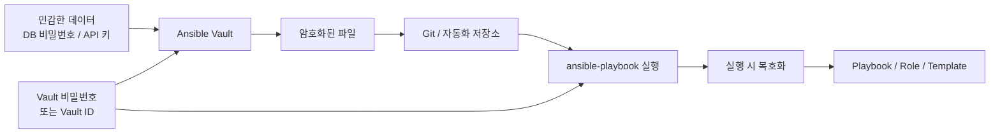
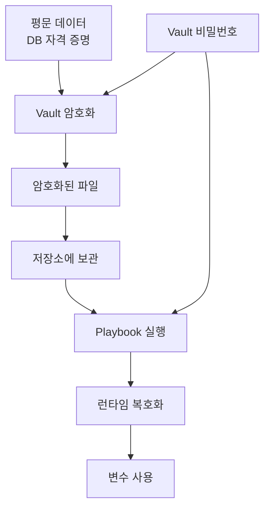
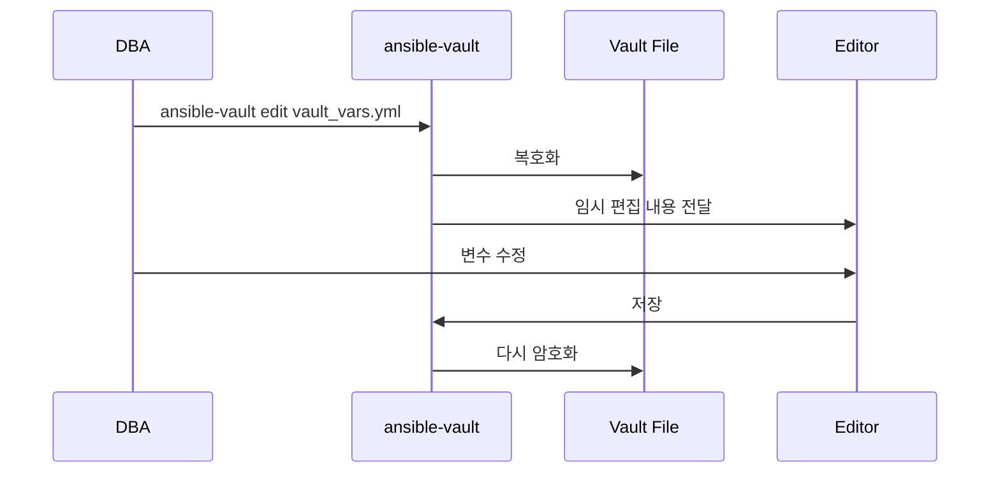
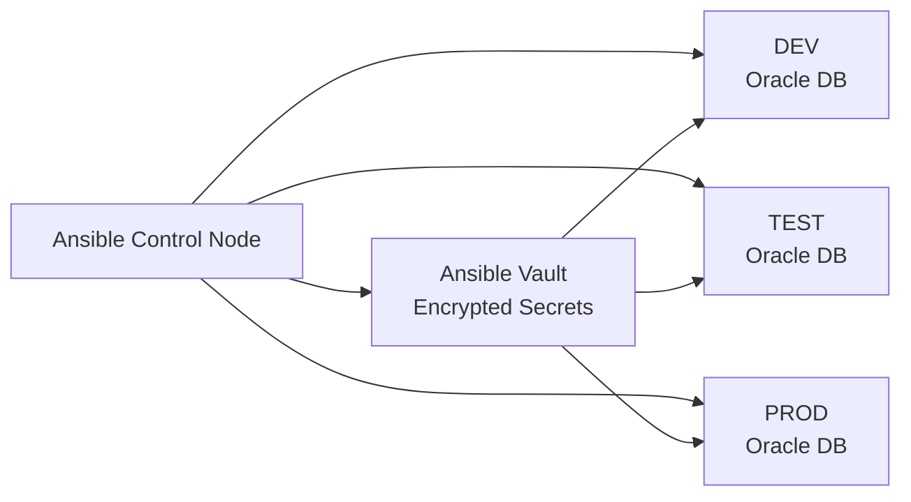
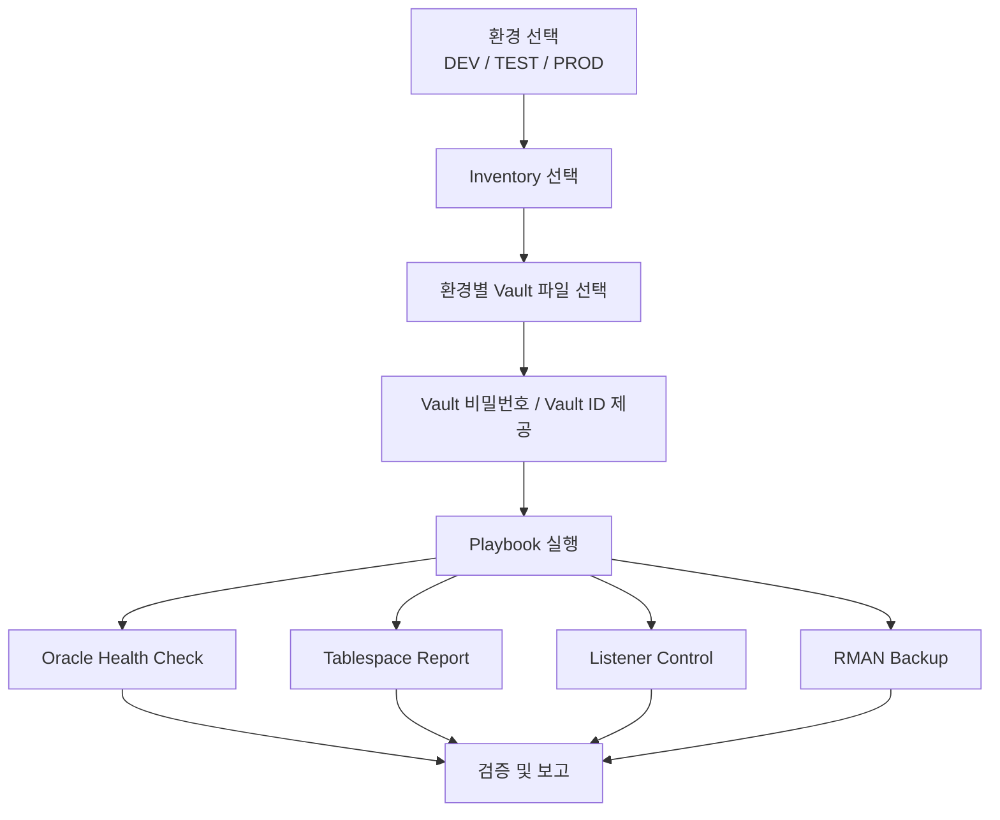

# 120 Days of Database Automation for DBAs
## Ansible for Oracle DBAs — Day 80/120
### Ansible Vault: Oracle DBA 자동화를 위한 보안·재사용·환경별 비밀정보 관리

> **원문 편집 기준:** 사용자가 제공한 `80_1791282608650.pdf`의 12개 본문 페이지와 표지 내용을 기반으로 편집했습니다.
>
> **편집 방향:** 원문의 구성과 교육 흐름은 유지하되, 한국어 문장 가독성·용어 일관성·코드 가독성·보안 관점·출판용 시각 구조를 정리했습니다.
>
> **중요:** 원문에 포함된 실제 비밀번호처럼 보이는 문자열은 출판용 원고에서는 그대로 재사용하지 않고 `<DB_PASSWORD>`, `<VAULT_PASSWORD>` 등의 플레이스홀더로 치환했습니다. 이는 원문의 교육 의도를 유지하면서 실제 비밀정보를 배포하지 않기 위한 편집상 보안 조치입니다.

---

# 조판 및 출판 스타일 가이드

| 요소 | 지정 폰트 |
|---|---|
| 책 본문 | `Noto Sans KR` |
| 장·절 제목 | `Noto Sans KR Bold` |
| 표 | `Noto Sans KR` |
| 캡션 | `Noto Sans KR` |
| 영문 기술 용어 | `Noto Sans KR` |
| 코드 블록 | `DejaVu Sans Mono` |

### 문체 원칙

- 본문은 `~합니다/입니다` 문체로 통일합니다.
- 기술 용어는 초출 시 `한글 용어(English Term)` 형식으로 표기합니다.
- 명령어, 변수, 파일명, 경로, 옵션은 Inline Code로 표기합니다.
- 하나의 단락에서는 하나의 핵심 개념만 설명합니다.
- 지나치게 긴 문장은 두 개 이상의 문장으로 나눕니다.
- 단순한 직역보다 DBA 실무자가 바로 이해할 수 있는 자연스러운 한국어를 우선합니다.

> 💡 **노트(Note):** Ansible Vault는 비밀번호·API 키·인증 정보 등의 민감한 데이터를 평문으로 플레이북이나 변수 파일에 저장하지 않도록 돕는 파일 단위 암호화 기능입니다.

> ⚠️ **주의(Caution):** Ansible Vault는 저장 데이터의 보호를 위한 기능입니다. 실행 시 복호화된 값이 로그, 디버그 출력, 명령행 인자 또는 외부 시스템으로 노출되지 않도록 별도의 비밀정보 보호 정책을 적용해야 합니다.

---

# 1. Ansible Vault 기초

Ansible Vault는 Ansible에 포함된 민감한 데이터 암호화 기능입니다.

데이터베이스 비밀번호, API 키, 인증서, 설정 파일 등의 정보를 암호화된 형태로 저장할 수 있습니다. 이를 활용하면 Oracle DBA 자동화에서 필요한 비밀정보를 보호하면서 플레이북과 역할을 재사용할 수 있습니다.

## 1.1 Ansible Vault란 무엇인가

Ansible Vault는 다음과 같은 데이터를 암호화하는 데 사용할 수 있습니다.

- 데이터베이스 자격 증명
- 리스너 비밀번호
- API 키
- 인증서
- 민감한 설정 파일
- 역할(Role)의 변수 파일
- 인벤토리의 그룹 변수와 호스트 변수
- 기타 Ansible에서 사용하는 구조화된 데이터 파일

암호화된 파일은 올바른 Vault 비밀번호 또는 Vault ID를 제공해야 사용할 수 있습니다.

## 1.2 주요 특징

| 특징 | 설명 |
|---|---|
| 민감한 데이터 암호화 | 비밀번호와 인증 정보 등을 암호화된 형태로 저장합니다. |
| 접근 제어 | 올바른 Vault 비밀값이 있어야 복호화할 수 있습니다. |
| 플레이북 통합 | `playbook`, `role`, `template` 등과 함께 사용할 수 있습니다. |
| 재사용성 | 동일한 자동화 구조를 여러 환경에서 재사용할 수 있습니다. |
| 환경 분리 | DEV, TEST, PROD별 비밀정보를 분리할 수 있습니다. |
| 버전 관리 | 암호화된 파일을 저장소에서 관리할 수 있습니다. 단, Vault 비밀번호 자체는 저장소에 함께 보관해서는 안 됩니다. |

## 1.3 기본 동작 구조



**그림 1-1. Ansible Vault의 기본 암호화 및 실행 흐름**

---

# 2. Ansible Vault가 Oracle DBA 자동화에 중요한 이유

Oracle DBA 자동화에서는 데이터베이스 인증 정보, 리스너 비밀번호, API 키, 설정 파일 등 민감한 정보가 여러 자동화 작업에 사용됩니다.

이를 평문으로 플레이북에 저장하면 소스 저장소, 백업 파일, 코드 리뷰 화면 또는 로그를 통해 정보가 노출될 수 있습니다.

## 2.1 Vault를 사용하지 않는 경우

다음과 같은 형태로 비밀번호를 플레이북에 직접 작성하면 안 됩니다.

```yaml
- name: Connect to Oracle DB
  hosts: dbservers

  vars:
    db_user: system
    db_password: "<DB_PASSWORD>"
    db_host: orcl1

  tasks:
    - name: Show connection details
      ansible.builtin.debug:
        msg: "Connecting to {{ db_user }} with {{ db_password }}"
```

문제는 다음과 같습니다.

- 인증 정보가 플레이북에 직접 노출됩니다.
- Git 저장소에 커밋될 가능성이 있습니다.
- 코드 리뷰나 화면 공유 과정에서 노출될 수 있습니다.
- 운영 환경에 적합하지 않습니다.
- 보안 및 감사 정책을 위반할 가능성이 있습니다.

## 2.2 Vault를 사용하면

민감한 변수를 암호화된 파일에 분리할 수 있습니다.

```text
vault_vars.yml
└── 암호화된 변수
    ├── db_user
    ├── db_password
    ├── db_host
    ├── db_port
    └── service_name
```

플레이북에서는 `vars_files`를 사용해 해당 파일을 참조합니다.

```yaml
- name: Connect to Oracle DB using Vault
  hosts: dbservers

  vars_files:
    - vault_vars.yml

  tasks:
    - name: Show DB host
      ansible.builtin.debug:
        msg: "Connecting to {{ db_user }} on {{ db_host }}"
```

> ⚠️ **주의(Caution):** 민감한 변수를 `debug`로 출력하는 것은 실제 운영 환경에서 피해야 합니다. 테스트 목적으로도 비밀번호 자체를 메시지에 포함하지 않는 것이 좋습니다.

## 2.3 실무 활용 사례

- Oracle 데이터베이스 자격 증명 관리
- Oracle Listener 관리
- ASM 관련 자격 증명 관리
- RMAN 자동화
- 데이터베이스 상태 점검
- Oracle 소프트웨어 구성
- OEM 또는 외부 모니터링 시스템 연동
- 백업 저장소 인증
- 환경별 데이터베이스 설정 관리

---

# 3. Ansible Vault 암호화와 보안 구조

Ansible Vault는 민감한 파일을 암호화하고, 실행 시 필요한 경우 복호화하여 사용할 수 있도록 합니다.

## 3.1 암호화 흐름



**그림 3-1. Ansible Vault의 암호화 흐름**

원문은 AES-256 기반 암호화를 설명하고 있으며, Vault 파일에는 `$ANSIBLE_VAULT;...;AES256` 형식의 헤더가 표시됩니다.

> 💡 **노트(Note):** Vault 파일의 실제 헤더 버전과 Vault ID 표시 형식은 Ansible 버전에 따라 달라질 수 있습니다. 따라서 출판용 코드와 설명은 사용하는 Ansible 버전을 기준으로 검증해야 합니다.

## 3.2 Vault 파일의 기본 구조

평문 상태에서는 다음과 같은 구조를 사용할 수 있습니다.

```yaml
db_user: system
db_password: "<DB_PASSWORD>"
db_host: orcl1
db_service: orcl
```

암호화하면 파일 내용은 사람이 읽을 수 있는 YAML이 아니라 Vault 형식의 암호문으로 변환됩니다.

```text
$ANSIBLE_VAULT;1.2;AES256
<ENCRYPTED_CONTENT>
```

## 3.3 주요 속성

| 항목 | 설명 |
|---|---|
| 암호화 알고리즘 | 원문은 AES-256을 사용한다고 설명합니다. |
| 파일 형식 | Ansible Vault 형식 |
| 비밀번호 필요 | 암호화된 데이터를 사용하려면 Vault 비밀번호 또는 Vault ID가 필요합니다. |
| 암호화 대상 | 파일 전체 또는 특정 민감 데이터 |
| 주요 용도 | DB 자격 증명, API 키, 인증서, 설정 파일 등 |

---

# 4. Vault 파일 생성 및 암호화

Ansible Vault는 새로운 암호화 파일을 만들거나 기존 파일을 암호화할 수 있습니다.

## 4.1 새로운 암호화 파일 생성

```bash
ansible-vault create vault_vars.yml
```

명령을 실행하면 Vault 비밀번호를 입력하고, 기본 편집기에서 파일 내용을 작성할 수 있습니다.

```text
New Vault password:
Confirm New Vault password:
```

파일을 저장하고 편집기를 종료하면 내용이 암호화된 상태로 저장됩니다.

## 4.2 기존 파일 암호화

이미 존재하는 평문 파일을 암호화하려면 다음 명령을 사용합니다.

```bash
ansible-vault encrypt db_vars.yml
```

암호화 후에는 파일이 Vault 형식으로 저장됩니다.

> ⚠️ **주의(Caution):** 평문 파일을 암호화한 후에는 원본 평문 파일이 별도로 남아 있지 않은지 확인하십시오. 백업, 임시 파일, 편집기 스왑 파일 등에 평문이 남아 있을 수 있습니다.

## 4.3 암호화 파일 확인

```bash
ansible-vault view vault_vars.yml
```

Vault 비밀번호를 입력하면 파일의 복호화된 내용을 화면에서 확인할 수 있습니다.

## 4.4 암호화 파일 편집

```bash
ansible-vault edit vault_vars.yml
```

이 명령은 암호화된 파일을 편집할 수 있도록 일시적으로 복호화한 뒤, 저장할 때 다시 암호화합니다.



**그림 4-1. `ansible-vault edit` 동작 흐름**

## 4.5 복호화

파일을 영구적으로 평문으로 전환하려면 다음 명령을 사용합니다.

```bash
ansible-vault decrypt vault_vars.yml
```

> ⚠️ **주의(Caution):** 운영 환경에서는 `decrypt`를 신중하게 사용해야 합니다. 복호화한 파일이 저장소나 백업 시스템에 남으면 민감한 정보가 평문으로 노출될 수 있습니다. 단순히 내용을 확인하거나 수정하려면 일반적으로 `view` 또는 `edit`가 더 적절합니다.

## 4.6 Vault 비밀번호 변경

기존 Vault 파일의 비밀번호를 변경하려면 다음 명령을 사용합니다.

```bash
ansible-vault rekey vault_vars.yml
```

기존 비밀번호를 입력한 다음 새 비밀번호를 입력합니다.

---

# 5. 암호화된 파일 편집

암호화된 파일은 평문으로 직접 변환하지 않고 `ansible-vault edit`를 사용하여 수정할 수 있습니다.

## 5.1 기본 편집기 사용

```bash
ansible-vault edit vault_vars.yml
```

기본 편집기를 사용하여 파일을 수정합니다.

## 5.2 특정 편집기 사용

원문에서는 `nano`를 예로 사용합니다.

```bash
ansible-vault edit --vault-editor nano vault_vars.yml
```

편집기가 설치되어 있고 Ansible 버전에서 해당 옵션을 지원하는지 확인해야 합니다.

## 5.3 비밀번호 파일 사용

```bash
ansible-vault edit \
  --vault-password-file vault.pass \
  vault_vars.yml
```

이 방식은 반복적인 자동화 작업에서 유용할 수 있습니다.

## 5.4 디렉터리의 여러 Vault 파일 관리

원문은 `group_vars` 및 `host_vars`와 같은 디렉터리 구조를 예로 제시합니다.

실제 Ansible Vault 명령은 파일 단위로 동작하므로, 여러 파일을 암호화하거나 편집할 때는 대상 파일 목록을 명시하는 방식을 사용합니다.

> ⚠️ **주의(Caution):** “디렉터리 전체를 하나의 Vault 파일처럼 암호화한다”는 의미로 이해해서는 안 됩니다. 출판용 원고에서는 파일 단위 암호화와 여러 파일 관리 방식을 구분해서 설명하는 것이 정확합니다.

## 5.5 Vault 파일 편집 시 보안 원칙

- Vault 파일은 암호화된 상태로 저장합니다.
- Vault 비밀번호를 Git 저장소에 커밋하지 않습니다.
- 비밀번호 파일은 적절한 파일 권한으로 보호합니다.
- 편집기와 임시 파일에 평문이 남지 않는지 확인합니다.
- 디버그 출력에 비밀번호가 표시되지 않도록 합니다.

---

# 6. 플레이북에서 Vault 변수 사용

암호화된 변수 파일은 일반 변수 파일과 유사한 방식으로 플레이북에서 참조할 수 있습니다.

## 6.1 Vault 변수 파일

```yaml
# vault_db.yml — 실제 파일은 암호화된 상태로 저장
db_user: system
db_password: "<DB_PASSWORD>"
db_host: orcl1
db_port: 1521
service_name: orcl
listener_user: admin
listener_password: "<LISTENER_PASSWORD>"
```

## 6.2 `vars_files` 사용

```yaml
---
- name: Connect to Oracle DB using Vault variables
  hosts: dbservers

  vars_files:
    - vault_db.yml

  tasks:
    - name: Show DB connection details
      ansible.builtin.debug:
        msg: "Connecting to {{ db_user }} on {{ db_host }}:{{ db_port }}"
```

플레이북 실행 시 Vault 비밀번호를 제공합니다.

```bash
ansible-playbook connect_db.yml --ask-vault-pass
```

## 6.3 모듈에서 Vault 변수 사용

원문은 Oracle SQL 작업에 Vault 변수를 사용하는 예를 제시합니다. 실제 모듈 이름과 매개변수는 사용 중인 Ansible Collection 버전에 맞춰 검증해야 합니다.

개념적인 예시는 다음과 같습니다.

```yaml
- name: Execute SQL using Vault credentials
  hosts: dbservers

  vars_files:
    - vault_db.yml

  tasks:
    - name: Run SQL query
      ansible.builtin.shell: |
        sqlplus -L "{{ db_user }}/{{ db_password }}@{{ db_host }}:{{ db_port }}/{{ service_name }}" <<'EOF'
        SELECT name FROM v$database;
        EXIT;
        EOF
      register: db_output
      no_log: true
```

> ⚠️ **주의(Caution):** 인증 정보를 명령행 문자열에 삽입하면 프로세스 목록이나 실행 기록을 통해 노출될 가능성이 있습니다. 실제 운영 자동화에서는 Oracle 전용 Ansible Collection, Wallet, 외부 비밀정보 저장소 등 더 안전한 인증 방식을 우선 검토하십시오.

## 6.4 여러 Vault 파일 사용

DEV, TEST, PROD 또는 데이터베이스 자격 증명과 API 키를 별도로 관리할 수 있습니다.

```yaml
vars_files:
  - vault_db.yml
  - vault_api.yml
```

Vault ID를 사용하면 서로 다른 비밀번호로 암호화된 파일을 하나의 플레이북에서 관리할 수 있습니다.

---

# 7. Vault 비밀번호, 비밀번호 파일과 프롬프트

Ansible Vault는 암호화된 데이터를 사용할 때 Vault 비밀값을 제공해야 합니다.

대표적인 방법은 다음과 같습니다.

| 방법 | 대표 옵션 | 적합한 환경 |
|---|---|---|
| 대화형 프롬프트 | `--ask-vault-pass` | 수동·임시 실행 |
| 비밀번호 파일 | `--vault-password-file` | 스크립트·자동화 |
| 환경 변수 | `ANSIBLE_VAULT_PASSWORD_FILE` | 자동화 환경 |
| Vault ID | `--vault-id` | 여러 환경·여러 비밀번호 |
| 구성 파일 | `vault_password_file` 관련 설정 | 프로젝트 기본값 |

## 7.1 대화형 프롬프트

```bash
ansible-playbook connect_db.yml --ask-vault-pass
```

실행 시 Vault 비밀번호를 직접 입력합니다.

## 7.2 비밀번호 파일

```bash
ansible-playbook connect_db.yml \
  --vault-password-file vault.pass
```

비밀번호 파일은 제한된 권한으로 보호해야 합니다.

```bash
chmod 600 vault.pass
```

> ⚠️ **주의(Caution):** 비밀번호 파일은 일반 텍스트 비밀정보입니다. Git 저장소에 커밋하거나 여러 사용자가 읽을 수 있는 공유 디렉터리에 두지 마십시오.

## 7.3 환경 변수

```bash
export ANSIBLE_VAULT_PASSWORD_FILE=/home/oracle/vault.pass
ansible-playbook connect_db.yml
```

자동화 스크립트에서 사용할 수 있지만, 환경 변수 역시 실행 환경에 따라 노출될 수 있으므로 운영 보안 정책을 함께 적용해야 합니다.

## 7.4 Vault ID

여러 환경에서 서로 다른 Vault 비밀번호를 사용하려면 Vault ID를 사용할 수 있습니다.

```bash
ansible-playbook \
  --vault-id dev@dev.pass \
  --vault-id prod@prompt \
  site.yml
```

Vault ID를 사용하면 DEV, TEST, PROD와 같은 환경별 비밀정보를 구분해서 관리할 수 있습니다.

## 7.5 프로젝트별 기본 설정

원문의 `ansible.cfg` 예시는 다음과 같은 개념입니다.

```ini
[defaults]
vault_password_file = /home/oracle/vault.pass
inventory = inventory.ini
```

> ⚠️ **주의(Caution):** 비밀번호 파일의 경로를 설정 파일에 기록하는 것과 비밀번호 자체를 기록하는 것은 다릅니다. 설정 파일과 비밀번호 파일의 접근 권한을 모두 검토해야 합니다.

## 7.6 방법별 비교

| 방법 | 사용 예 | 보안/운영 특성 |
|---|---|---|
| 대화형 프롬프트 | `--ask-vault-pass` | 수동 실행에 적합 |
| 비밀번호 파일 | `--vault-password-file` | 자동화에 편리하지만 파일 보호가 필수 |
| 환경 변수 | `ANSIBLE_VAULT_PASSWORD_FILE` | 스크립트와 CI/CD에 활용 가능 |
| Vault ID | `--vault-id` | 여러 환경 및 여러 Vault 비밀번호 관리에 적합 |
| `ansible.cfg` | 기본 비밀번호 소스 설정 | 프로젝트 단위 기본값 관리에 유용 |

---

# 8. Oracle DBA 자격 증명과 민감한 설정 관리

Oracle DBA 자동화에서는 데이터베이스 인증 정보 외에도 다양한 비밀정보를 관리해야 합니다.

## 8.1 Oracle 자격 증명 파일

```yaml
db_user: system
db_password: "<DB_PASSWORD>"
db_host: orcl1
db_port: 1521
service_name: orcl

sys_password: "<SYS_PASSWORD>"

asm_user: sysasm
asm_password: "<ASM_PASSWORD>"

listener_user: admin
listener_password: "<LISTENER_PASSWORD>"
```

이 파일은 실제 저장소에서는 암호화된 Vault 파일로 관리합니다.

## 8.2 민감한 설정의 범위

| 범주 | 예 |
|---|---|
| 데이터베이스 | `SYSTEM`, `SYS` 계정 등 |
| ASM | `SYSASM` 관련 자격 증명 |
| Listener | 관리자 및 리스너 제어용 인증 정보 |
| OEM/클라우드 | 모니터링 및 클라우드 API 인증 |
| TDE Wallet | Wallet 관련 비밀정보 |
| RMAN | 백업 저장소 인증 |
| SMTP | 알림 시스템 인증 |
| 구성 파일 | 민감한 접속 정보가 포함된 설정 파일 |

## 8.3 역할에서 사용

```yaml
- name: Configure Oracle listener
  ansible.builtin.command:
    cmd: lsnrctl start
  vars_files:
    - ../../vars/oracle_creds.yml
```

역할에서 Vault 파일을 사용하는 경우 역할 코드와 민감한 데이터를 분리할 수 있습니다.

> 💡 **노트(Note):** 역할의 재사용성을 높이려면 역할 코드에는 비밀값을 직접 작성하지 않고, 외부 변수나 Vault 변수에서 값을 주입하는 구조가 좋습니다.

---

# 9. 역할(Role)과 Jinja2 템플릿에서 Vault 사용

Ansible Vault의 장점은 역할과 템플릿을 함께 사용하면서 민감한 데이터를 코드와 분리할 수 있다는 점입니다.

## 9.1 역할 구조

```text
roles/
└── oracle_db/
    ├── tasks/
    │   └── main.yml
    ├── templates/
    │   └── tnsnames.ora.j2
    ├── vars/
    │   └── vault.yml
    └── defaults/
        └── main.yml
```

`vault.yml`은 암호화된 상태로 저장합니다.

## 9.2 Vault 변수

```yaml
db_user: system
db_password: "<DB_PASSWORD>"
db_host: orcl1
db_port: 1521
service_name: orcl
wallet_password: "<WALLET_PASSWORD>"
```

## 9.3 역할 작업에서 변수 사용

```yaml
- name: Create Oracle directory
  ansible.builtin.file:
    path: /u01/app/oracle/network/admin
    state: directory
    owner: oracle
    group: oinstall
    mode: "0755"

- name: Deploy tnsnames.ora
  ansible.builtin.template:
    src: tnsnames.ora.j2
    dest: /u01/app/oracle/network/admin/tnsnames.ora
    owner: oracle
    group: oinstall
    mode: "0644"
```

## 9.4 Jinja2 템플릿

```jinja2
{{ service_name }} =
  (DESCRIPTION =
    (ADDRESS = (PROTOCOL = TCP)
      (HOST = {{ db_host }})
      (PORT = {{ db_port }}))
    (CONNECT_DATA =
      (SERVICE_NAME = {{ service_name }})))
```

템플릿에서는 Vault 변수도 일반 Ansible 변수와 같은 방식으로 참조할 수 있습니다.

## 9.5 일반 변수와 민감한 변수 분리

```text
defaults/main.yml
├── oracle_base: /u01/app/oracle
├── oracle_home: /u01/app/oracle/product/19c
└── listener_port: 1521

vars/vault.yml
├── db_user
├── db_password
├── db_host
├── db_port
└── service_name
```

> 💡 **노트(Note):** 일반 구성값과 민감한 값을 분리하면 역할의 구조가 명확해지고, 민감한 변수만 별도로 보호할 수 있습니다.

---

# 10. DEV / TEST / PROD 환경별 비밀정보

실제 운영 환경에서는 DEV, TEST, PROD의 데이터베이스와 자격 증명을 분리하는 것이 중요합니다.

## 10.1 권장 디렉터리 구조

```text
project/
├── group_vars/
│   ├── dev/
│   │   └── vault.yml
│   ├── test/
│   │   └── vault.yml
│   └── prod/
│       └── vault.yml
├── playbooks/
│   └── site.yml
└── inventory/
    ├── dev.ini
    ├── test.ini
    └── prod.ini
```

각 환경의 `vault.yml`은 별도의 비밀번호 또는 Vault ID로 보호할 수 있습니다.

## 10.2 환경별 변수 예

### DEV

```yaml
db_user: dev_user
db_password: "<DEV_DB_PASSWORD>"
db_host: dev-db
db_port: 1521
db_service: devdb
```

### TEST

```yaml
db_user: test_user
db_password: "<TEST_DB_PASSWORD>"
db_host: test-db
db_port: 1521
db_service: testdb
```

### PROD

```yaml
db_user: prod_user
db_password: "<PROD_DB_PASSWORD>"
db_host: prod-db
db_port: 1521
db_service: proddb
```

## 10.3 환경별 인벤토리

예:

```ini
[dbservers]
dev-db ansible_host=192.168.1.10

[dbservers:vars]
ansible_user=oracle
env=dev
```

TEST와 PROD에서도 동일한 구조를 사용할 수 있습니다.

## 10.4 환경에 맞는 Vault 파일 로드

플레이북에서 환경 변수를 사용해 적절한 Vault 파일을 선택하는 구조입니다.

```yaml
---
- name: Run Oracle tasks using environment secrets
  hosts: dbservers

  vars_files:
    - "../group_vars/{{ env }}/vault.yml"

  tasks:
    - name: Show environment and DB host
      ansible.builtin.debug:
        msg: "Environment: {{ env }}, Host: {{ db_host }}"
```

## 10.5 환경별 실행

```bash
# DEV
ansible-playbook \
  -i inventory/dev.ini \
  playbooks/site.yml \
  -e "env=dev"

# TEST
ansible-playbook \
  -i inventory/test.ini \
  playbooks/site.yml \
  -e "env=test"

# PROD
ansible-playbook \
  -i inventory/prod.ini \
  playbooks/site.yml \
  -e "env=prod"
```

> ⚠️ **주의(Caution):** `-e`로 환경을 선택하는 방식은 편리하지만, PROD 실행 시 잘못된 환경 변수가 전달되지 않도록 CI/CD 파이프라인과 실행 권한을 함께 통제해야 합니다.

---

# 11. Vault 보안, 검증 및 문제 해결

Vault를 사용하는 것만으로 보안 구성이 완성되는 것은 아닙니다.

암호화 상태, 파일 권한, 변수 이름, Vault 비밀번호, 인벤토리 구성을 함께 검증해야 합니다.

## 11.1 암호화 상태 확인

```bash
ansible-vault view vault.yml
```

내용을 확인할 때 비밀번호가 출력되지 않도록 주의합니다.

## 11.2 Vault 파일 검증

원문에서는 `decrypt --output`을 이용해 별도의 출력 파일로 복호화하여 검증하는 방식을 제시합니다.

```bash
ansible-vault decrypt \
  --output /tmp/vault_check.yml \
  --vault-password-file vault.pass \
  vault.yml
```

검증이 끝난 뒤에는 평문 파일을 반드시 삭제합니다.

```bash
rm -f /tmp/vault_check.yml
```

> ⚠️ **주의(Caution):** `/tmp`에 평문 파일을 생성하는 방법은 운영 보안 관점에서 주의가 필요합니다. 파일 생성 후 삭제만으로 완전한 제거를 보장할 수 없으므로, 가능하면 `ansible-vault view` 또는 안전한 검증 절차를 우선 사용하십시오.

## 11.3 파일 권한

```bash
chmod 600 vault.yml
ls -l vault.yml
```

Vault 파일과 비밀번호 파일은 필요한 사용자만 읽을 수 있도록 권한을 제한합니다.

## 11.4 Vault 비밀번호 변경

```bash
ansible-vault rekey vault.yml
```

정기적인 비밀번호 교체 정책을 운영 환경에 적용할 수 있습니다.

## 11.5 플레이북에서 변수 검증

필수 Vault 변수가 로드되었는지 `assert`로 검증할 수 있습니다.

```yaml
- name: Validate required Vault variables
  ansible.builtin.assert:
    that:
      - db_user is defined
      - db_password is defined
    fail_msg: "Required Vault variables are missing!"
```

민감한 변수의 값을 출력하지 않고 **정의 여부만 검증**하는 것이 핵심입니다.

## 11.6 일반적인 오류

| 오류 | 원인 | 대응 |
|---|---|---|
| `Decryption failed (bad decrypt password)` | 잘못된 Vault 비밀번호 | 올바른 비밀번호 또는 `--vault-id` 확인 |
| `Variable is undefined` | 변수 이름 불일치 | 플레이북과 Vault 파일의 변수명 확인 |
| `Permission denied` | 파일 권한 문제 | 파일 소유자와 `chmod 600` 확인 |
| `Vault file not found` | 잘못된 경로 | 상대 경로·절대 경로 확인 |
| Vault ID 불일치 | 잘못된 Vault 비밀값 사용 | 올바른 `--vault-id` 확인 |

## 11.7 문제 해결 순서

```mermaid
flowchart TD
    A["Vault 오류 발생"] --> B["파일 경로 확인"]
    B --> C["Vault 비밀번호 / Vault ID 확인"]
    C --> D["파일 권한 확인"]
    D --> E["변수명 확인"]
    E --> F["단순 Playbook으로 재현"]
    F --> G["`-vv` 또는 필요한 수준의 로그 확인"]
    G --> H["수정 후 다시 검증"]
```

**그림 11-1. Ansible Vault 문제 해결 순서**

---

# 12. Ansible Vault 보안 모범 사례

## 12.1 강력한 Vault 비밀번호 사용

예측하기 쉬운 문자열이나 Oracle 제품명, 서버명 등을 비밀번호로 사용하지 않습니다.

## 12.2 Vault 비밀번호를 저장소에 커밋하지 않기

```text
vault.yml       ← 암호화 파일: 저장 가능
vault.pass      ← 비밀번호 파일: 저장소에 커밋하지 않음
```

필요하면 `.gitignore`에 민감한 파일을 등록합니다.

```gitignore
vault.pass
*.secret
*.password
```

## 12.3 파일 권한 제한

```bash
chmod 600 vault.pass
chmod 600 vault.yml
```

## 12.4 환경별 Vault 분리

```text
DEV  → dev Vault
TEST → test Vault
PROD → prod Vault
```

환경 간 자격 증명을 재사용하지 않는 것이 좋습니다.

## 12.5 최소한의 비밀정보만 저장

Vault 파일에는 실제로 보호해야 하는 값만 저장합니다.

일반적인 경로, 포트, 환경명 등 민감하지 않은 값까지 모두 암호화할 필요는 없습니다.

## 12.6 로그에 비밀정보가 노출되지 않도록 하기

민감한 값이 작업 결과나 명령 출력에 포함될 수 있다면 `no_log: true`를 검토합니다.

```yaml
- name: Run sensitive operation
  ansible.builtin.command: /path/to/sensitive-command
  no_log: true
```

> ⚠️ **주의(Caution):** `no_log: true`는 보안을 강화하지만 장애 분석에 필요한 정보까지 숨길 수 있습니다. 운영 환경에서는 민감한 값만 노출되지 않도록 작업을 세분화하고, 필요한 범위에서 사용하십시오.

## 12.7 Vault는 저장 데이터 보호 수단입니다

Ansible Vault는 암호화된 파일을 보호하지만, 실행 시 복호화된 데이터까지 자동으로 보호해 주는 것은 아닙니다.


**그림 12-1. Vault 사용 시 별도로 관리해야 하는 런타임 보안 영역**

따라서 다음 항목을 함께 관리해야 합니다.

- `debug` 출력
- 명령행 인자
- 작업 로그
- CI/CD 로그
- 임시 파일
- 백업 파일
- 실행 환경의 권한
- 외부 API 호출
- Oracle 인증 방식

---

# 13. 마스터 프로젝트: Ansible Vault를 이용한 Oracle DBA 자동화

이제 앞에서 배운 내용을 하나의 실무형 프로젝트로 통합합니다.

프로젝트 목표는 다음과 같습니다.

- Oracle 자격 증명을 Vault로 보호합니다.
- DEV, TEST, PROD별 비밀정보를 분리합니다.
- 역할과 Jinja2 템플릿을 재사용합니다.
- 데이터베이스 상태 점검을 자동화합니다.
- Tablespace 보고서를 생성합니다.
- Listener를 제어합니다.
- RMAN 백업을 자동화합니다.

## 13.1 프로젝트 아키텍처



**그림 13-1. Ansible Vault 기반 Oracle DBA 자동화 아키텍처**

## 13.2 프로젝트 디렉터리

```text
oracle_dba_vault_project/
├── group_vars/
│   ├── dev/
│   │   └── vault.yml
│   ├── test/
│   │   └── vault.yml
│   └── prod/
│       └── vault.yml
├── roles/
│   └── oracle_db/
│       ├── tasks/
│       │   └── main.yml
│       └── templates/
│           └── db_report.sql.j2
└── playbooks/
    ├── db_health_check.yml
    ├── tablespace_report.yml
    ├── listener_control.yml
    └── rman_backup.yml
```

## 13.3 PROD Vault 변수 예

```yaml
db_user: sys
db_password: "<PROD_DB_PASSWORD>"
db_host: prod-db
db_port: 1521
db_service: proddb

oracle_home: /u01/app/oracle/product/19c

listener_user: admin
listener_password: "<LISTENER_PASSWORD>"

rman_user: "<RMAN_USER>"
rman_password: "<RMAN_PASSWORD>"
```

실제 저장소에서는 이 파일을 평문으로 저장하지 않고 Ansible Vault로 암호화합니다.

---

# 14. 데이터베이스 상태 점검 Playbook

```yaml
---
- name: Oracle Database Health Check
  hosts: dbservers

  vars_files:
    - "../group_vars/{{ env }}/vault.yml"

  roles:
    - oracle_db

  tags:
    - health_check
```

역할에서는 Vault에서 가져온 인증 정보를 사용하여 데이터베이스 상태 점검 작업을 수행합니다.

## 14.1 보안상 중요한 점

- Vault 파일은 암호화된 상태로 유지합니다.
- 데이터베이스 비밀번호는 출력하지 않습니다.
- SQL 결과에 민감한 정보가 포함될 수 있다면 로그 노출 여부를 확인합니다.
- 환경에 따라 다른 Vault 파일을 사용합니다.

---

# 15. Tablespace 보고서 자동화

Jinja2 템플릿을 사용하여 SQL을 관리할 수 있습니다.

```sql
SELECT
    tablespace_name,
    ROUND(used_percent, 2) AS used_pct
FROM dba_tablespace_usage_metrics
WHERE used_percent > {{ threshold }}
ORDER BY used_percent DESC;
```

템플릿을 사용하면 임계값 등의 설정을 환경별 변수로 관리할 수 있습니다.

## 15.1 Playbook 개념

```yaml
---
- name: Generate Tablespace Report
  hosts: dbservers

  vars_files:
    - "../group_vars/{{ env }}/vault.yml"

  tasks:
    - name: Run tablespace query
      ansible.builtin.shell: >
        sqlplus -L "{{ db_user }}/{{ db_password }}@{{ db_host }}:{{ db_port }}/{{ db_service }}"
        @/path/to/db_report.sql
      register: ts_output
      no_log: true
```

> ⚠️ **주의(Caution):** 위 예시는 원문의 자동화 개념을 보여주기 위한 것입니다. 실제 운영에서는 비밀번호를 명령행에 직접 넣는 방식보다 Oracle Wallet 또는 적절한 비밀정보 관리 체계를 검토하십시오.

---

# 16. Listener 제어 자동화

원문에서는 Vault에 저장한 Listener 인증 정보를 이용하여 Listener를 시작하는 예를 제시합니다.

개념적인 구조는 다음과 같습니다.

```yaml
---
- name: Start Oracle Listener
  hosts: dbservers

  vars_files:
    - "../group_vars/{{ env }}/vault.yml"

  tasks:
    - name: Start listener
      ansible.builtin.shell: lsnrctl start
      become: true
      become_user: oracle
```

Listener 제어에 필요한 OS 권한과 Oracle 사용자 권한을 분리해서 관리하는 것이 좋습니다.

---

# 17. RMAN 백업 자동화

Vault를 사용하면 RMAN 자동화에 필요한 민감한 인증 정보를 암호화된 변수로 관리할 수 있습니다.

개념적인 예시는 다음과 같습니다.

```yaml
---
- name: Run RMAN Backup
  hosts: dbservers

  vars_files:
    - "../group_vars/{{ env }}/vault.yml"

  tasks:
    - name: Execute RMAN backup
      ansible.builtin.shell: >
        rman target "{{ rman_user }}/{{ rman_password }}"
        cmdfile=/path/to/rman_backup.rman
      register: backup_output
      no_log: true
```

> ⚠️ **주의(Caution):** RMAN 비밀번호를 명령행에 전달하는 방식은 프로세스 목록이나 로그에 노출될 수 있습니다. 실제 운영 환경에서는 Oracle Wallet 또는 별도의 인증 메커니즘을 우선 검토해야 합니다.

---

# 18. 전체 자동화 실행 구조



**그림 18-1. Oracle DBA 자동화 전체 실행 흐름**

---

# 19. 실무 운영 체크리스트

## 보안

- [ ] Vault 비밀번호가 Git 저장소에 포함되지 않았습니다.
- [ ] Vault 파일의 권한을 `600` 수준으로 제한했습니다.
- [ ] DEV, TEST, PROD의 Vault를 분리했습니다.
- [ ] 평문 자격 증명을 플레이북에 작성하지 않았습니다.
- [ ] 로그에 비밀번호가 출력되지 않습니다.
- [ ] `debug` 작업에서 민감한 변수를 출력하지 않습니다.
- [ ] CI/CD 로그에 Vault 비밀번호가 노출되지 않습니다.
- [ ] 임시 평문 파일이 남지 않는지 확인했습니다.

## Ansible

- [ ] `ansible-vault view`로 파일을 확인할 수 있습니다.
- [ ] `ansible-vault edit`로 파일을 안전하게 수정할 수 있습니다.
- [ ] 필요한 경우 `ansible-vault rekey`를 사용할 수 있습니다.
- [ ] 환경별 `--vault-id`를 올바르게 지정했습니다.
- [ ] 플레이북에서 `vars_files` 경로가 정확합니다.
- [ ] Vault 변수명이 플레이북에서 사용하는 변수명과 일치합니다.

## Oracle DBA

- [ ] 데이터베이스 접속 정보를 검증했습니다.
- [ ] Listener 작업을 검증했습니다.
- [ ] Tablespace 보고서 SQL을 검증했습니다.
- [ ] RMAN 백업 명령을 비운영 환경에서 먼저 테스트했습니다.
- [ ] Oracle Wallet 등 더 안전한 인증 방식의 적용 가능성을 검토했습니다.

---

# 20. 최종 정리

Ansible Vault는 Oracle DBA 자동화에서 민감한 데이터를 보호하기 위한 핵심 기능입니다.

다음 원칙을 기억하면 됩니다.

1. 민감한 데이터를 평문으로 플레이북에 저장하지 않습니다.
2. Vault 파일을 암호화된 상태로 저장합니다.
3. Vault 비밀번호를 저장소에 함께 보관하지 않습니다.
4. DEV, TEST, PROD의 비밀정보를 분리합니다.
5. 역할과 템플릿에서 Vault 변수를 재사용합니다.
6. `ansible-vault edit`를 활용하여 평문 전환 없이 암호화 파일을 수정합니다.
7. 자동화 환경에서는 `--vault-id`, 비밀번호 파일 또는 외부 비밀정보 관리 체계를 검토합니다.
8. Vault 변수의 값이 로그에 노출되지 않도록 합니다.
9. 파일 권한을 적절히 제한합니다.
10. 실행 시 복호화된 데이터에 대한 보안까지 함께 관리합니다.


**그림 20-1. Ansible Vault 기반 Oracle DBA 자동화의 핵심 구조**

> 💡 **노트(Note):** Ansible Vault의 핵심 가치는 단순히 비밀번호를 암호화하는 데 있지 않습니다. 민감한 데이터를 자동화 코드와 분리하고, 환경별로 관리하며, 동일한 플레이북과 역할을 안전하게 재사용할 수 있도록 하는 데 있습니다.

---

# 21. 실습 및 활용 시나리오 (Hands-on Scenario)

본 절에서는 교재에서 다룬 **Ansible Vault 보안 자동화** 핵심 기능을 로컬 Docker 가상 실습 환경(`chapter_9`)에서 직접 구축하고 검증한 실습 절차와 실제 실행 결과를 제공합니다.

---

## 21.1 실습 환경 구성 개요

실습 환경은 1대의 Ansible 제어 노드(Control Node)와 2대의 Oracle 대상 노드(Dev, Prod)로 구성되어 있습니다.

| 컨테이너명 | 호스트명 | 역할 | IP 주소 | 주요 실습 내용 |
|---|---|---|---|---|
| `ansible-control-ch9` | `ansible-control` | Control Node | `192.168.9.10` | 앤서블 명령 실행, Vault 암/복호화, 플레이북 수행 |
| `devdb` | `devdb` | Oracle Dev Node | `192.168.9.101` | 개발 환경 자격 증명 적용, mock sqlplus/lsnrctl 실행 |
| `proddb` | `proddb` | Oracle Prod Node | `192.168.9.102` | 운영 환경 자격 증명 적용, mock sqlplus/lsnrctl 실행 |

- **실습 소스코드 위치**: [`chapter_9`](file:///c:/Users/zapan/Documents/ansible_oracle/chapter_9)
- **주요 설정 및 자격 증명 파일**:
  - Docker Compose 명세: [`chapter_9/docker-compose.yml`](file:///c:/Users/zapan/Documents/ansible_oracle/chapter_9/docker-compose.yml)
  - Ansible 환경 설정: [`chapter_9/ansible-oracle-project/ansible.cfg`](file:///c:/Users/zapan/Documents/ansible_oracle/chapter_9/ansible-oracle-project/ansible.cfg)
  - 인벤토리 파일: [`chapter_9/ansible-oracle-project/inventory/hosts.ini`](file:///c:/Users/zapan/Documents/ansible_oracle/chapter_9/ansible-oracle-project/inventory/hosts.ini)
  - Vault 패스워드 파일 (권한 `600`):
    - 공통: [`chapter_9/ansible-oracle-project/vault/.vault_pass`](file:///c:/Users/zapan/Documents/ansible_oracle/chapter_9/ansible-oracle-project/vault/.vault_pass) (`OracleVault2026!`)
    - 개발 전용: [`chapter_9/ansible-oracle-project/vault/.vault_dev_pass`](file:///c:/Users/zapan/Documents/ansible_oracle/chapter_9/ansible-oracle-project/vault/.vault_dev_pass) (`DevSecret2026!`)
    - 운영 전용: [`chapter_9/ansible-oracle-project/vault/.vault_prod_pass`](file:///c:/Users/zapan/Documents/ansible_oracle/chapter_9/ansible-oracle-project/vault/.vault_prod_pass) (`ProdSecret2026!`)

---

## 21.2 단계별 실습 수행 및 검증

### 실습 1. 환경 기동 및 연결성 검증 (Ping)

제어 노드에서 `hosts.ini`에 정의된 대상 Oracle 데이터베이스 서버와의 SSH 통신 상태를 확인합니다.

```bash
docker exec -it ansible-control-ch9 bash
ansible all -m ping
```

**실제 실행 결과**:
```text
devdb | SUCCESS => {
    "ansible_facts": {
        "discovered_interpreter_python": "/usr/libexec/platform-python"
    },
    "changed": false,
    "ping": "pong"
}
proddb | SUCCESS => {
    "ansible_facts": {
        "discovered_interpreter_python": "/usr/libexec/platform-python"
    },
    "changed": false,
    "ping": "pong"
}
```

---

### 실습 2. Vault 파일 암호화 및 조회 (`encrypt` / `view`)

민감한 Oracle 자격 증명이 포함된 [`vars/vault_common.yml`](file:///c:/Users/zapan/Documents/ansible_oracle/chapter_9/ansible-oracle-project/vars/vault_common.yml) 파일을 AES-256 알고리즘으로 암호화하고, 디스크에 평문을 남기지 않고 즉시 조회합니다.

```bash
# 파일 암호화 실행
ansible-vault encrypt vars/vault_common.yml

# 파일 헤더 및 암호문 확인
head -n 4 vars/vault_common.yml
```

**암호화된 파일 내용 (`vars/vault_common.yml`)**:
```text
$ANSIBLE_VAULT;1.1;AES256
32363165313333333333323030366632613134373462633830306132646366366164393963363435
3137666236633663326162316462636263363065613333360a633737353132646564616265356463
39323730303732386134346165393539386337653738316164313233373362353363626366303239
```

`ansible-vault view`를 사용하여 안전하게 복호화 내용을 확인합니다.

```bash
ansible-vault view vars/vault_common.yml
```

**실제 조회 결과**:
```yaml
db_user: sys
db_password: OracleSysPass2026!
db_host: devdb
db_port: 1521
service_name: orcl
listener_password: ListenerSecure2026!
rman_user: rman_admin
rman_password: RmanBackup2026!
```

---

### 실습 3. Vault 파일 연동 플레이북 및 `no_log: true` 마스킹 검증

암호화된 Vault 파일을 로드하여 Oracle DB 연결 명령을 수행할 때, 터미널 및 로그에 비밀번호가 노출되지 않도록 `no_log: true`가 적용된 플레이북([`playbooks/01_vault_basic.yml`](file:///c:/Users/zapan/Documents/ansible_oracle/chapter_9/ansible-oracle-project/playbooks/01_vault_basic.yml))을 실행합니다.

```bash
ansible-playbook playbooks/01_vault_basic.yml
```

**실제 실행 결과**:
```text
PLAY [Practice Ansible Vault basics for Oracle DBA] ****************************

TASK [1. Verify Oracle DB connection using masked Vault credentials] ***********
changed: [devdb]
changed: [proddb]

TASK [2. Display task success status without printing the password] ************
ok: [devdb] => {
    "msg": "Connected to Oracle as sys on devdb successfully!"
}
ok: [proddb] => {
    "msg": "Connected to Oracle as sys on proddb successfully!"
}

TASK [3. Safe credential check] ************************************************
ok: [devdb] => {
    "changed": false,
    "msg": "Credential presence check passed for devdb"
}
ok: [proddb] => {
    "changed": false,
    "msg": "Credential presence check passed for proddb"
}

PLAY RECAP *********************************************************************
devdb                      : ok=3    changed=1    unreachable=0    failed=0    skipped=0    rescued=0    ignored=0   
proddb                     : ok=3    changed=1    unreachable=0    failed=0    skipped=0    rescued=0    ignored=0   
```

> 🛡️ **보안 확인**: `TASK [1]` 실행 시 `db_password` 값이 로그에 완전히 숨겨져(Censored) 출력되지 않으며, 변경 상태(`changed: [devdb]`)만 안전하게 리턴됩니다.

---

### 실습 4. 다중 Vault ID 환경별 분리 검증 (Dev vs Prod)

개발 환경(`dev`)과 운영 환경(`prod`)의 암호화 키를 완전히 분리하여 다중 Vault ID 라벨을 지정하는 실습입니다.

1. **환경별 전용 비밀번호로 암호화**:
   ```bash
   ansible-vault encrypt --vault-id dev@vault/.vault_dev_pass --encrypt-vault-id dev vars/dev_vault.yml
   ansible-vault encrypt --vault-id prod@vault/.vault_prod_pass --encrypt-vault-id prod vars/prod_vault.yml
   ```

   암호화 헤더에 `$ANSIBLE_VAULT;1.2;AES256;dev` 및 `$ANSIBLE_VAULT;1.2;AES256;prod` 라벨이 부여됩니다.

2. **다중 Vault ID를 지정하여 플레이북 실행**([`playbooks/02_vault_id_env.yml`](file:///c:/Users/zapan/Documents/ansible_oracle/chapter_9/ansible-oracle-project/playbooks/02_vault_id_env.yml)):
   ```bash
   ansible-playbook \
     --vault-id dev@vault/.vault_dev_pass \
     --vault-id prod@vault/.vault_prod_pass \
     playbooks/02_vault_id_env.yml
   ```

**실제 실행 결과**:
```text
PLAY [Practice multi-environment Vault ID (dev vs prod)] ***********************

TASK [1. Display environment-specific metadata] ********************************
ok: [devdb] => {
    "msg": "Host: devdb | Env: dev | DB Name: devdb | Threshold: 80%"
}
ok: [proddb] => {
    "msg": "Host: proddb | Env: prod | DB Name: proddb | Threshold: 85%"
}

TASK [2. Verify RMAN credential presence safely] *******************************
ok: [devdb] => {
    "msg": "RMAN Target user 'dev_rman' loaded securely from dev vault"
}
ok: [proddb] => {
    "msg": "RMAN Target user 'prod_rman' loaded securely from prod vault"
}

PLAY RECAP *********************************************************************
devdb                      : ok=2    changed=0    unreachable=0    failed=0    skipped=0    rescued=0    ignored=0   
proddb                     : ok=2    changed=0    unreachable=0    failed=0    skipped=0    rescued=0    ignored=0   
```

---

### 실습 5. 단일 변수 암호화(`encrypt_string`) 검증

전체 파일을 암호화하지 않고, 플레이북 내부의 특정 민감 문자열(인증 토큰 등)만 암호화하는 기법을 실습합니다.

1. **암호화 문자열 블록 생성**:
   ```bash
   ansible-vault encrypt_string 'MySuperSecretToken2026!' --name 'oracle_token'
   ```

2. **생성된 `!vault |` 블록을 플레이북([`playbooks/03_encrypted_string.yml`](file:///c:/Users/zapan/Documents/ansible_oracle/chapter_9/ansible-oracle-project/playbooks/03_encrypted_string.yml))에 삽입 후 실행**:
   ```bash
   ansible-playbook playbooks/03_encrypted_string.yml
   ```

**실제 실행 결과**:
```text
PLAY [Practice variable-level encryption with encrypted strings] ***************

TASK [1. Confirm loaded encrypted string variable length without exposing raw value] ***
ok: [devdb] => {
    "msg": "Oracle auth token successfully loaded (Token length: 23 chars)"
}
ok: [proddb] => {
    "msg": "Oracle auth token successfully loaded (Token length: 23 chars)"
}

TASK [2. Verify token pattern safely] ******************************************
ok: [devdb] => {
    "changed": false,
    "msg": "Encrypted string was decrypted seamlessly in memory!"
}
ok: [proddb] => {
    "changed": false,
    "msg": "Encrypted string was decrypted seamlessly in memory!"
}

PLAY RECAP *********************************************************************
devdb                      : ok=2    changed=0    unreachable=0    failed=0    skipped=0    rescued=0    ignored=0   
proddb                     : ok=2    changed=0    unreachable=0    failed=0    skipped=0    rescued=0    ignored=0   
```

---

### 실습 6. 마스터 프로젝트: 통합 Oracle DBA 운영 자동화

DB 인스턴스 오픈 모드 점검, Tablespace 사용률 분석 보고서 생성, Oracle Listener 상태 진단을 단일 플레이북([`playbooks/04_master_vault_dba.yml`](file:///c:/Users/zapan/Documents/ansible_oracle/chapter_9/ansible-oracle-project/playbooks/04_master_vault_dba.yml))으로 통합 실행합니다.

```bash
ansible-playbook playbooks/04_master_vault_dba.yml
```

**실제 실행 결과**:
```text
PLAY [Master Project - Automated Secure Oracle DBA Operations with Vault] ******

TASK [1. Oracle Health Check with masked credentials] **************************
changed: [proddb]
changed: [devdb]

TASK [2. Display database open status safely] **********************************
ok: [devdb] => {
    "msg": "Host: devdb | Oracle Instance Status: OPEN_MODE\n--------------------\nREAD WRITE"
}
ok: [proddb] => {
    "msg": "Host: proddb | Oracle Instance Status: OPEN_MODE\n--------------------\nREAD WRITE"
}

TASK [3. Execute Tablespace Usage Report query with masked credentials] ********
changed: [devdb]
changed: [proddb]

TASK [4. Display tablespace usage summary] *************************************
ok: [devdb] => {
    "msg": "Server: devdb | Tablespace Report: ['TABLESPACE_NAME                USED_PCT', '------------------------------ --------', 'SYSTEM                            64.20', 'SYSAUX                            72.50', 'USERS                             35.10']"
}
ok: [proddb] => {
    "msg": "Server: proddb | Tablespace Report: ['TABLESPACE_NAME                USED_PCT', '------------------------------ --------', 'SYSTEM                            64.20', 'SYSAUX                            72.50', 'USERS                             35.10']"
}

TASK [5. Verify Listener status] ***********************************************
ok: [devdb]
ok: [proddb]

TASK [6. Report Listener status] ***********************************************
ok: [devdb] => {
    "msg": "Server: devdb | Listener is active (RC: 0)"
}
ok: [proddb] => {
    "msg": "Server: proddb | Listener is active (RC: 0)"
}

PLAY RECAP *********************************************************************
devdb                      : ok=6    changed=2    unreachable=0    failed=0    skipped=0    rescued=0    ignored=0   
proddb                     : ok=6    changed=2    unreachable=0    failed=0    skipped=0    rescued=0    ignored=0   
```

---

### 실습 7. Vault 비밀번호 교체(Rekey) 및 복호화(Decrypt) 검증

정기적인 비밀번호 순환(Key Rotation) 정책을 준수하기 위해 `rekey` 명령으로 암호화 키를 교체하고 복호화 절차를 테스트합니다.

```bash
# 1. 이전 키로 암호화된 파일 준비
ansible-vault encrypt --vault-id old@vault/.old_pass --encrypt-vault-id old vars/key_test.yml

# 2. 신규 키로 즉시 재암호화 (Rekey)
ansible-vault rekey --vault-id old@vault/.old_pass --new-vault-id new@vault/.new_pass --encrypt-vault-id new vars/key_test.yml

# 3. 신규 키로 복호화 및 내용 확인
ansible-vault decrypt --vault-id new@vault/.new_pass vars/key_test.yml
cat vars/key_test.yml
```

**실제 실행 결과**:
```text
Encryption successful
Rekey successful
Decryption successful
secret_key: 'ModernRekey2026'
```

---

### 실습 8. 문제 해결 및 권한 보안 감사

비밀번호 파일의 파일 퍼미션이 비인가 사용자에게 노출되지 않도록 `ansible.builtin.stat` 모듈을 이용해 `0600` 권한 여부를 자동 감사하는 플레이북([`playbooks/05_troubleshooting.yml`](file:///c:/Users/zapan/Documents/ansible_oracle/chapter_9/ansible-oracle-project/playbooks/05_troubleshooting.yml))을 실행합니다.

```bash
ansible-playbook playbooks/05_troubleshooting.yml
```

**실제 실행 결과**:
```text
PLAY [Practice Vault troubleshooting and permission audits] ********************

TASK [1. Audit Vault password file permissions] ********************************
ok: [localhost]

TASK [2. Verify permission is 0600 or restricted] ******************************
ok: [localhost] => {
    "msg": "Vault password file mode: 0600 (Exists: True)"
}

TASK [3. Defensive variable check] *********************************************
ok: [localhost] => {
    "changed": false,
    "msg": "Security audit passed: Vault password file is intact."
}

PLAY RECAP *********************************************************************
localhost                  : ok=3    changed=0    unreachable=0    failed=0    skipped=0    rescued=0    ignored=0   
```

---

## 21.3 실습 정리 및 확장 과제

### 환경 정리
모든 실습이 완료되면 다음 명령어를 통해 컨테이너와 볼륨을 안전하게 종료합니다.

```bash
exit # 제어 노드 컨테이너 셸 종료
docker compose down -v # 컨테이너 및 공유 볼륨 정리
```

### 확장 과제
1. **Oracle Wallet과 Vault의 상호 보완 아키텍처 구현**:
   - `sqlplus / as sysdba`와 같은 OS 인증 또는 Oracle Wallet 인증을 기본으로 사용하되, 원격 연결 및 초기 Wallet 생성에 필요한 마스터 암호를 Vault로 관리.
2. **CI/CD 파이프라인 비밀정보 연동**:
   - Jenkins 또는 GitHub Actions 환경에서 환경변수(`ANSIBLE_VAULT_PASSWORD_FILE` 또는 Secret 매니저)를 파이프라인 단계에서 주입하여 실행 후 자동 파기.
3. **Vault ID 기반 다중 테넌트(PDB) 관리**:
   - CDB 단위 공통 자격 증명과 각 Pluggable Database(PDB)별 테넌트 관리자 자격 증명을 Vault ID별로 세분화하여 권한 위임 구성.

---

# 출판용 기술 검수 데이터

## A. 원문 유지와 편집상 보정

| 항목 | 편집 처리 |
|---|---|
| Day 80/120, Phase 4 | 유지 |
| Ansible Vault Fundamentals | `Ansible Vault 기초`로 자연스럽게 편집 |
| Vault 암호화 개념 | 유지 |
| DEV / TEST / PROD | 유지 |
| Roles / Jinja2 Templates | 유지 |
| Vault password / password file / prompt | 유지 |
| Oracle credentials | 유지 |
| Listener / ASM / RMAN | 유지 |
| Master Project | 유지하되 한국어 설명을 보강 |
| 원문의 예제 비밀번호 | 실제 비밀정보처럼 보이지 않도록 플레이스홀더로 치환 |
| 원문의 일부 명령 예시 | 문법·보안상 주의가 필요한 부분을 검수 메모로 분리 |

## B. 기술 정확성 검수 포인트

| 검수 항목 | 편집자 판정 | 출판 전 조치 |
|---|---|---|
| `ansible-vault create` | 유효한 핵심 명령 | 실행 테스트 권장 |
| `ansible-vault edit` | 유효 | 실행 테스트 권장 |
| `ansible-vault view` | 유효 | 실행 테스트 권장 |
| `ansible-vault encrypt` | 유효 | 파일 단위 동작을 명확히 설명 |
| `ansible-vault decrypt` | 유효 | 운영 환경 사용 주의 |
| `ansible-vault rekey` | 유효 | 기존 비밀번호 필요 여부 검증 |
| `--vault-password-file` | 유효 | 비밀번호 파일 권한 강조 |
| `--ask-vault-pass` | 유효 | 수동 실행에 적합 |
| `--vault-id` | 유효 | 다중 환경 설명에 권장 |
| `ANSIBLE_VAULT_PASSWORD_FILE` | 유효한 구성 방식 | 실행 환경의 환경변수 노출 여부 검토 |
| `vault_password_file` | 구성 옵션으로 사용 가능 | Ansible 버전에 맞춰 옵션명 검증 |
| Vault 파일의 AES-256 설명 | 원문 유지 | 사용 버전의 공식 문서와 대조 |
| Vault 파일의 버전 헤더 | 버전별 차이 가능 | 고정된 `1.1`/`1.2` 설명은 사용 버전에 맞춰 검증 |
| 디렉터리 암호화 표현 | 수정 | 파일 단위 암호화와 구분 |
| `debug`에 비밀번호 출력 | 부적절 | 출판본에서 제거 |
| SQL*Plus 접속 문자열에 비밀번호 포함 | 보안상 주의 | Wallet 등 대체 인증 방식 검토 |
| RMAN 명령행 비밀번호 | 보안상 주의 | Wallet 또는 안전한 인증 방식 검토 |
| `no_log: true` | 유효 | 로그 보호와 장애 분석의 균형 검토 |
| `chmod 600` | 권장 | 운영 사용자/그룹 정책과 함께 검증 |

## C. 출판 전 보안 검수

> ⚠️ **주의(Caution):** 원본 이미지에는 교육용 예제임에도 실제 비밀번호처럼 보이는 문자열이 여러 곳에 반복되어 있습니다. 출판본에서는 반드시 플레이스홀더 또는 무작위 예제값으로 변경하고, 저장소·이미지·코드 샘플 어디에도 실제 자격 증명이 포함되지 않았는지 최종 점검해야 합니다.

- [ ] 원본 PDF의 모든 자격 증명 문자열 제거
- [ ] Markdown 코드의 자격 증명 문자열 제거
- [ ] 이미지·스크린샷 내 자격 증명 문자열 제거
- [ ] Git 저장소 및 백업본에 평문 비밀번호가 없는지 확인
- [ ] CI/CD 로그의 민감정보 노출 여부 확인
- [ ] Oracle 접속 예제의 인증 방식 검토
- [ ] RMAN 예제의 인증 방식 검토
- [ ] `no_log` 적용 범위 검토
- [ ] Vault 비밀번호 파일의 라이선스/배포본 포함 여부 확인

## D. 저작권·상표권 검수

원본에는 다음과 같은 상표·제품명이 시각적으로 포함되어 있습니다.

- Ansible
- Oracle
- Linux
- Git
- OEM
- RMAN

출판 전 다음 사항을 별도로 확인합니다.

1. 로고 및 아이콘의 사용 허가
2. 제3자 이미지 및 일러스트의 라이선스
3. Oracle 및 Ansible 상표 사용 가이드
4. 코드 예제의 원출처
5. 외부 문서의 문장 및 구조와의 유사성
6. 사용 폰트의 상업 출판 및 배포 라이선스
7. 표지 및 내지 그래픽의 원본 제작·사용 권리

> ⚠️ **주의(Caution):** 상표명을 본문에서 기술적 설명 목적으로 사용하는 것과 로고를 출판물의 장식 요소로 사용하는 것은 별개의 문제입니다. 로고·아이콘은 원본 파일별로 라이선스와 사용 권한을 확인해야 합니다.

---

# AI 기여 및 유통 검토

이 편집본은 원본 자료의 구조와 기술 내용을 기반으로 문장 정리, 용어 표준화, 시각 구조화 및 출판용 편집을 수행한 결과물입니다.

출판사 제출 시에는 다음을 확인합니다.

- 저자가 실제 기술 내용을 검토했는지 확인합니다.
- 모든 코드 예제를 실제 Ansible 환경에서 실행합니다.
- Oracle 관련 명령은 대상 Oracle 버전에서 검증합니다.
- AI를 이용한 편집·생성에 관한 출판사 내부 정책을 확인합니다.
- 필요할 경우 AI 활용 또는 편집 기여에 대한 내부 기록을 보관합니다.
- AI 활용 사실을 숨기기 위한 임의의 저자성 주장이나 출처 삭제를 하지 않습니다.
- 외부 유통사의 최신 제출 정책은 제출 시점에 다시 확인합니다.

---

# 편집자 최종 판정

**원고:** `120 Days of Database Automation for DBAs — Day 80/120`  
**주제:** Ansible Vault를 활용한 Oracle DBA 자동화 보안  
**문체:** 습니다체  
**용어:** 한국어 IT 현장 용어 중심, 초출 영문 병기  
**코드:** `DejaVu Sans Mono`  
**본문/표/캡션:** `Noto Sans KR`  
**장·절 제목:** `Noto Sans KR Bold`  
**시각화:** Mermaid 다이어그램으로 재구성  
**보안:** 실제 비밀번호 형태의 원문 예제는 플레이스홀더로 편집  
**기술 검수:** Ansible Vault 명령 및 보안 동작을 공식 Ansible 문서와 대조할 수 있도록 검수 항목을 분리  
**저작권:** 로고·아이콘·폰트·제3자 자료에 대한 별도 권리 확인 필요  
**출판 상태:** 조판 전 최종 편집 원고

> **출판 승인 조건:** 본 원고는 출판용 편집 구조로 정리했지만, 최종 인쇄·전자책·유통본 확정 전에는 **Ansible 버전별 명령 문법, Oracle 인증 방식, 원본 이미지의 자격 증명 제거, 로고 및 그래픽 라이선스, 실제 코드 실행 결과**를 최종 검수해야 합니다.
