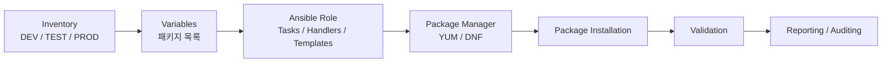
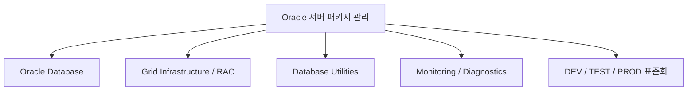

# 120 Days of Database Automation for DBAs
## Ansible for Oracle DBAs — Day 81/120
### Oracle 서버 패키지 설치·구성·검증 자동화

> **편집본 상태:** 최종 편집 원고(한국어 Markdown)  
> **원문 기반:** 사용자가 제공한 이미지형 PDF를 OCR로 판독한 후 문장·용어·구조를 편집했습니다.  
> **출판 전 필수 검수:** 원본 PDF가 텍스트 레이어를 제공하지 않아 일부 코드·패키지명·버전 표기는 원본 이미지와 대조 검수가 필요합니다.

---

# 조판 및 편집 스타일 가이드

| 요소 | 지정 규격 |
|---|---|
| 본문 | `Noto Sans KR` |
| 장·절 제목 | `Noto Sans KR Bold` |
| 표 | `Noto Sans KR` |
| 캡션 | `Noto Sans KR` |
| 영문 기술 용어 | `Noto Sans KR` |
| 코드 블록 | `DejaVu Sans Mono` |

> 💡 **노트(Note):** 본문에서는 기술 용어의 초출을 `한글 용어(English Term)` 형식으로 표기합니다. 이후에는 문맥상 자연스러운 경우 한글 용어를 사용합니다.

> ⚠️ **주의(Caution):** 이 문서의 코드와 패키지 목록은 Oracle Linux 버전, 저장소 구성, Oracle Database 버전에 따라 달라질 수 있습니다. 출판 전에는 실제 실행 환경에서 모든 명령을 검증해야 합니다.

---

# 1. Oracle 서버 패키지 자동화

Oracle Database, Grid Infrastructure, ASM, RAC 및 관련 클라이언트를 설치하려면 운영체제에 필요한 패키지와 라이브러리를 먼저 준비해야 합니다.

이 장에서는 Ansible을 사용하여 Oracle 서버의 필수 패키지를 자동으로 설치하고, 설치 상태를 검증하며, 환경별 구성을 관리하는 방법을 설명합니다.

## 1.1 전체 자동화 흐름



**그림 1-1. Oracle 서버 패키지 자동화 흐름**

자동화 구성은 다음 요소로 나눌 수 있습니다.

- **Inventory:** DEV, TEST, PROD 서버를 환경별로 정의합니다.
- **Variables:** 환경에 필요한 패키지 목록을 관리합니다.
- **Ansible Role:** 설치 작업, 핸들러, 템플릿 및 메타데이터를 구조화합니다.
- **Package Manager:** Oracle Linux 버전에 맞춰 `yum` 또는 `dnf`를 사용합니다.
- **Validation:** 설치된 패키지와 버전을 확인합니다.
- **Reporting:** 설치 결과를 기록하여 운영 및 감사에 활용합니다.

## 1.2 주요 패키지 예

| 범주 | 패키지 예 | 용도 |
|---|---|---|
| 시스템 라이브러리 | `glibc`, `libaio`, `libnsl` | Oracle 소프트웨어 실행에 필요한 라이브러리 |
| 개발 도구 | `gcc`, `gcc-c++`, `make`, `binutils` | 설치 및 빌드에 필요한 도구 |
| 데이터베이스 유틸리티 | `ksh`, `nfs-utils`, `smartmontools` | Oracle 운영 및 관리 지원 |
| 네트워크 도구 | `net-tools` | 네트워크 확인 및 관리 |
| 모니터링 도구 | `psmisc`, `sysstat` | 프로세스·성능 모니터링 |
| 클라이언트 도구 | Oracle Instant Client, `sqlplus` | Oracle 클라이언트 작업 |
| Grid/RAC 관련 구성 | ASM·클러스터 관련 패키지 | Grid Infrastructure 및 RAC 지원 |

## 1.3 핵심 효과

- 패키지 설치를 표준화할 수 있습니다.
- 여러 서버에 동일한 구성을 반복 적용할 수 있습니다.
- 환경별 패키지 목록을 분리할 수 있습니다.
- 수작업에 따른 오타와 누락을 줄일 수 있습니다.
- 설치 결과를 자동으로 검증하고 기록할 수 있습니다.
- 운영 환경에서 재사용 가능한 자동화 구조를 만들 수 있습니다.

---

# 2. Oracle 패키지 설치의 필요성

Oracle Database, Grid Infrastructure, ASM, RAC 및 관련 도구는 운영체제의 라이브러리와 유틸리티에 의존합니다.

따라서 Oracle 소프트웨어를 설치하기 전에 필요한 운영체제 패키지를 준비해야 합니다.

## 2.1 패키지가 필요한 이유

### Oracle 소프트웨어 설치

필수 패키지가 누락되면 Oracle Database 또는 Grid Infrastructure 설치 과정에서 오류가 발생할 수 있습니다.

### 정상적인 운영

`ksh`, `nfs-utils`, `smartmontools`와 같은 유틸리티는 Oracle 환경의 운영 및 관리 작업에 활용됩니다.

### 성능 및 모니터링

`sysstat`, `psmisc`, `net-tools` 등의 패키지는 서버 상태와 성능을 점검하는 데 사용됩니다.

### 호환성과 안정성

운영체제와 Oracle 소프트웨어가 요구하는 적절한 라이브러리와 패키지 버전을 사용하면 설치 및 실행 과정의 호환성 문제를 줄일 수 있습니다.

## 2.2 수작업 설치의 한계

| 문제 | 설명 |
|---|---|
| 시간 소요 | 서버가 많아질수록 반복 작업이 증가합니다. |
| 인적 오류 | 명령어 오타나 패키지 누락이 발생할 수 있습니다. |
| 환경 차이 | DEV, TEST, PROD 서버의 패키지 구성이 달라질 수 있습니다. |
| 유지보수 어려움 | 패키지 업데이트와 변경 사항을 일관되게 관리하기 어렵습니다. |
| 확장성 부족 | 대규모 서버 환경에서는 수작업 방식이 적합하지 않습니다. |
| 감사 어려움 | 어떤 서버에 어떤 패키지를 설치했는지 추적하기 어렵습니다. |

> 💡 **노트(Note):** 패키지 관리는 단순한 설치 작업이 아니라 서버 구성의 표준화와 운영 품질을 유지하기 위한 기반 작업입니다.

---

# 3. 패키지 관리 자동화가 중요한 이유

Ansible을 사용하면 여러 서버의 패키지 설치와 업데이트를 동일한 방식으로 수행할 수 있습니다.

## 3.1 주요 이점

| 이점 | 설명 |
|---|---|
| 일관성 | 모든 대상 서버에 동일한 패키지 정책을 적용합니다. |
| 시간 절감 | 여러 서버의 설치 작업을 한 번에 수행합니다. |
| 확장성 | 서버 수가 증가해도 동일한 자동화 구조를 사용할 수 있습니다. |
| 오류 감소 | 반복적인 수작업과 오타를 줄입니다. |
| 유지보수성 | 패키지 목록과 작업을 코드로 관리합니다. |
| 규정 준수 | 패키지 구성과 설치 결과를 추적하기 쉽습니다. |

## 3.2 Oracle 환경에서의 활용 범위



**그림 3-1. Oracle 환경의 패키지 관리 범위**

- **Oracle Database:** 필수 운영체제 패키지를 설치합니다.
- **Grid Infrastructure/RAC:** 클러스터 및 ASM 관련 패키지를 준비합니다.
- **Database Utilities:** `ksh`, `smartmontools`, `nfs-utils` 등을 관리합니다.
- **Monitoring/Diagnostics:** `sysstat`, `psmisc`, `net-tools` 등을 관리합니다.
- **Environment Standardization:** DEV, TEST, PROD의 구성을 표준화합니다.

---

# 4. Oracle Linux 패키지 관리자: YUM과 DNF

Oracle Linux는 패키지를 설치하고 업데이트하기 위해 `yum` 및 `dnf` 패키지 관리자를 사용합니다.

일반적으로 Oracle Linux 7에서는 YUM이 사용되고, Oracle Linux 8/9에서는 DNF가 사용됩니다.

| 항목 | YUM | DNF |
|---|---|---|
| 대표 Oracle Linux 버전 | OL 7 | OL 8/9 |
| 역할 | 패키지 설치·업데이트·삭제 | 패키지 설치·업데이트·삭제 |
| 의존성 처리 | 지원 | 개선된 의존성 처리 |
| Ansible 자동화 | `yum` 모듈 | `dnf` 모듈 |
| 권장 대상 | 기존 OL 7 환경 | OL 8/9 환경 |

> ⚠️ **주의(Caution):** 실제 운영 환경에서는 운영체제 버전과 Ansible 버전에 맞는 모듈을 사용해야 합니다. 단순히 운영체제 버전만 보고 모듈을 변경하지 말고 실제 지원 여부를 확인하십시오.

## 4.1 YUM 주요 명령

### 패키지 설치

```bash
sudo yum install libaio -y
```

### 설치된 패키지 조회

```bash
sudo yum list installed | grep libaio
```

### 패키지 업데이트

```bash
sudo yum update libaio -y
```

### 패키지 삭제

```bash
sudo yum remove libaio -y
```

---

# 5. Oracle 패키지 설치

Oracle Database, Grid Infrastructure, ASM 및 클라이언트 환경은 설치 전에 필요한 운영체제 패키지를 준비해야 합니다.

## 5.1 패키지 범주

### 핵심 패키지

- `libaio`
- `libnsl`
- `glibc`
- `libstdc++`
- `gcc`
- `gcc-c++`
- `make`
- `ksh`
- `sysstat`
- `smartmontools`
- `binutils`

### 추가 패키지

환경에 따라 다음 패키지도 사용할 수 있습니다.

- `net-tools`
- `nfs-utils`
- `unixODBC`
- `oracle-database-preinstall-19c`
- `oracleasm-support`
- 기타 Oracle 공식 사전 요구 사항 패키지

> ⚠️ **주의(Caution):** Oracle Database의 실제 사전 요구 사항은 버전과 운영체제에 따라 다릅니다. 출판용 원고의 패키지 목록은 특정 Oracle Database 버전의 공식 설치 문서와 반드시 대조하십시오.

## 5.2 Ansible을 사용한 패키지 설치 개념

```yaml
- name: Install Oracle prerequisite packages
  hosts: dbservers
  become: yes

  tasks:
    - name: Install packages using dnf
      ansible.builtin.dnf:
        name: "{{ oracle_packages }}"
        state: present
```

Ansible에서는 패키지 목록을 변수로 분리하여 여러 서버에 동일한 작업을 반복 적용할 수 있습니다.

### 주요 장점

- 여러 서버에 동시에 적용할 수 있습니다.
- DEV, TEST, PROD별 패키지 목록을 분리할 수 있습니다.
- 패키지 목록을 코드로 관리할 수 있습니다.
- 반복 실행에 적합한 구조를 만들 수 있습니다.

---

# 6. Ansible DNF 모듈을 사용한 패키지 설치

`ansible.builtin.dnf` 모듈은 Oracle Linux 8/9 환경에서 패키지를 관리하는 데 사용할 수 있습니다.

이 모듈은 패키지 설치, 업데이트, 삭제 및 조회 작업을 지원하며, 필요한 변경이 있을 때만 작업을 수행하는 멱등성(Idempotency)을 제공합니다.

## 6.1 주요 특징

- Oracle Linux 8/9 패키지 관리에 사용할 수 있습니다.
- 설치, 업데이트, 삭제 및 조회 작업을 지원합니다.
- 멱등성을 지원합니다.
- YUM보다 향상된 의존성 처리 기능을 제공합니다.
- Oracle 소프트웨어의 사전 요구 패키지 자동화에 적합합니다.

## 6.2 주요 매개변수

| 매개변수 | 설명 |
|---|---|
| `name` | 패키지 이름 또는 패키지 이름 목록 |
| `state` | `present`, `absent`, `latest` 등 패키지 상태 |
| `update_cache` | 설치 전에 DNF 캐시 갱신 |
| `enablerepo` | 특정 저장소 활성화 |
| `disablerepo` | 특정 저장소 비활성화 |
| `disable_gpg_check` | 필요한 경우 GPG 검사를 비활성화 |
| `releasever` | 특정 운영체제 릴리스 버전 사용 |
| `conf_file` | 사용자 지정 DNF 설정 파일 사용 |

## 6.3 단일 패키지 설치

```yaml
- name: Install libaio package
  hosts: dbservers
  become: yes

  tasks:
    - name: Install libaio
      ansible.builtin.dnf:
        name: libaio
        state: present
        update_cache: yes
```

## 6.4 패키지 업데이트

```yaml
- name: Update package to latest version
  hosts: dbservers
  become: yes

  tasks:
    - name: Update smartmontools
      ansible.builtin.dnf:
        name: smartmontools
        state: latest
        update_cache: yes
```

## 6.5 패키지 삭제

```yaml
- name: Remove a package
  hosts: dbservers
  become: yes

  tasks:
    - name: Remove telnet
      ansible.builtin.dnf:
        name: telnet
        state: absent
```

## 6.6 여러 패키지 설치

```yaml
- name: Install multiple Oracle packages
  hosts: dbservers
  become: yes

  tasks:
    - name: Install Oracle packages
      ansible.builtin.dnf:
        name:
          - libaio
          - ksh
          - compat-libstdc++
          - sysstat
        state: present
        update_cache: yes
```

> 💡 **노트(Note):** 패키지 설치에서는 최신 버전이 항상 정답은 아닙니다. Oracle Database 버전과 운영체제 조합에 필요한 지원 버전을 우선 확인하십시오.

---

# 7. 패키지 버전 및 업데이트 관리

엔터프라이즈 Oracle 환경에서는 특정 패키지 버전을 유지해야 할 수 있습니다.

패키지 버전이 예상과 다르면 설치 호환성이나 런타임 동작에 영향을 줄 수 있으므로, 운영 환경에서는 버전 정책을 명확하게 정의하는 것이 좋습니다.

## 7.1 특정 버전 설치

```yaml
- name: Install a specific package version
  hosts: dbservers
  become: yes

  tasks:
    - name: Install libaio specific version
      ansible.builtin.dnf:
        name: libaio-0.3.117
        state: present
```

## 7.2 패키지 상태

| 상태 | 의미 |
|---|---|
| `present` | 패키지가 설치되어 있는지 보장합니다. |
| `latest` | 최신 버전이 설치되도록 합니다. |
| `absent` | 패키지를 제거합니다. |

## 7.3 최신 버전으로 업데이트

```yaml
- name: Update smartmontools
  hosts: dbservers
  become: yes

  tasks:
    - name: Update package
      ansible.builtin.dnf:
        name: smartmontools
        state: latest
```

## 7.4 모든 패키지 업데이트

원문의 예시는 모든 패키지를 최신 상태로 갱신하는 형태를 제시합니다.

```yaml
- name: Upgrade all packages
  hosts: dbservers
  become: yes

  tasks:
    - name: Upgrade packages
      ansible.builtin.dnf:
        name: "*"
        state: latest
```

> ⚠️ **주의(Caution):** Oracle 서버에서 전체 패키지 업데이트는 운영 중인 데이터베이스 및 Grid Infrastructure와의 호환성 검토가 필요합니다. 운영 환경에서는 승인된 패치 정책과 유지보수 창을 기준으로 실행하십시오.

---

# 8. 반복문을 사용한 다중 패키지 설치

패키지를 하나씩 설치하는 대신 Ansible의 반복문(Loop)을 사용하면 하나의 작업으로 여러 패키지를 관리할 수 있습니다.

## 8.1 변수로 패키지 목록 정의

```yaml
oracle_packages:
  - libaio
  - ksh
  - libnsl
  - compat-libstdc++
  - gcc
  - gcc-c++
  - make
  - sysstat
  - smartmontools
```

## 8.2 반복문으로 설치

```yaml
- name: Install Oracle packages
  ansible.builtin.dnf:
    name: "{{ item }}"
    state: present
  loop: "{{ oracle_packages }}"
```

## 8.3 특정 버전을 반복문으로 설치

```yaml
oracle_packages_versioned:
  - name: libaio
    version: "0.3.117"
  - name: smartmontools
    version: "7.4"
  - name: ksh
    version: "20120801"
```

```yaml
- name: Install specific package versions
  ansible.builtin.dnf:
    name: "{{ item.name }}-{{ item.version }}"
    state: present
  loop: "{{ oracle_packages_versioned }}"
```

## 8.4 환경에 따른 조건부 설치

```yaml
- name: Install RAC packages
  ansible.builtin.dnf:
    name: "{{ item }}"
    state: present
  loop: "{{ rac_packages }}"
  when: oracle_env == "rac"
```

## 8.5 반복문의 장점

- 하나의 작업으로 여러 패키지를 설치할 수 있습니다.
- 플레이북의 중복을 줄일 수 있습니다.
- 패키지 이름과 버전을 변수로 관리할 수 있습니다.
- DEV, TEST, PROD, RAC 등 환경별 구성을 쉽게 적용할 수 있습니다.
- 패키지 목록을 수정하기 쉽습니다.

---

# 9. 환경별 패키지 설치

실제 운영 환경에서는 DEV, TEST, PROD 서버에 동일한 패키지가 필요하지 않을 수 있습니다.

Ansible의 변수, 인벤토리 그룹 및 조건문을 사용하면 환경별 패키지 정책을 분리할 수 있습니다.

## 9.1 환경별 인벤토리 예

```ini
[dev]
dbserver1 ansible_host=192.168.1.10

[test]
dbserver2 ansible_host=192.168.1.11

[prod]
dbserver3 ansible_host=192.168.1.12
```

## 9.2 환경별 패키지 변수

예를 들어 `group_vars`를 다음과 같이 구성할 수 있습니다.

```text
group_vars/
├── dev.yml
├── test.yml
└── prod.yml
```

### `dev.yml`

```yaml
oracle_packages:
  - binutils
  - gcc
  - ksh
  - libaio
  - smartmontools
```

### `test.yml`

```yaml
oracle_packages:
  - binutils
  - gcc
  - ksh
  - libaio
  - smartmontools
  - net-tools
```

### `prod.yml`

```yaml
oracle_packages:
  - binutils
  - gcc
  - ksh
  - libaio
  - smartmontools
  - net-tools
  - nfs-utils
  - sysstat
```

## 9.3 환경 변수를 이용한 플레이북

```yaml
- name: Install environment-specific packages
  hosts: all
  become: yes

  tasks:
    - name: Install Oracle packages
      ansible.builtin.dnf:
        name: "{{ oracle_packages }}"
        state: present
```

## 9.4 설치 결과 확인

```bash
rpm -qa | grep libaio
```

특정 패키지의 설치 버전과 아키텍처도 함께 확인할 수 있습니다.

> 💡 **노트(Note):** 환경별 변수 파일을 분리하면 DEV에서 변경한 패키지 정책이 PROD에 의도하지 않게 적용되는 위험을 줄일 수 있습니다.

---

# 10. Ansible Role과 변수로 구조화하기

Ansible Role은 패키지 자동화 코드를 재사용 가능한 단위로 구성하는 데 유용합니다.

## 10.1 권장 디렉터리 구조

```text
roles/
└── oracle_packages/
    ├── tasks/
    │   └── main.yml
    ├── vars/
    │   └── main.yml
    ├── defaults/
    │   └── main.yml
    ├── handlers/
    │   └── main.yml
    └── meta/
        └── main.yml
```

## 10.2 기본 패키지 목록

```yaml
oracle_base_packages:
  - binutils
  - compat-libcap1
  - compat-libstdc++-33
  - elfutils-libelf
  - gcc
  - gcc-c++
  - glibc
  - ksh
  - libaio
  - libnsl
  - libstdc++
  - make
  - net-tools
  - nfs-utils
  - smartmontools
  - sysstat
  - unzip
  - wget
```

> ⚠️ **주의(Caution):** 위 목록은 원문에 제시된 예시 목록입니다. 특정 Oracle Database 버전의 공식 사전 요구 사항 전체 목록으로 간주해서는 안 됩니다.

## 10.3 환경별 변수

```text
group_vars/
├── dev.yml
├── test.yml
└── prod.yml
```

각 환경의 `oracle_packages` 변수를 별도로 관리하면 환경별 요구 사항을 코드 수준에서 명확하게 분리할 수 있습니다.

---

# 11. Oracle Database 사전 요구 패키지 자동화

Oracle Database를 설치하기 전에 운영체제 패키지와 종속성을 준비해야 합니다.

원문에서는 Oracle Database 19c 또는 12c 환경을 대상으로 다음과 같은 패키지 예를 제시합니다.

## 11.1 패키지 예

```text
binutils
compat-libcap1
compat-libstdc++-33
elfutils-libelf
gcc
gcc-c++
glibc
glibc-devel
ksh
libaio
libnsl2
libstdc++
libXi
libXtst
make
net-tools
nfs-utils
smartmontools
sysstat
unixODBC
unixODBC-devel
unzip
wget
xorg-x11-utils
```

## 11.2 변수 파일로 분리

예를 들어 `vars/oracle_prereq.yml`에 패키지 목록을 관리할 수 있습니다.

```yaml
oracle_packages:
  - binutils
  - compat-libcap1
  - compat-libstdc++-33
  - elfutils-libelf
  - gcc
  - gcc-c++
  - glibc
  - glibc-devel
  - ksh
  - libaio
  - libnsl2
  - libstdc++
  - libXi
  - libXtst
  - make
  - net-tools
  - nfs-utils
  - smartmontools
  - sysstat
  - unixODBC
  - unixODBC-devel
  - unzip
  - wget
  - xorg-x11-utils
```

## 11.3 변수 파일을 사용하는 플레이북

```yaml
- name: Install Oracle prerequisite packages
  hosts: dbservers
  become: yes
  vars_files:
    - vars/oracle_prereq.yml

  tasks:
    - name: Install prerequisite packages
      ansible.builtin.dnf:
        name: "{{ oracle_packages }}"
        state: present
        update_cache: yes
```

## 11.4 설치 상태 확인

```yaml
- name: Check installed packages
  ansible.builtin.shell: >
    rpm -qa | egrep 'binutils|libaio|nfs-utils|smartmontools'
  register: pkg_check
  changed_when: false

- name: Display package status
  ansible.builtin.debug:
    var: pkg_check.stdout_lines
```

---

# 12. 패키지 검증, 문제 해결 및 모범 사례

패키지를 설치한 후에는 설치 결과를 반드시 검증해야 합니다.

검증 과정에서는 누락된 패키지, 의존성 오류, 저장소 문제 등을 확인합니다.

## 12.1 설치된 패키지 확인

```bash
rpm -qa | egrep 'binutils|gcc|ksh|libaio'
```

예시 출력:

```text
binutils-2.30-125.el8.x86_64
gcc-8.5.0-22.el8.x86_64
ksh-20120801-168.el8.x86_64
libaio-0.3.112-1.el8.x86_64
```

> ⚠️ **주의(Caution):** 원문 예시의 패키지 버전은 설명용 값입니다. 실제 환경에서는 설치된 Oracle Linux 릴리스와 저장소가 제공하는 버전을 기준으로 검증하십시오.

## 12.2 Ansible에서 패키지 상태 확인

```yaml
- name: Check binutils package
  hosts: dbservers
  become: yes

  tasks:
    - name: Check package
      ansible.builtin.shell: rpm -qa | grep binutils
      register: pkg_check
      changed_when: false

    - name: Display package status
      ansible.builtin.debug:
        var: pkg_check.stdout_lines
```

## 12.3 일반적인 문제 해결

### 패키지 검색

```bash
dnf search package_name
```

### 깨진 의존성을 건너뛰어 설치 시도

```bash
dnf install package_name --skip-broken
```

### 저장소 확인

```bash
dnf repolist
```

### 권한 상승

```bash
sudo -i
```

Ansible에서는 다음과 같이 권한 상승을 사용할 수 있습니다.

```yaml
become: yes
```

> ⚠️ **주의(Caution):** `--skip-broken`은 문제를 해결하는 만능 옵션이 아닙니다. 운영 환경에서는 누락된 의존성의 원인과 저장소 구성을 먼저 확인해야 합니다.

## 12.4 재시도 및 오류 처리

```yaml
- name: Install gcc with retry
  hosts: dbservers
  become: yes

  tasks:
    - name: Install gcc
      ansible.builtin.dnf:
        name: gcc
        state: present
      register: result
      retries: 3
      delay: 10
      until: result is succeeded
```

## 12.5 운영 모범 사례

1. 패키지 목록을 별도의 변수 파일로 관리합니다.
2. DEV, TEST, PROD 패키지 목록을 분리합니다.
3. 플레이북 실행 후 설치 상태를 검증합니다.
4. 일시적인 실패에 대비해 재시도와 오류 처리를 구성합니다.
5. 패키지를 정기적으로 검토하고 업데이트합니다.
6. 필요한 최소 패키지를 기준으로 구성합니다.
7. 설치 결과를 로그로 남겨 감사에 활용합니다.
8. Oracle 공식 문서의 사전 요구 사항을 기준으로 검증합니다.
9. 운영 환경에 적용하기 전에 비운영 환경에서 테스트합니다.

---

# 13. 종합 프로젝트: Oracle 서버 패키지 프로비저닝 자동화

마지막 프로젝트에서는 DEV, TEST, PROD 환경에서 재사용할 수 있는 Oracle 서버 패키지 프로비저닝 자동화 구조를 구성합니다.

## 13.1 프로젝트 구조

```text
ansible.cfg
inventory/
├── dev.yml
├── test.yml
└── prod.yml

group_vars/
├── dev.yml
├── test.yml
└── prod.yml

roles/
└── oracle_packages/
    ├── tasks/
    ├── vars/
    ├── defaults/
    ├── handlers/
    └── meta/

site.yml
```

## 13.2 메인 플레이북

```yaml
- name: Automated Oracle Server Package Provisioning
  hosts: all
  become: yes
  gather_facts: yes

  roles:
    - oracle_packages
```

## 13.3 Role의 패키지 설치 작업

```yaml
- name: Install Oracle packages
  ansible.builtin.dnf:
    name: "{{ oracle_packages }}"
    state: present
    update_cache: yes
```

## 13.4 패키지 업데이트

```yaml
- name: Update Oracle packages
  ansible.builtin.dnf:
    name: "{{ oracle_packages_update }}"
    state: latest
```

## 13.5 설치 검증

```yaml
- name: Verify installed packages
  ansible.builtin.shell: >
    rpm -qa | egrep 'binutils|gcc|ksh|libaio'
  register: pkg_check
  changed_when: false
```

## 13.6 실행 결과 보고서 생성

```yaml
- name: Generate Oracle package report
  ansible.builtin.shell: >
    rpm -qa | sort > /tmp/oracle_packages_report.txt
  register: report
  changed_when: false
```

보고서를 관리 서버로 가져오려면 `fetch` 모듈을 사용할 수 있습니다.

```yaml
- name: Fetch package report
  ansible.builtin.fetch:
    src: /tmp/oracle_packages_report.txt
    dest: "reports/{{ inventory_hostname }}_packages.txt"
    flat: yes
```

## 13.7 환경별 실행

DEV 환경:

```bash
ansible-playbook -i inventory/dev.yml site.yml
```

TEST 환경:

```bash
ansible-playbook -i inventory/test.yml site.yml
```

PROD 환경:

```bash
ansible-playbook -i inventory/prod.yml site.yml
```

## 13.8 패키지 목록

예시:

```yaml
oracle_packages:
  - binutils
  - gcc
  - ksh
  - libaio
  - smartmontools
  - net-tools
  - nfs-utils
  - sysstat
```

## 13.9 재시도 및 안정성 설정

```yaml
- name: Install Oracle packages
  ansible.builtin.dnf:
    name: "{{ item }}"
    state: present
  loop: "{{ oracle_packages }}"
  register: result
  retries: 3
  delay: 10
  until: result is succeeded
```

원문에는 오류 무시를 사용하지 않는 설정도 제시되어 있습니다.

```yaml
ignore_errors: no
```

---

# 14. 최종 정리

Oracle 서버 패키지 프로비저닝을 Ansible로 자동화하면 다음과 같은 운영 효과를 얻을 수 있습니다.

- Oracle 서버 패키지를 엔드 투 엔드로 자동화할 수 있습니다.
- DEV, TEST, PROD 환경을 구분하여 관리할 수 있습니다.
- Role과 변수를 사용하여 재사용 가능한 구조를 만들 수 있습니다.
- 필요한 Oracle 패키지를 자동으로 설치하고 업데이트할 수 있습니다.
- 설치 결과를 검증하고 오류를 처리할 수 있습니다.
- 패키지 설치 보고서를 생성하여 운영 및 감사에 활용할 수 있습니다.
- 반복 가능한 서버 구성으로 수작업과 인적 오류를 줄일 수 있습니다.


**그림 14-1. 최종 Oracle 서버 패키지 프로비저닝 파이프라인**

> 💡 **노트(Note):** 이 프로젝트의 핵심은 단순히 패키지를 설치하는 데 있지 않습니다. 환경별 정책을 코드로 관리하고, 동일한 절차를 반복 실행하며, 결과를 검증하고 기록하는 것이 핵심입니다.

> ⚠️ **주의(Caution):** Oracle Database, Grid Infrastructure, RAC 및 ASM 환경의 실제 사전 요구 사항은 제품 버전·운영체제 버전·CPU 아키텍처·저장소 구성에 따라 달라질 수 있습니다. 출판 전에는 해당 버전의 Oracle 공식 설치 및 사전 요구 사항 문서와 패키지 목록을 반드시 대조하십시오.

---

# 15. 실습 및 활용 시나리오 (Hands-on Scenario)

본 절에서는 교재에서 다룬 **Oracle 서버 패키지 설치·구성·검증 자동화** 핵심 기능을 로컬 Docker 가상 실습 환경(`chapter_10`)에서 직접 구축하고 검증한 실습 절차와 실제 실행 결과를 제공합니다.

---

## 15.1 실습 환경 구성 개요

실습 환경은 1대의 Ansible 제어 노드(Control Node)와 3대의 Oracle 관리 대상 노드(DEV, TEST, PROD)로 구성되어 있습니다.

| 컨테이너명 | 호스트명 | 역할 | IP 주소 | 주요 실습 내용 |
|---|---|---|---|---|
| `ansible-control-ch10` | `ansible-control` | Control Node | `192.168.10.10` | 앤서블 명령 실행, Role 및 플레이북 수행, 보고서 수집 |
| `devdb` | `devdb` | Oracle Dev Node | `192.168.10.101` | 개발 환경 패키지 세트(`binutils`, `libaio`, `ksh` 등) |
| `testdb` | `testdb` | Oracle Test Node | `192.168.10.102` | 테스트 환경 패키지 세트 (+ `net-tools` 등) |
| `proddb` | `proddb` | Oracle Prod Node | `192.168.10.103` | 운영 환경 풀 패키지 세트 (+ `net-tools`, `sysstat` 등) |

- **실습 소스코드 위치**: [`chapter_10`](file:///c:/Users/zapan/Documents/ansible_oracle/chapter_10)
- **주요 설정 및 자격 증명 파일**:
  - Docker Compose 명세: [`chapter_10/docker-compose.yml`](file:///c:/Users/zapan/Documents/ansible_oracle/chapter_10/docker-compose.yml)
  - Ansible 환경 설정: [`chapter_10/ansible-oracle-project/ansible.cfg`](file:///c:/Users/zapan/Documents/ansible_oracle/chapter_10/ansible-oracle-project/ansible.cfg)
  - 인벤토리 파일: [`chapter_10/ansible-oracle-project/inventory/hosts.ini`](file:///c:/Users/zapan/Documents/ansible_oracle/chapter_10/ansible-oracle-project/inventory/hosts.ini)
  - 환경별 그룹 변수:
    - 공통: [`chapter_10/ansible-oracle-project/inventory/group_vars/all.yml`](file:///c:/Users/zapan/Documents/ansible_oracle/chapter_10/ansible-oracle-project/inventory/group_vars/all.yml)
    - 개발: [`chapter_10/ansible-oracle-project/inventory/group_vars/dev.yml`](file:///c:/Users/zapan/Documents/ansible_oracle/chapter_10/ansible-oracle-project/inventory/group_vars/dev.yml)
    - 테스트: [`chapter_10/ansible-oracle-project/inventory/group_vars/test.yml`](file:///c:/Users/zapan/Documents/ansible_oracle/chapter_10/ansible-oracle-project/inventory/group_vars/test.yml)
    - 운영: [`chapter_10/ansible-oracle-project/inventory/group_vars/prod.yml`](file:///c:/Users/zapan/Documents/ansible_oracle/chapter_10/ansible-oracle-project/inventory/group_vars/prod.yml)
  - 패키지 관리 Role: [`chapter_10/ansible-oracle-project/roles/oracle_packages`](file:///c:/Users/zapan/Documents/ansible_oracle/chapter_10/ansible-oracle-project/roles/oracle_packages)
  - 수집된 감사 보고서 저장소: [`chapter_10/ansible-oracle-project/reports`](file:///c:/Users/zapan/Documents/ansible_oracle/chapter_10/ansible-oracle-project/reports)

---

## 15.2 단계별 실습 수행 및 검증

### 실습 1. 환경 기동 및 연결성 검증 (Ping)

제어 노드에서 `hosts.ini`에 정의된 3대의 대상 노드와의 SSH 통신 상태를 확인합니다.

```bash
docker exec -it ansible-control-ch10 bash
ansible all -m ping
```

**실제 실행 결과**:
```text
devdb | SUCCESS => {
    "ansible_facts": {
        "discovered_interpreter_python": "/usr/bin/python3.9"
    },
    "changed": false,
    "ping": "pong"
}
testdb | SUCCESS => {
    "ansible_facts": {
        "discovered_interpreter_python": "/usr/bin/python3.9"
    },
    "changed": false,
    "ping": "pong"
}
proddb | SUCCESS => {
    "ansible_facts": {
        "discovered_interpreter_python": "/usr/bin/python3.9"
    },
    "changed": false,
    "ping": "pong"
}
```

---

### 실습 2. 단일 패키지 설치 및 멱등성 검증 (`01_single_package.yml`)

Oracle 운영에 필수적인 `ksh` 패키지를 단일 패키지 설치 플레이북([`playbooks/01_single_package.yml`](file:///c:/Users/zapan/Documents/ansible_oracle/chapter_10/ansible-oracle-project/playbooks/01_single_package.yml))으로 설치하고, 연속 실행을 통해 멱등성을 검증합니다.

```bash
# 1차 실행 (신규 설치 진행)
ansible-playbook playbooks/01_single_package.yml
```

**1차 실행 결과**:
```text
PLAY [Practice single package installation and idempotency check] **************

TASK [1. Install single prerequisite package (ksh)] ****************************
changed: [devdb]
changed: [testdb]
changed: [proddb]

TASK [2. Show installation result and change status] ***************************
ok: [devdb] => { "msg": "Host: devdb | Package: ksh | Changed: True" }
ok: [testdb] => { "msg": "Host: testdb | Package: ksh | Changed: True" }
ok: [proddb] => { "msg": "Host: proddb | Package: ksh | Changed: True" }

PLAY RECAP *********************************************************************
devdb                      : ok=3    changed=1    unreachable=0    failed=0    skipped=0    rescued=0    ignored=0   
proddb                     : ok=3    changed=1    unreachable=0    failed=0    skipped=0    rescued=0    ignored=0   
testdb                     : ok=3    changed=1    unreachable=0    failed=0    skipped=0    rescued=0    ignored=0   
```

```bash
# 2차 재실행 (멱등성 확인: 변경 사항 없음)
ansible-playbook playbooks/01_single_package.yml
```

**2차 재실행 결과**:
```text
PLAY [Practice single package installation and idempotency check] **************

TASK [1. Install single prerequisite package (ksh)] ****************************
ok: [devdb]
ok: [testdb]
ok: [proddb]

TASK [2. Show installation result and change status] ***************************
ok: [devdb] => { "msg": "Host: devdb | Package: ksh | Changed: False" }
ok: [testdb] => { "msg": "Host: testdb | Package: ksh | Changed: False" }
ok: [proddb] => { "msg": "Host: proddb | Package: ksh | Changed: False" }

PLAY RECAP *********************************************************************
devdb                      : ok=3    changed=0    unreachable=0    failed=0    skipped=0    rescued=0    ignored=0   
proddb                     : ok=3    changed=0    unreachable=0    failed=0    skipped=0    rescued=0    ignored=0   
testdb                     : ok=3    changed=0    unreachable=0    failed=0    skipped=0    rescued=0    ignored=0   
```

> 💡 **검증 포인트**: 이미 패키지가 설치되어 있는 경우 DNF 모듈은 추가 작업을 수행하지 않고 `Changed: False`(`changed=0`)를 반환하여 멱등성을 안전하게 보장합니다.

---

### 실습 3. 반복문(`loop`)을 사용한 다중 패키지 설치 (`02_loop_packages.yml`)

`binutils`, `ksh`, `smartmontools` 목록을 반복문(`loop`)으로 전달하여, 미설치된 패키지만 선택적으로 설치되는 과정을 확인합니다([`playbooks/02_loop_packages.yml`](file:///c:/Users/zapan/Documents/ansible_oracle/chapter_10/ansible-oracle-project/playbooks/02_loop_packages.yml)).

```bash
ansible-playbook playbooks/02_loop_packages.yml
```

**실제 실행 결과**:
```text
PLAY [Practice multiple package installation using loop] ***********************

TASK [1. Install packages using loop] ******************************************
changed: [devdb] => (item=binutils)
ok: [devdb] => (item=ksh)
changed: [devdb] => (item=smartmontools)
changed: [testdb] => (item=binutils)
ok: [testdb] => (item=ksh)
changed: [testdb] => (item=smartmontools)
changed: [proddb] => (item=binutils)
ok: [proddb] => (item=ksh)
changed: [proddb] => (item=smartmontools)

TASK [2. Confirm installation of loop packages] ********************************
ok: [devdb] => (item=binutils) => { "msg": "Installed package 'binutils' on devdb (Changed: True)" }
ok: [devdb] => (item=ksh) => { "msg": "Installed package 'ksh' on devdb (Changed: False)" }
ok: [devdb] => (item=smartmontools) => { "msg": "Installed package 'smartmontools' on devdb (Changed: True)" }
ok: [testdb] => (item=binutils) => { "msg": "Installed package 'binutils' on testdb (Changed: True)" }
ok: [testdb] => (item=ksh) => { "msg": "Installed package 'ksh' on testdb (Changed: False)" }
ok: [testdb] => (item=smartmontools) => { "msg": "Installed package 'smartmontools' on testdb (Changed: True)" }
ok: [proddb] => (item=binutils) => { "msg": "Installed package 'binutils' on proddb (Changed: True)" }
ok: [proddb] => (item=ksh) => { "msg": "Installed package 'ksh' on proddb (Changed: False)" }
ok: [proddb] => (item=smartmontools) => { "msg": "Installed package 'smartmontools' on proddb (Changed: True)" }

PLAY RECAP *********************************************************************
devdb                      : ok=3    changed=1    unreachable=0    failed=0    skipped=0    rescued=0    ignored=0   
proddb                     : ok=3    changed=1    unreachable=0    failed=0    skipped=0    rescued=0    ignored=0   
testdb                     : ok=3    changed=1    unreachable=0    failed=0    skipped=0    rescued=0    ignored=0   
```

---

### 실습 4. 패키지 상태 및 버전 제어 (`03_package_versions.yml`)

`state: latest`를 통해 모니터링 패키지(`sysstat`)를 최신 버전으로 유지하고, `rpm -q --qf` 명령어로 실제 설치된 RPM 버전 문자열을 쿼리합니다([`playbooks/03_package_versions.yml`](file:///c:/Users/zapan/Documents/ansible_oracle/chapter_10/ansible-oracle-project/playbooks/03_package_versions.yml)).

```bash
ansible-playbook playbooks/03_package_versions.yml
```

**실제 실행 결과**:
```text
PLAY [Practice package states and updates (present vs latest vs absent)] *******

TASK [1. Ensure sysstat is installed to latest version] ************************
changed: [devdb]
changed: [testdb]
changed: [proddb]

TASK [2. Query sysstat rpm version details] ************************************
ok: [devdb]
ok: [testdb]
ok: [proddb]

TASK [3. Display sysstat version details] **************************************
ok: [devdb] => { "msg": "Host: devdb | Installed sysstat version: sysstat-11.7.3-13.0.3.el8_10.x86_64" }
ok: [testdb] => { "msg": "Host: testdb | Installed sysstat version: sysstat-11.7.3-13.0.3.el8_10.x86_64" }
ok: [proddb] => { "msg": "Host: proddb | Installed sysstat version: sysstat-11.7.3-13.0.3.el8_10.x86_64" }

PLAY RECAP *********************************************************************
devdb                      : ok=4    changed=1    unreachable=0    failed=0    skipped=0    rescued=0    ignored=0   
proddb                     : ok=4    changed=1    unreachable=0    failed=0    skipped=0    rescued=0    ignored=0   
testdb                     : ok=4    changed=1    unreachable=0    failed=0    skipped=0    rescued=0    ignored=0   
```

---

### 실습 5. 환경별(DEV vs TEST vs PROD) 차등 패키지 프로비저닝 (`04_env_packages.yml`)

환경 그룹 변수(`inventory/group_vars/{dev,test,prod}.yml`)를 기반으로 서버 용도에 따라 서로 다른 패키지 목록을 프로비저닝합니다([`playbooks/04_env_packages.yml`](file:///c:/Users/zapan/Documents/ansible_oracle/chapter_10/ansible-oracle-project/playbooks/04_env_packages.yml)).

```bash
ansible-playbook playbooks/04_env_packages.yml
```

**실제 실행 결과**:
```text
PLAY [Practice environment-specific package provisioning (DEV / TEST / PROD)] ***

TASK [1. Display target environment and designated package list] ***************
ok: [devdb] => { "msg": "Host: devdb | Environment: dev | Target Packages: ['binutils', 'libaio', 'ksh']" }
ok: [testdb] => { "msg": "Host: testdb | Environment: test | Target Packages: ['binutils', 'libaio', 'ksh', 'net-tools']" }
ok: [proddb] => { "msg": "Host: proddb | Environment: prod | Target Packages: ['binutils', 'libaio', 'ksh', 'net-tools', 'sysstat']" }

TASK [2. Provision packages tailored for this environment] *********************
ok: [devdb]
changed: [testdb]
changed: [proddb]

TASK [3. Verify specific environment feature packages] *************************
ok: [devdb]
ok: [testdb]
ok: [proddb]

TASK [4. Display installed package count and summary] **************************
ok: [devdb] => { "msg": "Host: devdb (dev) has 4 key packages installed: ['binutils-2.30-128.0.1.el8_10.x86_64', 'ksh-20120801-272.0.1.el8_10.x86_64', 'libaio-0.3.112-1.el8.x86_64', 'sysstat-11.7.3-13.0.3.el8_10.x86_64']" }
ok: [testdb] => { "msg": "Host: testdb (test) has 5 key packages installed: ['binutils-2.30-128.0.1.el8_10.x86_64', 'ksh-20120801-272.0.1.el8_10.x86_64', 'libaio-0.3.112-1.el8.x86_64', 'net-tools-2.0-0.52.20160912git.el8.x86_64', 'sysstat-11.7.3-13.0.3.el8_10.x86_64']" }
ok: [proddb] => { "msg": "Host: proddb (prod) has 5 key packages installed: ['binutils-2.30-128.0.1.el8_10.x86_64', 'ksh-20120801-272.0.1.el8_10.x86_64', 'libaio-0.3.112-1.el8.x86_64', 'net-tools-2.0-0.52.20160912git.el8.x86_64', 'sysstat-11.7.3-13.0.3.el8_10.x86_64']" }

PLAY RECAP *********************************************************************
devdb                      : ok=5    changed=0    unreachable=0    failed=0    skipped=0    rescued=0    ignored=0   
proddb                     : ok=5    changed=1    unreachable=0    failed=0    skipped=0    rescued=0    ignored=0   
testdb                     : ok=5    changed=1    unreachable=0    failed=0    skipped=0    rescued=0    ignored=0   
```

---

### 실습 6. Role 기반 종합 마스터 프로비저닝 & 감사 보고서 수집 (`05_role_master_provision.yml`)

표준 Ansible Role 구조([`roles/oracle_packages`](file:///c:/Users/zapan/Documents/ansible_oracle/chapter_10/ansible-oracle-project/roles/oracle_packages))를 사용하여 패키지 프로비저닝 및 최신화를 수행하고, 각 서버의 전체 RPM 설치 목록을 감사 보고서 파일로 생성한 뒤 `fetch` 모듈로 제어 노드에 자동 수집합니다.

```bash
ansible-playbook playbooks/05_role_master_provision.yml
```

**실제 실행 결과**:
```text
PLAY [Master Project - Automated Oracle Server Package Provisioning with Roles] ***

TASK [oracle_packages : 1. Install Oracle prerequisite packages] ***************
ok: [devdb]
ok: [testdb]
ok: [proddb]

TASK [oracle_packages : 2. Update specific Oracle packages if defined] *********
ok: [devdb]
ok: [testdb]
ok: [proddb]

TASK [oracle_packages : 3. Verify installed Oracle prerequisite packages via rpm query] ***
ok: [devdb]
ok: [testdb]
ok: [proddb]

TASK [oracle_packages : 4. Display installed packages for this host] ***********
ok: [devdb] => { "msg": "Host: devdb (Env: dev) - Installed: ['binutils-2.30-128.0.1.el8_10.x86_64', 'ksh-20120801-272.0.1.el8_10.x86_64', 'libaio-0.3.112-1.el8.x86_64', 'sysstat-11.7.3-13.0.3.el8_10.x86_64']" }
ok: [testdb] => { "msg": "Host: testdb (Env: test) - Installed: ['binutils-2.30-128.0.1.el8_10.x86_64', 'ksh-20120801-272.0.1.el8_10.x86_64', 'libaio-0.3.112-1.el8.x86_64', 'net-tools-2.0-0.52.20160912git.el8.x86_64', 'sysstat-11.7.3-13.0.3.el8_10.x86_64']" }
ok: [proddb] => { "msg": "Host: proddb (Env: prod) - Installed: ['binutils-2.30-128.0.1.el8_10.x86_64', 'ksh-20120801-272.0.1.el8_10.x86_64', 'libaio-0.3.112-1.el8.x86_64', 'net-tools-2.0-0.52.20160912git.el8.x86_64', 'sysstat-11.7.3-13.0.3.el8_10.x86_64']" }

TASK [oracle_packages : 5. Generate Oracle package audit report] ***************
ok: [devdb]
ok: [testdb]
ok: [proddb]

TASK [oracle_packages : 6. Fetch package audit report to control node] *********
changed: [devdb]
changed: [testdb]
changed: [proddb]

PLAY RECAP *********************************************************************
devdb                      : ok=7    changed=1    unreachable=0    failed=0    skipped=0    rescued=0    ignored=0   
proddb                     : ok=7    changed=1    unreachable=0    failed=0    skipped=0    rescued=0    ignored=0   
testdb                     : ok=7    changed=1    unreachable=0    failed=0    skipped=0    rescued=0    ignored=0   
```

**수집된 보고서 파일 확인**:
```bash
ls -l reports/
```
```text
-rw-r--r-- 1 oracle oinstall 8050 Oct 10 05:36 devdb_packages.txt
-rw-r--r-- 1 oracle oinstall 8092 Oct 10 05:36 proddb_packages.txt
-rw-r--r-- 1 oracle oinstall 8092 Oct 10 05:36 testdb_packages.txt
```

---

### 실습 7. 패키지 설치 무결성 검증 및 방어적 단언 (`06_validation_and_audit.yml`)

네트워크 일시 지연에 대비한 `retries` 재시도 설정과, `ansible.builtin.assert` 모듈을 통한 필수 패키지 설치 무결성 단언을 수행합니다([`playbooks/06_validation_and_audit.yml`](file:///c:/Users/zapan/Documents/ansible_oracle/chapter_10/ansible-oracle-project/playbooks/06_validation_and_audit.yml)).

```bash
ansible-playbook playbooks/06_validation_and_audit.yml
```

**실제 실행 결과**:
```text
PLAY [Practice package validation, defensive assertion, and retry policy] ******

TASK [1. Verify resilient package installation with retry policy] **************
ok: [devdb]
ok: [testdb]
ok: [proddb]

TASK [2. Query rpm database for mandatory Oracle prerequisite packages] ********
ok: [devdb]
ok: [testdb]
ok: [proddb]

TASK [3. Defensive assertion to guarantee all mandatory packages are installed] ***
ok: [devdb] => { "msg": "Audit passed: All mandatory Oracle prerequisite packages exist on devdb." }
ok: [testdb] => { "msg": "Audit passed: All mandatory Oracle prerequisite packages exist on testdb." }
ok: [proddb] => { "msg": "Audit passed: All mandatory Oracle prerequisite packages exist on proddb." }

TASK [4. Check fetched reports existence on control node] **********************
ok: [devdb -> localhost]
ok: [testdb -> localhost]
ok: [proddb -> localhost]

TASK [5. Confirm audit report collection] **************************************
ok: [devdb] => { "msg": "Audit report for devdb collected on Control Node: True (Size: 8050 bytes)" }
ok: [testdb] => { "msg": "Audit report for testdb collected on Control Node: True (Size: 8092 bytes)" }
ok: [proddb] => { "msg": "Audit report for proddb collected on Control Node: True (Size: 8092 bytes)" }

PLAY RECAP *********************************************************************
devdb                      : ok=6    changed=0    unreachable=0    failed=0    skipped=0    rescued=0    ignored=0   
proddb                     : ok=6    changed=0    unreachable=0    failed=0    skipped=0    rescued=0    ignored=0   
testdb                     : ok=6    changed=0    unreachable=0    failed=0    skipped=0    rescued=0    ignored=0   
```

---

## 15.3 실습 정리 및 확장 과제

### 환경 정리
모든 실습이 완료되면 다음 명령어를 통해 컨테이너와 볼륨을 안전하게 종료합니다.

```bash
exit # 제어 노드 컨테이너 셸 종료
docker compose down -v # 컨테이너 및 공유 볼륨 정리
```

### 확장 과제
1. **Oracle Database Preinstall RPM 연계**:
   - `oracle-database-preinstall-19c` 또는 `oracle-database-preinstall-23ai` 패키지를 DNF로 설치하여 OS 커널 파라미터(`sysctl.conf`), 리소스 한도(`limits.conf`), `oracle` 사용자 생성을 단일 패키지로 일괄 구성.
2. **사설 Yum 저장소(Nexus/Satellite) 연동**:
   - 외부 인터넷이 차단된 폐쇄망 환경을 고려하여 `enablerepo` 및 `disablerepo` 옵션을 통해 사내 미러 저장소만 사용하도록 제어.
3. **취약점 보안 패치 자동화 파이프라인**:
   - 특정 CVE 패치 대상 패키지만 `state: latest`로 핀포인트 지정하고, 패치 전후의 패키지 감사 보고서를 비교(`diff`)하여 변경 이력을 자동 문서화.

---

# 출판용 검수 데이터

## A. 기술 정확성 검수

| 검수 항목 | 상태 | 출판 전 조치 |
|---|---|---|
| Oracle Linux 7/8/9와 YUM/DNF 관계 | 검수 필요 | 실제 지원 매트릭스 대조 |
| `ansible.builtin.dnf` 사용 | 검수 필요 | 대상 Ansible 버전에서 실행 테스트 |
| Oracle Database 19c/12c 패키지 목록 | 검수 필요 | 해당 DB 버전의 공식 사전 요구 사항과 대조 |
| `compat-*` 패키지 | 검수 필요 | OS 버전 및 저장소에서 실제 제공 여부 확인 |
| `oracle-database-preinstall-19c` | 검수 필요 | 사용 OS와 저장소 구성에서 패키지 제공 여부 확인 |
| 특정 패키지 버전 예시 | 검수 필요 | 예시 버전임을 명시하고 실행 검증 |
| `dnf update`/전체 최신화 | 주의 필요 | Oracle 운영 서버의 패치 정책과 함께 설명 |
| `--skip-broken` | 주의 필요 | 문제 해결용 일반 옵션이 아님을 명시 |
| `rpm -qa`/`rpm -qa \| grep` | 검수 완료 후보 | 실제 명령 실행 테스트 권장 |

## B. 용어 표준화

| 초출 표기 | 이후 표기 |
|---|---|
| 패키지 관리자(Package Manager) | 패키지 관리자 |
| 사전 요구 사항(Prerequisite) | 사전 요구 사항 |
| 멱등성(Idempotency) | 멱등성 |
| 반복문(Loop) | 반복문 |
| 변수(Variable) | 변수 |
| 인벤토리(Inventory) | 인벤토리 |
| 역할(Role) | 역할 또는 Role |
| 프로비저닝(Provisioning) | 프로비저닝 |
| 검증(Validation) | 검증 |
| 보고서(Report) | 보고서 |
| 저장소(Repository) | 저장소 |

## C. 저작권·상표·초상권 검수

원본 PDF에는 Oracle, Ansible 및 Linux 관련 로고·아이콘·브랜드 표기가 포함되어 있습니다.

다음 사항은 원본 이미지와 별도로 권리 검증이 필요합니다.

- Oracle 로고 및 상표 사용 권한
- Ansible 로고 및 상표 사용 권한
- Linux 관련 로고·아이콘의 라이선스
- 외부 아이콘 및 일러스트의 라이선스
- 제3자 이미지의 원본 출처와 재사용 허용 범위
- 폰트 라이선스 및 배포 가능 범위
- 코드 예제의 출처 및 라이선스
- 타 문서와 동일하거나 유사한 문장의 출처 확인
- 인물 사진이 사용된 경우 초상권 및 사용 허가 확인

> ⚠️ **주의(Caution):** 편집자가 저작권 침해가 없다고 추정하는 것만으로는 출판용 검수가 완료되지 않습니다. 표지와 내지에 사용된 모든 제3자 시각 자료는 출처·라이선스·사용 범위를 확인하고 증빙을 보관해야 합니다.

## D. AI 기여 및 유통 검토

이 원고는 편집 과정에서 AI의 도움을 받아 문장 정리와 구조화가 가능하지만, **AI 사용 사실이나 기여 비율을 숨겨 유통 심사를 회피하는 방식으로 편집해서는 안 됩니다.**

출판 전에는 출판사 내부 정책과 유통사의 최신 제출 기준에 따라 다음을 확인해야 합니다.

1. 원저작물 및 제3자 자료의 권리 상태
2. 저자의 실제 기술 경험과 사실 검증 여부
3. AI가 생성·변환한 코드와 설명의 실행 검증
4. 인용 및 참고 자료의 출처 기록
5. 출판사 내부 AI 활용·고지 정책
6. 교보문고·알라딘·예스24 등 유통 채널의 최신 메타데이터 및 콘텐츠 제출 정책

---

# 편집자 최종 판정

**원고 편집 상태:** 한국어 출판용 초안으로 정리 완료  
**문체:** 습니다체  
**기술 용어:** 초출 영문 병기 원칙 적용  
**코드:** Markdown 코드 블록 및 `DejaVu Sans Mono` 조판 지정  
**시각화:** 복잡한 흐름을 Mermaid 다이어그램으로 재구성  
**표:** 비교·패키지·검수 정보를 표로 구조화  
**Callout:** Note/Caution 형식으로 통일  
**법적 검수:** 제3자 로고·아이콘·코드·폰트의 실제 라이선스 증빙이 추가로 필요  
**기술 검수:** Oracle/Ansible 버전별 실행 검증이 출판 전 필수

> **출판 승인 조건:** 본 원고는 편집·구조화 관점에서는 출판용 형태로 정리했지만, 원본 PDF가 이미지 기반이고 일부 코드 및 패키지명이 OCR로 판독된 자료이므로 **기술 검증 및 원본 이미지 대조를 완료한 뒤 최종 인쇄본으로 확정하는 것을 권장합니다.**
