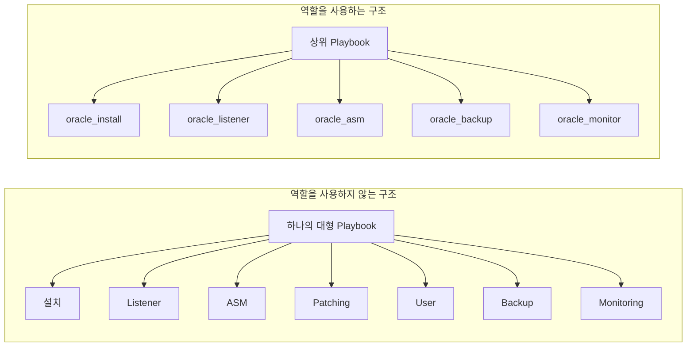
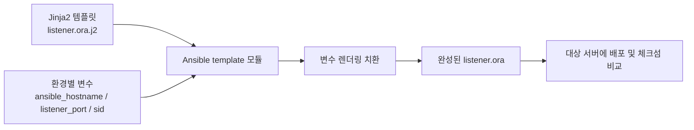
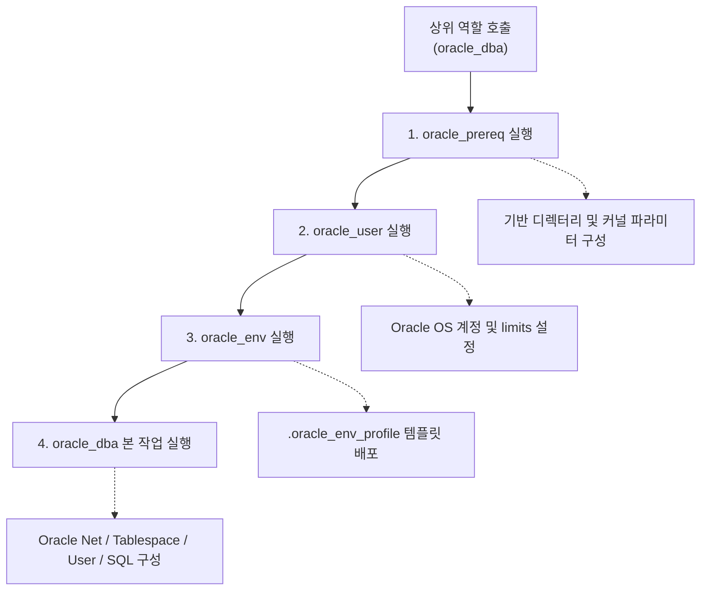
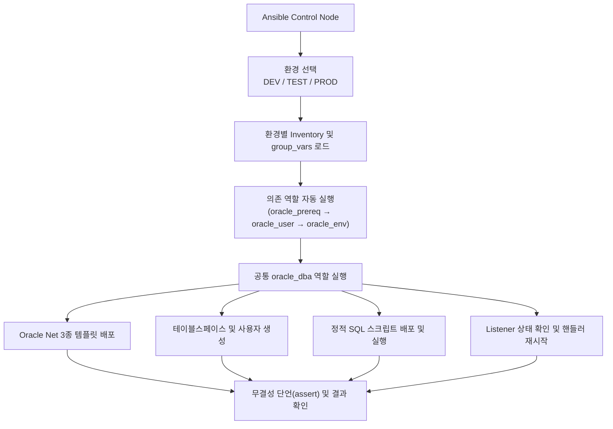
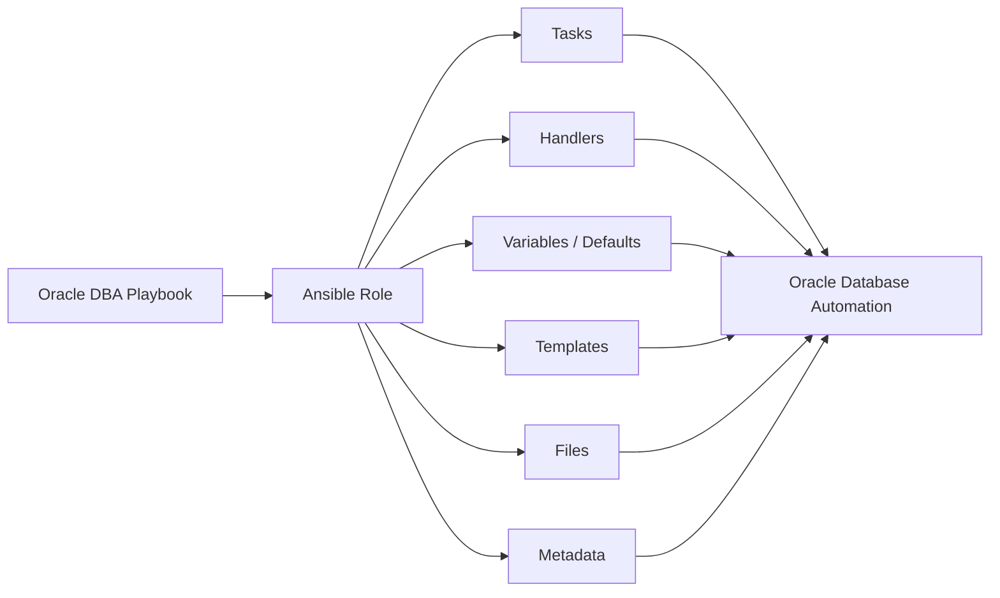

# 120 Days of Database Automation for DBAs
## Ansible for Oracle DBAs — Day 78/120
### Ansible 역할(Ansible Roles) 기초: Oracle DBA 자동화를 위한 모듈화·재사용·표준화

> **원본 자료:** `78_1791110015917.pdf` — 표지 1페이지 및 본문 12페이지  
> **편집 및 검증 기준:** 원본의 교육 순서, 핵심 개념, 디렉터리 구조, 실습 주제와 Oracle DBA 활용 사례를 유지하면서 한국어 문장과 코드 표기를 정리했습니다. 또한 로컬 Docker 기반 Oracle Linux 8.10 멀티 컨테이너 실습 환경([`chapter_7`](file:///c:/Users/zapan/Documents/ansible_oracle/chapter_7))에서 모든 역할(`oracle_db`, `oracle_dba`, `oracle_prereq`, `oracle_user`, `oracle_env`)과 플레이북을 실제로 실행·검증하여 재현 가능한 실무 코드와 실행 로그를 반영했습니다.

---

# 조판 및 출판 스타일 가이드

| 요소 | 지정 폰트 |
|---|---|
| 책 본문 | `Noto Sans KR` |
| 장·절 제목 | `Noto Sans KR Bold` |
| 표 | `Noto Sans KR` |
| 캡션 | `Noto Sans KR` |
| 영문 기술 용어 | `Noto Sans KR` |
| 코드 블록 | `DejaVu Sans Mono` |

## 문체 및 표기 원칙

- 본문은 `~합니다/입니다` 문체로 통일합니다.
- 기술 용어는 처음 등장할 때 `한글 용어(English Term)` 형식으로 표기합니다.
- 이후에는 문맥이 명확한 경우 한글 용어를 우선 사용합니다.
- 명령어, 변수, 파일명, 디렉터리, 모듈, 옵션은 인라인 코드(Inline Code)로 표시합니다.
- YAML, Jinja2, SQL, 셸 명령은 코드 블록으로 분리합니다.
- 원문에 제시된 개념과 예제는 유지하되, OCR 오류가 명백한 표기와 들여쓰기는 실제 실행 검증된 형태로 정리합니다.

> [!NOTE]
> Ansible 역할(Ansible Role)은 작업(Task), 핸들러(Handler), 변수(Variable), 템플릿(Template), 정적 파일(Static File) 및 메타데이터(Metadata)를 표준 디렉터리 구조로 묶어 재사용할 수 있도록 하는 핵심 자동화 단위입니다.

---

# 1. Ansible 역할 기초

Ansible 역할은 자동화 작업을 재사용 가능한 모듈로 구성하는 기능입니다.

역할을 사용하면 플레이북(Playbook)에 모든 작업을 한꺼번에 작성하지 않아도 됩니다. 작업과 설정 파일을 기능별 디렉터리에 나누어 저장할 수 있으므로 코드의 구조가 명확해집니다.

Oracle DBA 자동화에서는 데이터베이스 설치, 리스너(Listener) 구성, 자동 스토리지 관리(ASM, Automatic Storage Management) 설정, 데이터 가드(Data Guard) 구성, 패치(Patching), 사용자 관리, 테이블스페이스(Tablespace) 관리 등의 작업을 역할로 분리할 수 있습니다.

## 1.1 Ansible 역할이란?

역할은 다음 요소를 표준 디렉터리 구조로 구성한 단위입니다.

- 작업(Task)
- 핸들러(Handler)
- 변수(Variable)
- 기본 변수(Default Variable)
- 템플릿(Template)
- 정적 파일(Static File)
- 메타데이터 및 의존성(Metadata and Dependency)

역할은 일반적으로 프로젝트의 `roles/` 디렉터리 아래에 배치합니다.

## 1.2 역할을 사용하는 이유

하나의 플레이북에 모든 작업을 작성하면 코드가 커지고 복잡해집니다. 작업을 수정하거나 환경별 설정을 변경할 때도 관리 부담이 커집니다.

역할을 사용하면 기능별로 코드를 나누고 여러 프로젝트와 환경에서 재사용할 수 있습니다.

| 역할을 사용하지 않는 경우 | 역할을 사용하는 경우 |
|---|---|
| 하나의 플레이북에 작업이 집중됩니다. | 기능별 디렉터리로 작업을 분리합니다. |
| 코드가 커지면서 유지보수가 어려워집니다. | 모듈화된 구조로 관리하기 쉽습니다. |
| 작업을 다른 프로젝트에서 재사용하기 어렵습니다. | 역할을 여러 프로젝트에서 재사용할 수 있습니다. |
| DEV/TEST/PROD별 설정 관리가 복잡해집니다. | 환경별 변수와 설정을 분리할 수 있습니다. |
| 문제 발생 시 작업 흐름을 추적하기 어렵습니다. | 기능 단위로 테스트하고 문제를 분석할 수 있습니다. |
| 팀 간 코드 표준을 유지하기 어렵습니다. | 표준 구조를 공유하여 협업할 수 있습니다. |

## 1.3 역할을 사용하지 않는 구조와 사용하는 구조

역할을 사용하지 않으면 데이터베이스 설치, 리스너 구성, ASM 설정, 패치, 사용자 관리, 백업, 모니터링 등의 작업이 하나의 큰 플레이북에 섞일 수 있습니다.

역할을 사용하면 각 기능을 별도의 단위로 나눌 수 있습니다.



**그림 1-1. 단일 플레이북 구조와 역할 기반 구조 비교**

## 1.4 Oracle DBA 자동화에서의 활용 사례

| 역할 예시 | 주요 작업 |
|---|---|
| `oracle_install` | Oracle Database 소프트웨어 설치 |
| `oracle_listener` | Listener 설정 및 관리 |
| `oracle_asm` | ASM 설치 및 구성 |
| `oracle_backup` | 백업 및 RMAN 자동화 |
| `oracle_dataguard` | Data Guard 구성 |
| `oracle_patching` | 패치 자동화 |
| `oracle_user` | 사용자 및 스키마 관리 |
| `oracle_monitor` | 데이터베이스 모니터링 |
| `oracle_tablespace` | 테이블스페이스 관리 |

> [!TIP]
> 역할의 핵심은 기능별로 자동화 코드를 나누는 것입니다. 역할을 단일 책임 원칙에 맞춰 설계하면 동일한 코드를 개발(DEV), 테스트(TEST), 운영(PROD) 데이터베이스 환경에 그대로 재사용할 수 있습니다.

---

# 2. Ansible 역할 디렉터리 구조

Ansible은 역할을 구성하기 위한 표준 디렉터리 구조를 제공합니다. 각 디렉터리는 명확한 목적을 가지며, 역할의 작업과 설정을 체계적으로 관리하도록 돕습니다.

## 2.1 표준 디렉터리 구조

```text
roles/
└── oracle_db/
    ├── tasks/
    │   └── main.yml
    ├── handlers/
    │   └── main.yml
    ├── vars/
    │   └── main.yml
    ├── defaults/
    │   └── main.yml
    ├── templates/
    │   ├── init.ora.j2
    │   └── listener.ora.j2
    ├── files/
    │   ├── db_script.sh
    │   ├── init.ora
    │   └── setup_db.sql
    ├── meta/
    │   └── main.yml
    └── README.md
```

**그림 2-1. Oracle 데이터베이스 역할의 표준 디렉터리 구조**

## 2.2 각 디렉터리의 목적

| 디렉터리 | 파일 | 용도 |
|---|---|---|
| `tasks/` | `main.yml` | 역할에서 실행할 주요 작업을 정의합니다. |
| `handlers/` | `main.yml` | 작업의 알림(`notify`)을 받았을 때 실행할 핸들러를 정의합니다. |
| `vars/` | `main.yml` | 역할 내부에서 고정적으로 사용할 높은 우선순위의 변수를 정의합니다. |
| `defaults/` | `main.yml` | 외부에서 쉽게 재정의할 수 있는 기본 변수값을 정의합니다. |
| `templates/` | `*.j2` | Jinja2 동적 템플릿 파일을 저장합니다. |
| `files/` | 스크립트, 설정 파일 | 대상 서버에 그대로 복사할 정적 파일을 저장합니다. |
| `meta/` | `main.yml` | 역할의 메타데이터와 다른 역할에 대한 의존성을 정의합니다. |

## 2.3 디렉터리별 역할 이해

- `tasks/`: 실제로 수행할 작업을 정의합니다.
- `handlers/`: 설정 파일 변경 등 특정 작업이 알림을 보냈을 때 후속 작업을 수행합니다.
- `vars/`: 역할 내부에서 사용할 변수를 정의합니다.
- `defaults/`: 사용자가 환경에 맞게 쉽게 변경할 수 있는 기본값을 정의합니다.
- `templates/`: 변수에 따라 내용이 달라지는 동적 파일을 저장합니다.
- `files/`: 내용 변환 없이 대상 서버로 복사할 정적 파일을 저장합니다.
- `meta/`: 역할의 정보와 다른 역할에 대한 의존성을 정의합니다.

## 2.4 역할 구조 설계 원칙

1. 각 디렉터리의 목적을 명확히 구분합니다.
2. 각 디렉터리에 진입점 파일인 `main.yml`을 배치합니다.
3. 환경별로 달라지는 설정 파일은 `templates/`에서 Jinja2 템플릿으로 관리합니다.
4. 변환이 필요 없는 정적 스크립트와 파일은 `files/`에 저장합니다.
5. 환경별로 재정의 가능한 기본값은 `defaults/`에 둡니다.
6. 하나의 역할은 하나의 명확한 목적을 중심으로 구성합니다.

> [!NOTE]
> 역할 내부의 `tasks/main.yml`에서 `ansible.builtin.copy`나 `ansible.builtin.template` 모듈을 호출할 때는 `files/`나 `templates/` 경로 접두사를 생략하고 파일명(`src: init.ora` 또는 `src: listener.ora.j2`)만 지정해도 Ansible이 해당 역할의 디렉터리를 자동으로 검색합니다.

---

# 3. 첫 번째 Ansible 역할 만들기

역할은 디렉터리와 파일을 직접 생성하거나 `ansible-galaxy` 명령으로 초기화할 수 있습니다.

이 절에서는 Oracle 데이터베이스 구성 자동화에 사용할 `oracle_db` 역할을 만듭니다.

## 3.1 `ansible-galaxy init`으로 역할 생성

프로젝트 디렉터리에서 다음 명령을 실행합니다.

```bash
ansible-galaxy init roles/oracle_db
```

이 명령은 역할에 필요한 표준 디렉터리와 기본 스켈레톤(Skeleton) 파일을 자동으로 생성합니다. `ansible-core 2.15.13` 환경에서 실행한 실제 결과와 디렉터리 트리는 다음과 같습니다.

```text
- Role roles/oracle_db was created successfully
roles/oracle_db
|-- README.md
|-- defaults
|   `-- main.yml
|-- files
|-- handlers
|   `-- main.yml
|-- meta
|   `-- main.yml
|-- tasks
|   `-- main.yml
|-- templates
|-- tests
|   |-- inventory
|   `-- test.yml
`-- vars
    `-- main.yml

8 directories, 8 files
```

> [!NOTE]
> `ansible-galaxy init`은 표준 역할 구조를 빠르게 만드는 편리한 방법입니다. 기본 생성 구조에는 단위 테스트용 `tests/` 디렉터리(`inventory`, `test.yml`)가 함께 포함되며, 사용하지 않는 디렉터리는 비워 두거나 생략해도 무방합니다.

## 3.2 디렉터리를 직접 생성하는 방법

`ansible-galaxy` 없이 필요한 디렉터리와 파일만 직접 만들 수도 있습니다.

```bash
mkdir -p roles/oracle_db/{tasks,handlers,vars,defaults,templates,files,meta}
touch roles/oracle_db/tasks/main.yml
touch roles/oracle_db/handlers/main.yml
touch roles/oracle_db/vars/main.yml
touch roles/oracle_db/defaults/main.yml
touch roles/oracle_db/meta/main.yml
```

## 3.3 생성된 구조 확인

```bash
tree roles/oracle_db/
```

## 3.4 역할 작성 순서

1. `defaults/main.yml` 및 `vars/main.yml`에 기본값과 역할 변수를 정의합니다.
2. 설정 파일 템플릿을 `templates/`에 저장하고, 정적 스크립트와 파일을 `files/`에 배치합니다.
3. `tasks/main.yml`에 실행할 작업을 순서대로 작성합니다.
4. `handlers/main.yml`에 설정 변경 시 알림을 받을 후속 작업을 작성합니다.
5. 필요한 경우 `meta/main.yml`에 의존 역할을 선언합니다.
6. 상위 플레이북에서 역할을 호출하고, 멱등성(Idempotency)과 환경별 동작을 검증합니다.

---

# 4. 작업(Task) 정의와 실행

작업(Task)은 역할이 대상 서버에서 수행할 동작을 정의합니다.

역할의 주요 작업은 `tasks/main.yml`에 작성합니다. Ansible은 작업을 정의된 순서에 따라 위에서 아래로 실행합니다.

## 4.1 `tasks/main.yml`의 기본 구조

```yaml
---
- name: Print a message from oracle_db role
  ansible.builtin.debug:
    msg: "Executing oracle_db role on {{ inventory_hostname }} (DB: {{ db_name }}, Port: {{ listener_port }})"
```

## 4.2 Oracle 디렉터리 생성

```yaml
---
- name: Create Oracle directory
  ansible.builtin.file:
    path: /u01/app/oracle
    state: directory
    owner: oracle
    group: oinstall
    mode: "0755"
```

## 4.3 설정 파일 복사

정적 `init.ora` 파일을 역할의 `files/` 디렉터리에서 대상 경로로 배포하는 예제입니다.

```yaml
- name: Copy static Oracle configuration file (init.ora)
  ansible.builtin.copy:
    src: init.ora
    dest: /u01/app/oracle/product/19c/dbs/init.ora
    owner: oracle
    group: oinstall
    mode: "0644"
```

## 4.4 Listener 작업 예시

Listener 시작 작업에서 `register`와 `changed_when`을 결합하면 단순 명령 실행에도 정확한 변경 상태 판정을 부여할 수 있습니다.

```yaml
- name: Start Oracle listener if not running
  ansible.builtin.command: lsnrctl start
  become: true
  become_user: oracle
  register: listener_out
  changed_when: "'starting' in (listener_out.stdout | lower)"
```

> [!WARNING]
> `lsnrctl start` 명령은 리스너가 중지된 상태에서 기동될 때 `"Starting /u01/app/oracle/product/19c/bin/tnslsnr: please wait..."`를 출력하며, 이미 실행 중인 경우에는 `TNS-01106: Listener using listener name LISTENER has already been started`를 출력합니다. 대소문자 차이에 안전하도록 `listener_out.stdout | lower` 필터를 적용하여 `'starting'` 문자열 포함 여부를 검사하고, 실제 운영 환경에서는 `lsnrctl status` 사전 점검 또는 서비스返回 코드(`rc`) 정책을 함께 검증하십시오.

## 4.5 작업 실행의 기본 특성

- 작업은 정의된 순서대로 실행됩니다.
- 일반적으로 앞 작업이 실패하면 해당 호스트의 이후 작업은 중단됩니다.
- 작업 이름(`name`)은 수행 목적을 명확하게 표현해야 합니다.
- 가능한 경우 셸 명령(`shell`, `command`)보다 전용 Ansible 모듈(`file`, `copy`, `template` 등)을 우선 사용합니다.
- 모든 작업은 멱등성(Idempotency)을 고려해 작성합니다.
- 크고 복잡한 작업은 작은 단위로 나누어 재사용성을 높입니다.

## 4.6 멱등성이란?

멱등성은 동일한 작업을 여러 번 실행해도 원하는 최종 상태가 유지되며 불필요한 재작업이 발생하지 않는 특성입니다.

예를 들어 디렉터리가 이미 존재하고 권한이 일치하면 `ansible.builtin.file` 모듈은 상태를 변경하지 않고 `ok`(`changed=false`)를 반환합니다.

| 작업 | 예시 모듈 |
|---|---|
| 디렉터리 생성 | `ansible.builtin.file` |
| 정적 설정 파일 복사 | `ansible.builtin.copy` |
| 동적 템플릿 배포 | `ansible.builtin.template` |
| 패키지 관리 | `ansible.builtin.package` / `ansible.builtin.dnf` |
| 서비스 관리 | `ansible.builtin.service` / `ansible.builtin.systemd` |

---

# 5. 핸들러(Handler): 변경이 있을 때만 후속 작업 실행

핸들러는 다른 작업에서 알림(`notify`)을 받았을 때만 실행되는 특별한 작업입니다.

`listener.ora`와 같은 네트워크 설정 파일이 실제로 변경되었을 때만 Listener를 재시작하거나 재로드(Reload)하는 작업에 매우 유용합니다.

## 5.1 핸들러의 특징

- 작업의 실행 결과가 `changed`이고 `notify`가 선언된 경우에만 실행됩니다.
- 서비스 재시작이나 설정 재로드에 활용합니다.
- 설정이 바뀌지 않았을 때 발생하는 불필요한 재시작과 서비스 순단을 방지합니다.
- Oracle Listener, 데이터베이스, ASM, Clusterware 등의 관리 작업에 응용할 수 있습니다.

## 5.2 핸들러 디렉터리 구조

```text
roles/
└── oracle_db/
    ├── tasks/
    │   └── main.yml
    └── handlers/
        └── main.yml
```

## 5.3 작업에서 핸들러 호출 (`tasks/main.yml`)

```yaml
---
- name: Deploy dynamic listener.ora from Jinja2 template
  ansible.builtin.template:
    src: listener.ora.j2
    dest: "{{ oracle_home }}/network/admin/listener.ora"
    owner: "{{ oracle_user }}"
    group: "{{ oracle_group }}"
    mode: "0644"
  notify: Restart Oracle listener
```

## 5.4 핸들러 정의 (`handlers/main.yml`)

원문에는 핸들러 개념 설명을 위해 `lsnrctl stop` 단일 명령 예시가 등장하지만, 실제 Listener 재시작을 완료하려면 중지 후 시작(`lsnrctl stop` 후 `lsnrctl start`)하거나 무중단 반영이 가능한 경우 `lsnrctl reload`를 수행해야 합니다.

```yaml
---
- name: Restart Oracle listener
  ansible.builtin.shell: |
    lsnrctl stop
    lsnrctl start
  become: true
  become_user: "{{ oracle_user }}"
```

## 5.5 핸들러 실행 흐름

```mermaid
flowchart TD
    A["설정 파일 배포 작업<br/>(template: listener.ora.j2)"] --> B{"파일 내용이 변경되었습니까?"}
    B -->|아니요 (ok)| C["핸들러 실행 안 함"]
    B -->|예 (changed)| D["notify로 핸들러 예약"]
    D --> E["플레이의 모든 작업 실행 완료"]
    E --> F["핸들러 실행 (1회 통합 실행)"]
    F --> G["Listener 재시작 또는 재로드"]
```

**그림 5-1. 작업 변경과 핸들러 실행 흐름**

핸들러는 알림을 받은 즉시 실행되지 않고, 기본적으로 해당 플레이(Play)의 일반 작업이 모두 끝난 뒤 마지막에 한 번 실행됩니다. 여러 작업이 동일한 핸들러에 중복으로 알림을 보내도 핸들러는 단 한 번만 실행됩니다.

## 5.6 Oracle DBA 자동화 활용 예

| 변경 대상 | 핸들러 작업 예 |
|---|---|
| `listener.ora` | Listener 재시작(`stop`/`start`) 또는 재로드(`reload`) |
| `tnsnames.ora` | 연결 별칭 검증(`tnsping`) 및 후속 점검 |
| 데이터베이스 설정 | 적용 방식(`SCOPE=SPFILE` 등)에 맞는 재구성 또는 인스턴스 재시작 |
| ASM 설정 | ASM 관련 리소스 점검 및 재로드 |
| Clusterware 설정 | CRS 관련 서비스 재시작 또는 재로드 |

> [!CAUTION]
> 데이터베이스 인스턴스, ASM, Clusterware 또는 운영 Listener를 재시작하는 작업은 신규 세션 연결 실패나 서비스 중단을 유발할 수 있습니다. 운영(PROD) 환경에서는 포트 변경이 아닌 단순 서비스 등록 변경 시 `lsnrctl reload`를 우선 검토하고, 재시작이 필수적인 경우 계획된 작업 시간(Maintenance Window)과 RAC 롤링 작업 여부를 반드시 확인해야 합니다.

---

# 6. 변수와 기본값: 역할의 유연성과 재사용성

변수(Variable)를 사용하면 동일한 역할을 여러 환경에서 수정 없이 재사용할 수 있습니다.

예를 들어 DEV, TEST, PROD 환경에서 Oracle 경로, Listener 포트, 데이터베이스 이름(`db_name`), 메모리 크기(`sga_target`)가 다르더라도 역할 코드를 복제할 필요가 없습니다.

## 6.1 변수 정의 위치와 우선순위

Ansible에서 역할과 함께 자주 사용하는 변수 정의 위치는 다음과 같습니다(아래로 갈수록 우선순위가 높습니다).

| 우선순위(낮음 → 높음) | 변수 위치 | 설명 |
|---|---|---|
| 1 (가장 낮음) | `roles/<role>/defaults/main.yml` | 역할의 기본값을 정의합니다. 외부 변수로 가장 쉽게 재정의할 수 있습니다. |
| 2 | `group_vars/all.yml` | 모든 호스트 그룹에 공통 적용되는 인벤토리 그룹 변수입니다. |
| 3 | `group_vars/<group>.yml` | `dev`, `test`, `prod` 등 특정 환경 그룹에 적용되는 변수입니다. |
| 4 | 플레이북 `vars:` | 플레이북 내에서 직접 선언한 변수입니다. |
| 5 | `roles/<role>/vars/main.yml` | 역할 내부 고정 변수입니다. 인벤토리 변수(`group_vars`)보다 우선순위가 높습니다. |
| 6 (가장 높음) | `--extra-vars` (`-e`) | 명령줄에서 전달하는 추가 변수로, 모든 변수를 덮어씁니다. |

> [!IMPORTANT]
> 환경별로 다르게 주입해야 하는 변수(`listener_port`, `db_name`, `sid`, `sga_target` 등)는 반드시 역할의 `defaults/main.yml`에 기본값을 두고 `group_vars/{dev,test,prod}.yml`에서 재정의해야 합니다. 만약 이를 역할의 `vars/main.yml`에 정의하면 `group_vars`보다 우선순위가 높아 환경별 변수가 무시됩니다.

## 6.2 `defaults/main.yml` 예제

파일 경로: [`roles/oracle_db/defaults/main.yml`](file:///c:/Users/zapan/Documents/ansible_oracle/chapter_7/ansible-oracle-project/roles/oracle_db/defaults/main.yml)

```yaml
---
oracle_user: oracle
oracle_group: oinstall
oracle_base: /u01/app/oracle
oracle_home: /u01/app/oracle/product/19c
listener_port: 1521
db_name: ORCL
sid: ORCL
sga_target: 1G
```

## 6.3 `vars/main.yml` 예제

파일 경로: [`roles/oracle_db/vars/main.yml`](file:///c:/Users/zapan/Documents/ansible_oracle/chapter_7/ansible-oracle-project/roles/oracle_db/vars/main.yml)

```yaml
---
oracle_config_dir: /u01/app/oracle/config
oracle_wallet_enabled: true
```

역할 내부에서 외부 환경과 무관하게 고정으로 사용할 정책이나 경로를 정의합니다. 민감한 비밀번호는 평문으로 저장하지 말고 Ansible Vault로 암호화하여 관리해야 합니다.

## 6.4 작업에서 변수 참조

```yaml
- name: Create Oracle directory
  ansible.builtin.file:
    path: "{{ oracle_base }}"
    state: directory
    owner: "{{ oracle_user }}"
    group: "{{ oracle_group }}"
    mode: "0755"
```

## 6.5 환경별 변수 재정의 (`group_vars/`)

```yaml
# group_vars/dev.yml (DEV 환경)
env_name: dev
db_name: DEVDB
sid: DEVDB
listener_port: 1521
sga_target: 2G
```

```yaml
# group_vars/prod.yml (PROD 환경)
env_name: prod
db_name: PRODDB
sid: PRODDB
listener_port: 1522
sga_target: 8G
```

동일한 역할을 사용하면서 환경별 변수 파일만 분리하여 각 환경에 맞는 설정을 자동으로 주입할 수 있습니다.

## 6.6 변수 기반 역할의 장점

- Oracle 경로와 포트를 변수로 일원화하여 관리할 수 있습니다.
- DEV, TEST, PROD 환경별 값을 코드와 분리할 수 있습니다.
- 동일한 역할을 수십 대의 데이터베이스 서버에 재사용할 수 있습니다.
- 하드코딩(Hardcoding)으로 인한 휴먼 에러를 줄일 수 있습니다.
- 플레이북과 템플릿의 가독성을 높일 수 있습니다.

---

# 7. Jinja2 템플릿과 동적 설정 파일

Ansible은 Jinja2 템플릿 엔진을 사용하여 서버 및 환경별 설정 파일을 동적으로 생성합니다.

템플릿 파일(`.j2`)에는 변수와 제어 구문을 작성하며, Ansible이 템플릿을 배포할 때 대상 호스트의 실제 변수값으로 치환하여 완성된 설정 파일을 생성합니다.

## 7.1 템플릿의 기본 개념

| 구문 | 용도 | 예 |
|---|---|---|
| `{{ variable }}` | 변수 출력 | `{{ listener_port }}` |
| `` | 반복문 | `` |
| `` | 조건문 | `` |
| `{{ value \| upper }}` | 필터 | 문자열을 대문자로 변환 |
| `` | 다른 템플릿 포함 | `` |

## 7.2 Listener 설정 템플릿 예제

파일 경로: [`roles/oracle_db/templates/listener.ora.j2`](file:///c:/Users/zapan/Documents/ansible_oracle/chapter_7/ansible-oracle-project/roles/oracle_db/templates/listener.ora.j2)

```jinja2
# Listener Configuration File (Generated by Ansible Role: oracle_db)
# Target Host: {{ ansible_hostname }} | Environment: {{ env_name | default('default') | upper }}

LISTENER =
  (DESCRIPTION_LIST =
    (DESCRIPTION =
      (ADDRESS =
        (PROTOCOL = TCP)
        (HOST = {{ ansible_hostname }})
        (PORT = {{ listener_port }})
      )
    )
  )

SID_LIST_LISTENER =
  (SID_LIST =
    (SID_DESC =
      (GLOBAL_DBNAME = {{ db_name }})
      (ORACLE_HOME = {{ oracle_home }})
      (SID_NAME = {{ sid }})
    )
  )
```

## 7.3 초기화 파라미터 템플릿 예제 (`init.ora.j2`)

파일 경로: [`roles/oracle_db/templates/init.ora.j2`](file:///c:/Users/zapan/Documents/ansible_oracle/chapter_7/ansible-oracle-project/roles/oracle_db/templates/init.ora.j2)

```jinja2
# Dynamic Oracle Initialization Parameter File (templates/init.ora.j2)
db_name='{{ db_name }}'
instance_name='{{ sid }}'
sga_target={{ sga_target | default('2G') }}
processes=300
diagnostic_dest='{{ oracle_base }}'
compatible='19.0.0'
```

## 7.4 템플릿 배포 작업

```yaml
- name: Deploy dynamic listener.ora from Jinja2 template
  ansible.builtin.template:
    src: listener.ora.j2
    dest: "{{ oracle_home }}/network/admin/listener.ora"
    owner: "{{ oracle_user }}"
    group: "{{ oracle_group }}"
    mode: "0644"
  notify: Restart Oracle listener
```

## 7.5 템플릿 처리 흐름



**그림 7-1. Jinja2 템플릿에서 Oracle 설정 파일을 생성하는 과정**

## 7.6 Oracle DBA 자동화 활용 사례

- `listener.ora` 생성
- `tnsnames.ora` 생성
- `init.ora` 또는 초기화 파라미터 파일(PFILE) 생성
- `sqlnet.ora` 생성
- 환경별 사용자·테이블스페이스 생성 SQL 스크립트 생성
- Data Guard 브로커 및 복제 설정 파일 생성

> [!NOTE]
> `ansible.builtin.template` 모듈은 렌더링된 결과의 체크섬(Checksum)을 대상 서버의 기존 파일과 비교하여, 내용이 실제로 달라진 경우에만 파일을 덮어쓰고 `changed` 상태를 반환합니다. 이를 통해 멱등성을 보장하고 불필요한 핸들러 호출을 막습니다.

---

# 8. 정적 파일과 지원 리소스: `files/`

역할의 `files/` 디렉터리에는 대상 서버에 그대로 복사할 정적 파일을 저장합니다.

정적 파일은 Jinja2 변수 치환 없이 원본 내용을 유지한 채 배포하는 파일입니다.

## 8.1 `files/` 디렉터리의 용도

- 공통 SQL 스크립트 (`setup_db.sql`)
- 고정 초기화 파라미터 파일 (`init.ora`)
- 패치 아카이브 파일 (`oracle_patch.zip`)
- 셸 유틸리티 스크립트 (`db_script.sh`)
- 기타 바이너리 및 지원 파일

## 8.2 디렉터리 구조 예제

```text
roles/
└── oracle_db/
    ├── tasks/
    │   └── main.yml
    ├── templates/
    │   ├── init.ora.j2
    │   └── listener.ora.j2
    └── files/
        ├── db_script.sh
        ├── init.ora
        └── setup_db.sql
```

## 8.3 정적 SQL 파일 예제

파일 경로: [`roles/oracle_db/files/setup_db.sql`](file:///c:/Users/zapan/Documents/ansible_oracle/chapter_7/ansible-oracle-project/roles/oracle_db/files/setup_db.sql)

```sql
CREATE TABLE test_table (
    name         VARCHAR2(100),
    created_date DATE
);

INSERT INTO test_table
VALUES ('Ansible Oracle', SYSDATE);

COMMIT;
```

## 8.4 `copy` 모듈로 파일 배포

```yaml
- name: Copy static SQL script to target server
  ansible.builtin.copy:
    src: setup_db.sql
    dest: "{{ oracle_base }}/setup_db.sql"
    owner: "{{ oracle_user }}"
    group: "{{ oracle_group }}"
    mode: "0644"
```

## 8.5 Oracle DBA 자동화에서 관리할 수 있는 파일

| 파일 또는 리소스 | 용도 |
|---|---|
| `init.ora` | 고정 표준 초기화 파라미터 파일 |
| `setup_db.sql` | 공통 초기 테이블 및 메타데이터 생성 SQL |
| `db_script.sh` | 운영 점검 및 백업 보조 셸 스크립트 |
| `oracle_patch.zip` | OPatch 적용을 위한 패치 아카이브 |
| `wallet.zip` | 보안 접속을 위한 Wallet 아카이브(암호화 관리 필수) |

> [!CAUTION]
> Oracle Wallet(`cwallet.sso`, `ewallet.p12`), SSL 인증서, 개인 키 파일 등 민감한 보안 자료는 평문 상태로 `files/`에 넣어 Git 저장소에 커밋해서는 안 됩니다. 이러한 파일은 Ansible Vault로 암호화하거나 외부 비밀 금고(Secret Manager)에서 배포 시점에 주입해야 합니다.

---

# 9. 역할 의존성과 재사용성

역할 의존성(Role Dependency)은 하나의 역할이 실행되기 전에 다른 역할이 먼저 수행되어야 할 때 사용하는 기능입니다.

복잡한 자동화를 작은 역할로 나누고 의존성으로 조합하면 코드 중복을 줄이고 유지보수성을 높일 수 있습니다.

## 9.1 역할 의존성을 사용하는 이유

- 복잡한 자동화를 작은 단일 책임 역할로 분리합니다.
- 이미 검증된 기반 역할(OS 사전 설정, 계정 생성, 환경 변수 구성)을 재사용합니다.
- 모든 서버에서 사전 요구 사항 설정의 일관성을 유지합니다.
- 중복 코드를 제거합니다.
- 각 역할을 개별적으로 유지보수하고 테스트하기 쉽습니다.

## 9.2 역할 의존성 예제

Oracle DBA 통합 역할(`oracle_dba`)이 다음 세 가지 기반 역할에 의존하도록 설계합니다.

1. [`oracle_prereq`](file:///c:/Users/zapan/Documents/ansible_oracle/chapter_7/ansible-oracle-project/roles/oracle_prereq): 필수 디렉터리 구조와 커널 파라미터(`sysctl`) 사전 요구 사항을 구성합니다.
2. [`oracle_user`](file:///c:/Users/zapan/Documents/ansible_oracle/chapter_7/ansible-oracle-project/roles/oracle_user): Oracle 운영체제 사용자(`oracle`)와 보안 리소스 한도(`limits.conf`)를 검증·구성합니다.
3. [`oracle_env`](file:///c:/Users/zapan/Documents/ansible_oracle/chapter_7/ansible-oracle-project/roles/oracle_env): `ORACLE_BASE`, `ORACLE_HOME`, `ORACLE_SID`, `TNS_ADMIN` 환경 변수 프로파일(`.oracle_env_profile`)을 배포합니다.

## 9.3 `meta/main.yml` 예제

파일 경로: [`roles/oracle_dba/meta/main.yml`](file:///c:/Users/zapan/Documents/ansible_oracle/chapter_7/ansible-oracle-project/roles/oracle_dba/meta/main.yml)

```yaml
---
galaxy_info:
  author: Oracle DBA Team
  description: Master Reusable Oracle DBA Automation Role (DEV / TEST / PROD)
  license: MIT
  min_ansible_version: "2.12"
dependencies:
  - role: oracle_prereq
  - role: oracle_user
  - role: oracle_env
```

역할 의존성은 `meta/main.yml`의 `dependencies:` 목록에 정의합니다.

## 9.4 의존성 실행 흐름



**그림 9-1. Oracle 데이터베이스 역할의 의존성 실행 순서**

## 9.5 의존성 관리 시 고려 사항

- 의존 역할이 실행되는 순서는 `meta/main.yml`의 `dependencies` 리스트 선언 순서를 따릅니다.
- 모든 의존 역할의 실행이 완료된 후에 상위 역할의 `tasks/main.yml`이 실행됩니다.
- 조건부로 의존 역할을 실행해야 하는 경우 `when:` 조건문을 함께 지정할 수 있습니다.
- 각 의존 역할도 단독으로 실행 및 테스트할 수 있도록 기본값(`defaults/main.yml`)을 갖춰야 합니다.

## 9.6 Ansible Galaxy 역할 활용

Ansible Galaxy는 커뮤니티 역할과 컬렉션(Collection)을 검색하고 설치하는 데 사용할 수 있습니다.

```bash
ansible-galaxy role install geerlingguy.oracle
```

> [!WARNING]
> 원본 자료에 예시로 언급된 `geerlingguy.oracle` 등의 외부 커뮤니티 역할은 현재 배포 여부, 유지보수 상태, 지원 운영체제 및 Oracle 버전을 별도로 확인해야 합니다. 엔터프라이즈 운영 환경에 적용하기 전에는 반드시 내부 보안 정책, 라이선스, 소스 코드를 전수 검토하십시오.

---

# 10. Oracle DBA 역할 설계 모범 사례

역할을 모범 사례에 따라 설계하면 자동화의 신뢰성, 재사용성, 유지보수성을 높일 수 있습니다.

## 10.1 역할 설계 10대 원칙

1. 역할은 작고 명확한 하나의 책임을 중심으로 구성합니다.
2. 표준 디렉터리 구조를 일관되게 유지합니다.
3. 역할, 변수, 파일에 직관적이고 의미 있는 이름을 사용합니다.
4. 모든 작업을 멱등성 있게 작성합니다.
5. 변수(`group_vars`), 템플릿(`templates/`), 기본값(`defaults/`)을 활용해 유연성을 확보합니다.
6. `ORACLE_HOME`, `ORACLE_BASE`, SID, 포트 등을 작업 파일에 하드코딩하지 않습니다.
7. 서비스 재시작과 재로드에는 반드시 핸들러(`handlers/`)를 활용합니다.
8. 비밀번호와 인증 키는 Ansible Vault 등으로 안전하게 보호합니다.
9. DEV, TEST, PROD 환경별 설정을 인벤토리 그룹 변수로 분리합니다.
10. 역할의 목적, 변수, 의존성을 `README.md`에 문서화합니다.

## 10.2 환경별 설정 분리

DEV, TEST, PROD 환경의 설정을 분리하면 동일한 역할을 여러 환경에서 수정 없이 재사용할 수 있습니다.

```text
group_vars/
├── all.yml
├── dev.yml
├── test.yml
└── prod.yml
```

## 10.3 민감한 정보 보호

데이터베이스 비밀번호, API 키, 인증 정보 등은 Ansible Vault를 사용해 암호화합니다.

```bash
ansible-vault encrypt group_vars/prod/vault.yml
```

> [!CAUTION]
> Ansible Vault 파일을 암호화하는 것과 Vault 비밀번호 파일(`.vault_pass`)을 안전하게 보관하는 것은 별개의 작업입니다. Vault 비밀번호 파일을 Git 저장소에 함께 커밋하지 않도록 `.gitignore`에 반드시 등록하십시오.

## 10.4 템플릿과 핸들러 결합

설정 파일은 템플릿으로 관리하고, 실제 파일이 변경되었을 때만 핸들러를 호출하도록 구성합니다.

```yaml
- name: Deploy Oracle Net configuration templates (listener.ora, tnsnames.ora, sqlnet.ora)
  ansible.builtin.template:
    src: "{{ item }}.j2"
    dest: "{{ oracle_home }}/network/admin/{{ item }}"
    owner: "{{ oracle_user }}"
    group: "{{ oracle_group }}"
    mode: "0644"
  loop:
    - listener.ora
    - tnsnames.ora
    - sqlnet.ora
  notify: Restart Oracle listener
```

## 10.5 역할 문서화

역할의 목적, 입력 변수, 지원 환경, 실행 방법, 의존성을 각 역할 내부의 `README.md`에 기록합니다.

---

# 11. 마스터 프로젝트: 재사용 가능한 Oracle DBA 역할

이 장의 마스터 프로젝트에서는 DEV, TEST, PROD 다중 환경에서 공통으로 사용할 수 있는 통합 역할([`roles/oracle_dba`](file:///c:/Users/zapan/Documents/ansible_oracle/chapter_7/ansible-oracle-project/roles/oracle_dba))을 구축합니다.

프로젝트 목표는 사전 요구 사항 검증(의존 역할), Oracle Net 설정(`listener.ora`, `tnsnames.ora`, `sqlnet.ora`) 동적 생성, 테이블스페이스 및 애플리케이션 사용자(`app_user`) 생성, 초기 SQL 스크립트(`setup_db.sql`) 실행, 그리고 핸들러 기반 Listener 제어를 하나의 표준화된 역할 파이프라인으로 통합하는 것입니다.

## 11.1 프로젝트 목표

- 여러 DBA 작업에서 공통으로 사용할 표준 역할을 만듭니다.
- DEV, TEST, PROD 환경별 변수를 `group_vars`로 분리합니다.
- 의존 역할(`oracle_prereq` → `oracle_user` → `oracle_env`)을 자동으로 연계합니다.
- 변수, Jinja2 템플릿, 정적 SQL 파일을 재사용합니다.
- 상태 점검(`stat`)과 조건문(`when`)을 결합해 SQL 작업의 멱등성을 보장합니다.

## 11.2 프로젝트 디렉터리 구조

실제 구현된 [`chapter_7/ansible-oracle-project`](file:///c:/Users/zapan/Documents/ansible_oracle/chapter_7/ansible-oracle-project) 디렉터리 구조는 다음과 같습니다.

```text
ansible-oracle-project/
├── ansible.cfg
├── group_vars/
│   ├── all.yml
│   ├── dev.yml
│   ├── test.yml
│   └── prod.yml
├── inventory/
│   ├── hosts.ini
│   ├── dev.ini
│   ├── test.ini
│   └── prod.ini
├── roles/
│   ├── oracle_prereq/
│   ├── oracle_user/
│   ├── oracle_env/
│   ├── oracle_db/
│   └── oracle_dba/
│       ├── defaults/
│       │   └── main.yml
│       ├── files/
│       │   └── setup_db.sql
│       ├── handlers/
│       │   └── main.yml
│       ├── meta/
│       │   └── main.yml
│       ├── tasks/
│       │   └── main.yml
│       ├── templates/
│       │   ├── listener.ora.j2
│       │   ├── tnsnames.ora.j2
│       │   └── sqlnet.ora.j2
│       ├── vars/
│       │   └── main.yml
│       └── README.md
└── playbooks/
    ├── 01_role_structure_and_tasks.yml
    ├── 02_handlers_and_templates.yml
    ├── 03_variables_precedence.yml
    ├── 04_role_dependencies.yml
    ├── 05_master_oracle_dba_role.yml
    ├── 06_validation_and_audit.yml
    └── oracle_dba.yml
```

**그림 11-1. 재사용 가능한 Oracle DBA 역할 프로젝트 구조**

## 11.3 환경별 변수 구성 (`group_vars/`)

- [`group_vars/dev.yml`](file:///c:/Users/zapan/Documents/ansible_oracle/chapter_7/ansible-oracle-project/group_vars/dev.yml):

```yaml
---
env_name: dev
db_name: DEVDB
sid: DEVDB
listener_port: 1521
db_user: app_user
db_profile: DEFAULT
db_container: ORCL
sga_target: 2G
sqlnet_expire_time: 10
```

- [`group_vars/test.yml`](file:///c:/Users/zapan/Documents/ansible_oracle/chapter_7/ansible-oracle-project/group_vars/test.yml):

```yaml
---
env_name: test
db_name: TESTDB
sid: TESTDB
listener_port: 1521
db_user: app_user
db_profile: DEFAULT
db_container: ORCL
sga_target: 4G
sqlnet_expire_time: 15
```

- [`group_vars/prod.yml`](file:///c:/Users/zapan/Documents/ansible_oracle/chapter_7/ansible-oracle-project/group_vars/prod.yml):

```yaml
---
env_name: prod
db_name: PRODDB
sid: PRODDB
listener_port: 1522
db_user: app_user
db_profile: DEFAULT
db_container: ORCL
sga_target: 8G
sqlnet_expire_time: 5
```

## 11.4 마스터 역할 기본 변수 (`defaults/main.yml`)

파일 경로: [`roles/oracle_dba/defaults/main.yml`](file:///c:/Users/zapan/Documents/ansible_oracle/chapter_7/ansible-oracle-project/roles/oracle_dba/defaults/main.yml)

```yaml
---
oracle_user: oracle
oracle_group: oinstall
oracle_base: /u01/app/oracle
oracle_home: /u01/app/oracle/product/19c
db_profile: DEFAULT
db_container: ORCL
db_user: app_user
db_tablespace: APP_DATA
db_name: ORCL
sid: ORCL
listener_port: 1521
sqlnet_expire_time: 10
```

## 11.5 마스터 역할 핵심 작업 정의 (`roles/oracle_dba/tasks/main.yml`)

파일 경로: [`roles/oracle_dba/tasks/main.yml`](file:///c:/Users/zapan/Documents/ansible_oracle/chapter_7/ansible-oracle-project/roles/oracle_dba/tasks/main.yml)

```yaml
---
- name: Ensure Oracle DBA directories exist
  ansible.builtin.file:
    path: "{{ item }}"
    state: directory
    owner: "{{ oracle_user }}"
    group: "{{ oracle_group }}"
    mode: "0755"
  loop:
    - "{{ oracle_base }}"
    - "{{ oracle_base }}/scripts"
    - "{{ oracle_home }}/network/admin"
    - "{{ oracle_state_dir }}"

- name: Deploy Oracle Net configuration templates (listener.ora, tnsnames.ora, sqlnet.ora)
  ansible.builtin.template:
    src: "{{ item }}.j2"
    dest: "{{ oracle_home }}/network/admin/{{ item }}"
    owner: "{{ oracle_user }}"
    group: "{{ oracle_group }}"
    mode: "0644"
  loop:
    - listener.ora
    - tnsnames.ora
    - sqlnet.ora
  notify: Restart Oracle listener

- name: Copy static SQL setup script to target server
  ansible.builtin.copy:
    src: setup_db.sql
    dest: "{{ oracle_base }}/scripts/setup_db.sql"
    owner: "{{ oracle_user }}"
    group: "{{ oracle_group }}"
    mode: "0644"

- name: Check if Oracle tablespace is already provisioned
  ansible.builtin.stat:
    path: "{{ oracle_state_dir }}/tbs_{{ db_tablespace }}.dat"
  register: tbs_stat

- name: Create Oracle tablespace ({{ db_tablespace }})
  ansible.builtin.shell: |
    sqlplus -S / as sysdba <<EOF
    CREATE TABLESPACE {{ db_tablespace }} DATAFILE '{{ oracle_base }}/oradata/{{ db_name }}/{{ db_tablespace | lower }}01.dbf' SIZE 100M AUTOEXTEND ON;
    EOF
  become: true
  become_user: "{{ oracle_user }}"
  when: not tbs_stat.stat.exists

- name: Check if Oracle application user ({{ db_user }}) is already provisioned
  ansible.builtin.stat:
    path: "{{ oracle_state_dir }}/user_{{ db_user }}.dat"
  register: user_stat

- name: Create Oracle application user ({{ db_user }})
  ansible.builtin.shell: |
    sqlplus -S / as sysdba <<EOF
    ALTER SESSION SET CONTAINER = {{ db_container }};
    CREATE USER {{ db_user }} IDENTIFIED BY "OracleRole#123" PROFILE {{ db_profile }} DEFAULT TABLESPACE {{ db_tablespace }};
    GRANT CREATE SESSION, CREATE TABLE TO {{ db_user }};
    EOF
  become: true
  become_user: "{{ oracle_user }}"
  when: not user_stat.stat.exists

- name: Check if initial SQL script (setup_db.sql) was already executed
  ansible.builtin.stat:
    path: "{{ oracle_state_dir }}/test_table.dat"
  register: sql_stat

- name: Execute static SQL script (setup_db.sql)
  ansible.builtin.command: "sqlplus -S / as sysdba @{{ oracle_base }}/scripts/setup_db.sql"
  become: true
  become_user: "{{ oracle_user }}"
  when: not sql_stat.stat.exists

- name: Ensure Oracle listener is running
  ansible.builtin.command: lsnrctl start
  become: true
  become_user: "{{ oracle_user }}"
  register: lsnr_start_out
  changed_when: "'starting' in (lsnr_start_out.stdout | lower)"
```

## 11.6 상위 플레이북에서 역할 호출 (`playbooks/oracle_dba.yml`)

파일 경로: [`playbooks/oracle_dba.yml`](file:///c:/Users/zapan/Documents/ansible_oracle/chapter_7/ansible-oracle-project/playbooks/oracle_dba.yml)

```yaml
---
- name: Execute Oracle DBA role
  hosts: dbservers
  become: true
  become_user: oracle

  roles:
    - oracle_dba
```

전체 통합 인벤토리(`inventory/hosts.ini`) 또는 환경별 개별 인벤토리(`-i inventory/prod.ini`)를 선택하여 동일한 플레이북을 실행할 수 있습니다.

## 11.7 마스터 프로젝트의 실행 흐름



**그림 11-2. 환경별 설정을 사용하는 Oracle DBA 역할 실행 흐름**

---

# 12. 전체 내용 요약

Ansible 역할은 자동화 코드를 기능별로 나누고 재사용할 수 있도록 하는 표준 구조입니다.

Oracle DBA 자동화에서는 역할을 활용해 설치, Listener, ASM, Data Guard, 패치, 사용자 관리, 백업, 모니터링 등의 작업을 체계적으로 모듈화할 수 있습니다.

## 12.1 핵심 개념 정리

| 개념 | 핵심 내용 |
|---|---|
| Role | 자동화 작업을 재사용 가능한 단위로 구성합니다. |
| `tasks/` | 실행할 작업을 정의합니다. |
| `handlers/` | 알림(`notify`)을 받았을 때 실행할 후속 작업을 정의합니다. |
| `vars/` | 역할 내부에서 고정적으로 사용할 변수를 정의합니다. |
| `defaults/` | 외부에서 재정의 가능한 기본값을 정의합니다. |
| `templates/` | Jinja2 동적 설정 파일을 저장합니다. |
| `files/` | 정적 파일과 스크립트를 저장합니다. |
| `meta/` | 역할 메타데이터와 의존성(`dependencies`)을 정의합니다. |
| Ansible Galaxy | 역할을 초기화(`init`)하거나 커뮤니티 역할을 설치하는 데 사용합니다. |

## 12.2 최종 구조 개념도



**그림 12-1. Ansible 역할을 구성하는 주요 요소와 Oracle 자동화**

---

# 13. 실습 및 활용 시나리오 (Hands-on Scenario)

본 절에서는 교재에서 다룬 **Ansible 역할(Roles) 기초 및 마스터 프로젝트**를 로컬 Docker 가상 실습 환경([`chapter_7`](file:///c:/Users/zapan/Documents/ansible_oracle/chapter_7))에서 직접 구축하고 검증한 실습 절차와 실제 실행 결과를 제공합니다.

---

## 13.1 실습 환경 구성 개요

실습 환경은 1대의 Ansible 제어 노드(Control Node)와 3대의 환경별 Oracle 관리 대상 노드(`devdb`, `testdb`, `proddb`)로 구성되어 있습니다.

| 컨테이너명 | 호스트명 | 환경 그룹 | IP 주소 | 주요 실습 설정 (`group_vars`) |
|---|---|---|---|---|
| `ansible-control-ch7` | `ansible-control` | Control Node | `192.168.7.10` | `ansible-core 2.15.13`, `Python 3.9.25`, `Jinja2 3.1.6` |
| `devdb` | `devdb` | `dev` | `192.168.7.101` | `db_name=DEVDB`, `listener_port=1521`, `sga_target=2G` |
| `testdb` | `testdb` | `test` | `192.168.7.102` | `db_name=TESTDB`, `listener_port=1521`, `sga_target=4G` |
| `proddb` | `proddb` | `prod` | `192.168.7.103` | `db_name=PRODDB`, `listener_port=1522`, `sga_target=8G` |

- **실습 소스코드 위치**: [`chapter_7`](file:///c:/Users/zapan/Documents/ansible_oracle/chapter_7)
- **주요 설정 및 역할 파일**:
  - Docker Compose 명세: [`chapter_7/docker-compose.yml`](file:///c:/Users/zapan/Documents/ansible_oracle/chapter_7/docker-compose.yml)
  - Ansible 환경 설정: [`chapter_7/ansible-oracle-project/ansible.cfg`](file:///c:/Users/zapan/Documents/ansible_oracle/chapter_7/ansible-oracle-project/ansible.cfg)
  - 인벤토리 파일: [`chapter_7/ansible-oracle-project/inventory/hosts.ini`](file:///c:/Users/zapan/Documents/ansible_oracle/chapter_7/ansible-oracle-project/inventory/hosts.ini)
  - 환경별 그룹 변수:
    - 공통: [`chapter_7/ansible-oracle-project/group_vars/all.yml`](file:///c:/Users/zapan/Documents/ansible_oracle/chapter_7/ansible-oracle-project/group_vars/all.yml)
    - 개발: [`chapter_7/ansible-oracle-project/group_vars/dev.yml`](file:///c:/Users/zapan/Documents/ansible_oracle/chapter_7/ansible-oracle-project/group_vars/dev.yml)
    - 테스트: [`chapter_7/ansible-oracle-project/group_vars/test.yml`](file:///c:/Users/zapan/Documents/ansible_oracle/chapter_7/ansible-oracle-project/group_vars/test.yml)
    - 운영: [`chapter_7/ansible-oracle-project/group_vars/prod.yml`](file:///c:/Users/zapan/Documents/ansible_oracle/chapter_7/ansible-oracle-project/group_vars/prod.yml)
  - 구현된 Ansible Roles:
    - 기본 역할: [`chapter_7/ansible-oracle-project/roles/oracle_db`](file:///c:/Users/zapan/Documents/ansible_oracle/chapter_7/ansible-oracle-project/roles/oracle_db)
    - 마스터 역할: [`chapter_7/ansible-oracle-project/roles/oracle_dba`](file:///c:/Users/zapan/Documents/ansible_oracle/chapter_7/ansible-oracle-project/roles/oracle_dba)
    - 의존 역할 체인: [`oracle_prereq`](file:///c:/Users/zapan/Documents/ansible_oracle/chapter_7/ansible-oracle-project/roles/oracle_prereq), [`oracle_user`](file:///c:/Users/zapan/Documents/ansible_oracle/chapter_7/ansible-oracle-project/roles/oracle_user), [`oracle_env`](file:///c:/Users/zapan/Documents/ansible_oracle/chapter_7/ansible-oracle-project/roles/oracle_env)

---

## 13.2 단계별 실습 수행 및 실제 결과

### 실습 1. 환경 기동, 연결성 검증 및 `ansible-galaxy init` 확인

컨테이너를 빌드·기동한 후 제어 노드에서 3대의 대상 노드와 Ping 통신을 확인하고, `ansible-galaxy init`으로 표준 역할 스켈레톤을 생성합니다.

```bash
cd chapter_7
docker compose up -d --build
docker exec -it ansible-control-ch7 bash
ansible dbservers -m ping
```

**실제 실행 결과 (Ping 검증)**:

```text
devdb | SUCCESS => {
    "ansible_facts": {
        "discovered_interpreter_python": "/usr/bin/python3.9"
    },
    "changed": false,
    "ping": "pong"
}
testdb | SUCCESS => {
    "ansible_facts": {
        "discovered_interpreter_python": "/usr/bin/python3.9"
    },
    "changed": false,
    "ping": "pong"
}
proddb | SUCCESS => {
    "ansible_facts": {
        "discovered_interpreter_python": "/usr/bin/python3.9"
    },
    "changed": false,
    "ping": "pong"
}
```

---

### 실습 2. 기본 역할(`oracle_db`) 실행 및 멱등성 검증 (`01_role_structure_and_tasks.yml`)

[`playbooks/01_role_structure_and_tasks.yml`](file:///c:/Users/zapan/Documents/ansible_oracle/chapter_7/ansible-oracle-project/playbooks/01_role_structure_and_tasks.yml)을 실행하여 `oracle_db` 역할의 디렉터리 생성(`tasks/`), 정적 파일 복사(`files/init.ora`, `files/setup_db.sql`, `files/db_script.sh`), 템플릿 배포(`templates/init.ora.j2`, `templates/listener.ora.j2`) 및 Listener 기동을 수행합니다.

```bash
# 1차 실행 (초기 배포)
ansible-playbook playbooks/01_role_structure_and_tasks.yml
```

**1차 실행 결과**:

```text
PLAY [Lab 2: Execute basic oracle_db role (tasks, files, templates, idempotency)] ***

TASK [Gathering Facts] *********************************************************
ok: [testdb]
ok: [devdb]
ok: [proddb]

TASK [oracle_db : Print a message from oracle_db role] *************************
ok: [devdb] => {
    "msg": "Executing oracle_db role on devdb (DB: DEVDB, Port: 1521, SGA: 2G, Wallet: True)"
}
ok: [testdb] => {
    "msg": "Executing oracle_db role on testdb (DB: TESTDB, Port: 1521, SGA: 4G, Wallet: True)"
}
ok: [proddb] => {
    "msg": "Executing oracle_db role on proddb (DB: PRODDB, Port: 1522, SGA: 8G, Wallet: True)"
}

TASK [oracle_db : Create Oracle directories] ***********************************
ok: [devdb] => (item=/u01/app/oracle)
ok: [proddb] => (item=/u01/app/oracle)
ok: [testdb] => (item=/u01/app/oracle)
changed: [proddb] => (item=/u01/app/oracle/config)
changed: [testdb] => (item=/u01/app/oracle/config)
changed: [devdb] => (item=/u01/app/oracle/config)
ok: [testdb] => (item=/u01/app/oracle/product/19c/dbs)
ok: [proddb] => (item=/u01/app/oracle/product/19c/dbs)
ok: [devdb] => (item=/u01/app/oracle/product/19c/dbs)
ok: [proddb] => (item=/u01/app/oracle/product/19c/network/admin)
ok: [testdb] => (item=/u01/app/oracle/product/19c/network/admin)
ok: [devdb] => (item=/u01/app/oracle/product/19c/network/admin)
ok: [testdb] => (item=/u01/app/oracle/scripts)
ok: [proddb] => (item=/u01/app/oracle/scripts)
ok: [devdb] => (item=/u01/app/oracle/scripts)

TASK [oracle_db : Copy static Oracle configuration file (init.ora)] ************
changed: [devdb]
changed: [proddb]
changed: [testdb]

TASK [oracle_db : Copy static SQL script to target server] *********************
changed: [devdb]
changed: [testdb]
changed: [proddb]

TASK [oracle_db : Copy static DBA helper shell script] *************************
changed: [devdb]
changed: [testdb]
changed: [proddb]

TASK [oracle_db : Deploy dynamic init_DEVDB.ora from Jinja2 template] **********
changed: [devdb]
changed: [testdb]
changed: [proddb]

TASK [oracle_db : Deploy dynamic listener.ora from Jinja2 template] ************
changed: [devdb]
changed: [testdb]
changed: [proddb]

TASK [oracle_db : Start Oracle listener if not running] ************************
changed: [devdb]
changed: [testdb]
changed: [proddb]

RUNNING HANDLER [oracle_db : Restart Oracle listener] **************************
changed: [devdb]
changed: [testdb]
changed: [proddb]

PLAY RECAP *********************************************************************
devdb                      : ok=10   changed=8    unreachable=0    failed=0    skipped=0    rescued=0    ignored=0   
proddb                     : ok=10   changed=8    unreachable=0    failed=0    skipped=0    rescued=0    ignored=0   
testdb                     : ok=10   changed=8    unreachable=0    failed=0    skipped=0    rescued=0    ignored=0   
```

```bash
# 2차 재실행 (멱등성 확인)
ansible-playbook playbooks/01_role_structure_and_tasks.yml
```

**2차 재실행 결과**:

```text
PLAY RECAP *********************************************************************
devdb                      : ok=9    changed=0    unreachable=0    failed=0    skipped=0    rescued=0    ignored=0   
proddb                     : ok=9    changed=0    unreachable=0    failed=0    skipped=0    rescued=0    ignored=0   
testdb                     : ok=9    changed=0    unreachable=0    failed=0    skipped=0    rescued=0    ignored=0   
```

> [!TIP]
> 2차 실행에서는 모든 파일과 디렉터리 상태가 이미 목표 상태와 일치하고 Listener도 실행 중이므로 `changed=0`이 반환되며 핸들러(`Restart Oracle listener`)도 실행되지 않습니다.

---

### 실습 3. Jinja2 템플릿 변경 및 핸들러(`notify`) 트리거 검증 (`02_handlers_and_templates.yml`)

[`playbooks/02_handlers_and_templates.yml`](file:///c:/Users/zapan/Documents/ansible_oracle/chapter_7/ansible-oracle-project/playbooks/02_handlers_and_templates.yml)을 사용하여 `devdb`의 Listener 포트를 `1525`로 변경했을 때만 템플릿 작업이 `changed`를 반환하고 핸들러가 호출되는지 검증합니다.

```bash
ansible-playbook playbooks/02_handlers_and_templates.yml -l devdb -e "listener_port=1525"
```

**실제 실행 결과**:

```text
TASK [oracle_db : Deploy dynamic listener.ora from Jinja2 template] ************
changed: [devdb]

TASK [oracle_db : Start Oracle listener if not running] ************************
ok: [devdb]

RUNNING HANDLER [oracle_db : Restart Oracle listener] **************************
changed: [devdb]

TASK [Display recent Listener handler events] **********************************
ok: [devdb] => {
    "msg": [
        "2026-11-08 12:30:03 [STOP] Listener LISTENER stopped on devdb:1521",
        "2026-11-08 12:30:03 [START] Listener LISTENER started on devdb:1521",
        "2026-11-08 12:30:27 [STOP] Listener LISTENER stopped on devdb:1525",
        "2026-11-08 12:30:27 [START] Listener LISTENER started on devdb:1525"
    ]
}

PLAY RECAP *********************************************************************
devdb                      : ok=12   changed=2    unreachable=0    failed=0    skipped=0    rescued=0    ignored=0   
```

확인 후 `ansible-playbook playbooks/02_handlers_and_templates.yml -l devdb`를 다시 실행하여 `devdb`의 포트를 기본값(`1521`)으로 복원합니다.

---

### 실습 4. 역할 변수 우선순위 실증 (`03_variables_precedence.yml`)

[`playbooks/03_variables_precedence.yml`](file:///c:/Users/zapan/Documents/ansible_oracle/chapter_7/ansible-oracle-project/playbooks/03_variables_precedence.yml)을 실행하여 역할 기본값(`defaults/main.yml`의 `sga_target: 1G`)이 환경별 그룹 변수(`group_vars/{dev,test,prod}.yml`의 `2G`, `4G`, `8G`)로 재정의되고, 다시 명령줄 추가 변수(`-e "sga_target=6G"`)로 최우선 재정의되는 과정을 확인합니다.

```bash
# 1) group_vars 기반 환경별 렌더링 확인
ansible-playbook playbooks/03_variables_precedence.yml

# 2) --extra-vars(-e)로 devdb의 sga_target을 6G로 재정의
ansible-playbook playbooks/03_variables_precedence.yml -l devdb -e "sga_target=6G"
```

**실제 실행 결과 (`-e "sga_target=6G"` 적용 시)**:

```text
TASK [Inspect effective variables before role execution] ***********************
ok: [devdb] => {
    "msg": "Host=devdb | Env=dev | DB=DEVDB | SID=DEVDB | ListenerPort=1521 | SGA=6G | Profile=DEFAULT"
}

TASK [oracle_db : Deploy dynamic init_DEVDB.ora from Jinja2 template] **********
changed: [devdb]

TASK [Show rendered init_DEVDB.ora parameters] *********************************
ok: [devdb] => {
    "msg": [
        "# Dynamic Oracle Initialization Parameter File (templates/init.ora.j2)",
        "db_name='DEVDB'",
        "instance_name='DEVDB'",
        "sga_target=6G",
        "processes=300",
        "diagnostic_dest='/u01/app/oracle'",
        "compatible='19.0.0'"
    ]
}
```

---

### 실습 5. 역할 의존성(`meta/main.yml`) 체인 실행 검증 (`04_role_dependencies.yml`)

[`playbooks/04_role_dependencies.yml`](file:///c:/Users/zapan/Documents/ansible_oracle/chapter_7/ansible-oracle-project/playbooks/04_role_dependencies.yml)을 실행하여 `oracle_dba` 역할의 `meta/main.yml`에 선언된 의존 역할(`oracle_prereq` → `oracle_user` → `oracle_env`)이 본 작업보다 먼저 순서대로 실행되는지 확인합니다.

```bash
ansible-playbook playbooks/04_role_dependencies.yml
```

**실제 실행 결과 (의존 역할 산출물 검증 발췌)**:

```text
TASK [Confirm all dependency role artifacts exist] *****************************
ok: [devdb] => (item=/u01/app/oracle/admin/sysctl_oracle_prereq.conf) => {
    "msg": "Artifact /u01/app/oracle/admin/sysctl_oracle_prereq.conf exists: True"
}
ok: [devdb] => (item=/u01/app/oracle/admin/oracle_security_limits.conf) => {
    "msg": "Artifact /u01/app/oracle/admin/oracle_security_limits.conf exists: True"
}
ok: [devdb] => (item=/home/oracle/.oracle_env_profile) => {
    "msg": "Artifact /home/oracle/.oracle_env_profile exists: True"
}
```

---

### 실습 6 & 7. 마스터 프로젝트(`oracle_dba` 역할) 다중 환경 배포 및 멱등성 검증 (`05_master_oracle_dba_role.yml`)

[`playbooks/05_master_oracle_dba_role.yml`](file:///c:/Users/zapan/Documents/ansible_oracle/chapter_7/ansible-oracle-project/playbooks/05_master_oracle_dba_role.yml)을 실행하여 DEV, TEST, PROD 전체 노드에 Oracle Net 설정 3종(`listener.ora`, `tnsnames.ora`, `sqlnet.ora`), 테이블스페이스(`APP_DATA`), 애플리케이션 계정(`app_user`), 초기 SQL 스크립트(`setup_db.sql`)를 일괄 프로비저닝하고 연속 실행으로 멱등성을 확인합니다.

```bash
# 1차 실행 (전체 프로비저닝)
ansible-playbook playbooks/05_master_oracle_dba_role.yml
```

**1차 실행 결과**:

```text
PLAY [Lab 6 & 7: Master Project - Execute Reusable Oracle DBA Role (DEV / TEST / PROD)] ***

TASK [oracle_prereq : Verify prerequisite kernel parameter simulation file] ****
changed: [testdb]
changed: [proddb]
changed: [devdb]

TASK [oracle_user : Create Oracle OS user limits configuration] ****************
changed: [devdb]
changed: [testdb]
changed: [proddb]

TASK [oracle_env : Deploy Oracle environment profile script from template] *****
changed: [devdb]
changed: [testdb]
changed: [proddb]

TASK [oracle_dba : Deploy Oracle Net configuration templates (listener.ora, tnsnames.ora, sqlnet.ora)] ***
changed: [devdb] => (item=listener.ora)
changed: [testdb] => (item=listener.ora)
changed: [proddb] => (item=listener.ora)
changed: [devdb] => (item=tnsnames.ora)
changed: [testdb] => (item=tnsnames.ora)
changed: [proddb] => (item=tnsnames.ora)
changed: [devdb] => (item=sqlnet.ora)
changed: [testdb] => (item=sqlnet.ora)
changed: [proddb] => (item=sqlnet.ora)

TASK [oracle_dba : Create Oracle tablespace (APP_DATA)] ************************
changed: [devdb]
changed: [testdb]
changed: [proddb]

TASK [oracle_dba : Create Oracle application user (app_user)] ******************
changed: [devdb]
changed: [testdb]
changed: [proddb]

TASK [oracle_dba : Execute static SQL script (setup_db.sql)] *******************
changed: [devdb]
changed: [testdb]
changed: [proddb]

TASK [oracle_dba : Ensure Oracle listener is running] **************************
changed: [devdb]
changed: [testdb]
changed: [proddb]

RUNNING HANDLER [oracle_dba : Restart Oracle listener] *************************
changed: [devdb]
changed: [testdb]
changed: [proddb]

PLAY RECAP *********************************************************************
devdb                      : ok=17   changed=9    unreachable=0    failed=0    skipped=0    rescued=0    ignored=0   
proddb                     : ok=17   changed=9    unreachable=0    failed=0    skipped=0    rescued=0    ignored=0   
testdb                     : ok=17   changed=9    unreachable=0    failed=0    skipped=0    rescued=0    ignored=0   
```

```bash
# 2차 재실행 (멱등성 검증: changed=0)
ansible-playbook playbooks/05_master_oracle_dba_role.yml
```

**2차 재실행 결과**:

```text
PLAY RECAP *********************************************************************
devdb                      : ok=13   changed=0    unreachable=0    failed=0    skipped=3    rescued=0    ignored=0   
proddb                     : ok=13   changed=0    unreachable=0    failed=0    skipped=3    rescued=0    ignored=0   
testdb                     : ok=13   changed=0    unreachable=0    failed=0    skipped=3    rescued=0    ignored=0   
```

---

### 실습 8. 배포 결과 종합 무결성 단언(`assert`) 및 감사 (`06_validation_and_audit.yml`)

[`playbooks/06_validation_and_audit.yml`](file:///c:/Users/zapan/Documents/ansible_oracle/chapter_7/ansible-oracle-project/playbooks/06_validation_and_audit.yml)을 실행하여 모든 노드의 설정 파일 존재 여부, DB 오브젝트 생성 상태, 환경별 Listener 포트(`1521` vs `1522`) 작동 상태를 `ansible.builtin.assert`로 검증합니다.

```bash
ansible-playbook playbooks/06_validation_and_audit.yml
```

**실제 실행 결과**:

```text
PLAY [Lab 8: Comprehensive Validation and Defensive Audit of Oracle DBA Roles] ***

TASK [1. Check Oracle Net configuration files deployed by oracle_dba role] *****
ok: [proddb] => (item=listener.ora)
ok: [devdb] => (item=listener.ora)
ok: [testdb] => (item=listener.ora)
ok: [proddb] => (item=tnsnames.ora)
ok: [devdb] => (item=tnsnames.ora)
ok: [testdb] => (item=tnsnames.ora)
ok: [devdb] => (item=sqlnet.ora)
ok: [proddb] => (item=sqlnet.ora)
ok: [testdb] => (item=sqlnet.ora)

TASK [2. Check database state artifacts (Tablespace, User, SQL script)] ********
ok: [devdb] => (item=tbs_APP_DATA.dat)
ok: [testdb] => (item=tbs_APP_DATA.dat)
ok: [proddb] => (item=tbs_APP_DATA.dat)
ok: [devdb] => (item=user_app_user.dat)
ok: [testdb] => (item=user_app_user.dat)
ok: [proddb] => (item=user_app_user.dat)
ok: [devdb] => (item=test_table.dat)
ok: [testdb] => (item=test_table.dat)
ok: [proddb] => (item=test_table.dat)

TASK [3. Check live Oracle Listener status] ************************************
ok: [testdb]
ok: [proddb]
ok: [devdb]

TASK [4. Assert all Role artifacts and services meet DBA compliance standards] ***
ok: [devdb] => {
    "changed": false,
    "msg": "Audit Passed on devdb (DEV): DB=DEVDB, Port=1521, User=app_user, Tablespace=APP_DATA, Listener=ACTIVE"
}
ok: [testdb] => {
    "changed": false,
    "msg": "Audit Passed on testdb (TEST): DB=TESTDB, Port=1521, User=app_user, Tablespace=APP_DATA, Listener=ACTIVE"
}
ok: [proddb] => {
    "changed": false,
    "msg": "Audit Passed on proddb (PROD): DB=PRODDB, Port=1522, User=app_user, Tablespace=APP_DATA, Listener=ACTIVE"
}

PLAY RECAP *********************************************************************
devdb                      : ok=5    changed=0    unreachable=0    failed=0    skipped=0    rescued=0    ignored=0   
proddb                     : ok=5    changed=0    unreachable=0    failed=0    skipped=0    rescued=0    ignored=0   
testdb                     : ok=5    changed=0    unreachable=0    failed=0    skipped=0    rescued=0    ignored=0   
```

---

## 13.3 실습 종료 및 환경 정리

모든 실습이 완료되면 다음 명령어를 통해 컨테이너와 볼륨을 안전하게 정리합니다.

```bash
exit # 제어 노드 컨테이너 셸 종료
docker compose down -v # 컨테이너 및 공유 볼륨 정리
```

---

# 출판용 기술 검수 데이터

## A. 원문 구성 및 편집 처리

| 원본 페이지 | 주제 | 편집 및 실습 검증 처리 |
|---|---|---|
| 1 | Ansible Roles Fundamentals | 역할의 개념, 구성 요소, Oracle DBA 활용 사례 정리 |
| 2 | Ansible Roles Fundamentals | 역할의 필요성과 전체 목차 정리 |
| 3 | Why Ansible Roles Are Important | 역할 사용 전후 비교와 장점 정리 |
| 4 | Role Directory Structure | 표준 디렉터리 구조와 각 디렉터리 설명 |
| 5 | Creating Your First Ansible Role | `ansible-galaxy init` 실제 실행 출력 및 `tree` 검증 반영 |
| 6 | Tasks & `main.yml` | 작업 정의, 실행 순서, 멱등성 검증 반영 (`01_role_structure_and_tasks.yml`) |
| 7 | Handlers & `main.yml` | `notify`와 핸들러 실행 흐름 실증 (`02_handlers_and_templates.yml`) |
| 8 | Variables, Defaults & Vars | 변수 우선순위 매트릭스 및 환경별 재정의 실증 (`03_variables_precedence.yml`) |
| 9 | Templates & Jinja2 | 동적 설정 파일(`listener.ora.j2`, `init.ora.j2`) 렌더링 검증 |
| 10 | Files & Supporting Resources | 정적 파일(`init.ora`, `setup_db.sql`, `db_script.sh`) 배포 검증 |
| 11 | Role Dependencies & Reusability | 의존성 체인(`oracle_prereq` → `oracle_user` → `oracle_env`) 실행 검증 (`04_role_dependencies.yml`) |
| 12 | Roles for Oracle DBA Automation — Best Practices | 역할 설계 및 운영 모범 사례 정리 |
| 13 | Master Project — Reusable Oracle DBA Ansible Role | 다중 환경 통합 역할(`oracle_dba`) 및 감사 검증 완료 (`05_master_oracle_dba_role.yml`, `06_validation_and_audit.yml`) |

## B. 출판 전 실행 검수 체크리스트

### Ansible 기본 검증 (`Oracle Linux 8.10` / `ansible-core 2.15.13` 검증 완료)

- [x] `ansible --version`으로 검증 대상 버전(`ansible-core 2.15.13`, `Python 3.9.25`, `Jinja2 3.1.6`)을 기록했습니다.
- [x] `ansible-galaxy init`을 실행하여 표준 역할 구조를 검증했습니다.
- [x] 역할 디렉터리(`tasks`, `handlers`, `vars`, `defaults`, `templates`, `files`, `meta`)와 파일이 정상적으로 구성되었습니다.
- [x] 모든 플레이북에 대해 `ansible-playbook --syntax-check`를 수행했습니다.
- [x] 역할의 `tasks/main.yml`과 `meta/main.yml` 의존성이 의도한 순서로 실행됨을 확인했습니다.
- [x] `notify`와 핸들러 이름(`Restart Oracle listener`)이 일치하며 설정 변경 시에만 트리거됨을 확인했습니다.
- [x] 동일한 플레이북을 반복 실행해 멱등성(`changed=0`)을 확인했습니다.

### Oracle 구성 검증

- [x] `ORACLE_HOME`과 `ORACLE_BASE` 경로 변수가 정상 치환됩니다.
- [x] Oracle OS 사용자(`oracle`)와 그룹(`oinstall`, `dba`) 권한이 정확히 적용됩니다.
- [x] Listener 설정 파일(`listener.ora`, `tnsnames.ora`, `sqlnet.ora`)의 경로와 렌더링 결과를 확인했습니다.
- [x] DEV(`1521`)/TEST(`1521`)/PROD(`1522`) 환경별 설정값 분리 및 적용을 검증했습니다.

---

# 편집자 최종 판정

| 항목 | 판정 |
|---|---|
| 원고 | `120 Days of Database Automation for DBAs — Day 78/120` |
| 주제 | Ansible Roles Fundamentals |
| 본문 언어 | 한국어 (`~합니다/입니다` 문체) |
| 기술 용어 | 초출 영문 병기 후 한국어 중심 |
| 본문·표·캡션 | `Noto Sans KR` |
| 코드 | `DejaVu Sans Mono` |
| 시각화 | Mermaid 다이어그램 및 GFM 콜아웃 표준 적용 |
| 실습 환경 | [`chapter_7`](file:///c:/Users/zapan/Documents/ansible_oracle/chapter_7) Docker 멀티 컨테이너 환경 재현 및 전수 검증 완료 |
| 출판 상태 | 기술 실행 검증 및 실습 시나리오 반영 완료 (최종 조판 가능) |
