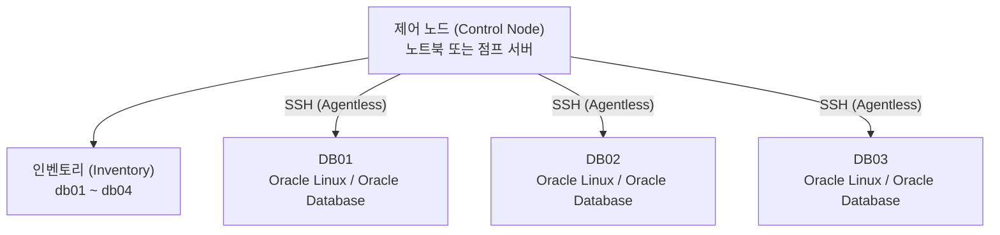
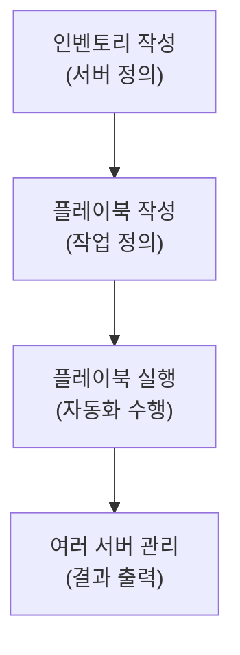
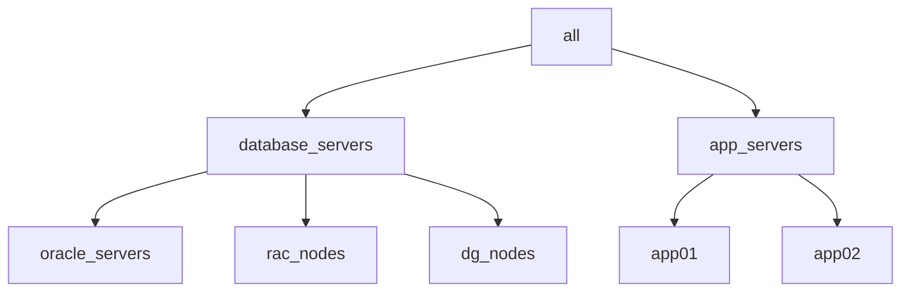
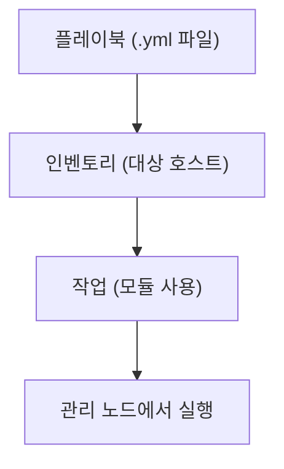
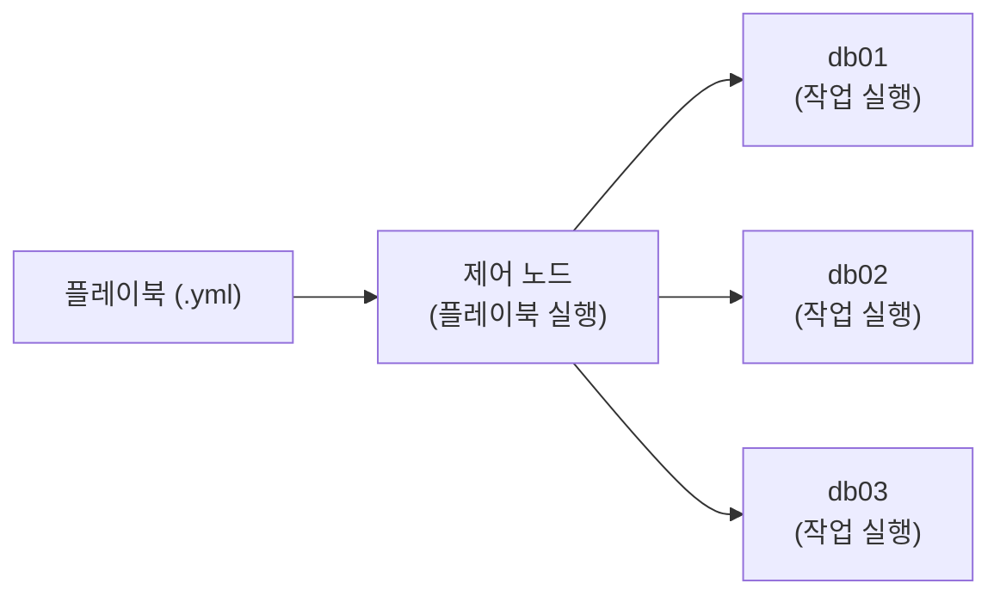
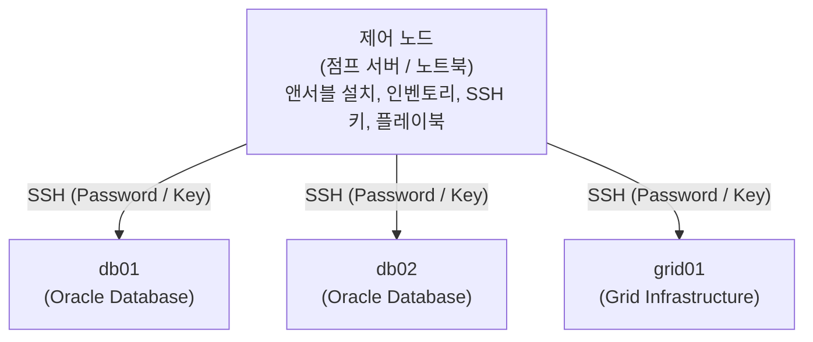

# Ansible 기초와 오라클 DBA 자동화 환경 구축

> **조판 규격**: 본문·제목·표·캡션·영문 용어는 `Noto Sans KR`(제목 Bold), 코드 블록은 `DejaVu Sans Mono`를 적용합니다.

## 개요

반복되는 서버 작업을 사람이 서버마다 접속해서 처리하면 시간이 오래 걸리고 실수도 늘어납니다. 앤서블(Ansible)은 이 문제를 해결하는 오픈 소스 자동화 및 구성 관리(Configuration Management) 도구입니다.

이 장에서는 오라클 DBA(Database Administrator)의 관점에서 다음 내용을 차례로 학습합니다.

- 앤서블의 구조와 핵심 개념(제어 노드, 관리 노드, 인벤토리)
- 설치와 설정 파일(`ansible.cfg`) 구성
- 인벤토리, 호스트, 그룹, 변수 작성법
- 애드혹(Ad-hoc) 명령과 모듈 사용법
- SSH 인증 설정과 첫 플레이북(Playbook) 작성
- 플레이북 실행과 문제 해결
- 마스터 프로젝트: 오라클 DBA용 앤서블 환경 구축

---

## 1. 앤서블 기본과 아키텍처

### 1.1 앤서블이란

앤서블은 여러 서버의 작업을 간단한 YAML 플레이북으로 자동화하는 도구입니다. 다음 특징이 있습니다.

- 에이전트가 필요 없고(Agentless) 통신에 SSH를 사용합니다.
- 멱등성(Idempotent)을 가져, 같은 작업을 여러 번 실행해도 결과가 일정합니다.
- 사용법이 쉽고 인프라 자동화에 효과적입니다.

오라클 DBA는 앤서블로 리눅스 설정, 오라클 소프트웨어 설치, 리스너(Listener) 관리, 데이터베이스 시작, 패치 적용 등을 자동화할 수 있습니다.

### 1.2 핵심 특징

| 번호 | 특징 | 설명 |
|:---:|---|---|
| 1 | 에이전트리스(Agentless) | SSH를 사용하며 대상 서버에 에이전트가 필요 없습니다. |
| 2 | 단순함(Simple) | 배우고 사용하기 쉽습니다. |
| 3 | 강력함(Powerful) | 인프라와 애플리케이션 자동화를 모두 지원합니다. |
| 4 | 멱등성(Idempotent) | 일관되고 반복 가능한 실행을 보장합니다. |
| 5 | 확장성(Extensible) | 풍부한 모듈 모음을 제공합니다. |
| 6 | 크로스 플랫폼(Cross-platform) | 리눅스, 유닉스, 윈도우, 네트워크 장비와 연동됩니다. |
| 7 | 커뮤니티 지원 | 활발한 커뮤니티가 있습니다. |

### 1.3 아키텍처와 작업 흐름

제어 노드(Control Node)가 인벤토리(Inventory)에 정의된 관리 노드(Managed Node)에 SSH로 접속해 작업을 수행합니다.



작업은 다음 네 단계로 진행합니다.



오라클 DBA의 전형적인 작업 흐름 예시는 다음과 같습니다.

1. OS 패키지 설치
2. 오라클 사용자·그룹 생성
3. 디렉터리 및 권한 설정
4. 오라클 소프트웨어 설치
5. 리스너 시작
6. 데이터베이스 시작
7. 헬스 체크(Health Check) 수행
8. 패치 자동화

### 1.4 수동 방식과 앤서블 방식

수동 방식에서는 DBA가 DB01부터 DB05까지 서버마다 SSH로 접속해야 합니다. 앤서블 방식에서는 DBA가 앤서블 한 곳에서 명령을 내리면 모든 서버에 작업이 반영됩니다.

### 1.5 오라클 DBA 활용 사례

1. 운영체제 설정(패키지, 커널 파라미터)
2. 사용자·그룹 관리(oracle, grid)
3. 디렉터리 생성과 권한 설정
4. 오라클 소프트웨어 설치
5. 리스너 자동화(시작, 중지, 상태 확인)
6. 데이터베이스 시작·종료
7. 오라클 데이터 가드(Data Guard) 구성
8. 헬스 체크 및 모니터링 자동화
9. 패치 자동화와 유지 보수

---

## 2. 제어 노드와 관리 노드

**제어 노드**는 앤서블이 설치되어 있고 자동화 명령과 플레이북을 실행하는 머신입니다. **관리 노드**는 앤서블이 SSH를 통해 관리하는 대상 서버입니다.

앤서블은 에이전트리스이므로 관리 노드에는 별도 소프트웨어를 설치할 필요가 없고 SSH 접근만 가능하면 됩니다. 오라클 DBA 환경에서는 제어 노드로 노트북이나 전용 서버를 쓸 수 있으며, 관리 노드는 오라클 소프트웨어와 데이터베이스가 설치된 오라클 리눅스 서버입니다.

### 2.1 핵심 구성 요소

| 구성 요소 | 역할 |
|---|---|
| 제어 노드 | 앤서블 명령·플레이북 실행, 인벤토리 유지, SSH로 관리 노드 접속. 노트북 또는 전용 서버 가능 |
| 관리 노드 | 대상 서버(오라클 리눅스). 앤서블 에이전트 불필요, SSH 접근 필요, 오라클 소프트웨어·데이터베이스 호스팅 |
| 인벤토리 | 관리 노드 목록. 정적 또는 동적 구성 가능, 그룹(예: DB 서버)으로 구성 |
| SSH 연결 | 기본 통신 방식. 기존 SSH 자격 증명과 키 사용, 추가 소프트웨어 설치 불필요 |

### 2.2 오라클 DBA 환경 예시

| 호스트 | 구성 |
|---|---|
| db01 | Oracle 19c, RAC 노드 1, ASM |
| db02 | Oracle 19c, RAC 노드 2, ASM |
| db03 | 스탠바이 DB, 데이터 가드, Oracle 19c |

### 2.3 관리 노드 연결 확인

`ping` 모듈로 연결을 확인합니다.

```bash
[orauser@ansible ~]$ ansible all -m ping
db01 | SUCCESS => {
    "changed": false,
    "ping": "pong"
}
db02 | SUCCESS => {
    "changed": false,
    "ping": "pong"
}
db03 | SUCCESS => {
    "changed": false,
    "ping": "pong"
}
```

> 💡 **노트(Note)**: 여기서 `ping`은 네트워크 ICMP ping이 아니라, 앤서블이 SSH로 접속해 응답(`pong`)을 확인하는 모듈입니다.

---

## 3. 앤서블 설치와 환경 구성

### 3.1 사전 요구 사항

| 번호 | 요구 사항 |
|:---:|---|
| 1 | Oracle Linux 8/9 (또는 RHEL/CentOS) |
| 2 | Python 3.x (앤서블이 필요로 함) |
| 3 | 인터넷 접근(패키지 설치용) |
| 4 | sudo/root 권한 |

### 3.2 시스템 정보 확인

```bash
# 1. OS 버전 확인
[oracle@ansible ~]$ cat /etc/oracle-release
Oracle Linux Server release 8.10

# 2. 파이썬 버전 확인
[oracle@ansible ~]$ python3 --version
Python 3.9.16

# 3. 앤서블 설치 여부 확인
[oracle@ansible ~]$ ansible --version
bash: ansible: command not found
```

### 3.3 오라클 리눅스 8/9에 설치

```bash
# 1. 시스템 패키지 업데이트
sudo dnf update -y

# 2. 필수 패키지 설치
sudo dnf install -y epel-release

# 3. 앤서블 설치
sudo dnf install -y ansible

# 4. 설치 확인
ansible --version
```

### 3.4 설치 확인

```text
[oracle@ansible ~]$ ansible --version
ansible [core 2.15.5]
  config file = /etc/ansible/ansible.cfg
  python version = 3.9.16
  executable location = /usr/bin/ansible
```

도움말은 `ansible --help`로 확인합니다.

---

## 4. 앤서블 설정 파일: ansible.cfg

`ansible.cfg`는 앤서블의 기본 동작을 정의하는 주 설정 파일입니다. 인벤토리, 롤(Role), 플러그인(Plugin) 등의 위치를 앤서블에 알려 줍니다.

### 4.1 설정 파일 위치

| 수준 | 경로 | 설명 |
|---|---|---|
| 프로젝트 수준(권장) | `./ansible.cfg` | 앤서블 프로젝트 폴더 내부 |
| 사용자 수준 | `~/.ansible.cfg` | 홈 디렉터리 |
| 시스템 수준 | `/etc/ansible/ansible.cfg` | 모든 사용자에게 적용 |

오라클 DBA 자동화에서는 앤서블 자동화 폴더 안에 프로젝트 수준 `ansible.cfg`를 둡니다.

```text
ansible-dba/
├── ansible.cfg
├── inventory/
├── playbooks/
├── roles/
├── group_vars/
└── host_vars/
```

### 4.2 기본 설정 예시

```ini
[defaults]
inventory = ./inventory
roles_path = ./roles
host_key_checking = False
retry_files_enabled = False
timeout = 30
remote_user = oracle
become = True
become_method = sudo
log_path = ./ansible.log
stdout_callback = yaml
bin_ansible_callbacks = True
```

### 4.3 주요 설정 파라미터

| 파라미터 | 설명 |
|---|---|
| `inventory` | 인벤토리 파일 경로 |
| `roles_path` | 롤 위치 |
| `host_key_checking` | SSH 호스트 키 검사 활성화/비활성화 |
| `retry_files_enabled` | 실패한 호스트에 대한 재시도 파일 생성 여부 |
| `timeout` | SSH 연결 타임아웃(초) |
| `remote_user` | 관리 노드의 기본 사용자 |
| `become` | 권한 상승(sudo) 활성화 |
| `become_method` | 권한 상승 방법 |
| `log_path` | 앤서블 로그 파일 경로 |
| `stdout_callback` | 출력 형식(yaml, json, debug) |
| `bin_ansible_callbacks` | 추가 출력 플러그인 활성화 |

### 4.4 오라클 DBA 환경용 확장 설정

```ini
[defaults]
inventory = ./inventory/hosts.yml
roles_path = ./roles
host_key_checking = False
retry_files_enabled = False
timeout = 30
remote_user = oracle
become = True
become_method = sudo
log_path = ./logs/ansible.log
stdout_callback = yaml
bin_ansible_callbacks = True
deprecation_warnings = False
callback_whitelist = profile_tasks
interpreter_python = auto
forks = 10
```

추가 항목은 다음과 같습니다.

| 파라미터 | 설명 |
|---|---|
| `deprecation_warnings` | 사용 중단 경고를 줄입니다. |
| `callback_whitelist` | `profile_tasks`로 작업 실행 시간을 표시합니다. |
| `interpreter_python` | 파이썬을 자동 감지합니다. |
| `forks` | 병렬 연결 수를 지정합니다(다중 노드용). |

### 4.5 단계별 생성과 확인

1. 앤서블 프로젝트 디렉터리로 이동합니다: `cd ~/ansible-dba`
2. 파일을 생성합니다: `vi ansible.cfg`
3. 필요한 설정을 추가합니다.
4. 저장합니다: `:wq`
5. 설정을 확인합니다: `ansible --version`

프로젝트 수준 설정이 적용되면 `config file` 항목에 프로젝트 경로가 표시됩니다.

```text
[oracle@ansible ansible-dba]$ ansible --version
ansible [core 2.15.5]
  config file = /home/oracle/ansible-dba/ansible.cfg
  configured module search path = ['/home/oracle/ansible-dba/roles']
```

> ⚠️ **주의(Caution)**: `host_key_checking = False`는 랩(Lab)이나 개발 환경에서만 사용하십시오.

### 4.6 모범 사례

- `ansible.cfg`를 프로젝트 수준에 둡니다.
- 상대 경로를 사용합니다.
- 로그 파일 위치를 적절히 설정합니다.
- 여러 서버를 대상으로 할 때는 적절한 타임아웃과 `forks`를 사용합니다.
- 오라클 DBA 자동화에 맞게 맞춤 구성합니다.

---

## 5. 인벤토리 기초

인벤토리는 앤서블이 작업할 관리 노드(서버) 목록을 담은 파일입니다. 호스트명 또는 IP 주소와 그룹을 정의합니다. 정적(파일 기반) 또는 동적(클라우드/CMDB) 방식이 있습니다.

### 5.1 오라클 환경 인벤토리 구조

| 그룹 | 목적 | 예시 호스트 |
|---|---|---|
| `oracle_servers` | 단일 인스턴스 오라클 DB 서버 | db01, db02, db03 |
| `rac_nodes` | RAC 클러스터 노드 | rac1, rac2 |
| `dg_nodes` | 데이터 가드 노드 | primary, standby |
| `dev_servers` | 개발 서버 | devdb1, devdb2 |
| `test_servers` | 테스트 서버 | testdb1, testdb2 |
| `prod_servers` | 운영 서버 | proddb1, proddb2 |

### 5.2 기본 인벤토리 예시

```ini
# inventory
[oracle_servers]
db01 ansible_host=192.168.1.101
db02 ansible_host=192.168.1.102
db03 ansible_host=192.168.1.103

[rac_nodes]
rac1 ansible_host=192.168.1.201
rac2 ansible_host=192.168.1.202

[dg_nodes]
primary ansible_host=192.168.1.301
standby ansible_host=192.168.1.302
```

### 5.3 변수를 포함한 인벤토리

```ini
# inventory with variables
[oracle_servers]
db01 ansible_host=192.168.1.101 oracle_home=/u01/app/oracle/product/19c
db02 ansible_host=192.168.1.102 oracle_home=/u01/app/oracle/product/19c
db03 ansible_host=192.168.1.103 oracle_home=/u01/app/oracle/product/19c

[rac_nodes]
rac1 ansible_host=192.168.1.201 node_type=RAC
rac2 ansible_host=192.168.1.202 node_type=RAC

[dg_nodes]
primary ansible_host=192.168.1.301 role=primary
standby ansible_host=192.168.1.302 role=standby
```

### 5.4 그룹 계층 구조

그룹 안에 그룹을 둘 수 있습니다. `:children` 접미사를 사용합니다.

```ini
# inventory with group hierarchy
[all:children]
database_servers
app_servers

[database_servers:children]
oracle_servers
rac_nodes
dg_nodes

[app_servers]
app01 ansible_host=192.168.2.101
app02 ansible_host=192.168.2.102
```



### 5.5 인벤토리 사용 명령

| 작업 | 명령 |
|---|---|
| 모든 서버에 ping | `ansible all -m ping` |
| 특정 그룹에 ping | `ansible oracle_servers -m ping` |
| 모든 호스트 나열 | `ansible-inventory --list` |
| 특정 호스트 확인 | `ansible db01 -m ping` |

### 5.6 모범 사례

- 의미 있는 그룹 이름을 사용합니다.
- 인벤토리를 체계적으로 유지합니다.
- 데이터베이스별 세부 정보는 변수로 관리합니다.
- 대규모 환경에서는 그룹 계층을 사용합니다.
- 민감한 데이터는 앤서블 볼트(Ansible Vault)에 보관합니다.
- 클라우드 환경에서는 동적 인벤토리를 사용합니다.

---

## 6. 호스트, 그룹, 변수

**호스트**는 대상 서버(관리 노드), **그룹**은 공통 목적을 가진 호스트 묶음, **변수**는 Oracle Home, DB 이름, 포트 등 환경별 정보를 저장하는 값입니다. 그룹과 변수를 활용하면 플레이북을 유연하고 재사용 가능하게 만들 수 있습니다.

### 6.1 INI 형식 인벤토리

```ini
# inventory file (INI format)
[oracle_dbs]
db01 ansible_host=192.168.1.101
db02 ansible_host=192.168.1.102
db03 ansible_host=192.168.1.103

[rac_nodes]
rac1 ansible_host=192.168.1.201
rac2 ansible_host=192.168.1.202

[dg_nodes]
primary ansible_host=192.168.1.301
standby ansible_host=192.168.1.302

[all:vars]
ansible_user=oracle
ansible_ssh_private_key_file=~/.ssh/id_rsa
```

### 6.2 YAML 형식 인벤토리

```yaml
# inventory.yml (YAML format)
all:
  vars:
    ansible_user: oracle
    ansible_ssh_private_key_file: ~/.ssh/id_rsa

  children:
    oracle_dbs:
      hosts:
        db01: { ansible_host: 192.168.1.101 }
        db02: { ansible_host: 192.168.1.102 }
        db03: { ansible_host: 192.168.1.103 }

    rac_nodes:
      hosts:
        rac1: { ansible_host: 192.168.1.201 }
        rac2: { ansible_host: 192.168.1.202 }

    dg_nodes:
      hosts:
        primary: { ansible_host: 192.168.1.301 }
        standby: { ansible_host: 192.168.1.302 }
```

### 6.3 오라클 환경 변수

| 변수명 | 설명 | 예시 값 |
|---|---|---|
| `oracle_home` | 오라클 홈 디렉터리 | `/u01/app/oracle/product/19c` |
| `oracle_sid` | 오라클 SID | `ORCL` |
| `oracle_port` | 오라클 리스너 포트 | `1521` |
| `db_unique_name` | 데이터베이스 고유 이름 | `orcl.example.com` |
| `grid_home` | 그리드 홈(RAC) | `/u01/app/19c/grid` |
| `asm_diskgroup` | ASM 디스크 그룹 | `DATA` |
| `env` | 환경 이름 | `DEV / TEST / PROD` |

### 6.4 그룹 변수 파일

`group_vars/oracle_dbs.yml`은 해당 그룹의 모든 호스트에 적용됩니다.

```yaml
---
# group_vars/oracle_dbs.yml
oracle_home: /u01/app/oracle/product/19c
oracle_user: oracle
oracle_group: oinstall
oracle_sid: ORCL
oracle_port: 1521
listener_name: LISTENER
db_unique_name: orcl.example.com
env: PROD
backup_dir: /backup/oracle
```

### 6.5 호스트 변수 파일

`host_vars/db01.yml`은 해당 호스트에만 적용됩니다.

```yaml
---
# host_vars/db01.yml
oracle_sid: ORCL
oracle_home: /u01/app/oracle/product/19c
role: primary
db_unique_name: orcl.example.com
data_guard: false
```

### 6.6 확인 명령

```bash
ansible-inventory --list        # 모든 호스트 나열
ansible-inventory --host db01   # 호스트 변수 확인
```

> 💡 **노트(Note)**: 그룹 전체에 공통인 값은 `group_vars`에, 호스트마다 다른 값은 `host_vars`에 두면 관리가 쉬워집니다.

---

## 7. 애드혹 명령

애드혹 명령은 플레이북 없이 관리 노드에서 작업을 실행하는 한 줄짜리 앤서블 명령입니다. 빠른 작업, 연결 테스트, 간단한 운영 작업에 유용합니다.

### 7.1 기본 문법

```bash
ansible <host_pattern> -m <module_name> -a "arguments"
```

| 구성 요소 | 설명 |
|---|---|
| `ansible` | 애드혹 실행용 명령 |
| `<host_pattern>` | 인벤토리의 대상 호스트 또는 그룹 |
| `-m` | 사용할 모듈 이름(예: ping, shell, file) |
| `-a` | 모듈에 전달할 인자 |

### 7.2 오라클 DBA 상용 애드혹 명령

| 작업 | 명령 | 목적 |
|---|---|---|
| 연결 확인 | `ansible all -m ping` | 관리 노드 확인 |
| OS 정보 확인 | `ansible all -m setup` | 시스템 정보 수집 |
| 호스트명 확인 | `ansible all -m command -a "hostname"` | 호스트명 표시 |
| 디스크 확인 | `ansible all -m command -a "df -h"` | 파일 시스템 사용량 |
| 메모리 확인 | `ansible all -m command -a "free -h"` | 메모리 사용량 |
| 오라클 사용자 확인 | `ansible all -m command -a "id oracle"` | 사용자 존재 확인 |
| 오라클 홈 목록 | `ansible all -m command -a "ls -l /u01/app"` | 오라클 디렉터리 확인 |

### 7.3 실행 예시

```text
[oracle@ansible-dba ~]$ ansible all -m command -a "id oracle"
db01 | CHANGED | rc=0 >>
uid=54321(oracle) gid=54321(oinstall) groups=54321(oinstall)
db02 | CHANGED | rc=0 >>
uid=54321(oracle) gid=54321(oinstall) groups=54321(oinstall)
```

특정 호스트나 그룹만 대상으로 지정할 수도 있습니다.

```bash
ansible db01 -m command -a "uptime"
ansible oracle_servers -m ping
```

### 7.4 장점과 한계

| 장점 | 한계 |
|---|---|
| 빠르고 쉽게 사용 | 복잡한 작업에 부적합 |
| 플레이북 작성 불필요 | 재사용 불가(플레이북과 달리) |
| 테스트·문제 해결에 유용 | 장기 자동화 유지 보수 어려움 |
| 일회성·단순 작업에 적합 | 오류 처리 제한적 |
| DBA 운영 시간 절약 | 운영 자동화는 플레이북 권장 |

---

## 8. 리눅스 관리용 모듈

모듈은 관리 노드에서 특정 작업을 수행하는 재사용 가능한 코드 단위입니다. 복잡한 스크립트를 작성하지 않아도 되고, 멱등성이 있어 여러 번 실행해도 안전합니다.

### 8.1 주요 모듈

| 모듈 | 용도 | 예시 |
|---|---|---|
| `ping` | 연결 확인 | 서버 접근 가능 여부 확인 |
| `command` | 시스템 명령 실행 | `df -h`, `uname -a` |
| `shell` | 셸 명령 실행 | 복잡한 명령 실행 |
| `file` | 파일/디렉터리 관리 | 생성·삭제·권한 설정 |
| `copy` | 원격 호스트로 파일 복사 | 오라클 설치 파일 복사 |
| `yum` / `dnf` | 패키지 설치·삭제 | 필수 OS 패키지 설치 |
| `service` | 서비스 관리 | 시작·중지·활성화 |
| `user` | OS 사용자 관리 | 오라클 사용자 생성 |
| `group` | OS 그룹 관리 | dba 그룹 생성 |
| `stat` | 파일/디렉터리 상태 확인 | 파일 존재 확인 |
| `unarchive` | 압축 파일 해제 | 오라클 소프트웨어 압축 해제 |
| `cron` | 크론 작업 관리 | 유지 보수 작업 예약 |

### 8.2 `file` 모듈: 디렉터리 생성

```yaml
- name: Create Oracle directory
  ansible.builtin.file:
    path: /u01/app/oracle
    state: directory
    owner: oracle
    group: oinstall
    mode: '0755'
```

```text
[oracle@db01 ~]$ ls -ld /u01/app/oracle
drwxr-xr-x 2 oracle oinstall 4096 Sep 25 10:30 /u01/app/oracle
```

### 8.3 `copy` 모듈: 파일 복사

```yaml
- name: Copy Oracle profile file
  ansible.builtin.copy:
    src: ./oracle_profile.sh
    dest: /home/oracle/.bash_profile
    owner: oracle
    group: oinstall
    mode: '0644'
```

### 8.4 `yum`/`dnf` 모듈: 패키지 설치

```yaml
- name: Install required package
  ansible.builtin.yum:
    name: vim
    state: present
```

### 8.5 `service` 모듈: 서비스 시작과 활성화

```yaml
- name: Start and enable chronyd service
  ansible.builtin.service:
    name: chronyd
    state: started
    enabled: yes
```

### 8.6 `group`·`user` 모듈

```yaml
- name: Create dba group
  ansible.builtin.group:
    name: dba
    state: present

- name: Create oracle user
  ansible.builtin.user:
    name: oracle
    group: oinstall
    groups: dba
    shell: /bin/bash
    state: present
    create_home: yes
```

### 8.7 모듈 사용 모범 사례

- 가능하면 `shell`/`command`보다 내장 모듈을 사용합니다.
- 작업은 멱등하게 유지합니다.
- 작업에 의미 있는 이름을 붙입니다.
- 오류는 `ignore_errors` 또는 `failed_when`으로 처리합니다.
- 경로, 사용자명, 패키지명은 변수로 관리합니다.
- 여러 서버에 적용하기 전에 단일 서버에서 먼저 테스트합니다.

---

## 9. SSH 연결과 인증

앤서블은 기본적으로 SSH로 관리 노드에 접속합니다. 인증은 **비밀번호** 또는 **SSH 키**로 하며, 보안과 자동화를 위해 운영 환경에서는 SSH 키 방식이 널리 쓰입니다. 애드혹 명령이나 플레이북을 실행하기 전에 SSH 연결이 정상이어야 합니다.

### 9.1 SSH 연결 수동 테스트

```bash
[oracle@ansible ~]$ ssh oracle@192.168.1.101
[oracle@db01 ~]$ exit
logout
Connection to 192.168.1.101 closed.
```

확인 항목은 다음과 같습니다.

- 호스트에 도달 가능한가
- 사용자명이 올바른가
- 비밀번호 문제가 없는가
- SSH 포트(22)가 열려 있는가
- 로그인과 로그아웃이 가능한가

### 9.2 비밀번호 인증

```bash
ansible all -m ping -k
```

`-k` 옵션은 SSH 비밀번호를 묻습니다. 테스트에는 유용하지만 운영 환경에는 권장하지 않습니다(보안이 약함).

### 9.3 SSH 키 인증(권장)

```bash
# 1. 제어 노드에서 SSH 키 생성
ssh-keygen -t rsa -b 4096

# 2. 관리 노드로 공개 키 복사
ssh-copy-id oracle@192.168.1.101
```

키 인증은 더 안전하고, 비밀번호 입력이 없으며, 자동화에 필수이고, 플레이북과 예약 작업에서 동작합니다. 설정 후 `ssh`와 `ansible all -m ping`으로 확인합니다. 비밀번호 프롬프트 없이 연결되고 모든 관리 노드에 도달하면 정상입니다.

### 9.4 SSH용 ansible.cfg

```ini
[defaults]
inventory = inventory
remote_user = oracle
host_key_checking = False
retry_files_enabled = False
timeout = 30
private_key_file = ~/.ssh/id_rsa
ssh_args = -o ControlMaster=auto -o ControlPersist=60s
```

| 파라미터 | 설명 |
|---|---|
| `remote_user` | 기본 SSH 사용자 |
| `private_key_file` | SSH 개인 키 경로 |
| `host_key_checking` | 호스트 키 검사 비활성화(랩/개발용) |
| `timeout` | SSH 연결 타임아웃 |
| `ssh_args` | 연결 재사용으로 SSH 성능 개선 |

### 9.5 자주 발생하는 문제와 해결

| 문제 | 원인 | 해결 |
|---|---|---|
| Permission denied | 잘못된 사용자 또는 키 | 올바른 사용자/키 사용 |
| Host unreachable | 네트워크 또는 방화벽 문제 | 연결 확인, 22번 포트 개방 |
| Host key verification failed | 새 호스트가 known_hosts에 없음 | `ssh-keyscan` 사용 또는 `host_key_checking=False` 설정 |
| Key not working | 키 파일 또는 권한 오류 | 키 경로와 파일 권한(600) 확인 |
| Connection timeout | 네트워크 지연 또는 불가 | 네트워크 확인, 타임아웃 증가 |

---

## 10. 첫 번째 플레이북

플레이북은 관리 노드에서 실행할 작업(Task) 집합을 정의한 YAML 파일입니다. 인벤토리, 모듈, 변수를 사용하며, 애드혹 명령보다 강력해 **여러 작업을 순서대로** 실행할 수 있습니다.

### 10.1 구조와 흐름

```yaml
---
- name: Play name
  hosts: target_hosts
  become: yes
  vars:
    # variables (optional)
  tasks:
    - name: Task 1
      module_name:
        parameters
    - name: Task 2
      module_name:
        parameters
```



### 10.2 간단한 플레이북

```yaml
---
- name: Check server details
  hosts: all
  become: yes
  tasks:
    - name: Display hostname
      ansible.builtin.command: hostname
      register: hostname_result

    - name: Show output
      ansible.builtin.debug:
        msg: "Hostname is {{ hostname_result.stdout }}"
```

이 플레이북은 모든 서버에서 실행되어 호스트명을 가져오고, 출력을 변수(`hostname_result`)에 저장한 뒤 표시합니다.

### 10.3 여러 작업이 있는 플레이북

```yaml
---
- name: Basic Server Checks
  hosts: all
  become: yes
  tasks:
    - name: Check hostname
      ansible.builtin.command: hostname
      register: hostname_result

    - name: Check OS details
      ansible.builtin.command: cat /etc/os-release
      register: os_result

    - name: Display results
      ansible.builtin.debug:
        msg: |
          Hostname: {{ hostname_result.stdout }}
          OS Details: {{ os_result.stdout }}
```

### 10.4 변수 사용

```yaml
---
- name: Create Oracle directory
  hosts: oracle_servers
  become: yes
  vars:
    oracle_base: /u01/app/oracle
    oracle_user: oracle
  tasks:
    - name: Create directory
      ansible.builtin.file:
        path: "{{ oracle_base }}"
        state: directory
        owner: "{{ oracle_user }}"
        group: oinstall
        mode: '0755'
```

변수를 쓰면 환경별로 쉽게 맞출 수 있고, 값만 바꿔 플레이북을 재사용하며, 설정을 작업과 분리할 수 있습니다.

### 10.5 플레이북 실행

| 순서 | 목적 | 명령 |
|:---:|---|---|
| 1 | 문법 검사(선택) | `ansible-playbook --syntax-check first_playbook.yml` |
| 2 | 플레이북 실행 | `ansible-playbook first_playbook.yml` |
| 3 | 인벤토리 지정 | `ansible-playbook -i inventory first_playbook.yml` |
| 4 | 상세 출력 | `ansible-playbook first_playbook.yml -v` |

### 10.6 핵심 정리

- 플레이북은 YAML 형식으로 작성합니다.
- 인벤토리, 모듈, 변수를 사용합니다.
- 여러 작업을 순서대로 실행할 수 있습니다.
- 멱등성이 있고 재사용 가능합니다.
- 항상 `--syntax-check`로 먼저 테스트합니다.
- 작은 플레이북에서 시작해 점차 복잡하게 만듭니다.

> ⚠️ **주의(Caution)**: YAML은 들여쓰기에 민감합니다. 들여쓰기가 틀리면 문법 오류가 발생하므로 실행 전에 `--syntax-check`를 습관화하십시오.

---

## 11. 플레이북 실행과 문제 해결

### 11.1 실행 방법

| 방법 | 명령 |
|---|---|
| 기본 인벤토리로 실행 | `ansible-playbook playbook.yml` |
| 인벤토리 파일 지정 | `ansible-playbook -i inventory playbook.yml` |
| 태그로 특정 작업 실행 | `ansible-playbook playbook.yml --tags "install"` |
| 특정 태그 건너뛰기 | `ansible-playbook playbook.yml --skip-tags "restart"` |
| 실행 전 문법 검사 | `ansible-playbook --syntax-check playbook.yml` |
| 드라이 런(체크 모드) | `ansible-playbook --check playbook.yml` |



앤서블은 플레이, 작업, 모듈에 정의된 순서대로 관리 노드에서 플레이북을 실행합니다.

### 11.2 실행 예시

```text
[oracle@ansible-dba ~]$ ansible-playbook -i inventory setup_oracle_user.yml

PLAY [Create Oracle user] ****************************
TASK [Gathering Facts] *******************************
ok: [db01]
ok: [db02]

TASK [Create Oracle user] ****************************
changed: [db01]
changed: [db02]

PLAY RECAP *******************************************
db01 : ok=2 changed=1 unreachable=0 failed=0
db02 : ok=2 changed=1 unreachable=0 failed=0
```

### 11.3 출력 상태의 의미

| 상태 | 의미 | 예시 |
|---|---|---|
| `ok` | 작업이 성공했으며 변경 없음 | `ok: [db01]` |
| `changed` | 작업이 실행되어 시스템이 변경됨 | `changed: [db01]` |
| `skipped` | 조건 또는 태그로 작업을 건너뜀 | `skipping: [db01]` |
| `failed` | 작업 실패 | `fatal: [db01]: FAILED!` |
| `unreachable` | 호스트에 도달할 수 없음 | `UNREACHABLE! => [db01]` |

### 11.4 문제 해결 명령

| 작업 | 명령 |
|---|---|
| 문법 검사 | `ansible-playbook --syntax-check playbook.yml` |
| 상세 모드 | `ansible-playbook playbook.yml -v` |
| 더 상세한 출력 | `ansible-playbook playbook.yml -vv` |
| 디버그 모드(전체 로그) | `ansible-playbook playbook.yml -vvv` |
| 인벤토리 확인 | `ansible-inventory -i inventory --list` |
| 호스트 연결 테스트 | `ansible all -m ping` |
| 태그로 특정 작업 실행 | `ansible-playbook playbook.yml --tags "tag_name"` |
| 특정 태그 건너뛰기 | `ansible-playbook playbook.yml --skip-tags "tag_name"` |
| 체크 모드 실행 | `ansible-playbook --check playbook.yml` |

### 11.5 자주 발생하는 오류와 해결

| 오류 | 원인 | 해결 |
|---|---|---|
| `UNREACHABLE!` | 잘못된 IP/호스트명, SSH 문제 | 인벤토리, ping, SSH 연결 확인 |
| `Permission denied (publickey)` | SSH 키 미설정 | SSH 키 기반 인증 설정 |
| `Failed to connect to host` | 호스트 다운 또는 방화벽 차단 | 호스트 상태, 방화벽, 22번 포트 확인 |
| `Module not found` | 모듈 이름 오류 또는 컬렉션 누락 | 올바른 모듈 사용 또는 필요한 컬렉션 설치 |
| `YAML syntax error` | 들여쓰기 또는 문법 실수 | `--syntax-check` 실행, 들여쓰기 수정 |
| `Variable undefined` | 인벤토리/플레이북에 변수 미정의 | 변수 정의 또는 변수명 확인 |

### 11.6 실패한 플레이북 디버깅 예시

```text
[oracle@ansible-dba ~]$ ansible-playbook playbook.yml -vv

TASK [Create directory] **************************
fatal: [db01]: FAILED! => {
    "msg": "Permission denied: '/u01/app/oracle'"
}

PLAY RECAP ***************************************
db01 : ok=1 changed=0 unreachable=0 failed=1
```

해결 순서는 다음과 같습니다.

1. 사용자 권한을 확인합니다.
2. 경로가 존재하는지 확인합니다.
3. 올바른 사용자로 실행합니다(예: `become: yes`).
4. 디스크 공간을 확인합니다.
5. 더 자세한 정보가 필요하면 `-vvv`를 사용합니다.

> 💡 **노트(Note)**: 실행 전 `--syntax-check`, 안전한 사전 점검용 `--check`, 문제 발생 시 `-v` 계열 옵션 순으로 활용하면 원인 파악이 빨라집니다.

### 11.7 모범 사례

- 실행 전에 항상 `--syntax-check`를 실행합니다.
- 플레이북과 작업에 의미 있는 이름을 사용합니다.
- `-v` 또는 `-vv`로 가시성을 높입니다.
- 인벤토리와 SSH 연결을 먼저 검증합니다.
- 안전한 실행을 위해 체크 모드(`--check`)를 사용합니다.
- 오류는 `ignore_errors` 또는 `block/rescue`로 처리합니다.
- 선택적 작업 실행에는 태그를 사용합니다.
- 플레이북은 모듈화하고 재사용 가능하게 유지합니다.
- 로그를 확인하고 반복해서 수정합니다.
- 항상 비운영 환경에서 먼저 테스트합니다.

---

## 12. 마스터 프로젝트: 오라클 DBA 앤서블 환경 구축

### 12.1 프로젝트 목표

- 오라클 DBA 자동화를 위한 완전한 앤서블 환경을 구축합니다.
- 제어 노드와 관리 노드를 구성합니다.
- SSH 키 기반 인증을 설정합니다.
- 오라클 서버 그룹(db, grid, asm 등)이 있는 체계적인 인벤토리를 만듭니다.
- 모범 사례에 따라 `ansible.cfg`를 구성합니다.
- 애드혹 명령으로 연결을 검증합니다.
- 샘플 플레이북으로 기본 오라클 서버 작업(디렉터리 생성, 오라클 홈 확인, 리스너 상태 확인)을 수행합니다.
- 이 구성은 이후 오라클 DBA 자동화 프로젝트의 기본 환경이 됩니다.

### 12.2 아키텍처



하나의 제어 노드가 앤서블로 여러 오라클 서버를 관리합니다.

### 12.3 프로젝트 디렉터리 구조

```text
ansible-oracle-dba/
├── ansible.cfg              # Ansible configuration
├── inventory/
│   └── hosts                # Inventory file
├── group_vars/
│   ├── db_servers.yml       # Variables for DB servers
│   └── grid_servers.yml     # Variables for Grid servers
├── playbooks/
│   ├── setup_oracle_env.yml # Sample playbook
│   └── README.md
└── logs/                    # Execution logs (optional)
```

### 12.4 샘플 인벤토리 (`inventory/hosts`)

```ini
[db_servers]
db01 ansible_host=192.168.1.101 ansible_user=oracle
db02 ansible_host=192.168.1.102 ansible_user=oracle

[grid_servers]
grid01 ansible_host=192.168.1.103 ansible_user=oracle

[all:vars]
ansible_python_interpreter=/usr/bin/python3
ansible_ssh_private_key_file=~/.ssh/id_rsa
ansible_user=oracle
```

핵심 포인트는 다음과 같습니다.

- 역할(DB, Grid, ASM)에 따라 서버를 그룹화합니다.
- 의미 있는 그룹 이름을 사용합니다.
- 공통 변수는 `[all:vars]`에 정의합니다.
- IP 주소 또는 호스트명을 사용합니다.

### 12.5 샘플 ansible.cfg

```ini
[defaults]
inventory = inventory/hosts
remote_user = oracle
host_key_checking = False
retry_files_enabled = False
timeout = 30
forks = 10
log_path = ./logs/ansible.log
stdout_callback = yaml
roles_path = ./roles
```

| 설정 | 설명 |
|---|---|
| `inventory` | 인벤토리 파일 경로 정의 |
| `remote_user` | 원격 사용자(oracle) 지정 |
| `host_key_checking` | 호스트 키 검사 비활성화(랩 환경용) |
| `log_path` | 로깅 활성화 |
| `forks` | 병렬 실행 수 증가 |
| `stdout_callback` | yaml 출력으로 가독성 향상 |

### 12.6 샘플 플레이북 (`playbooks/setup_oracle_env.yml`)

```yaml
---
- name: Setup Oracle Environment on Managed Nodes
  hosts: all
  become: yes
  tasks:
    - name: Create Oracle base directory
      ansible.builtin.file:
        path: /u01/app/oracle
        state: directory
        owner: oracle
        group: oinstall
        mode: '0755'

    - name: Check Oracle home
      ansible.builtin.command: ls -ld /u01/app/oracle
      register: oracle_home

    - name: Display Oracle home details
      ansible.builtin.debug:
        var: oracle_home.stdout
```

이 플레이북은 오라클 베이스 디렉터리를 만들고, 오라클 홈 디렉터리를 확인하며, 결과를 출력합니다. 이후 리스너 점검, ASM 점검 등으로 확장할 수 있습니다.

### 12.7 실행과 검증

```bash
ansible-playbook -i inventory/hosts playbooks/setup_oracle_env.yml
```

```text
PLAY [Setup Oracle Environment on Managed Nodes] ****
TASK [Create Oracle base directory] ****
ok: [db01]
ok: [db02]
ok: [grid01]

TASK [Check Oracle home] ****
ok: [db01]
ok: [db02]
ok: [grid01]
```

검증과 다음 단계는 다음 순서로 진행합니다.

| 순서 | 목적 | 명령 |
|:---:|---|---|
| 1 | 연결 확인 | `ansible all -m ping` |
| 2 | 인벤토리 확인 | `ansible-inventory --list` |
| 3 | 플레이북 실행 | `ansible-playbook -i inventory/hosts playbooks/setup_oracle_env.yml` |
| 4 | 로그 확인 | `cat logs/ansible.log` |
| 5 | 추가 작업으로 확장 | 리스너 상태 확인, ASM 상태 확인, 필수 패키지 설치, 디렉터리·사용자 생성 등 |

### 12.8 주요 이점

- 한 번의 환경 구성으로 끝납니다.
- 여러 오라클 서버에서 일관된 구성을 유지합니다.
- 패치, 백업, 모니터링 등 향후 자동화 작업에 재사용할 수 있습니다.
- 시간을 절약하고 수작업을 줄입니다.
- 여러 환경(DEV/TEST/PROD)으로 확장할 수 있습니다.
- 이 시리즈의 향후 오라클 DBA 자동화 프로젝트의 기반이 됩니다.

---

## 실습 및 활용 시나리오 (Hands-on Scenario)

**시나리오**: 제어 노드 한 대로 `db01`, `db02`, `grid01` 세 대의 오라클 서버에 오라클 베이스 디렉터리를 일괄 구성하고, 결과를 검증합니다.

### 실습 1. 프로젝트 폴더 준비

```bash
mkdir -p ~/ansible-oracle-dba/{inventory,group_vars,playbooks,logs}
cd ~/ansible-oracle-dba
```

### 실습 2. 설치 확인

```bash
cat /etc/oracle-release
python3 --version
sudo dnf install -y epel-release
sudo dnf install -y ansible
ansible --version
```

`ansible [core 2.15.5]`와 같은 버전 정보가 출력되면 설치가 완료된 것입니다.

### 실습 3. SSH 키 인증 설정

```bash
ssh-keygen -t rsa -b 4096
ssh-copy-id oracle@192.168.1.101
ssh-copy-id oracle@192.168.1.102
ssh-copy-id oracle@192.168.1.103
```

> ⚠️ **주의(Caution)**: SSH 키 파일의 권한(600)이 올바른지 확인하십시오. 권한이 맞지 않으면 키 인증이 동작하지 않을 수 있습니다.

### 실습 4. `ansible.cfg`와 인벤토리 작성

12.5절의 `ansible.cfg`를 프로젝트 루트에, 12.4절의 인벤토리를 `inventory/hosts`에 저장합니다.

### 실습 5. 연결 검증

```bash
ansible all -m ping
ansible-inventory --list
ansible all -m command -a "id oracle"
```

세 서버 모두 `SUCCESS`가 나와야 다음 단계로 넘어갑니다.

### 실습 6. 플레이북 작성과 실행

12.6절의 플레이북을 `playbooks/setup_oracle_env.yml`로 저장한 뒤 순서대로 실행합니다.

```bash
ansible-playbook --syntax-check playbooks/setup_oracle_env.yml
ansible-playbook --check playbooks/setup_oracle_env.yml
ansible-playbook -i inventory/hosts playbooks/setup_oracle_env.yml
```

### 실습 7. 결과 확인과 문제 해결

```bash
cat logs/ansible.log
ansible all -m command -a "ls -ld /u01/app/oracle"
```

오류가 발생하면 `-vv` 또는 `-vvv` 옵션으로 다시 실행하고, 11.5절의 오류 표에서 원인과 해결 방법을 찾아 조치합니다.

### 확장 과제

- 리스너 상태 확인 작업 추가
- ASM 상태 확인 작업 추가
- 필수 패키지 설치 작업 추가
- 디렉터리·사용자·그룹 생성 작업 추가

> 💡 **노트(Note)**: 운영 환경에 적용하기 전에는 반드시 비운영 환경에서 먼저 테스트하십시오.
