# 오라클 19c 관리와 자동화를 위한 앤서블 실전 가이드

> **조판 및 편집 규격 안내 (Editorial & Typesetting Specification)**
> - **본문 / 표(Table) / 캡션(Caption) / 영문 기술 용어**: `Noto Sans KR`
> - **장·절 제목 (Heading 1 ~ Heading 4)**: `Noto Sans KR Bold`
> - **코드 블록 (Code Block / YAML / INI / Shell / SQL / Log)**: `DejaVu Sans Mono`
> - **수식 및 기호**: `Cambria Math`

---

# Chapter 1. 앤서블 인벤토리 설계: 오라클 19c DBA 환경을 위한 서버 조직화

## 개요

앤서블(Ansible)이 어떤 서버를, 어떤 계정과 경로로 관리할지 알려 주는 지도가 **인벤토리(Inventory)**입니다. 인벤토리를 체계적으로 설계하면 관리 대상 서버가 수십 대로 늘어나도 플레이북(Playbook) 코드를 한 줄도 수정하지 않고 자동화 범위를 즉시 확장할 수 있습니다.

오라클 데이터베이스 관리자(DBA, Database Administrator)가 운영하는 인프라는 단일 서버로 끝나지 않습니다. 오라클 19c(Oracle Database 19c) 환경에는 데이터베이스 인스턴스 서버, 그리드 인프라스트럭처(Grid Infrastructure) 및 자동 스토리지 관리(ASM, Automatic Storage Management) 노드, 리얼 애플리케이션 클러스터(RAC, Real Application Clusters) 노드, 데이터 가드(Data Guard) 스탠바이 서버가 유기적으로 결합되어 있습니다. 또한 개발(DEV), 테스트(TEST), 운영(PROD) 환경에 따라 접속 계정과 디렉터리 구조도 달라집니다.

이 장에서는 도커(Docker) 기반의 오라클 리눅스 8(Oracle Linux 8) 멀티 컨테이너 실습 환경을 직접 기동하고, 오라클 19c RAC 및 Grid 아키텍처에 최적화된 인벤토리를 설계부터 검증까지 단계별로 완성합니다.

이 장에서 학습할 핵심 내용은 다음과 같습니다.

- 앤서블 제어 노드(Control Node)와 관리 노드(Managed Node)의 에이전트리스(Agentless) 아키텍처 이해
- 도커 컴포즈(Docker Compose)를 활용한 오라클 19c 4노드 실습 랩(Lab) 구축
- INI 형식과 YAML 형식의 정적 인벤토리(Static Inventory) 작성 및 비교
- 호스트(Host), 역할별 그룹(Group), 부모·자식 그룹(Parent/Child Group)의 계층화 설계
- `group_vars`와 `host_vars`를 활용한 오라클 최적 유연 아키텍처(OFA, Optimal Flexible Architecture) 변수 분리
- `ansible-inventory` 명령을 활용한 인벤토리 구조 검증 및 트러블슈팅
- 마스터 프로젝트: 4단계 플레이북(`01`~`04`) 실행을 통한 오라클 19c 디렉터리 프로비저닝 및 사전 점검 자동화

> 💡 **노트(Note)**: 오라클 환경의 다양한 서버(DB, Grid/ASM, RAC, Data Guard)를 인벤토리에서 역할과 계층별로 명확히 분리해 두면, 동일한 플레이북으로 전체 클러스터와 특정 노드를 자유자재로 제어하는 멱등성(Idempotency) 기반 자동화를 구현할 수 있습니다.

---

## 1. 앤서블 인벤토리 기초와 오라클 19c 실습 아키텍처

### 1.1 인벤토리와 에이전트리스 구조의 이해

인벤토리는 앤서블이 작업을 수행할 관리 노드의 목록과 접속 정보를 정의한 파일입니다. 앤서블은 대상 서버에 별도의 데몬이나 에이전트를 설치하지 않는 에이전트리스 방식을 사용하며, 표준 오픈에스에스비(OpenSSH) 프로토콜과 파이썬(Python) 인터프리터만으로 모든 자동화 작업을 처리합니다.

앤서블 제어 노드는 작업 실행 시 가장 먼저 설정 파일(`ansible.cfg`)과 인벤토리 파일을 읽어 들입니다. 이후 인벤토리에 정의된 IP 주소, SSH 포트, 접속 계정(`oracle` 또는 `grid`), 그리고 그룹·호스트 변수를 조합하여 각 서버에 맞는 명령을 병렬로 전달합니다.

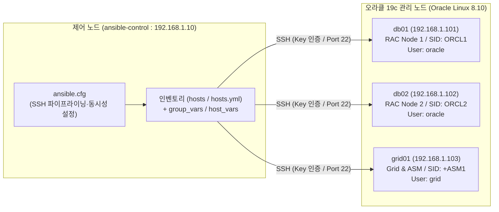

### 1.2 인벤토리의 5대 핵심 구성 요소

오라클 DBA가 인벤토리를 설계할 때 다루는 핵심 구성 요소는 표 1-1과 같습니다.

| 구성 요소 | 영문 명칭 | 오라클 DBA 실무 적용 내용 |
| :--- | :--- | :--- |
| **호스트** | Hosts | 관리 대상 데이터베이스 및 그리드 서버의 식별 이름(예: `db01`, `db02`, `grid01`) |
| **그룹** | Groups | 서버의 역할이나 클러스터 단위의 논리적 묶음(예: `db_servers`, `grid_servers`, `rac_nodes`) |
| **부모·자식 그룹** | Parent/Child Groups | 여러 하위 그룹을 포괄하는 상위 계층 그룹(예: `db_servers`와 `grid_servers`를 묶은 `database_servers`) |
| **변수** | Variables | 오라클 베이스(`ORACLE_BASE`), 오라클 홈(`ORACLE_HOME`), SID, 리스너 포트 등 환경 설정값 |
| **접속 파라미터** | Connection Details | 실제 접속 IP(`ansible_host`), OS 계정(`ansible_user`), SSH 개인키 경로(`ansible_ssh_private_key_file`) |

### 1.3 Chapter 1 실습 랩 환경 구성 및 기동

본격적인 인벤토리 작성을 위해 `chapter_1` 디렉터리에 준비된 도커 기반 오라클 19c 실습 환경을 먼저 살펴봅니다. 이 실습 환경은 1대의 앤서블 제어 노드와 3대의 오라클 리눅스 8 관리 노드로 구성되며, 독립된 브리지 네트워크(`192.168.1.0/24`)와 공유 SSH 키 볼륨(`shared-ssh-keys`)으로 연결됩니다.

```text
chapter_1/
├── docker-compose.yml                 # 제어 노드 및 관리 노드 3대 오케스트레이션 정의
├── docker/
│   ├── Dockerfile.control             # 제어 노드 (Oracle Linux 8, Python 3.9, Ansible)
│   ├── Dockerfile.oracle_node         # 관리 노드 (oracle-database-preinstall-19c, oracle/grid 계정)
│   └── entrypoint-node.sh             # 관리 노드 기동 시 SSH 공개키 자동 배포 및 sshd 실행
└── ansible-oracle-dba/                # 앤서블 프로젝트 루트 디렉터리
    ├── ansible.cfg                    # 프로젝트 전용 앤서블 환경 설정
    ├── inventory/
    │   ├── hosts                      # INI 형식 정적 인벤토리
    │   ├── hosts.yml                  # YAML 형식 정적 인벤토리
    │   ├── group_vars/                # 인벤토리 기준 그룹 변수 디렉터리
    │   └── host_vars/                 # 인벤토리 기준 호스트 변수 디렉터리
    ├── group_vars/                    # 프로젝트 루트 기준 그룹 변수 디렉터리
    ├── host_vars/                     # 프로젝트 루트 기준 호스트 변수 디렉터리
    ├── playbooks/
    │   ├── 01_ping_check.yml          # SSH 통신 및 OS 팩트 수집 플레이북
    │   ├── 02_setup_oracle_env.yml    # Oracle Base, Inventory, DB/Grid 19c Home 생성 플레이북
    │   ├── 03_oracle_19c_precheck.yml # OS 커널, 계정/그룹, 디스크, 메모리 사전 점검 플레이북
    │   └── 04_verify_all.yml          # 최종 디렉터리 트리 및 호스트 상태 종합 검증 플레이북
    └── scripts/
        └── run_playbook.sh            # 플레이북 실행 래퍼 스크립트
```

각 컨테이너 노드에 할당된 역할과 네트워크 정보는 표 1-2와 같습니다.

| 호스트명 | 컨테이너 역할 | 고정 IP 주소 | 기본 접속 계정 | 오라클 19c 역할 및 SID |
| :--- | :--- | :--- | :--- | :--- |
| `ansible-control` | **제어 노드 (Control Node)** | `192.168.1.10` | `oracle` | 앤서블 명령 및 플레이북 실행 중앙 서버 |
| `db01` | **관리 노드 1 (Managed Node 1)** | `192.168.1.101` | `oracle` | Oracle 19c RAC Node 1 (`ORCL1`, VIP: `192.168.1.111`) |
| `db02` | **관리 노드 2 (Managed Node 2)** | `192.168.1.102` | `oracle` | Oracle 19c RAC Node 2 (`ORCL2`, VIP: `192.168.1.112`) |
| `grid01` | **관리 노드 3 (Managed Node 3)** | `192.168.1.103` | `grid` | Grid Infrastructure 19c & ASM 노드 (`+ASM1`) |

관리 노드 이미지(`Dockerfile.oracle_node`)는 오라클 공식 프리인스톨 패키지인 `oracle-database-preinstall-19c`를 설치하여 오라클 19c가 요구하는 리눅스 커널 파라미터와 필수 라이브러리를 자동으로 구성합니다. 또한 Grid 및 RAC 운영에 필수적인 OS 그룹(`oinstall`, `dba`, `asmdba`, `asmoper`, `asmadmin`, `racdba`)과 `oracle`(UID `54321`), `grid`(UID `54322`) 계정을 생성하고 무암호 `sudo` 권한을 부여합니다.

터미널을 열고 `chapter_1` 디렉터리로 이동하여 실습 컨테이너 4대를 빌드하고 백그라운드로 기동합니다.

```bash
cd chapter_1
docker compose up -d --build
```

컨테이너가 정상적으로 올라왔는지 확인한 뒤 제어 노드의 배시(Bash) 셸에 접속합니다.

```bash
docker compose ps
docker exec -it ansible-control bash
```

> 💡 **노트(Note)**: 윈도우(Windows) 호스트의 폴더를 도커 컨테이너 내부로 바인드 마운트(Bind Mount)하면, 리눅스 컨테이너에서는 해당 디렉터리 권한이 누구나 쓸 수 있는 상태(World-writable, `0777`)로 인식됩니다. 앤서블은 보안상 월드 라이터블 디렉터리에 위치한 `ansible.cfg`를 자동으로 무시하므로, 실습 환경의 `docker-compose.yml`에서는 환경 변수 `ANSIBLE_CONFIG=/home/oracle/ansible-oracle-dba/ansible.cfg`를 명시적으로 주입하여 이 제약을 해결했습니다.

---

## 2. 정적 인벤토리 아키텍처와 앤서블 설정(`ansible.cfg`)

### 2.1 정적 인벤토리와 동적 인벤토리 비교

앤서블 인벤토리는 서버 목록을 관리하는 방식에 따라 **정적 인벤토리(Static Inventory)**와 **동적 인벤토리(Dynamic Inventory)**로 나뉩니다.

정적 인벤토리는 관리자가 직접 작성하고 버전 관리 시스템(Git)으로 유지 보수하는 텍스트 파일(INI 또는 YAML)입니다. 반면 동적 인벤토리는 오라클 클라우드 인프라스트럭처(OCI, Oracle Cloud Infrastructure), 아마존 웹 서비스(AWS), 또는 사내 구성 관리 데이터베이스(CMDB, Configuration Management Database)의 API를 호출하여 실행 시점에 서버 목록을 동적으로 받아오는 스크립트나 플러그인입니다.

| 비교 항목 | 정적 인벤토리 (Static Inventory) | 동적 인벤토리 (Dynamic Inventory) |
| :--- | :--- | :--- |
| **데이터 원천** | 관리자가 작성한 INI 또는 YAML 텍스트 파일 | 클라우드 프로바이더(OCI, AWS) 또는 CMDB 연동 |
| **유지 관리 방식** | 서버 증설·변경 시 파일 직접 수정 및 Git 커밋 | 외부 인프라 상태에 따라 실시간 자동 갱신 |
| **외부 의존성** | 없음 (독립 실행 가능) | API 인증 키, 네트워크 연동, 전용 플러그인 필요 |
| **구조 복잡도** | 직관적이고 단순함 | 초기 구성 및 플러그인 설정이 복잡함 |
| **권장 적용 환경** | 온프레미스 오라클 DB, 고정 IP 기반 RAC/Exadata, 실습 랩 | 오토스케일링이 빈번한 대규모 클라우드 환경 |

금융권이나 대기업의 핵심 오라클 19c 데이터베이스 서버는 고정 IP와 엄격하게 통제된 호스트명을 사용하며 서버가 매일 생성되거나 삭제되지 않습니다. 따라서 오라클 DBA 실무에서는 외부 장애 포인트가 없고 변경 이력을 Git으로 투명하게 추적할 수 있는 **정적 인벤토리**가 가장 널리 쓰입니다.

### 2.2 인벤토리 파일 경로와 우선순위

앤서블의 시스템 기본 인벤토리 파일 경로는 `/etc/ansible/hosts`입니다. 하지만 실무에서는 시스템 전역 파일을 직접 수정하지 않고, 자동화 프로젝트 디렉터리 내부에 전용 인벤토리 파일(`inventory/hosts` 또는 `inventory/hosts.yml`)을 두고 관리합니다.

앤서블에 인벤토리 파일을 지정하는 방법은 두 가지입니다.

1. 명령어 실행 시 `-i` 옵션으로 인벤토리 파일 경로를 직접 지정합니다.
2. 프로젝트 루트의 `ansible.cfg` 파일에 기본 인벤토리 경로를 선언하여 `-i` 옵션 없이도 항상 해당 인벤토리를 바라보게 설정합니다.

### 2.3 오라클 DBA 환경을 위한 `ansible.cfg` 최적화

제어 노드의 작업 디렉터리(`/home/oracle/ansible-oracle-dba`)에 구성된 `ansible.cfg` 파일을 확인해 봅니다.

```ini
[defaults]
inventory = inventory/hosts
remote_user = oracle
host_key_checking = False
retry_files_enabled = False
timeout = 30
forks = 10
log_path = ./logs/ansible.log
stdout_callback = yaml
bin_ansible_callbacks = True
roles_path = ./roles
interpreter_python = auto_silent
deprecation_warnings = False
become = True
become_method = sudo
private_key_file = ~/.ssh/id_rsa

[ssh_connection]
ssh_args = -o ControlMaster=auto -o ControlPersist=60s -o StrictHostKeyChecking=no -o UserKnownHostsFile=/dev/null
pipelining = True
```

이 설정 파일에는 오라클 DBA가 다수의 데이터베이스 서버를 빠르고 안전하게 제어하기 위한 핵심 실무 노하우가 담겨 있습니다.

- `inventory = inventory/hosts`: 별도의 `-i` 옵션을 생략하더라도 현재 프로젝트의 `inventory/hosts` 파일을 기본 인벤토리로 사용합니다.
- `remote_user = oracle` 및 `become = True`: 기본 SSH 접속 계정을 `oracle`로 지정하고, OS 패키지 설치나 디렉터리 권한 변경 시 `sudo`를 통해 권한을 상승(Privilege Escalation)하도록 설정합니다.
- `forks = 10`: 최대 10대의 서버에 동시에 명령을 병렬 실행합니다. 관리 대상 DB 서버가 수십 대라면 이 값을 `20`~`50`으로 늘려 실행 시간을 단축할 수 있습니다.
- `stdout_callback = yaml` 및 `bin_ansible_callbacks = True`: 플레이북뿐 아니라 단일 애드혹(Ad-hoc) 명령의 출력 결과도 가독성이 뛰어난 YAML 포맷으로 정렬하여 보여 줍니다. 오라클 `sqlplus`나 `lsnrctl`의 긴 여러 줄(Multi-line) 출력을 깨짐 없이 읽을 때 필수적인 옵션입니다.
- `ControlPersist=60s` 및 `pipelining = True`: SSH 연결을 매 태스크마다 새로 맺지 않고 60초 동안 소켓을 재사용하며, 파이썬 모듈을 임시 파일로 복사하는 대신 SSH 파이프라인으로 즉시 실행하여 플레이북 수행 속도를 2배 이상 끌어올립니다.

> ⚠️ **주의(Caution)**: `pipelining = True` 옵션을 사용할 때는 관리 노드의 `/etc/sudoers` 파일에 `Defaults requiretty` 설정이 비활성화(주석 처리)되어 있어야 합니다. 오라클 리눅스 8 기본 이미지와 본 실습 환경의 `Dockerfile.oracle_node`는 `requiretty`를 강제하지 않으므로 파이프라이닝이 완벽하게 동작합니다.

---

## 3. 인벤토리 파일 형식: INI와 YAML

앤서블 정적 인벤토리는 전통적인 **INI 형식**과 계층 구조 표현에 강력한 **YAML 형식**을 모두 지원합니다. 실습 프로젝트의 `inventory/hosts`(INI)와 `inventory/hosts.yml`(YAML)은 완전히 동일한 오라클 19c 클러스터 구성을 두 가지 문법으로 구현하고 있습니다.

### 3.1 INI 형식 인벤토리 분석 (`inventory/hosts`)

INI 형식은 대괄호(`[그룹명]`)로 섹션을 나누고, 그 아래에 호스트와 변수를 한 줄씩 나열하는 직관적인 텍스트 포맷입니다. 소규모 환경이나 빠른 테스트 구성에 적합합니다.

실습 환경의 `inventory/hosts` 파일 전체 내용은 다음과 같습니다.

```ini
# ========================================================
# Oracle DBA Ansible Lab Inventory (INI Format)
# Chapter 1: Basic & Master Project Setup (Oracle 19c RAC)
# ========================================================

[db_servers]
db01 ansible_host=192.168.1.101 ansible_user=oracle oracle_sid=ORCL1
db02 ansible_host=192.168.1.102 ansible_user=oracle oracle_sid=ORCL2

[grid_servers]
grid01 ansible_host=192.168.1.103 ansible_user=grid oracle_sid=+ASM1

[rac_nodes]
db01 ansible_host=192.168.1.101 node_role=rac_instance_1
db02 ansible_host=192.168.1.102 node_role=rac_instance_2

[database_servers:children]
db_servers
grid_servers

[all:vars]
ansible_python_interpreter=/usr/bin/python3
ansible_ssh_private_key_file=~/.ssh/id_rsa
ansible_ssh_common_args='-o StrictHostKeyChecking=no'
oracle_base=/u01/app/oracle
grid_base=/u01/app/grid
ora_inventory=/u01/app/oraInventory
```

INI 문법의 주요 특징은 다음 네 가지로 요약됩니다.

1. `[db_servers]`, `[grid_servers]`, `[rac_nodes]`처럼 대괄호로 서버 그룹을 선언합니다.
2. 호스트명(`db01`) 뒤에 공백으로 구분하여 `key=value` 형태의 호스트 변수(`ansible_host=192.168.1.101`, `oracle_sid=ORCL1`)를 인라인으로 지정합니다.
3. `[database_servers:children]` 섹션을 사용하여 `db_servers`와 `grid_servers`를 자식 그룹으로 묶는 부모 그룹을 정의합니다.
4. `[all:vars]` 섹션을 통해 모든 그룹과 호스트에 공통으로 적용할 전역 변수(`oracle_base`, `ora_inventory` 등)를 선언합니다.

### 3.2 YAML 형식 인벤토리 분석 (`inventory/hosts.yml`)

YAML 형식은 들여쓰기(공백 2칸)를 사용하여 부모 그룹, 자식 그룹, 호스트, 변수의 상하 관계를 트리 형태로 명확하게 표현합니다. 그룹 중첩이 깊어지거나 리스트·딕셔너리 형태의 복합 변수를 다뤄야 하는 대규모 오라클 운영 환경에서 강력히 권장되는 표준 형식입니다.

실습 환경의 `inventory/hosts.yml` 파일 전체 내용은 다음과 같습니다.

```yaml
---
# ========================================================
# Oracle DBA Ansible Lab Inventory (YAML Format)
# Chapter 1: Basic & Master Project Setup (Oracle 19c RAC)
# ========================================================

all:
  vars:
    ansible_python_interpreter: /usr/bin/python3
    ansible_ssh_private_key_file: ~/.ssh/id_rsa
    ansible_ssh_common_args: '-o StrictHostKeyChecking=no'
    oracle_base: /u01/app/oracle
    grid_base: /u01/app/grid
    ora_inventory: /u01/app/oraInventory

  children:
    database_servers:
      children:
        db_servers:
          hosts:
            db01:
              ansible_host: 192.168.1.101
              ansible_user: oracle
              oracle_sid: ORCL1
            db02:
              ansible_host: 192.168.1.102
              ansible_user: oracle
              oracle_sid: ORCL2

        grid_servers:
          hosts:
            grid01:
              ansible_host: 192.168.1.103
              ansible_user: grid
              oracle_sid: +ASM1

    rac_nodes:
      hosts:
        db01:
          ansible_host: 192.168.1.101
          node_role: rac_instance_1
        db02:
          ansible_host: 192.168.1.102
          node_role: rac_instance_2
```

YAML 인벤토리에서는 최상위 루트 그룹인 `all` 아래에 전역 변수 블록인 `vars:`와 하위 그룹 블록인 `children:`을 배치합니다. 각 그룹 내부에는 다시 하위 그룹(`children:`)이나 소속 서버 목록(`hosts:`)을 계층적으로 선언하여 전체 인프라의 포함 관계를 한눈에 파악할 수 있습니다.

### 3.3 INI와 YAML 형식의 실무 선택 기준

두 형식의 구조적 차이와 실무 선택 기준은 표 1-3과 같습니다.

| 비교 항목 | INI 형식 (`hosts`) | YAML 형식 (`hosts.yml`) |
| :--- | :--- | :--- |
| **문법 구조** | 평면적인 섹션(`[group]`) 및 `key=value` 나열 | 계층적인 트리 구조 및 `key: value` 매핑 |
| **가독성** | 호스트와 변수가 적을 때 한눈에 들어옴 | 다중 계층 그룹과 다수의 호스트 변수가 있을 때 뛰어남 |
| **복합 데이터 표현** | 리스트나 딕셔너리 표현이 불편함 | 플레이북과 동일한 문법으로 리스트·딕셔너리 완벽 지원 |
| **유지 보수성** | 호스트가 여러 그룹에 속할 때 설정이 분산됨 | 계층 구조가 명확하여 대규모 인프라 관리에 유리함 |
| **권장 용도** | 빠른 애드혹 테스트, 10대 미만의 소규모 랩 | 엔터프라이즈 오라클 19c 운영 환경 및 GitOps 파이프라인 |

> ⚠️ **주의(Caution)**: INI 형식에서는 숫자처럼 보이는 문자열이나 불리언(Boolean) 값이 의도치 않게 문자열로 파싱되는 경우가 종종 발생합니다. 반면 YAML 형식은 자료형(문자열, 정수, 불리언, 리스트, 딕셔너리)을 명확히 구분하므로, 플레이북의 조건문(`when`)이나 반복문(`loop`)과 결합할 때 예기치 않은 타입 오류를 예방할 수 있습니다.

---

## 4. 호스트와 접속 식별자 설계

### 4.1 호스트명 별칭(Alias)과 `ansible_host`의 분리

앤서블 인벤토리에서 호스트를 정의할 때 IP 주소를 그대로 호스트 식별자로 쓸 수도 있지만, 실무에서는 반드시 **의미 있는 호스트 별칭(Inventory Hostname)**과 **실제 네트워크 접속 주소(`ansible_host`)**를 분리하여 설계합니다.

```ini
# 권장하지 않는 방식: IP 주소만 나열하면 서버의 역할을 알 수 없음
[db_servers]
192.168.1.101
192.168.1.102

# 권장하는 실무 표준 방식: 논리적 식별자(db01)와 물리적 접속 정보 분리
[db_servers]
db01 ansible_host=192.168.1.101 ansible_user=oracle oracle_sid=ORCL1
db02 ansible_host=192.168.1.102 ansible_user=oracle oracle_sid=ORCL2
```

이렇게 논리적 호스트명(`db01`)과 접속 IP(`ansible_host=192.168.1.101`)를 분리하면 다음과 같은 강력한 이점을 얻습니다.

- 데이터센터 이전이나 네트워크 재구성으로 서버 IP 주소가 바뀌더라도, 플레이북이나 `host_vars/db01.yml` 파일명은 전혀 수정할 필요 없이 인벤토리의 `ansible_host` 값만 바꾸면 됩니다.
- 사내 DNS 서버에 아직 등록되지 않은 신규 구축 서버나 컨테이너 랩 환경에서도 `/etc/hosts` 수정 없이 즉시 호스트명으로 서버를 지칭할 수 있습니다.
- 플레이북 실행 로그에서 IP 주소 대신 `ok: [db01]`, `ok: [grid01]`처럼 직관적인 이름이 출력되어 작업 대상 서버를 즉각 식별할 수 있습니다.

### 4.2 오라클 서버의 계정 분리(`oracle` vs `grid`)와 접속 제어

오라클 19c 엔터프라이즈 환경에서는 보안 및 역할 분리(Role Separation) 정책에 따라 데이터베이스 엔진 소유자인 `oracle` 계정과 클러스터웨어 및 ASM 스토리지 소유자인 `grid` 계정을 분리하여 운영하는 경우가 많습니다.

본 실습 인벤토리에서도 이러한 실무 표준을 그대로 반영했습니다.

| 인벤토리 호스트명 | 소속 그룹 | `ansible_host` | `ansible_user` | `oracle_sid` | 계정 분리 목적 |
| :--- | :--- | :--- | :--- | :--- | :--- |
| `db01` | `db_servers`, `rac_nodes` | `192.168.1.101` | `oracle` | `ORCL1` | RDBMS 19c 바이너리 및 DB 인스턴스1 관리 |
| `db02` | `db_servers`, `rac_nodes` | `192.168.1.102` | `oracle` | `ORCL2` | RDBMS 19c 바이너리 및 DB 인스턴스2 관리 |
| `grid01` | `grid_servers` | `192.168.1.103` | `grid` | `+ASM1` | Grid Infrastructure 19c 및 ASM 디스크 그룹 관리 |

`ansible.cfg`에 기본 접속 계정이 `remote_user = oracle`로 선언되어 있더라도, 인벤토리의 `grid01` 호스트에 `ansible_user=grid`를 지정하면 앤서블은 `grid01`에 접속할 때만 자동으로 `grid` 계정을 사용하여 SSH 세션을 맺습니다.

---

## 5. 그룹 조직화와 부모·자식 그룹 계층 설계

### 5.1 다중 그룹 소속(Multi-group Membership)을 통한 다차원 관리

하나의 물리적(또는 컨테이너) 서버는 동시에 여러 가지 특성을 가집니다. 예를 들어 `db01`과 `db02`는 오라클 데이터베이스 엔진이 설치된 **DB 서버(`db_servers`)**이면서, 동시에 클러스터 인터커넥트와 VIP를 공유하는 **RAC 클러스터 노드(`rac_nodes`)**이기도 합니다.

앤서블에서는 하나의 호스트를 여러 그룹에 중복해서 등록할 수 있습니다. 이를 통해 작업의 성격에 따라 대상 그룹을 유연하게 선택할 수 있습니다.

- 단일 인스턴스 DB와 RAC DB 모두에 공통으로 적용할 패치나 백업 스크립트 배포 시: `db_servers` 그룹 지정
- SCAN 리스너 점검이나 노드 간 사설 인터커넥트(Private Interconnect) 점검처럼 클러스터 전용 작업 수행 시: `rac_nodes` 그룹 지정
- ASM 디스크 그룹(`+DATA`, `+RECO`) 용량 확인 및 CRS 리소스 점검 시: `grid_servers` 그룹 지정

### 5.2 부모 그룹과 자식 그룹(`children`)을 활용한 계층화

오라클 인프라 전체에 공통 OS 패키지를 설치하거나 `/u01/app/oracle` 베이스 디렉터리를 생성할 때는 DB 서버와 Grid 서버를 한꺼번에 지정해야 합니다. 이때 매번 `db_servers:grid_servers`처럼 여러 그룹을 나열하는 대신, 두 그룹을 자식(Child)으로 묶는 부모(Parent) 그룹 `database_servers`를 정의하면 관리가 훨씬 간결해집니다.

실습 환경 인벤토리의 그룹 계층 구조를 다이어그램으로 나타내면 그림 1-2와 같습니다.

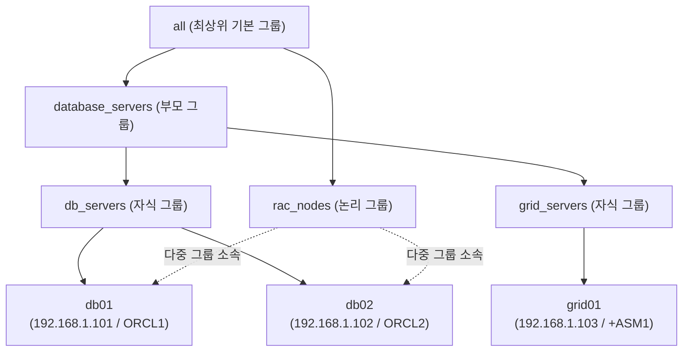

부모 그룹을 대상으로 명령을 실행하면 그 아래에 속한 모든 자식 그룹의 호스트가 자동으로 포함됩니다. 또한 부모 그룹 수준에서 정의한 변수는 모든 자식 그룹과 소속 호스트에 그대로 상속됩니다.

| 실행 대상 그룹 지정 | 실제 작업이 수행되는 호스트 | 주요 오라클 DBA 작업 시나리오 |
| :--- | :--- | :--- |
| `all` 또는 `database_servers` | `db01`, `db02`, `grid01` (3대 전체) | OS 커널 파라미터 설정, 공통 디렉터리(`/u01`) 생성, 사전 요구사항 점검 |
| `db_servers` | `db01`, `db02` (2대) | RDBMS 19c 홈 생성, `sqlplus` 기반 DB 상태 점검, 아카이브 로그 백업 |
| `grid_servers` | `grid01` (1대) | Grid 19c 홈 생성, `asmcmd` 디스크 그룹 점검, `crsctl` 상태 확인 |
| `rac_nodes` | `db01`, `db02` (2대) | RAC VIP/SCAN 네트워크 검증, 인스턴스 스레드(Thread 1, 2) 구성 점검 |

---

## 6. 오라클 19c를 위한 호스트 변수와 그룹 변수 분리 설계

### 6.1 왜 변수를 인벤토리 파일 밖으로 분리해야 하는가

앞서 살펴본 `inventory/hosts` 파일에는 `oracle_sid=ORCL1`처럼 최소한의 핵심 식별 변수만 들어 있습니다. 그러나 실제 오라클 19c 운영 자동화에는 오라클 홈 경로, 리스너 포트, 고속 복구 영역(FRA, Fast Recovery Area) 경로, SCAN 도메인, 노드별 VIP 및 사설 IP 등 수십 개의 파라미터가 필요합니다.

이 모든 변수를 인벤토리 파일 하나에 적어 넣으면 파일이 수백 줄로 비대해져 가독성이 떨어지고 유지 보수가 불가능해집니다. 따라서 앤서블 모범 사례(Best Practice)에서는 인벤토리 파일에는 **호스트와 그룹의 뼈대**만 남기고, 상세 설정 변수는 **`group_vars/`**와 **`host_vars/`** 디렉터리의 개별 YAML 파일로 완전히 분리합니다.

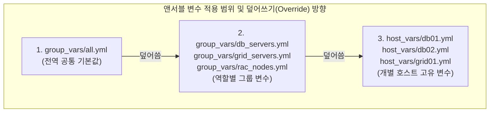

일반적인 범위(`all`)에서 구체적인 범위(`host_vars`)로 갈수록 우선순위가 높아지며, 동일한 변수명이 존재할 경우 더 구체적인 범위에 정의된 값이 상위 값을 덮어씁니다(Override).

> ⚠️ **주의(Caution): `group_vars`와 `host_vars` 탐색 경로의 함정 (실무 트러블슈팅 인사이트)**
> 앤서블은 인벤토리 파일이 하위 디렉터리(`inventory/hosts`)에 있을 때, 기본적으로 **인벤토리 파일이 위치한 디렉터리 기준(`inventory/group_vars/`, `inventory/host_vars/`)**에서 변수 파일을 찾습니다. 반면 플레이북을 실행할 때는 **플레이북 파일이 위치한 디렉터리 기준**으로도 탐색합니다.
> 만약 프로젝트 루트에만 `group_vars/`를 만들어 두고 `inventory/` 하위에는 두지 않으면, 실행 방식에 따라 `'oracle_home' is undefined` 오류가 발생할 수 있습니다. 본 실습 환경(`chapter_1/ansible-oracle-dba`)에서는 어떤 경로에서 명령을 실행하더라도 변수가 누락되지 않도록 루트와 `inventory/` 양쪽에 동일한 `group_vars` 및 `host_vars` 구성을 배치해 두었습니다.

### 6.2 그룹 변수(`group_vars/`) 상세 분석

실습 환경에 구성된 4개의 그룹 변수 파일을 차례대로 살펴봅니다. 파일 이름은 반드시 인벤토리에 정의된 그룹 이름과 정확히 일치해야 합니다(확장자는 `.yml` 또는 `.yaml`).

#### (1) 전역 공통 변수 (`group_vars/all.yml`)

모든 관리 노드에 공통으로 적용되는 OS 그룹명, 백업 경로, 디렉터리 기본 권한(`0755`)을 정의합니다.

```yaml
---
# group_vars/all.yml
# 공통 환경 변수 및 오라클 공통 경로
oracle_group: oinstall
dba_group: dba
env: LAB_ORACLE_19C
backup_dir: /backup/oracle
admin_email: dba-team@example.com

# 19c 디렉터리 권한 표준
dir_mode: '0755'
ora_inventory_group: oinstall
```

#### (2) 데이터베이스 서버 그룹 변수 (`group_vars/db_servers.yml`)

`db01`과 `db02`가 공유하는 오라클 19c(19.3.0) RDBMS 표준 경로와 데이터베이스 전역 이름(`ORCL`), FRA 경로를 정의합니다.

```yaml
---
# group_vars/db_servers.yml
# Oracle Database 19c 환경 변수
oracle_version: "19.3.0"
oracle_base: /u01/app/oracle
oracle_home: /u01/app/oracle/product/19.3.0/dbhome_1
oracle_user: oracle
oracle_group: oinstall
oracle_port: 1521
listener_name: LISTENER
db_name: ORCL
db_unique_name: ORCL_LAB
db_recovery_file_dest: /u01/app/oracle/fast_recovery_area
```

#### (3) 그리드 인프라 서버 그룹 변수 (`group_vars/grid_servers.yml`)

`grid01` 노드에 적용되는 Grid Infrastructure 19c 홈 경로(`/u01/app/19c/grid`), ASM 전용 관리 그룹(`asmadmin`, `asmdba`), 디스크 그룹 이름(`DATA`, `RECO`)을 정의합니다.

```yaml
---
# group_vars/grid_servers.yml
# Oracle 19c Grid Infrastructure & ASM 환경 변수
grid_version: "19.3.0"
grid_base: /u01/app/grid
grid_home: /u01/app/19c/grid
grid_user: grid
grid_group: oinstall
asm_admin_group: asmadmin
asm_dba_group: asmdba
asm_diskgroup: DATA
asm_recovery_diskgroup: RECO
cluster_name: rac-cluster-lab
cluster_nodes:
  - db01
  - db02
```

> 💡 **노트(Note)**: 오라클 19c Grid Infrastructure 설치 시 `grid_home`(`/u01/app/19c/grid`) 경로는 클러스터 루트 스크립트(`root.sh`) 실행 전까지는 `grid:oinstall` 소유여야 하며, 상위 디렉터리(`/u01/app/oracle`)와 경로가 겹치지 않는 Out-of-place 구조를 유지해야 합니다. 이처럼 복잡한 오라클 OFA 표준 경로를 `group_vars`에 코드로 고정해 두면 작업자의 휴먼 에러를 원천 차단할 수 있습니다.

#### (4) RAC 클러스터 그룹 변수 (`group_vars/rac_nodes.yml`)

2-노드 RAC 클러스터 구성을 위한 단일 클라이언트 접속 이름(SCAN, Single Client Access Name) 정보와 각 노드의 인스턴스 번호, 리두 스레드(Redo Thread), 가상 IP(VIP), 사설 인터커넥트 IP를 중첩 딕셔너리(`rac_instances`) 구조로 정의합니다.

```yaml
---
# group_vars/rac_nodes.yml
# Oracle 19c Real Application Clusters (RAC) 환경 변수
scan_name: rac-scan.lab.local
scan_port: 1521
cluster_domain: lab.local

rac_instances:
  db01:
    instance_name: ORCL1
    thread: 1
    vip_ip: 192.168.1.111
    vip_name: db01-vip
    priv_ip: 192.168.17.101
    priv_name: db01-priv
  db02:
    instance_name: ORCL2
    thread: 2
    vip_ip: 192.168.1.112
    vip_name: db02-vip
    priv_ip: 192.168.17.102
    priv_name: db02-priv
```

### 6.3 호스트 변수(`host_vars/`) 상세 분석

동일한 `db_servers` 그룹에 속하더라도 각 노드의 인스턴스 SID(`ORCL1` vs `ORCL2`), 노드 번호(`1` vs `2`), 가상 IP(`vip_ip`)는 서버마다 고유해야 합니다. 이 값들은 `host_vars/` 디렉터리 아래에 호스트명과 동일한 파일로 정의합니다.

**`host_vars/db01.yml` (RAC 1번 노드)**
```yaml
---
# host_vars/db01.yml
oracle_sid: ORCL1
node_number: 1
instance_role: primary_node_1
is_rac_member: true
db_unique_name: ORCL_LAB
vip_ip: 192.168.1.111
```

**`host_vars/db02.yml` (RAC 2번 노드)**
```yaml
---
# host_vars/db02.yml
oracle_sid: ORCL2
node_number: 2
instance_role: primary_node_2
is_rac_member: true
db_unique_name: ORCL_LAB
vip_ip: 192.168.1.112
```

**`host_vars/grid01.yml` (Grid/ASM 관리 노드)**
```yaml
---
# host_vars/grid01.yml
oracle_sid: +ASM1
node_number: 1
is_rac_member: false
grid_role: cluster_infrastructure_manager
asm_diskgroup_count: 2
```

각 관리 노드가 최종적으로 상속받고 조합하는 핵심 변수를 요약하면 표 1-4와 같습니다.

| 변수명 | 정의 위치 (우선순위 기준) | `db01` 최종 적용값 | `db02` 최종 적용값 | `grid01` 최종 적용값 |
| :--- | :--- | :--- | :--- | :--- |
| `ansible_user` | `inventory/hosts` | `oracle` | `oracle` | `grid` |
| `oracle_base` | `inventory` / `group_vars` | `/u01/app/oracle` | `/u01/app/oracle` | `/u01/app/oracle` |
| `ora_inventory` | `inventory/hosts` (`all:vars`) | `/u01/app/oraInventory` | `/u01/app/oraInventory` | `/u01/app/oraInventory` |
| `oracle_home` | `group_vars/db_servers.yml` | `/u01/app/oracle/product/19.3.0/dbhome_1` | `/u01/app/oracle/product/19.3.0/dbhome_1` | *(미정의 - 불필요)* |
| `grid_home` | `group_vars/grid_servers.yml` | *(미정의 - 불필요)* | *(미정의 - 불필요)* | `/u01/app/19c/grid` |
| `oracle_sid` | `host_vars/<hostname>.yml` | `ORCL1` | `ORCL2` | `+ASM1` |
| `node_number` | `host_vars/<hostname>.yml` | `1` | `2` | `1` |
| `is_rac_member` | `host_vars/<hostname>.yml` | `true` | `true` | `false` |

---

## 7. 인벤토리 명령과 구조 검증 실습

인벤토리와 변수 파일 작성을 마쳤다면, 실제 플레이북을 실행하기 전에 반드시 앤서블이 인벤토리 계층과 변수를 의도한 대로 파싱했는지 검증해야 합니다. 제어 노드(`ansible-control`) 터미널에서 다음 검증 명령들을 직접 실행해 봅니다.

### 7.1 인벤토리 트리 구조 시각화 (`--graph`)

`ansible-inventory --graph` 명령은 부모 그룹과 자식 그룹, 그리고 소속 호스트의 계층 구조를 아스키(ASCII) 트리로 깔끔하게 보여 줍니다.

```bash
[oracle@ansible-control ansible-oracle-dba]$ ansible-inventory --graph
@all:
  |--@database_servers:
  |  |--@db_servers:
  |  |  |--db01
  |  |  |--db02
  |  |--@grid_servers:
  |  |  |--grid01
  |--@rac_nodes:
  |  |--db01
  |  |--db02
  |--@ungrouped:
```

YAML 인벤토리 파일(`inventory/hosts.yml`)을 지정하여 실행해도 정확히 동일한 트리 구조가 출력되는지 비교해 봅니다.

```bash
[oracle@ansible-control ansible-oracle-dba]$ ansible-inventory -i inventory/hosts.yml --graph
```

### 7.2 특정 호스트의 병합된 변수 확인 (`--host`)

`db01` 노드가 `all.yml`, `db_servers.yml`, `rac_nodes.yml`, 그리고 `host_vars/db01.yml`로부터 상속받아 최종적으로 가지게 된 모든 변수를 JSON 형식으로 조회합니다.

```bash
[oracle@ansible-control ansible-oracle-dba]$ ansible-inventory --host db01
{
    "admin_email": "dba-team@example.com",
    "ansible_host": "192.168.1.101",
    "ansible_python_interpreter": "/usr/bin/python3",
    "ansible_ssh_common_args": "-o StrictHostKeyChecking=no",
    "ansible_ssh_private_key_file": "~/.ssh/id_rsa",
    "ansible_user": "oracle",
    "backup_dir": "/backup/oracle",
    "cluster_domain": "lab.local",
    "db_name": "ORCL",
    "db_recovery_file_dest": "/u01/app/oracle/fast_recovery_area",
    "db_unique_name": "ORCL_LAB",
    "dba_group": "dba",
    "dir_mode": "0755",
    "env": "LAB_ORACLE_19C",
    "grid_base": "/u01/app/grid",
    "instance_role": "primary_node_1",
    "is_rac_member": true,
    "listener_name": "LISTENER",
    "node_number": 1,
    "node_role": "rac_instance_1",
    "ora_inventory": "/u01/app/oraInventory",
    "ora_inventory_group": "oinstall",
    "oracle_base": "/u01/app/oracle",
    "oracle_group": "oinstall",
    "oracle_home": "/u01/app/oracle/product/19.3.0/dbhome_1",
    "oracle_port": 1521,
    "oracle_sid": "ORCL1",
    "oracle_user": "oracle",
    "oracle_version": "19.3.0",
    "rac_instances": {
        "db01": {
            "instance_name": "ORCL1",
            "priv_ip": "192.168.17.101",
            "priv_name": "db01-priv",
            "thread": 1,
            "vip_ip": "192.168.1.111",
            "vip_name": "db01-vip"
        },
        "db02": {
            "instance_name": "ORCL2",
            "priv_ip": "192.168.17.102",
            "priv_name": "db02-vip",
            "thread": 2,
            "vip_ip": "192.168.1.112",
            "vip_name": "db02-vip"
        }
    },
    "scan_name": "rac-scan.lab.local",
    "scan_port": 1521,
    "vip_ip": "192.168.1.111"
}
```

이어서 `grid01` 호스트의 변수도 확인하여 `ansible_user`가 `grid`로, `oracle_sid`가 `+ASM1`로 정상 매핑되었는지 검증합니다.

```bash
[oracle@ansible-control ansible-oracle-dba]$ ansible-inventory --host grid01
```

### 7.3 전체 인벤토리 JSON 덤프(`--list`) 및 대상 호스트 목록 확인(`--list-hosts`)

전체 인벤토리의 메타데이터(`_meta.hostvars`)와 그룹 구성을 한 번에 확인하려면 `--list` 옵션을 사용합니다. 또한 특정 그룹에 명령을 내리기 전에 대상 서버 목록만 미리 뽑아 보려면 `--list-hosts` 옵션을 사용합니다.

```bash
# 전체 인벤토리 JSON 출력
[oracle@ansible-control ansible-oracle-dba]$ ansible-inventory --list

# 부모 그룹 database_servers에 포함된 호스트 목록 확인
[oracle@ansible-control ansible-oracle-dba]$ ansible database_servers --list-hosts
  hosts (3):
    db01
    db02
    grid01

# 자식 그룹 db_servers에 포함된 호스트 목록 확인
[oracle@ansible-control ansible-oracle-dba]$ ansible db_servers --list-hosts
  hosts (2):
    db01
    db02
```

### 7.4 애드혹 `ping` 모듈을 이용한 SSH 연결 및 파이썬 검증

인벤토리 파싱에 문제가 없다면, 실제 네트워크와 SSH 키 인증, 그리고 원격 노드의 파이썬 인터프리터(`/usr/bin/python3`)가 정상 동작하는지 `ping` 모듈로 점검합니다.

```bash
[oracle@ansible-control ansible-oracle-dba]$ ansible all -m ping
db01 | SUCCESS => {
    "changed": false,
    "ping": "pong"
}
grid01 | SUCCESS => {
    "changed": false,
    "ping": "pong"
}
db02 | SUCCESS => {
    "changed": false,
    "ping": "pong"
}
```

> 💡 **노트(Note)**: 앤서블의 `ping` 모듈은 네트워크 계층의 ICMP `ping` 패킷을 보내는 것이 아닙니다. 제어 노드에서 관리 노드로 실제 SSH 로그인을 수행한 뒤, 파이썬 스크립트를 실행할 수 있는지 확인하고 `"pong"`을 반환하는 **엔드투엔드(End-to-End) 자동화 준비 상태 검증 도구**입니다.

실무에서 자주 사용하는 인벤토리 검증 명령을 정리하면 표 1-5와 같습니다.

| 실행 명령어 | 검증 목적 및 활용 시점 |
| :--- | :--- |
| `ansible-inventory --graph` | 부모·자식 그룹 계층 구조와 호스트 소속 관계를 트리 형태로 시각적 점검 |
| `ansible-inventory --host <호스트명>` | 특정 서버에 최종 병합된 그룹 변수 및 호스트 변수 값 디버깅 |
| `ansible-inventory --list` | 전체 인벤토리의 `_meta.hostvars` 및 그룹 구조를 JSON으로 덤프 |
| `ansible <그룹명> --list-hosts` | 플레이북 실행 전 작업 대상 그룹에 속한 서버 명단 사전 확인 |
| `ansible all -m ping` | 모든 관리 노드의 SSH 무암호 키 인증 및 파이썬 실행 가능 여부 점검 |

---

## 8. 마스터 프로젝트: 오라클 19c 환경 구축 및 사전 점검 자동화 (실습)

이제 앞서 설계하고 검증한 인벤토리와 계층형 변수를 바탕으로, `playbooks/` 디렉터리에 준비된 4단계 실무 플레이북(`01`~`04`)을 차례대로 실행하며 오라클 19c 환경을 프로비저닝하고 검증합니다.


### 8.1 Step 1: 연결 점검 및 OS 팩트 수집 (`01_ping_check.yml`)

첫 번째 플레이북은 모든 관리 노드(`hosts: all`)를 대상으로 SSH 연결을 확인하고, 앤서블이 자동 수집한 시스템 팩트(Facts) 변수에서 IP 주소, 운영체제 배포판 버전(`OracleLinux 8.10`), CPU 아키텍처(`x86_64`)를 추출하여 출력합니다.

**플레이북 코드 (`playbooks/01_ping_check.yml`)**
```yaml
---
# ========================================================
# Playbook: 01_ping_check.yml
# Description: Test connectivity and gather facts from all Oracle lab nodes
# ========================================================
- name: Oracle Lab Connectivity & Basic Host Check
  hosts: all
  gather_facts: yes
  become: no

  tasks:
    - name: Ping all managed nodes via Ansible SSH
      ansible.builtin.ping:

    - name: Display connection success details
      ansible.builtin.debug:
        msg: >-
          Host: {{ inventory_hostname }} |
          IP: {{ ansible_default_ipv4.address | default(ansible_all_ipv4_addresses[0]) }} |
          OS: {{ ansible_distribution }} {{ ansible_distribution_version }} |
          Arch: {{ ansible_architecture }}
```

**실행 및 결과 확인**
```bash
[oracle@ansible-control ansible-oracle-dba]$ ansible-playbook playbooks/01_ping_check.yml

PLAY [Oracle Lab Connectivity & Basic Host Check] ******************************

TASK [Gathering Facts] *********************************************************
ok: [grid01]
ok: [db02]
ok: [db01]

TASK [Ping all managed nodes via Ansible SSH] **********************************
ok: [grid01]
ok: [db02]
ok: [db01]

TASK [Display connection success details] **************************************
ok: [db01] => 
  msg: 'Host: db01 | IP: 192.168.1.101 | OS: OracleLinux 8.10 | Arch: x86_64'
ok: [db02] => 
  msg: 'Host: db02 | IP: 192.168.1.102 | OS: OracleLinux 8.10 | Arch: x86_64'
ok: [grid01] => 
  msg: 'Host: grid01 | IP: 192.168.1.103 | OS: OracleLinux 8.10 | Arch: x86_64'

PLAY RECAP *********************************************************************
db01                       : ok=3    changed=0    unreachable=0    failed=0    skipped=0    rescued=0    ignored=0   
db02                       : ok=3    changed=0    unreachable=0    failed=0    skipped=0    rescued=0    ignored=0   
grid01                     : ok=3    changed=0    unreachable=0    failed=0    skipped=0    rescued=0    ignored=0   
```

### 8.2 Step 2: 인벤토리 그룹별 오라클 19c 디렉터리 프로비저닝 (`02_setup_oracle_env.yml`)

두 번째 플레이북은 인벤토리 그룹 설계의 진가를 보여 주는 핵심 예제입니다. 하나의 플레이북 파일 안에 **3개의 플레이(Play)**를 정의하여, 각 그룹의 역할에 맞는 디렉터리와 소유권·권한을 차등 생성합니다.

1. **첫 번째 플레이 (`hosts: all`)**: 3대 모든 노드에 공통 오라클 베이스(`/u01/app/oracle`, 권한 `0755`)와 인벤토리 디렉터리(`/u01/app/oraInventory`, 권한 `0770`)를 생성합니다.
2. **두 번째 플레이 (`hosts: db_servers`)**: `db01`, `db02` 노드에만 `group_vars/db_servers.yml`의 `{{ oracle_home }}`(`/u01/app/oracle/product/19.3.0/dbhome_1`)과 고속 복구 영역(`{{ db_recovery_file_dest }}`)을 `oracle:oinstall` 소유로 생성합니다.
3. **세 번째 플레이 (`hosts: grid_servers`)**: `grid01` 노드에만 `group_vars/grid_servers.yml`의 `{{ grid_home }}`(`/u01/app/19c/grid`)을 `grid:oinstall` 소유 및 `0775` 권한으로 생성합니다.

**플레이북 코드 (`playbooks/02_setup_oracle_env.yml`)**
```yaml
---
# ========================================================
# Playbook: 02_setup_oracle_env.yml
# Description: Chapter 1 Master Project - Setup Oracle & Grid Base Directories
# ========================================================

# --------------------------------------------------------
# 1. 모든 노드: Oracle Base 및 Inventory 공통 디렉터리 생성
# --------------------------------------------------------
- name: Setup Common Oracle Base & Inventory Directories
  hosts: all
  become: yes
  gather_facts: no

  tasks:
    - name: Create Oracle base directory (/u01/app/oracle)
      ansible.builtin.file:
        path: "{{ oracle_base }}"
        state: directory
        owner: oracle
        group: oinstall
        mode: "{{ dir_mode | default('0755') }}"

    - name: Create Oracle Inventory directory (/u01/app/oraInventory)
      ansible.builtin.file:
        path: "{{ ora_inventory }}"
        state: directory
        owner: oracle
        group: oinstall
        mode: '0770'

    - name: Verify Oracle Base directory exists
      ansible.builtin.command: ls -ld {{ oracle_base }}
      register: oracle_base_check
      changed_when: false

    - name: Display Oracle Base status
      ansible.builtin.debug:
        msg: "[{{ inventory_hostname }}] Oracle Base: {{ oracle_base_check.stdout }}"

# --------------------------------------------------------
# 2. DB 서버 (db01, db02): Oracle Database 19c Home 생성
# --------------------------------------------------------
- name: Setup Oracle Database 19c Product Home on DB Nodes
  hosts: db_servers
  become: yes
  gather_facts: no

  tasks:
    - name: Create Oracle 19c product home directory
      ansible.builtin.file:
        path: "{{ oracle_home }}"
        state: directory
        owner: "{{ oracle_user | default('oracle') }}"
        group: oinstall
        mode: '0755'

    - name: Create Fast Recovery Area directory
      ansible.builtin.file:
        path: "{{ db_recovery_file_dest | default('/u01/app/oracle/fast_recovery_area') }}"
        state: directory
        owner: "{{ oracle_user | default('oracle') }}"
        group: oinstall
        mode: '0755'

    - name: Verify Oracle Home directory
      ansible.builtin.command: ls -ld {{ oracle_home }}
      register: oracle_home_check
      changed_when: false

    - name: Display Oracle Home details
      ansible.builtin.debug:
        msg: "[{{ inventory_hostname }}] Oracle Home: {{ oracle_home_check.stdout }}"

# --------------------------------------------------------
# 3. Grid 서버 (grid01): Oracle Grid Infrastructure 19c Home 생성
# --------------------------------------------------------
- name: Setup Oracle Grid Infrastructure 19c Home on Grid Nodes
  hosts: grid_servers
  become: yes
  gather_facts: no

  tasks:
    - name: Create Oracle 19c Grid home directory
      ansible.builtin.file:
        path: "{{ grid_home }}"
        state: directory
        owner: "{{ grid_user | default('grid') }}"
        group: oinstall
        mode: '0775'

    - name: Verify Grid Home directory
      ansible.builtin.command: ls -ld {{ grid_home }}
      register: grid_home_check
      changed_when: false

    - name: Display Grid Home details
      ansible.builtin.debug:
        msg: "[{{ inventory_hostname }}] Grid Home: {{ grid_home_check.stdout }}"
```

**실행 및 결과 확인**
```bash
[oracle@ansible-control ansible-oracle-dba]$ ansible-playbook playbooks/02_setup_oracle_env.yml

PLAY [Setup Common Oracle Base & Inventory Directories] ************************

TASK [Create Oracle base directory (/u01/app/oracle)] **************************
ok: [db01]
ok: [db02]
ok: [grid01]

TASK [Create Oracle Inventory directory (/u01/app/oraInventory)] ***************
ok: [db01]
ok: [db02]
ok: [grid01]

TASK [Verify Oracle Base directory exists] *************************************
ok: [grid01]
ok: [db02]
ok: [db01]

TASK [Display Oracle Base status] **********************************************
ok: [db01] => 
  msg: '[db01] Oracle Base: drwxr-xr-x 2 oracle oinstall 4096 Oct  3 23:07 /u01/app/oracle'
ok: [db02] => 
  msg: '[db02] Oracle Base: drwxr-xr-x 2 oracle oinstall 4096 Oct  3 23:07 /u01/app/oracle'
ok: [grid01] => 
  msg: '[grid01] Oracle Base: drwxr-xr-x 2 oracle oinstall 4096 Oct  3 23:07 /u01/app/oracle'

PLAY [Setup Oracle Database 19c Product Home on DB Nodes] **********************

TASK [Create Oracle 19c product home directory] ********************************
changed: [db01]
changed: [db02]

TASK [Create Fast Recovery Area directory] *************************************
changed: [db01]
changed: [db02]

TASK [Verify Oracle Home directory] ********************************************
ok: [db01]
ok: [db02]

TASK [Display Oracle Home details] *********************************************
ok: [db01] => 
  msg: '[db01] Oracle Home: drwxr-xr-x 2 oracle oinstall 4096 Oct  3 23:12 /u01/app/oracle/product/19.3.0/dbhome_1'
ok: [db02] => 
  msg: '[db02] Oracle Home: drwxr-xr-x 2 oracle oinstall 4096 Oct  3 23:12 /u01/app/oracle/product/19.3.0/dbhome_1'

PLAY [Setup Oracle Grid Infrastructure 19c Home on Grid Nodes] *****************

TASK [Create Oracle 19c Grid home directory] ***********************************
ok: [grid01]

TASK [Verify Grid Home directory] **********************************************
ok: [grid01]

TASK [Display Grid Home details] ***********************************************
ok: [grid01] => 
  msg: '[grid01] Grid Home: drwxrwxr-x 2 grid oinstall 4096 Oct  3 23:07 /u01/app/19c/grid'

PLAY RECAP *********************************************************************
db01                       : ok=8    changed=2    unreachable=0    failed=0    skipped=0    rescued=0    ignored=0   
db02                       : ok=8    changed=2    unreachable=0    failed=0    skipped=0    rescued=0    ignored=0   
grid01                     : ok=7    changed=0    unreachable=0    failed=0    skipped=0    rescued=0    ignored=0   
```

최초 실행 시에는 `db01`과 `db02`에 오라클 19c 홈과 FRA 디렉터리가 새로 생성되어 `changed=2`가 기록됩니다. 동일한 플레이북을 즉시 한 번 더 실행하면 이미 디렉터리와 권한이 원하는 상태로 존재하므로 모든 노드가 `changed=0`으로 완료되며 멱등성이 보장됨을 확인할 수 있습니다.

### 8.3 Step 3: 오라클 19c RAC 사전 요구사항 일괄 점검 (`03_oracle_19c_precheck.yml`)

세 번째 플레이북은 부모 그룹인 `database_servers`(`db01`, `db02`, `grid01`)를 대상으로 오라클 19c 설치 전 필수 점검 항목인 OS 버전과 커널, `oracle` 및 `grid` 계정의 UID/GID 소속 그룹, `/u01` 마운트 볼륨의 여유 디스크 용량(`df -h /u01`), 메모리 및 스왑 공간(`free -h`)을 수집하여 일목요연한 요약 리포트로 출력합니다.

**플레이북 코드 (`playbooks/03_oracle_19c_precheck.yml`)**
```yaml
---
# ========================================================
# Playbook: 03_oracle_19c_precheck.yml
# Description: Oracle 19c RAC Pre-installation & Environment Verification
# Targets: database_servers (db01, db02, grid01)
# ========================================================
- name: Oracle 19c RAC Pre-installation Environment Check
  hosts: database_servers
  become: yes
  gather_facts: yes

  tasks:
    - name: 1. Check OS Version and Distribution
      ansible.builtin.debug:
        msg: "Host: {{ inventory_hostname }} runs {{ ansible_distribution }} {{ ansible_distribution_version }} (Kernel: {{ ansible_kernel }})"

    - name: 2. Check oracle user and group membership
      ansible.builtin.command: id oracle
      register: id_oracle_result
      changed_when: false

    - name: 3. Check grid user and group membership (if exists)
      ansible.builtin.command: id grid
      register: id_grid_result
      changed_when: false
      failed_when: false

    - name: 4. Check available disk space on /u01
      ansible.builtin.command: df -h /u01
      register: disk_u01_result
      changed_when: false

    - name: 5. Check memory and swap details
      ansible.builtin.command: free -h
      register: memory_result
      changed_when: false

    - name: 6. Display Pre-check Summary
      ansible.builtin.debug:
        msg:
          - "================= [ {{ inventory_hostname }} Pre-Check Summary ] ================="
          - "Oracle User: {{ id_oracle_result.stdout }}"
          - "Grid User:   {{ id_grid_result.stdout | default('N/A') }}"
          - "U01 Storage:"
          - "{{ disk_u01_result.stdout }}"
          - "Memory Stats:"
          - "{{ memory_result.stdout }}"
          - "=========================================================================="
```

**실행 및 결과 확인**
```bash
[oracle@ansible-control ansible-oracle-dba]$ ansible-playbook playbooks/03_oracle_19c_precheck.yml
```

실행 결과(아래 `db01` 출력 발췌)를 보면 `oracle-database-preinstall-19c` 패키지와 도커파일을 통해 구성된 세부 그룹(`oinstall`, `dba`, `oper`, `backupdba`, `dgdba`, `kmdba`, `racdba`, `asmdba`, `asmadmin`)이 한 치의 오차도 없이 검증되는 것을 확인할 수 있습니다.

```text
ok: [db01] => 
  msg:
  - ================= [ db01 Pre-Check Summary ] =================
  - 'Oracle User: uid=54321(oracle) gid=54321(oinstall) groups=54321(oinstall),10(wheel),54322(dba),54323(oper),54324(backupdba),54325(dgdba),54326(kmdba),54330(racdba),54327(asmdba),54329(asmadmin)'
  - 'Grid User:   uid=54322(grid) gid=54321(oinstall) groups=54321(oinstall),10(wheel),54322(dba),54327(asmdba),54328(asmoper),54329(asmadmin)'
  - 'U01 Storage:'
  - |-
    Filesystem      Size  Used Avail Use% Mounted on
    /dev/sde        251G   62G  177G  26% /u01
  - 'Memory Stats:'
  - |2-
                  total        used        free      shared  buff/cache   available
    Mem:          7.5Gi       1.0Gi       5.8Gi        50Mi       694Mi       6.3Gi
    Swap:         2.0Gi          0B       2.0Gi
  - ==========================================================================
```

### 8.4 Step 4: 최종 환경 종합 검증 (`04_verify_all.yml`)

마지막 네 번째 플레이북은 모든 노드의 `/u01/app` 하위 디렉터리 트리와 권한(`ls -la /u01/app`) 및 커널 호스트명(`uname -n`)을 최종 검증합니다.

**플레이북 코드 (`playbooks/04_verify_all.yml`)**
```yaml
---
# ========================================================
# Playbook: 04_verify_all.yml
# Description: Comprehensive Verification for Chapter 1 Setup
# ========================================================
- name: Final Verification of Oracle 19c DBA Lab
  hosts: all
  become: yes
  gather_facts: no

  tasks:
    - name: Verify /u01 directory tree
      ansible.builtin.command: ls -la /u01/app
      register: u01_tree
      changed_when: false

    - name: Verify SSH connectivity across nodes
      ansible.builtin.command: uname -n
      register: host_name_cmd
      changed_when: false

    - name: Final report
      ansible.builtin.debug:
        msg: >-
          [SUCCESS] {{ inventory_hostname }} is healthy.
          Hostname: {{ host_name_cmd.stdout }}.
          Directory status:
          {{ u01_tree.stdout }}
```

이 플레이북은 프로젝트에 포함된 헬퍼 스크립트(`scripts/run_playbook.sh`)를 사용하여 실행해 볼 수도 있습니다.

```bash
[oracle@ansible-control ansible-oracle-dba]$ ./scripts/run_playbook.sh playbooks/04_verify_all.yml
==================================================
Running Ansible Playbook: playbooks/04_verify_all.yml
==================================================

PLAY [Final Verification of Oracle 19c DBA Lab] ********************************

TASK [Verify /u01 directory tree] **********************************************
ok: [db01]
ok: [db02]
ok: [grid01]

TASK [Verify SSH connectivity across nodes] ************************************
ok: [db01]
ok: [db02]
ok: [grid01]

TASK [Final report] ************************************************************
ok: [db01] => 
  msg: |-
    [SUCCESS] db01 is healthy. Hostname: db01. Directory status: total 20
    drwxrwxr-x 5 root   root     4096 Oct  3 23:07 .
    drwxrwxr-x 3 root   root     4096 Oct  3 23:07 ..
    drwxrwxr-x 3 root   root     4096 Oct  3 23:07 19c
    drwxrwx--- 2 oracle oinstall 4096 Oct  3 23:07 oraInventory
    drwxr-xr-x 4 oracle oinstall 4096 Oct  3 23:12 oracle
ok: [db02] => 
  msg: |-
    [SUCCESS] db02 is healthy. Hostname: db02. Directory status: total 20
    drwxrwxr-x 5 root   root     4096 Oct  3 23:07 .
    drwxrwxr-x 3 root   root     4096 Oct  3 23:07 ..
    drwxrwxr-x 3 root   root     4096 Oct  3 23:07 19c
    drwxrwx--- 2 oracle oinstall 4096 Oct  3 23:07 oraInventory
    drwxr-xr-x 4 oracle oinstall 4096 Oct  3 23:12 oracle
ok: [grid01] => 
  msg: |-
    [SUCCESS] grid01 is healthy. Hostname: grid01. Directory status: total 20
    drwxrwxr-x 5 root   root     4096 Oct  3 23:07 .
    drwxrwxr-x 3 root   root     4096 Oct  3 23:07 ..
    drwxrwxr-x 3 root   root     4096 Oct  3 23:07 19c
    drwxrwx--- 2 oracle oinstall 4096 Oct  3 23:07 oraInventory
    drwxr-xr-x 2 oracle oinstall 4096 Oct  3 23:07 oracle
```

---

## 9. 인벤토리 및 실습 환경 트러블슈팅 가이드

실제 오라클 서버나 미니멀(Minimal) 리눅스 컨테이너 환경에서 인벤토리와 플레이북을 운영할 때 자주 겪는 대표적인 오류 4가지와 해결 방법을 정리합니다.

### 9.1 자주 발생하는 오류 요약

| 오류 유형 | 콘솔 출력 메시지 증상 | 근본 원인 | 핵심 해결 방법 |
| :--- | :--- | :--- | :--- |
| **변수 미정의 오류** | `'oracle_home' is undefined` | 인벤토리 디렉터리(`inventory/`)와 `group_vars/` 경로 불일치 또는 그룹명 오타 | `ansible-inventory --host db01`로 변수 로드 여부 확인 및 `inventory/group_vars/` 배치 |
| **호스트 매칭 실패** | `ERROR! Specified hosts and/or --limit does not match any hosts` | 플레이북의 `hosts:` 지정 그룹명이 인벤토리에 없음 | `ansible-inventory --graph`로 정확한 그룹명(예: `db_servers` 복수형) 확인 |
| **명령어 바이너리 누락** | `[Errno 2] No such file or directory: b'hostname'` | 미니멀 컨테이너/OS 이미지에 `hostname` 패키지가 설치되지 않음 | `Dockerfile`에 `hostname` 패키지 추가 또는 POSIX 표준 명령인 `uname -n` 사용 |
| **SSH 인증 실패** | `UNREACHABLE! => Permission denied (publickey,password)` | 관리 노드 `oracle` 또는 `grid` 계정의 `~/.ssh/authorized_keys` 권한·소유자 불일치 | `~/.ssh`는 `0700`, `authorized_keys`는 `0600` 권한 및 해당 계정 소유권 확인 |

### 9.2 실전 디버깅 사례 1: `'oracle_home' is undefined` 해결

`02_setup_oracle_env.yml` 실행 중 다음과 같은 치명적(Fatal) 오류가 발생했다고 가정해 봅니다.

```text
TASK [Create Oracle 19c product home directory] ********************************
fatal: [db01]: FAILED! => 
  msg: |-
    The task includes an option with an undefined variable. The error was: 'oracle_home' is undefined.
```

이 오류가 발생하면 당황하지 말고 다음 3단계로 원인을 좁혀 나갑니다.

1. `ansible-inventory --host db01` 명령을 실행하여 출력 JSON에 `oracle_home` 키가 존재하는지 확인합니다.
2. 출력에 `oracle_home`이 없다면, `group_vars/db_servers.yml` 파일 이름이 인벤토리의 `[db_servers]` 그룹 이름과 철자까지 일치하는지 점검합니다(`db_server.yml`처럼 단수로 적으면 매핑되지 않습니다).
3. 인벤토리 파일이 `inventory/hosts`에 위치한다면 `inventory/group_vars/db_servers.yml` 경로에도 파일이 존재하는지 확인합니다.

### 9.3 실전 디버깅 사례 2: 미니멀 리눅스 이미지의 `hostname` 바이너리 누락

오라클 리눅스 8 컨테이너 이미지를 처음 빌드할 때 흔히 겪는 또 다른 오류는 다음과 같습니다.

```text
TASK [Verify SSH connectivity across nodes] ************************************
fatal: [db01]: FAILED! => changed=false 
  cmd: hostname
  msg: '[Errno 2] No such file or directory: b''hostname'''
  rc: 2
```

일반 가상 머신(VM)이나 베어메탈 서버와 달리, 도커용 미니멀 베이스 이미지(`oraclelinux:8`)에는 `hostname` 바이너리가 기본 포함되지 않는 경우가 있습니다. 이를 방지하기 위해 `04_verify_all.yml`에서는 어떤 유닉스/리눅스 커널에서도 `coreutils`에 기본 내장된 `uname -n` 명령을 사용하도록 개선했으며, `Dockerfile.oracle_node`에도 `hostname` 패키지를 명시적으로 추가하여 이중으로 안정성을 확보했습니다.

### 9.4 운영 환경 적용 전 최종 체크리스트

인벤토리 설계를 마치고 운영 플레이북을 실행하기 전에 표 1-6의 체크리스트를 점검하십시오.

| 번호 | 점검 항목 | 확인 명령어 또는 기준 | 점검 |
| :---: | :--- | :--- | :---: |
| 1 | `ansible.cfg`가 올바르게 로드되고 있는가? | `ansible --version` 출력의 `config file` 경로 확인 | ☐ |
| 2 | 부모·자식 그룹 계층이 설계 의도와 일치하는가? | `ansible-inventory --graph` | ☐ |
| 3 | YAML 인벤토리와 INI 인벤토리의 파싱 결과가 동일한가? | `ansible-inventory -i inventory/hosts.yml --list` | ☐ |
| 4 | `db01`, `db02`, `grid01`의 호스트·그룹 변수가 누락 없이 병합되었는가? | `ansible-inventory --host db01` | ☐ |
| 5 | `oracle` 계정과 `grid` 계정의 무암호 SSH 키 인증이 모두 성공하는가? | `ansible all -m ping` | ☐ |
| 6 | 플레이북 재실행 시 `changed=0`으로 멱등성이 유지되는가? | `ansible-playbook playbooks/02_setup_oracle_env.yml` 2회 실행 | ☐ |

---

## 10. 심화 연계: 컨테이너 기반 오라클 19c RAC 아키텍처 확장

`chapter_1/rac_19c_architecture/` 디렉터리에는 본 장에서 설계한 인벤토리 변수(`group_vars/rac_nodes.yml`)를 실제 오라클 공식 RAC 19c 컨테이너 이미지(`oracle/database-rac:19.3.0`)와 연결하기 위한 아키텍처 가이드와 환경 템플릿(`rac19c.env`)이 수록되어 있습니다.

실제 오라클 19c 2-노드 RAC 클러스터는 그림 1-3과 같이 공인 네트워크(Public Network, `192.168.1.0/24`), 캐시 퓨전(Cache Fusion) 및 하트비트 통신을 위한 사설 인터커넥트(Private Interconnect, `192.168.17.0/24`), 그리고 두 노드가 동시에 마운트하는 공유 ASM 스토리지(`+DATA`, `+RECO`)로 구성됩니다.

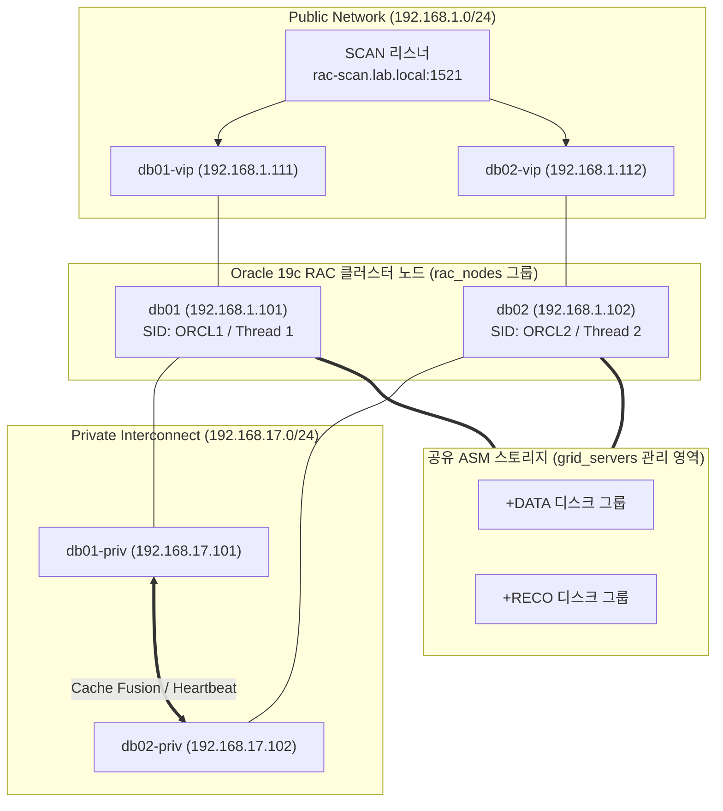

우리가 `group_vars/rac_nodes.yml`과 `group_vars/grid_servers.yml`에 미리 정의해 둔 `scan_name`, `vip_ip`, `priv_ip`, `asm_diskgroup` 변수들은 향후 장(Chapter)에서 다룰 Jinja2 템플릿(`tnsnames.ora`, `listener.ora` 자동 생성)과 클러스터 상태 점검 자동화 플레이북의 핵심 데이터 소스로 그대로 재사용됩니다.

실습을 모두 마쳤다면 호스트 터미널에서 다음 명령으로 컨테이너를 안전하게 종료하고 볼륨을 정리할 수 있습니다.

```bash
# 제어 노드 셸 종료
exit

# 컨테이너 및 임시 볼륨 정리
docker compose down -v
```

---

## 핵심 요약

1. **인벤토리의 역할**: 인벤토리는 앤서블 제어 노드가 관리할 오라클 서버들의 접속 정보, 역할 그룹, 환경 변수를 정의하는 자동화의 출발점입니다.
2. **INI와 YAML 형식**: 소규모 환경에서는 직관적인 INI(`inventory/hosts`)가 편리하며, 부모·자식 그룹 계층과 복합 변수가 많은 오라클 19c 운영 환경에서는 계층적인 YAML(`inventory/hosts.yml`) 형식이 권장됩니다.
3. **논리적 그룹과 계층화**: 오라클 인프라를 `db_servers`, `grid_servers`, `rac_nodes`로 나누고 상위 부모 그룹인 `database_servers`로 묶으면, 단일 플레이북 내에서도 플레이별로 작업 대상을 정밀하게 분리할 수 있습니다.
4. **변수의 외부 분리와 우선순위**: 공통 설정은 `group_vars/all.yml`, 역할별 설정(`oracle_home`, `grid_home`)은 `group_vars/<group>.yml`, 노드별 고유 설정(`oracle_sid`, `vip_ip`)은 `host_vars/<host>.yml`에 분리하여 코드 중복을 제거합니다.
5. **사전 검증의 생활화**: 플레이북을 실행하기 전에 항상 `ansible-inventory --graph`, `ansible-inventory --host <호스트명>`, 그리고 `ansible all -m ping`으로 구조와 연결 상태를 먼저 검증하는 습관이 운영 장애를 예방합니다.


---

# Chapter 2. 앤서블 애드혹 명령과 다중 환경(DEV/TEST/PROD) 서버 운영 자동화

## 개요

데이터베이스 서버의 SSH 통신 점검, 리스너 상태 확인, 긴급 디렉터리 생성처럼 단 한 번이면 끝나는 일상 작업까지 매번 YAML 플레이북 파일로 작성하는 것은 오히려 번거롭습니다. 이럴 때 사용하는 강력한 도구가 **애드혹 명령(Ad-hoc Command)**입니다. 제어 노드 터미널에서 단 한 줄의 명령만 입력하면 수십 대의 오라클 서버에 동일한 작업을 즉시 병렬로 실행할 수 있어, 오라클 DBA의 일상 운영과 긴급 장애 진단에 특히 유용합니다.

또한 엔터프라이즈 오라클 인프라는 단일 환경으로 운영되지 않습니다. 개발(`dev`), 테스트(`test`), 운영(`prod`) 환경이 엄격히 분리되어 있으며, 각 환경 내부에는 단일 인스턴스 DB, Grid/ASM, RAC 클러스터, 데이터 가드(Data Guard) 스탠바이 노드가 공존합니다. 애드혹 명령의 **호스트 패턴(Host Pattern)**을 다중 환경 인벤토리와 결합하면, 원하는 환경과 역할의 서버만 정확히 조준하여 명령을 내릴 수 있습니다.

이 장에서는 `chapter_2`의 9노드 다중 환경 아키텍처(`dev`/`test`/`prod` × `DB`/`Grid`/`RAC`/`Data Guard`)를 기반으로, 애드혹 명령의 핵심 모듈 9종과 환경별·역할별 운영 자동화를 실습합니다.

이 장에서 학습할 핵심 내용은 다음과 같습니다.

- 애드혹 명령의 구조(`ansible <host_pattern> -m <module> -a "<args>"`)와 플레이북과의 차이점
- 9노드 다중 환경(`dev`, `test`, `prod`) 및 역할(`db_servers`, `grid_servers`, `rac_nodes`, `dataguard_servers`) 매트릭스 아키텍처 구축
- 호스트 패턴(교집합 `:&`, 차집합 `:!`, 합집합 `:`, 와일드카드 `*`)을 활용한 정밀 타기팅
- 필수 모듈 9종(`ping`, `command`, `shell`, `file`, `copy`, `package`, `service`, `user`, `group`) 완벽 마스터
- `command` 모듈과 `shell` 모듈의 보안 및 동작 차이(`|`, `>`, `<<EOF`, `$ORACLE_HOME` 처리)
- 오라클 DBA 실무 애드혹 레시피(`sqlplus`, `lsnrctl`, `dgmgrl`, `ora_pmon` 점검)
- 마스터 프로젝트: 9노드 엔터프라이즈 환경의 변수 상속 검증 및 종합 감사(Audit) 플레이북 실행

> 💡 **노트(Note)**: 애드혹 명령은 빠른 상태 점검과 일회성 긴급 조치에 최적화되어 있습니다. 애드혹 명령으로 충분히 테스트하고 검증한 작업 중, 정기적으로 반복해야 하는 절차는 플레이북으로 전환하여 코드로 관리하십시오.

---

## 1. 애드혹 명령 기초와 9노드 다중 환경 아키텍처

### 1.1 애드혹 명령과 플레이북의 역할 분담

앤서블은 크게 **애드혹 명령(`ansible`)**과 **플레이북(`ansible-playbook`)** 두 가지 실행 방식을 제공합니다. 두 방식의 차이와 실무 적용 기준은 표 2-1과 같습니다.

| 비교 항목 | 애드혹 명령 (`ansible`) | 플레이북 (`ansible-playbook`) |
| :--- | :--- | :--- |
| **실행 형태** | 터미널에서 실행하는 한 줄짜리 CLI 명령 | 여러 플레이와 태스크를 정의한 YAML 파일 |
| **주요 목적** | 빠른 상태 조회, 연결 확인, 긴급 일회성 조치 | 표준화된 다단계 프로비저닝, 정기 작업 자동화 |
| **재사용성** | 실행 후 휘발됨 (셸 히스토리에만 남음) | Git 리포지토리에 커밋하여 영구 재사용 및 협업 가능 |
| **학습 난이도** | 매우 낮음 (리눅스 기본 명령과 유사) | 중간 (YAML 문법, 변수, 조건·반복문 이해 필요) |
| **오라클 DBA 활용 시점** | 전 서버 `ora_pmon` 확인, `/u01` 용량 긴급 조회 | 오라클 19c 설치 사전 작업, 정기 패치 및 백업 구성 |

### 1.2 Chapter 2 실습 랩: 9노드 다중 환경 아키텍처 구성

실제 기업의 데이터베이스 인프라는 **생애주기 환경(DEV / TEST / PROD)**이라는 가로축과 **서버 역할(DB / Grid / RAC / Data Guard)**이라는 세로축이 교차하는 매트릭스 구조를 가집니다. `chapter_2` 실습 환경은 이 구조를 완벽히 재현하기 위해 제어 노드 1대와 관리 노드 8대(총 9대 컨테이너)로 구성되어 있습니다.

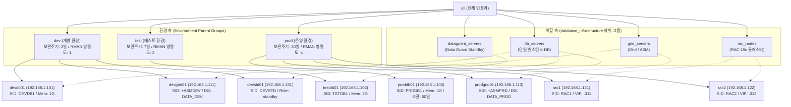

`chapter_2/docker-compose.yml`에 정의된 9개 컨테이너 노드의 상세 스펙은 표 2-2와 같습니다.

| 컨테이너명 (호스트명) | 환경 그룹 | 역할 그룹 | 고정 IP 주소 | 오라클 SID | 주요 특징 및 할당 스펙 |
| :--- | :--- | :--- | :--- | :--- | :--- |
| `ansible-control-ch2` | - | **Control Node** | `192.168.1.10` | - | 앤서블 제어 노드 (`/home/oracle/ansible-oracle-inventory`) |
| `devdb01` | `dev` | `db_servers` | `192.168.1.101` | `DEVDB1` | 개발 DB (`db_name=devdb`, 메모리 타깃 `1G`, 보관 `3일`) |
| `testdb01` | `test` | `db_servers` | `192.168.1.102` | `TSTDB1` | 테스트 DB (`db_name=testdb`, 메모리 타깃 `2G`, 보관 `7일`) |
| `proddb01` | `prod` | `db_servers` | `192.168.1.103` | `PRDDB1` | 운영 DB (`db_name=proddb`, 메모리 타깃 `4G`, 보관 `60일`) |
| `devgrid01` | `dev` | `grid_servers` | `192.168.1.111` | `+ASMDEV` | 개발 Grid/ASM 노드 (`asm_diskgroup=DATA_DEV`) |
| `prodgrid01` | `prod` | `grid_servers` | `192.168.1.113` | `+ASMPRD` | 운영 Grid/ASM 노드 (`asm_diskgroup=DATA_PROD`) |
| `rac1` | `prod` | `rac_nodes` | `192.168.1.121` | `RAC1` | 운영 RAC 1번 노드 (`node_id=1`, `vip_ip=192.168.1.311`) |
| `rac2` | `prod` | `rac_nodes` | `192.168.1.122` | `RAC2` | 운영 RAC 2번 노드 (`node_id=2`, `vip_ip=192.168.1.312`) |
| `devstd01` | `dev` | `dataguard_servers` | `192.168.1.131` | `DEVSTD` | 개발 Data Guard 물리적 스탠바이 (`primary_db_name=devdb`) |

터미널에서 `chapter_2` 디렉터리로 이동하여 9대의 컨테이너를 빌드 및 기동하고 제어 노드에 접속합니다.

```bash
cd chapter_2
docker compose up -d --build
docker exec -it ansible-control-ch2 bash
```

---

## 2. 애드혹 명령의 문법 구조와 호스트 패턴 타기팅

### 2.1 애드혹 명령의 표준 문법

애드혹 명령은 다음과 같은 일관된 문법 구조를 가집니다.

```bash
ansible <호스트_패턴> -m <모듈명> -a "<모듈_인자>" [추가_옵션]
```

명령줄을 구성하는 각 옵션의 의미와 활용법은 표 2-3과 같습니다.

| 구성 요소 / 옵션 | 필수 여부 | 설명 | 오라클 DBA 실무 예시 |
| :--- | :---: | :--- | :--- |
| `<호스트_패턴>` | **필수** | 명령을 실행할 대상 호스트 또는 그룹 패턴 | `all`, `prod`, `db_servers`, `prod:&db_servers` |
| `-m <모듈명>` | 선택 (기본값: `command`) | 실행할 앤서블 내장 모듈 이름 | `-m ping`, `-m shell`, `-m file`, `-m package` |
| `-a "<모듈_인자>"` | 모듈에 따라 필수 | 모듈에 전달할 명령어나 `key=value` 파라미터 | `-a "df -h /u01"`, `-a "path=/u01/backup state=directory"` |
| `-i <인벤토리_경로>` | 선택 (`ansible.cfg` 참조) | 사용할 인벤토리 파일 명시적 지정 | `-i inventory/inventory.ini`, `-i inventory/inventory.yml` |
| `-u <계정명>` | 선택 | 원격 서버에 접속할 SSH 사용자 지정 | `-u oracle`, `-u grid` |
| `-b` (`--become`) | 선택 | `sudo`를 통한 루트(Root) 권한 상승 실행 | `-b` (패키지 설치, `/u01` 루트 영역 디렉터리 생성 시) |
| `-l <제한_패턴>` (`--limit`) | 선택 | 대상 호스트 범위를 특정 서버로 एक 번 더 제한 | `--limit proddb01` |
| `-f <개수>` (`--forks`) | 선택 | 동시 병렬 실행 프로세스 수 지정 | `-f 10` |
| `-v` (`-vvv`) | 선택 | 디버깅을 위한 상세 출력 레벨 조정 | `-v` (결과 상세), `-vvv` (SSH 통신 로우 레벨 디버깅) |

### 2.2 다중 환경 제어를 위한 고급 호스트 패턴 (Host Patterns)

`chapter_2`의 인벤토리(`inventory/inventory.ini`)는 호스트가 환경 그룹(`dev`, `test`, `prod`)과 역할 그룹(`db_servers`, `grid_servers`, `rac_nodes`, `dataguard_servers`) 양쪽에 동시에 속하도록 정교하게 설계되어 있습니다.

이 구조에서 호스트 패턴 연산자를 사용하면 외과 수술처럼 정밀하게 대상 서버만 골라낼 수 있습니다.

| 패턴 유형 | 연산자 문법 | `chapter_2` 실행 예시 | 매칭되는 실제 호스트 |
| :--- | :--- | :--- | :--- |
| **전체 호스트** | `all` 또는 `*` | `ansible all -m ping` | 8대 관리 노드 전체 |
| **단일 그룹** | `<그룹명>` | `ansible prod -m ping` | `proddb01`, `prodgrid01`, `rac1`, `rac2` (4대) |
| **합집합 (OR)** | `그룹1:그룹2` 또는 `그룹1,그룹2` | `ansible "dev:test" --list-hosts` | `devdb01`, `devgrid01`, `devstd01`, `testdb01` (4대) |
| **교집합 (AND)** | `그룹1:&그룹2` | `ansible "prod:&db_servers" --list-hosts` | 운영 환경이면서 단일 DB 서버인 `proddb01` (1대) |
| **차집합 (NOT)** | `그룹1:!그룹2` | `ansible "all:!prod" --list-hosts` | 운영(`prod`) 서버를 제외한 개발·테스트 서버 (4대) |
| **와일드카드** | `*` 패턴 | `ansible "rac*" --list-hosts` | 이름이 `rac`로 시작하는 `rac1`, `rac2` (2대) |

> ⚠️ **주의(Caution)**: 교집합(`:&`), 차집합(`:!`), 와일드카드(`*`) 기호는 리눅스 배시(Bash) 셸에서 특수 문자(백그라운드 실행 `&`, 히스토리 치환 `!`, 파일명 확장 `*`)로 먼저 해석될 수 있습니다. 따라서 복합 호스트 패턴을 사용할 때는 반드시 큰따옴표(`"prod:&db_servers"`)나 작은따옴표(`'all:!prod'`)로 감싸서 실행하십시오.

제어 노드에서 `--list-hosts` 옵션을 사용하여 호스트 패턴이 정확히 원하는 서버만 선택하는지 직접 확인해 봅니다.

```bash
# 1. 운영(prod) 환경이면서 그리드(grid_servers) 역할을 수행하는 서버만 추출 (교집합)
[oracle@ansible-control ansible-oracle-inventory]$ ansible 'prod:&grid_servers' --list-hosts
  hosts (1):
    prodgrid01

# 2. 전체 DB 서버(db_servers) 중 운영(prod) 서버를 제외한 비운영 DB 서버만 추출 (차집합)
[oracle@ansible-control ansible-oracle-inventory]$ ansible 'db_servers:!prod' --list-hosts
  hosts (2):
    devdb01
    testdb01
```

---

## 3. 오라클 DBA를 위한 필수 애드혹 모듈 9종 마스터

앤서블은 수천 개의 모듈을 제공하지만, 오라클 DBA의 서버 운영과 트러블슈팅의 95% 이상은 지금부터 살펴볼 **9개 핵심 내장 모듈**로 해결할 수 있습니다.

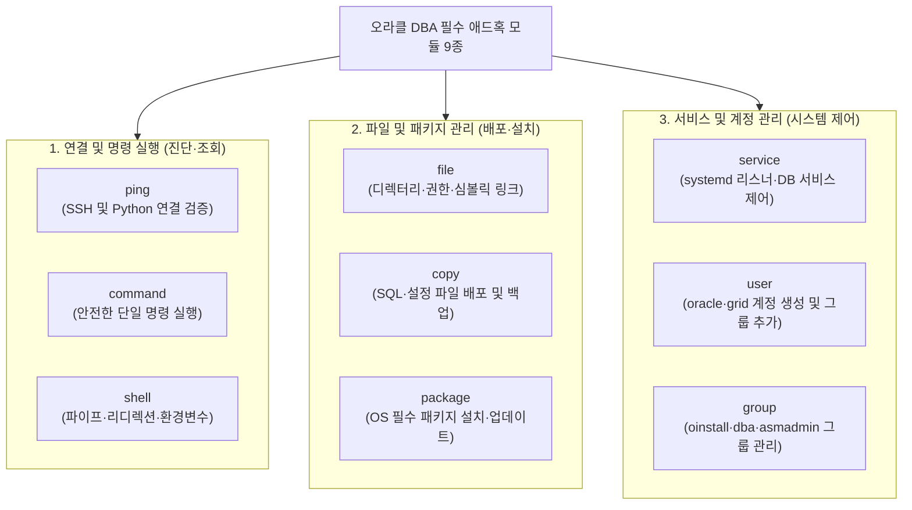

### 3.1 `ping` 모듈: SSH 통신 및 파이썬 인터프리터 검증

`ping` 모듈은 모든 자동화 작업의 첫 단추입니다. 별도의 인자(`-a`)가 필요 없으며, 원격 노드에 SSH로 접속하여 파이썬 실행 환경을 확인한 후 정상일 경우 `"pong"`을 반환합니다.

```bash
# DEV, TEST, PROD 환경별로 나누어 연결 상태 점검
[oracle@ansible-control ansible-oracle-inventory]$ ansible dev -m ping
[oracle@ansible-control ansible-oracle-inventory]$ ansible test -m ping
[oracle@ansible-control ansible-oracle-inventory]$ ansible prod -m ping
```

만약 특정 서버의 SSH 키 인증이 실패하거나 네트워크가 단절되어 있다면 다음과 같은 `UNREACHABLE!` 오류가 즉시 출력되므로 문제 서버를 1초 만에 골라낼 수 있습니다.

```json
devdb01 | UNREACHABLE! => {
    "changed": false,
    "msg": "Failed to connect to the host via ssh: Permission denied (publickey,password).",
    "unreachable": true
}
```

### 3.2 `command` 모듈 vs `shell` 모듈: 명령 실행의 정확한 구분

원격 오라클 서버에서 리눅스 명령어를 실행할 때는 `command` 모듈(기본값)과 `shell` 모듈을 구분해서 사용해야 합니다. 두 모듈의 동작 방식 차이는 오라클 DBA가 가장 자주 실수하는 포인트이므로 표 2-4를 통해 명확히 이해해 두어야 합니다.

| 비교 항목 | `command` 모듈 (`-m command`) | `shell` 모듈 (`-m shell`) |
| :--- | :---: | :---: |
| **리눅스 셸(`/bin/sh`) 경유 여부** | **아니요** (파이썬이 바이너리 직접 실행) | **예** (서브 셸을 띄워 명령어 해석 후 실행) |
| **파이프(`\|`) 및 리디렉션(`>`, `>>`)** | 지원 안 함 (단순 문자열 인자로 취급됨) | **완벽 지원** |
| **다중 명령 연결(`&&`, `;`) 및 히어 도큐먼트(`<<EOF`)** | 지원 안 함 | **완벽 지원** (`sqlplus <<EOF` 실행 가능) |
| **원격지 환경 변수(`$ORACLE_HOME`) 확장** | 지원 안 함 | **완벽 지원** |
| **보안성 (셸 인젝션 방지)** | **높음 (권장 기본값)** | 상대적으로 주의 필요 |
| **대표적인 오라클 DBA 용도** | `uname -a`, `id oracle`, `df -h /u01`, `uptime` | `ps -ef \| grep pmon`, `sqlplus -s / as sysdba <<EOF` |

`chapter_2` 제어 노드에서 `command` 모듈과 `shell` 모듈을 각각 실행하여 차이를 확인해 봅니다.

```bash
# 1. command 모듈: 파이프나 환경 변수가 필요 없는 안전한 단일 명령 실행
[oracle@ansible-control ansible-oracle-inventory]$ ansible db_servers -m command -a "id oracle"
[oracle@ansible-control ansible-oracle-inventory]$ ansible db_servers -m command -a "df -h"
[oracle@ansible-control ansible-oracle-inventory]$ ansible all -m command -a "cat /etc/os-release"

# 2. shell 모듈: 파이프(|) 필터링이나 다중 명령(&&)이 필요한 경우
[oracle@ansible-control ansible-oracle-inventory]$ ansible prod -m shell -a "free -m && uptime"
[oracle@ansible-control ansible-oracle-inventory]$ ansible rac_nodes -m shell -a "ps -ef | grep sshd"
```

> ⚠️ **주의(Caution): `command` 모듈에서 `$ORACLE_HOME`이나 파이프(`|`)를 쓸 때의 함정**
> `ansible db_servers -m command -a "ps -ef | grep ora_pmon"`처럼 `command` 모듈에 파이프(`|`)를 넣으면, `ps` 명령이 `|`와 `grep`을 자신의 명령줄 옵션으로 잘못 인식하여 문법 오류를 냅니다. 파이프(`|`), 리디렉션(`>`), 환경 변수(`$ORACLE_HOME`), 또는 `sqlplus <<EOF`와 같은 히어 도큐먼트(Here-document)를 사용할 때는 반드시 **`-m shell`**을 지정하십시오.

### 3.3 `file` 모듈: 멱등성 기반 디렉터리·권한·심볼릭 링크 관리

`file` 모듈은 원격 서버의 디렉터리 생성, 빈 파일 생성(`touch`), 삭제(`absent`), 소유자·그룹·권한(`mode`) 변경, 그리고 심볼릭 링크(`link`) 생성을 담당합니다. `mkdir` 명령을 `shell` 모듈로 실행하는 것과 달리, 이미 동일한 디렉터리와 권한이 존재하면 아무 작업도 하지 않고 `changed: false`를 반환하는 완벽한 **멱등성**을 제공합니다.

| 주요 파라미터 | 설명 | 오라클 DBA 설정 예시 |
| :--- | :--- | :--- |
| `path` | 대상 파일 또는 디렉터리의 절대 경로 | `path=/u01/app/oracle/admin` |
| `state` | 목표 상태 (`directory`, `touch`, `absent`, `link`) | `state=directory` |
| `owner` / `group` | 소유 계정 및 소유 그룹 지정 | `owner=oracle group=oinstall` |
| `mode` | 8진수 권한 모드 (앞에 `0`을 붙여 표기 권장) | `mode=0755` 또는 `mode=0775` |
| `recurse` | 하위 디렉터리와 파일에 재귀적 적용 여부 | `recurse=yes` |
| `src` / `dest` | 심볼릭 링크(`state=link`) 생성 시 원본과 대상 경로 | `src=/u01/app/oracle dest=/opt/oracle` |

개발 환경(`dev`) 서버들에 백업 테스트용 디렉터리를 생성하고 심볼릭 링크를 만든 뒤, 다시 정리하는 실습을 진행해 봅니다. `/u01` 최상위 영역에 디렉터리를 생성하고 소유권을 지정할 때는 `-b`(`--become`, `sudo` 권한 상승) 옵션을 함께 사용합니다.

```bash
# 1. DEV 환경 서버들에 /u01/backup 디렉터리 생성 (소유자: oracle:oinstall, 권한: 0775)
[oracle@ansible-control ansible-oracle-inventory]$ ansible dev -m file \
  -a "path=/u01/backup state=directory owner=oracle group=oinstall mode=0775" -b

# 2. 동일한 명령을 다시 실행하여 멱등성(changed: false) 확인
[oracle@ansible-control ansible-oracle-inventory]$ ansible dev -m file \
  -a "path=/u01/backup state=directory owner=oracle group=oinstall mode=0775" -b

# 3. /opt/oracle 심볼릭 링크를 /u01/app/oracle로 연결
[oracle@ansible-control ansible-oracle-inventory]$ ansible dev_db_servers -m file \
  -a "src=/u01/app/oracle dest=/opt/oracle state=link force=yes" -b

# 4. 생성한 테스트 디렉터리 삭제 (state=absent)
[oracle@ansible-control ansible-oracle-inventory]$ ansible dev -m file \
  -a "path=/u01/backup state=absent" -b
```

> ⚠️ **주의(Caution)**: `state=absent` 옵션은 대상 디렉터리와 그 안의 모든 하위 파일을 `rm -rf`처럼 즉시 삭제합니다. 운영(`prod`) 환경에서 사용할 때는 반드시 경로에 오타가 없는지 확인하고, `--limit` 옵션으로 단일 테스트 서버에서 먼저 검증하십시오.

### 3.4 `copy` 모듈: SQL 스크립트 및 설정 파일 배포와 자동 백업

`copy` 모듈은 앤서블 제어 노드에 있는 로컬 파일(`src`)을 원격 관리 노드의 지정 경로(`dest`)로 안전하게 전송하거나, `content` 파라미터로 짧은 텍스트 파일을 원격지에 직접 생성합니다. 특히 기존 파일을 덮어쓰기 전에 타임스탬프가 찍힌 백업본을 자동으로 남겨 주는 **`backup=yes`** 파라미터는 `tnsnames.ora`나 `listener.ora`를 수정하는 오라클 DBA에게 생명줄과도 같은 기능입니다.

```bash
# 1. content 파라미터를 사용해 모든 DB 서버에 점검용 SQL 스크립트 즉석 배포
[oracle@ansible-control ansible-oracle-inventory]$ ansible db_servers -m copy \
  -a "content='SELECT name, open_mode FROM v\$database;\nEXIT;\n' dest=/u01/app/oracle/check_db.sql owner=oracle group=oinstall mode=0644" -b

# 2. 스크립트 내용을 수정하여 재배포하면서 기존 파일 자동 백업(backup=yes) 활성화
[oracle@ansible-control ansible-oracle-inventory]$ ansible db_servers -m copy \
  -a "content='SELECT instance_name, status FROM v\$instance;\nEXIT;\n' dest=/u01/app/oracle/check_db.sql owner=oracle group=oinstall mode=0644 backup=yes" -b
```

두 번째 명령을 실행하면 출력 결과에 `"backup_file": "/u01/app/oracle/check_db.sql.412.2026-10-04@00:15:22~"`와 같이 원본 파일의 백업 경로가 명시되어, 변경 작업 후 문제가 생겼을 때 즉시 원복(Rollback)할 수 있습니다.

### 3.5 `package` 모듈: OS 필수 패키지 설치 및 버전 관리

`package` 모듈은 원격 리눅스 배포판의 패키지 관리자(`dnf`, `yum`, `apt`)를 자동으로 감지하여 소프트웨어를 설치(`state=present`), 최신 업데이트(`state=latest`), 또는 삭제(`state=absent`)합니다. 패키지 관리는 루트 권한이 필수이므로 항상 **`-b`** 옵션을 붙여 실행합니다.

```bash
# 1. 개발 DB 서버에 시스템 모니터링 도구(sysstat) 설치
[oracle@ansible-control ansible-oracle-inventory]$ ansible dev_db_servers -m package \
  -a "name=sysstat state=present" -b

# 2. 여러 패키지를 리스트 형태로 한 번에 설치 확인
[oracle@ansible-control ansible-oracle-inventory]$ ansible dev_db_servers -m package \
  -a "name='[bc, net-tools, bind-utils]' state=present" -b
```

### 3.6 `service` 모듈: 시스템 서비스 시작·중지 및 자동 시작 제어

`service` 모듈은 `systemd` 또는 `init` 기반의 리눅스 백그라운드 데몬(예: `sshd`, `crond`, 또는 OS 서비스로 등록된 `oracle-listener`)을 시작(`state=started`), 중지(`state=stopped`), 재시작(`state=restarted`)하고 부팅 시 자동 시작 여부(`enabled=yes|no`)를 관리합니다.

```bash
# 운영(prod) 서버들의 SSH 데몬이나 스케줄러 상태가 started인지 확인
[oracle@ansible-control ansible-oracle-inventory]$ ansible prod -m service \
  -a "name=sshd state=started enabled=yes" -b
```

### 3.7 `group` 및 `user` 모듈: 오라클 표준 OS 그룹과 계정 관리

오라클 19c나 관리 에이전트를 신규 서버에 설치할 때는 표준 UID/GID를 가진 OS 그룹(`oinstall`, `dba`, `oper`, `backupdba`, `dgdba`, `kmdba`, `asmdba`, `asmadmin`, `racdba`)과 사용자 계정(`oracle`, `grid`)이 모든 클러스터 노드에서 100% 동일한 번호로 생성되어야 합니다.

```bash
# 1. group 모듈로 백업 전담 그룹(backupdba, GID 54324) 존재 여부 확인 및 생성
[oracle@ansible-control ansible-oracle-inventory]$ ansible all -m group \
  -a "name=backupdba gid=54324 state=present" -b

# 2. user 모듈로 oracle 계정을 보조 그룹(dba,backupdba)에 추가 (append=yes 필수!)
[oracle@ansible-control ansible-oracle-inventory]$ ansible all -m user \
  -a "name=oracle group=oinstall groups=dba,backupdba append=yes state=present" -b
```

> ⚠️ **주의(Caution): `user` 모듈에서 `append=yes` 누락 주의**
> 기존 사용자에게 보조 그룹(`groups=...`)을 추가할 때 `append=yes` 파라미터를 생략하면, 기존에 속해 있던 다른 보조 그룹들이 모두 초기화되고 새로 지정한 그룹만 남게 됩니다. 오라클 계정에 그룹을 추가할 때는 반드시 `append=yes`를 함께 지정하십시오.

---

## 4. 오라클 DBA 실전 애드혹 자동화 레시피

실제 오라클 19c 운영 서버에서 DBA가 매일 수행하는 핵심 점검 및 제어 작업을 애드혹 명령 레시피로 정리합니다. 앞서 강조한 대로 파이프(`|`), 환경 변수(`$ORACLE_HOME`), 히어 도큐먼트(`<<EOF`)가 포함된 명령은 모두 **`-m shell`** 모듈을 사용합니다.

### 4.1 오라클 홈(`$ORACLE_HOME`) 확인 및 프로세스(`pmon`), 리스너 점검

```bash
# 1. 오라클 홈 경로 및 sqlplus 바이너리 버전 확인
ansible db_servers -m shell -a "echo \$ORACLE_HOME && \$ORACLE_HOME/bin/sqlplus -v"

# 2. 데이터베이스 PMON 백그라운드 프로세스 기동 여부 일괄 확인
ansible db_servers -m shell -a "ps -ef | grep [o]ra_pmon"

# 3. ASM 인스턴스 PMON 프로세스 기동 여부 확인 (Grid 서버 대상)
ansible grid_servers -m shell -a "ps -ef | grep [a]sm_pmon"

# 4. 오라클 리스너 상태 일괄 확인
ansible db_servers -m shell -a "lsnrctl status"
```

> 💡 **노트(Note)**: `grep [o]ra_pmon`처럼 첫 글자를 대괄호(`[]`)로 감싸는 정규식 트릭을 사용하면, `grep ora_pmon` 프로세스 자기 자신이 출력 결과에 섞여 나오는 현상을 깔끔하게 방지할 수 있습니다 (`grep -v grep`을 파이프로 한 번 더 연결할 필요가 없습니다).

### 4.2 원격 `sqlplus` 및 `dgmgrl` 명령 실행과 리포트 저장

```bash
# 1. 모든 DB 서버의 데이터베이스 이름과 오픈 모드(READ WRITE) 일괄 조회
ansible db_servers -m shell -a "sqlplus -s / as sysdba <<EOF
SET HEADING ON FEEDBACK OFF PAGESIZE 50
SELECT name, open_mode, database_role FROM v\$database;
EXIT;
EOF"

# 2. 데이터 가드 브로커(DGMGRL) 구성 및 동기화 지연(Lag) 상태 점검
ansible dataguard_servers -m shell -a "dgmgrl -silent / 'show configuration;'"

# 3. 조회 결과를 제어 노드의 로컬 텍스트 리포트 파일로 리디렉션 저장
mkdir -p reports
ansible db_servers -m shell -a "df -h /u01 && free -h" > reports/server_health_report.txt
```

---

## 5. 마스터 프로젝트: 9노드 다중 환경 인벤토리 설계 및 종합 검증 실습

이제 `chapter_2/ansible-oracle-inventory` 디렉터리에 구축된 엔터프라이즈 9노드 인벤토리와 변수 파일, 그리고 4단계 검증 플레이북(`01`~`04`)을 차례대로 실행하며 다중 환경 자동화의 완성형을 실습합니다.

### 5.1 다중 환경×역할 매트릭스 인벤토리 분석 (`inventory/inventory.ini` & `inventory.yml`)

Chapter 1의 인벤토리가 단일 랩 환경의 역할 분리에 집중했다면, Chapter 2의 인벤토리는 **환경별 리프 그룹(`dev_db_servers`, `test_db_servers`, `prod_db_servers`)**을 먼저 정의한 뒤, 이를 **환경 부모 그룹(`dev`, `test`, `prod`)**과 **역할 부모 그룹(`db_servers`, `grid_servers`, `rac_nodes`, `dataguard_servers`)** 양쪽에서 동시에 자식(`children`)으로 참조하는 **이중 계층(Dual-Hierarchy) 설계**를 채택하고 있습니다.

> 💡 **노트(Note): 왜 `dev_db_servers`처럼 환경별 하위 그룹으로 먼저 나누어야 하는가?**
> 만약 `db_servers` 그룹 하나에 `devdb01`, `testdb01`, `proddb01`을 모두 넣고 `[dev:children]`에 `db_servers`를 등록해 버리면, `dev` 그룹을 대상으로 명령을 실행했을 때 `db_servers`에 속한 운영 서버(`proddb01`)까지 함께 딸려 들어가는 대형 사고가 발생합니다.
> 따라서 호스트는 반드시 `dev_db_servers`, `prod_db_servers`처럼 가장 작은 교차 단위로 먼저 묶고, 상위 그룹(`dev`, `prod`, `db_servers`)이 이 하위 그룹들을 조합하도록 설계해야 환경 간 완벽한 격리가 보장됩니다.

**`inventory/inventory.ini` 전문**
```ini
# ========================================================
# Oracle DBA Master Inventory (INI Format - Chapter 2)
# Production-grade Hierarchical Structure with Environments
# ========================================================

[all:children]
dev
test
prod
database_infrastructure

# --------------------------------------------------------
# Environment Parent Groups (자식 그룹 포함)
# --------------------------------------------------------
[dev:children]
dev_db_servers
dev_grid_servers
dev_dataguard_servers

[test:children]
test_db_servers

[prod:children]
prod_db_servers
prod_grid_servers
prod_rac_nodes

[database_infrastructure:children]
db_servers
grid_servers
rac_nodes
dataguard_servers

[db_servers:children]
dev_db_servers
test_db_servers
prod_db_servers

[grid_servers:children]
dev_grid_servers
prod_grid_servers

[rac_nodes:children]
prod_rac_nodes

[dataguard_servers:children]
dev_dataguard_servers

# --------------------------------------------------------
# Host Endpoints Definition
# --------------------------------------------------------
[dev_db_servers]
devdb01   ansible_host=192.168.1.101 db_name=devdb   oracle_sid=DEVDB1

[test_db_servers]
testdb01  ansible_host=192.168.1.102 db_name=testdb  oracle_sid=TSTDB1

[prod_db_servers]
proddb01  ansible_host=192.168.1.103 db_name=proddb  oracle_sid=PRDDB1

[dev_grid_servers]
devgrid01   ansible_host=192.168.1.111 oracle_sid=+ASMDEV

[prod_grid_servers]
prodgrid01  ansible_host=192.168.1.113 oracle_sid=+ASMPRD

[prod_rac_nodes]
rac1 ansible_host=192.168.1.121 node_id=1 oracle_sid=RAC1
rac2 ansible_host=192.168.1.122 node_id=2 oracle_sid=RAC2

[dev_dataguard_servers]
devstd01   ansible_host=192.168.1.131 role=standby oracle_sid=DEVSTD
```

제어 노드에서 `ansible-inventory --graph`를 실행하면 이 정교한 이중 계층 트리가 한눈에 펼쳐집니다.

```bash
[oracle@ansible-control ansible-oracle-inventory]$ ansible-inventory -i inventory/inventory.ini --graph
@all:
  |--@ungrouped:
  |--@dev:
  |  |--@dev_db_servers:
  |  |  |--devdb01
  |  |--@dev_grid_servers:
  |  |  |--devgrid01
  |  |--@dev_dataguard_servers:
  |  |  |--devstd01
  |--@test:
  |  |--@test_db_servers:
  |  |  |--testdb01
  |--@prod:
  |  |--@prod_db_servers:
  |  |  |--proddb01
  |  |--@prod_grid_servers:
  |  |  |--prodgrid01
  |  |--@prod_rac_nodes:
  |  |  |--rac1
  |  |  |--rac2
  |--@database_infrastructure:
  |  |--@db_servers:
  |  |  |--@dev_db_servers:
  |  |  |  |--devdb01
  |  |  |--@test_db_servers:
  |  |  |  |--testdb01
  |  |  |--@prod_db_servers:
  |  |  |  |--proddb01
  |  |--@grid_servers:
  |  |  |--@dev_grid_servers:
  |  |  |  |--devgrid01
  |  |  |--@prod_grid_servers:
  |  |  |  |--prodgrid01
  |  |--@rac_nodes:
  |  |  |--@prod_rac_nodes:
  |  |  |  |--rac1
  |  |  |  |--rac2
  |  |--@dataguard_servers:
  |  |  |--@dev_dataguard_servers:
  |  |  |  |--devstd01
```

### 5.2 다중 계층 변수 상속과 오버라이딩(`group_vars` → `host_vars`) 설계

`chapter_2/ansible-oracle-inventory/group_vars/`에는 환경별 정책 파일 3개(`dev.yml`, `test.yml`, `prod.yml`)와 역할별 기술 설정 파일 4개(`db_servers.yml`, `grid_servers.yml`, `rac_nodes.yml`, `dataguard_servers.yml`)가 분리되어 있습니다.

환경별 그룹 변수 파일은 백업 보관 주기(`backup_retention_days`), RMAN 병렬 채널 수(`rman_parallelism`), 정기 점검 시간(`maintenance_window`) 등 운영 정책의 차이를 정의합니다.

| 환경 변수 파일 | `environment` | `backup_retention_days` | `rman_parallelism` | `monitoring_level` | `maintenance_window` |
| :--- | :---: | :---: | :---: | :---: | :--- |
| `group_vars/dev.yml` | `DEV` | `3` (3일) | `1` | `basic` | `Sat 22:00-24:00` |
| `group_vars/test.yml` | `TEST` | `7` (7일) | `2` | `medium` | `Sun 00:00-03:00` |
| `group_vars/prod.yml` | `PROD` | `30` (30일) | `4` | `full_24x7` | `Sun 02:00-05:00` |

여기에 더해 핵심 운영 DB인 `proddb01`은 일반 운영 서버의 기본 보관 주기(30일)보다 더 긴 **60일 보관 정책**과 **4G 메모리 타깃**이 필요합니다. 이를 위해 `host_vars/proddb01.yml`에 다음과 같이 호스트 변수를 정의하여 `prod.yml`의 그룹 변수(`30`)를 `60`으로 덮어썼습니다(Override).

```yaml
---
# host_vars/proddb01.yml
db_name: proddb
oracle_sid: PRDDB1
instance_name: proddb1
server_role: primary
custom_memory_target: "4G"
backup_retention_days: 60
```

제어 노드에서 `proddb01`의 최종 병합 변수를 조회하면 `all.yml`, `prod.yml`, `db_servers.yml`, 그리고 `host_vars/proddb01.yml`의 값이 완벽하게 하나로 합쳐진 것을 확인할 수 있습니다.

```bash
[oracle@ansible-control ansible-oracle-inventory]$ ansible-inventory --host proddb01
```

### 5.3 4단계 검증 플레이북 실행 및 결과 분석

프로젝트에 포함된 헬퍼 스크립트 `./scripts/test_inventory.sh`를 실행하여 기본 인벤토리 점검을 마친 뒤, `playbooks/` 하위의 4개 플레이북을 순서대로 실행합니다.

#### (1) 소속 그룹 매핑 검증 (`01_inventory_overview.yml`)

내장 매직 변수인 `group_names` 리스트를 출력하여 각 노드가 환경 그룹과 역할 그룹 양쪽에 정상 소속되었는지 확인합니다.

```bash
[oracle@ansible-control ansible-oracle-inventory]$ ansible-playbook playbooks/01_inventory_overview.yml

PLAY [Chapter 2 Inventory Overview & Group Verification] ***********************

TASK [Display Host and Associated Groups] **************************************
ok: [testdb01] => 
  msg: 'Host: testdb01 | IP: 192.168.1.102 | Groups: database_infrastructure, db_servers, test, test_db_servers'
ok: [proddb01] => 
  msg: 'Host: proddb01 | IP: 192.168.1.103 | Groups: database_infrastructure, db_servers, prod, prod_db_servers'
ok: [prodgrid01] => 
  msg: 'Host: prodgrid01 | IP: 192.168.1.113 | Groups: database_infrastructure, grid_servers, prod, prod_grid_servers'
ok: [rac1] => 
  msg: 'Host: rac1 | IP: 192.168.1.121 | Groups: database_infrastructure, prod, prod_rac_nodes, rac_nodes'
ok: [rac2] => 
  msg: 'Host: rac2 | IP: 192.168.1.122 | Groups: database_infrastructure, prod, prod_rac_nodes, rac_nodes'
ok: [devdb01] => 
  msg: 'Host: devdb01 | IP: 192.168.1.101 | Groups: database_infrastructure, db_servers, dev, dev_db_servers'
ok: [devgrid01] => 
  msg: 'Host: devgrid01 | IP: 192.168.1.111 | Groups: database_infrastructure, dev, dev_grid_servers, grid_servers'
ok: [devstd01] => 
  msg: 'Host: devstd01 | IP: 192.168.1.131 | Groups: database_infrastructure, dataguard_servers, dev, dev_dataguard_servers'
```

#### (2) 환경별 백업 보관 주기 및 오버라이딩 검증 (`02_env_ping_check.yml`)

`dev`, `test`, `prod` 세 환경 그룹을 순회하며 `backup_retention_days` 값을 출력합니다.

```bash
[oracle@ansible-control ansible-oracle-inventory]$ ansible-playbook playbooks/02_env_ping_check.yml
```

실행 결과를 보면 `dev` 노드들은 `3d`, `testdb01`은 `7d`, 일반 `prod` 노드(`prodgrid01`, `rac1`, `rac2`)는 `30d`가 출력되는 반면, `host_vars/proddb01.yml`에서 값을 덮어쓴 **`proddb01`만 정확히 `Retention: 60d`**로 출력되는 것을 확인할 수 있습니다.

```text
PLAY [3. PROD Environment Ping Check] ******************************************
TASK [Report PROD Environment] *************************************************
ok: [proddb01] => 
  msg: '[PROD] Host proddb01 (192.168.1.103) - Env: [], Retention: 60d'
ok: [prodgrid01] => 
  msg: '[PROD] Host prodgrid01 (192.168.1.113) - Env: [], Retention: 30d'
ok: [rac1] => 
  msg: '[PROD] Host rac1 (192.168.1.121) - Env: [], Retention: 30d'
ok: [rac2] => 
  msg: '[PROD] Host rac2 (192.168.1.122) - Env: [], Retention: 30d'
```

> ⚠️ **주의(Caution): 앤서블 예약 키워드 `environment`와 변수명 충돌 (실무 트러블슈팅 인사이트)**
> 위 실행 로그에서 `Env: []`처럼 빈 리스트가 출력된 것에 주목하십시오. `group_vars/dev.yml` 등에 `environment: DEV`를 정의했음에도 빈 리스트(`[]`)가 찍힌 이유는, **`environment`가 앤서블 태스크에 OS 환경 변수를 주입할 때 사용하는 내장 예약 키워드(Reserved Keyword)**이기 때문입니다!
> 앤서블 최신 버전에서는 플레이·태스크의 `environment` 지시어가 일반 변수보다 우선 참조되어 빈 리스트(`[]`)를 반환합니다. 따라서 실무에서 서버의 환경 구분자 변수를 만들 때는 예약어인 `environment` 대신 **`env_name: DEV`** 또는 **`ora_env: PROD`**와 같이 예약어와 겹치지 않는 이름을 사용하는 것이 안전합니다.

#### (3) 역할별 오라클 파라미터 검증 (`03_oracle_vars_check.yml`)

`db_servers`, `grid_servers`, `rac_nodes` 그룹별로 각기 다른 오라클 스펙 변수(`custom_memory_target`, `asm_diskgroup`, `scan_name`, `vip_ip`)가 정확히 바인딩되었는지 확인합니다.

```bash
[oracle@ansible-control ansible-oracle-inventory]$ ansible-playbook playbooks/03_oracle_vars_check.yml
```

```text
PLAY [Verify Single-Instance DB Server Variables] ******************************
ok: [devdb01] => 
  msg:
  - 'Host: devdb01'
  - 'DB Name: devdb'
  - 'Oracle SID: DEVDB1'
  - 'Oracle Home: /u01/app/oracle'
  - 'Memory Target: 1G'
ok: [testdb01] => 
  msg:
  - 'Host: testdb01'
  - 'DB Name: testdb'
  - 'Oracle SID: TSTDB1'
  - 'Oracle Home: /u01/app/oracle'
  - 'Memory Target: 2G'
ok: [proddb01] => 
  msg:
  - 'Host: proddb01'
  - 'DB Name: proddb'
  - 'Oracle SID: PRDDB1'
  - 'Oracle Home: /u01/app/oracle'
  - 'Memory Target: 4G'

PLAY [Verify Grid & ASM Server Variables] **************************************
ok: [devgrid01] => 
  msg:
  - 'Host: devgrid01'
  - 'ASM SID: +ASMDEV'
  - 'ASM Diskgroup: DATA_DEV'
  - 'Grid User: grid'
ok: [prodgrid01] => 
  msg:
  - 'Host: prodgrid01'
  - 'ASM SID: +ASMPRD'
  - 'ASM Diskgroup: DATA_PROD'
  - 'Grid User: grid'

PLAY [Verify RAC Node Cluster Variables] ***************************************
ok: [rac1] => 
  msg:
  - 'Host: rac1'
  - 'Cluster Name: rac-prod-cluster'
  - 'Node ID: 1'
  - 'SCAN Name: rac-scan.lab.local'
  - 'VIP IP: 192.168.1.311'
```

#### (4) 전 노드 종합 감사 리포트 생성 (`04_master_inventory_verification.yml`)

마지막으로 8대 모든 관리 노드의 커널 버전(`uname -a`), 오라클 계정 및 그룹 소속(`id oracle`), 소속 인벤토리 그룹, 오라클 SID를 일괄 감사(Audit)하는 마스터 플레이북을 실행합니다.

```bash
[oracle@ansible-control ansible-oracle-inventory]$ ansible-playbook playbooks/04_master_inventory_verification.yml
```

```text
TASK [Display Host Audit Summary] **********************************************
ok: [proddb01] => 
  msg:
  - ==========================================================================
  - 'Host: proddb01 (IP: 192.168.1.103)'
  - 'Environment: []'
  - 'Primary Role Groups: database_infrastructure, db_servers, prod, prod_db_servers'
  - 'Oracle SID: PRDDB1'
  - 'OS: OracleLinux 8.10'
  - 'Kernel: Linux proddb01 6.18.40.1-microsoft-standard-WSL2 #1 SMP PREEMPT_DYNAMIC x86_64 GNU/Linux'
  - 'User Check: uid=54321(oracle) gid=54321(oinstall) groups=54321(oinstall),10(wheel),54322(dba),54323(oper),54324(backupdba),54325(dgdba),54326(kmdba),54330(racdba),54327(asmdba),54329(asmadmin)'
  - ==========================================================================
```

실습을 모두 마쳤다면 제어 노드에서 빠져나와 컨테이너를 정리합니다.

```bash
exit
docker compose down -v
```

---

## 핵심 요약

1. **애드혹 명령의 가치**: 플레이북 작성 없이 `ansible <호스트_패턴> -m <모듈> -a "<인자>"` 한 줄로 다수의 오라클 서버 상태를 즉시 조회하고 긴급 조치를 수행할 수 있습니다.
2. **이중 계층(Dual-Hierarchy) 인벤토리**: 엔터프라이즈 환경에서는 `dev_db_servers`, `prod_db_servers` 같은 교차 리프 그룹을 먼저 만들고, 이를 환경 부모 그룹(`dev`, `prod`)과 역할 부모 그룹(`db_servers`) 양쪽에서 상속받게 설계하여 환경 간 간섭을 차단합니다.
3. **정밀 호스트 패턴**: 교집합(`'prod:&db_servers'`), 차집합(`'all:!prod'`), 합집합(`'dev:test'`) 연산자를 활용하면 원하는 대상 서버만 정확히 타기팅할 수 있습니다.
4. **`command`와 `shell`의 엄격한 구분**: 단순 바이너리 실행은 안전한 `command` 모듈을 쓰고, 파이프(`|`), 리디렉션(`>`), 환경 변수(`$ORACLE_HOME`), 히어 도큐먼트(`sqlplus <<EOF`)가 필요할 때는 반드시 `shell` 모듈을 사용합니다.
5. **예약어 회피 및 백업 습관화**: 변수 이름을 지을 때는 앤서블 예약어(`environment` 등)를 피하여 `env_name` 등으로 명명하고, `copy` 모듈로 설정 파일을 배포할 때는 `backup=yes`를 지정하여 장애 시 즉시 복구할 수 있는 안전장치를 마련합니다.


---

# Chapter 3. 앤서블 플레이북: 구조화된 자동화로 오라클 19c 운영 다루기

## 개요

앞선 장에서 살펴본 애드혹(Ad-hoc) 명령은 단일 작업을 빠르게 실행하고 확인하는 데 유용합니다. 하지만 오라클 19c 서버의 디렉터리를 구성하고, 설정 파일을 배포한 뒤, 변경이 발생했을 때만 리스너를 재시작하고 헬스 체크 보고서를 생성하는 것처럼 **여러 단계가 순서대로 맞물려 돌아가야 하는 운영 절차**에는 한계가 있습니다.

이 한계를 넘어서는 핵심 도구가 **플레이북(Playbook)**입니다. 플레이북은 오라클 DBA의 표준 운영 절차서(SOP, Standard Operating Procedure)를 YAML 형식의 코드로 구조화한 파일입니다. 한 번 플레이북을 작성해 Git으로 버전 관리해 두면, 개발(`devdb`), 테스트(`testdb`), 운영(`proddb`) 서버에 언제든 100% 동일한 절차를 오차 없이 반복 적용할 수 있습니다.

이 장에서는 `chapter_3`의 도커 멀티 컨테이너 환경(`devdb`, `testdb`, `proddb` 및 제어 노드 `ansible-control-ch3`)을 기동하고, YAML 플레이북의 기초 문법부터 고급 제어 구조까지 단계별로 작성하고 실행합니다.

이 장에서 학습할 핵심 내용은 다음과 같습니다.

- 플레이북(Playbook), 플레이(Play), 호스트(Host), 태스크(Task)의 계층 구조와 YAML 문법 규칙
- 정규화된 컬렉션 이름(FQCN, Fully Qualified Collection Name, 예: `ansible.builtin.file`) 기반 모듈 활용
- 플레이북 내부 변수(`vars`), 외부 변수 파일(`vars_files`), 명령줄 추가 변수(`-e`)의 정의와 활용
- `register` 키워드를 통한 명령 결과(`stdout`, `rc`, `stdout_lines`) 캡처 및 `changed_when`/`failed_when` 상태 제어
- 조건문(`when`)과 반복문(`loop`, `dict2items`)을 결합한 지능형 태스크 설계
- 핸들러(`handlers`)와 알림(`notify`)을 활용한 이벤트 기반 리스너 재로드(`lsnrctl reload`)
- 문법 검사(`--syntax-check`), 드라이 런(`--check --diff`), 대상 제한(`--limit`)을 통한 안전한 운영 배포
- 마스터 프로젝트: `devdb`, `testdb`, `proddb` 3개 환경을 아우르는 오라클 19c 서버 운영 및 일일 점검 리포트 자동화 플레이북 완성

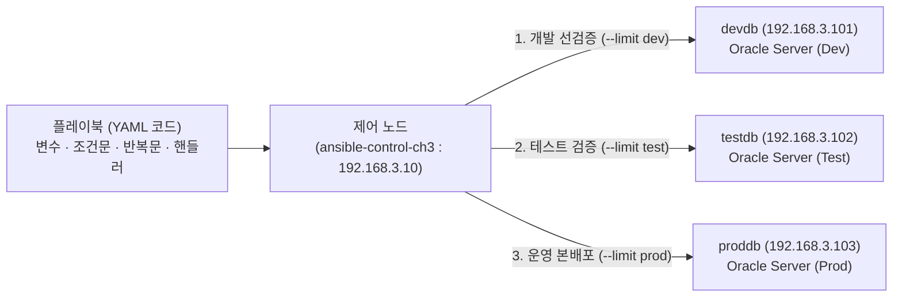

> 💡 **노트(Note)**: 잘 작성된 플레이북은 그 자체로 살아 있는 운영 문서(Executable Documentation)가 됩니다. 담당 DBA가 바뀌더라도 플레이북 코드만 읽으면 해당 회사의 오라클 19c 표준 디렉터리 구조와 점검 절차를 한눈에 파악할 수 있습니다.

---

## 1. 플레이북 기초와 Chapter 3 실습 환경 구축

### 1.1 왜 애드혹 명령에서 플레이북으로 전환해야 하는가

일회성 확인 작업과 달리, 실무 데이터베이스 운영 자동화에서 플레이북이 필수적인 이유는 표 3-1의 비교를 통해 명확히 드러납니다.

| 비교 항목 | 애드혹 명령 (`ansible`) | 플레이북 (`ansible-playbook`) |
| :--- | :--- | :--- |
| **작업의 복잡도** | 단일 모듈, 단일 명령 실행 | 다수의 플레이와 수십 개의 태스크를 순차적·구조적으로 연결 |
| **실행 제어 로직** | 불가능 (무조건 일괄 실행) | `register`, `when`(조건문), `loop`(반복문), `notify`(핸들러) 지원 |
| **사전 시뮬레이션** | 지원이 제한적임 | `--syntax-check` 및 `--check --diff`(드라이 런)로 변경 사항 사전 검증 |
| **코드 버전 관리 (GitOps)** | 불가능 (터미널 입력 후 소멸) | Git 리포지토리에서 변경 이력 추적, 코드 리뷰(PR) 및 롤백 가능 |
| **실무 적용 영역** | 긴급 상태 조회, 빠른 연결 확인 | 오라클 19c 환경 구축, 파라미터 일괄 변경, 패치 사전·사후 점검 |

### 1.2 Chapter 3 실습 랩 아키텍처 및 기동

`chapter_3` 디렉터리에는 플레이북 실습에 최적화된 4노드 컨테이너 환경(`192.168.3.0/24` 서브넷)이 구성되어 있습니다.

```text
chapter_3/
├── docker-compose.yml          # 제어 노드(192.168.3.10) 및 devdb, testdb, proddb 오케스트레이션
├── ansible.cfg                 # 기본 인벤토리(inventory.ini) 및 원격 계정(oracle) 설정
├── inventory.ini               # dev, test, prod 그룹 및 부모 그룹 db_servers 정의
├── README.md                   # 실습 환경 안내서
└── docker/
    ├── Dockerfile.control      # Ansible Control Node (Oracle Linux 8, Python 3.9, Ansible)
    ├── Dockerfile.oracle_node  # Oracle 19c Managed Node (oracle-database-preinstall-19c 탑재)
    └── entrypoint-node.sh      # SSH 공개키 자동 등록 및 /u01 소유권(oracle:oinstall) 보장
```

각 컨테이너 노드의 구성 정보는 표 3-2와 같습니다.

| 컨테이너명 (호스트명) | 인벤토리 그룹 | 부모 그룹 | 고정 IP 주소 | 기본 접속 계정 | 설명 |
| :--- | :--- | :--- | :--- | :--- | :--- |
| `ansible-control-ch3` | - | - | `192.168.3.10` | `oracle` | 플레이북 작성 및 실행 제어 노드 (`/home/oracle/ansible-oracle-adhoc`) |
| `devdb` | `dev` | `db_servers` | `192.168.3.101` | `oracle` | 개발 오라클 19c 서버 (플레이북 최초 테스트 및 드라이 런 대상) |
| `testdb` | `test` | `db_servers` | `192.168.3.102` | `oracle` | 테스트 오라클 19c 서버 (스테이징 검증 대상) |
| `proddb` | `prod` | `db_servers` | `192.168.3.103` | `oracle` | 운영 오라클 19c 서버 (최종 배포 대상) |

`chapter_3/inventory.ini`와 `ansible.cfg` 파일은 도커 내부 DNS(컨테이너 이름 해석)를 활용하여 간결하게 구성되어 있습니다.

```ini
# chapter_3/inventory.ini
[dev]
devdb ansible_host=devdb

[test]
testdb ansible_host=testdb

[prod]
proddb ansible_host=proddb

[db_servers:children]
dev
test
prod
```

```ini
# chapter_3/ansible.cfg
[defaults]
inventory = inventory.ini
host_key_checking = False
remote_user = oracle
interpreter_python = auto_silent
```

> 💡 **노트(Note)**: `chapter_3/docker-compose.yml`에는 윈도우 호스트 바인드 마운트 환경에서도 앤서블이 현재 디렉터리의 `ansible.cfg`를 경고 없이 읽어들일 수 있도록 `ANSIBLE_CONFIG=/home/oracle/ansible-oracle-adhoc/ansible.cfg`와 `ANSIBLE_CFG_IN_WORLD_WRITABLE_DIR=1` 환경 변수가 함께 설정되어 있습니다. 또한 `entrypoint-node.sh`에서 컨테이너 기동 시 `chown oracle:oinstall /u01`을 자동 수행하므로, `/u01` 하위의 파일·디렉터리 작업은 루트 권한 상승(`become: yes`) 없이도 `oracle` 계정으로 안전하게 수행할 수 있습니다.

터미널에서 `chapter_3` 디렉터리로 이동하여 컨테이너를 기동하고 제어 노드에 접속한 뒤, 실습 플레이북을 저장할 하위 디렉터리들을 생성합니다.

```bash
cd chapter_3
docker compose up -d --build
docker exec -it ansible-control-ch3 bash

# 제어 노드 내부에서 플레이북 실습용 디렉터리 구조 생성
mkdir -p playbooks vars files reports
ansible all -m ping
```

---

## 2. 플레이북의 해부학과 YAML 문법 규칙

### 2.1 플레이북·플레이·태스크·모듈의 4계층 구조

앤서블 플레이북은 그림 3-2와 같이 **플레이북(Playbook) → 플레이(Play) → 태스크(Task) → 모듈(Module)**의 명확한 계층 구조로 이루어집니다.

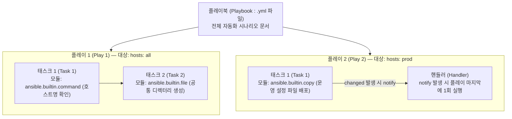

각 구성 요소의 역할은 표 3-3과 같습니다.

| 계층 요소 | YAML 표현 방식 | 핵심 역할 |
| :--- | :--- | :--- |
| **플레이북 (Playbook)** | `---`로 시작하는 `.yml` 파일 | 하나 이상의 플레이(Play)를 순서대로 담는 최상위 실행 파일 |
| **플레이 (Play)** | 최상위 리스트 항목 (`- name: ...`, `hosts: ...`) | 특정 인벤토리 그룹(`hosts`)과 실행할 작업 목록(`tasks`)을 매핑하는 단위 |
| **태스크 (Task)** | `tasks:` 아래의 리스트 항목 (`- name: ...`) | 위에서 아래로 순차 실행되는 개별 작업 단계 (태스크당 1개의 모듈 호출) |
| **모듈 (Module)** | `ansible.builtin.file:` 등 | 실제 원격 서버에서 작업을 처리하는 실행 엔진 (FQCN 표기 권장) |
| **핸들러 (Handler)** | `handlers:` 아래의 리스트 항목 | 일반 태스크에서 변경(`changed`)이 일어나고 `notify`를 보냈을 때만 실행되는 특수 태스크 |

### 2.2 DBA가 반드시 지켜야 할 YAML 문법 5계명

YAML(YAML Ain't Markup Language)은 사람이 읽기 쉬운 데이터 직렬화 양식이지만, 들여쓰기가 곧 문법 구조를 결정하므로 다음 5가지 규칙을 엄격히 준수해야 합니다.

1. **문서 시작 기호(`---`)**: 모든 플레이북과 변수 파일의 첫 줄은 대시 3개(`---`)로 시작하여 YAML 문서임을 명시합니다.
2. **탭(Tab) 절대 금지, 공백 2칸 들여쓰기**: YAML 파서는 탭 문자를 허용하지 않습니다. 모든 계층 수준은 **스페이스(공백) 2칸**으로 일관되게 맞춥니다.
3. **콜론(`:`)과 대시(`-`) 뒤에는 반드시 공백 1칸**: `hosts: all`이나 `- name: Check status`처럼 키-값 구분자(`:`)와 리스트 기호(`-`) 뒤에는 반드시 공백이 최소 한 칸 있어야 합니다.
4. **콜론이나 특수 문자가 포함된 문자열은 따옴표로 감싸기**: 메시지에 콜론(`:`)이나 중괄호(`{{ }}`)가 들어갈 때는 `"Database: {{ db_name }}"`처럼 큰따옴표로 감싸야 YAML 구문 분석 오류(`Syntax Error`)가 발생하지 않습니다.
5. **여러 줄(Multi-line) 스크립트는 파이프(`|`) 블록 스칼라 활용**: `sqlplus <<EOF`처럼 줄 바꿈이 유지되어야 하는 여러 줄 셸 스크립트는 `ansible.builtin.shell: |` 기호를 쓰고 다음 줄부터 들여쓰기하여 작성합니다.

### 2.3 단일 플레이와 다중 플레이(Multi-Play) 플레이북 비교

가장 기본적인 단일 플레이 플레이북(`playbooks/01_basic_check.yml`)은 다음과 같이 작성합니다.

```yaml
---
# playbooks/01_basic_check.yml
- name: Play 1 - Common OS & Storage Check on All DB Servers
  hosts: db_servers
  gather_facts: no
  tasks:
    - name: 1. Check server hostname
      ansible.builtin.command: uname -n
      register: host_info
      changed_when: false

    - name: 2. Display hostname output
      ansible.builtin.debug:
        msg: "Target Server Hostname: {{ host_info.stdout }}"

    - name: 3. Check /u01 mount disk space
      ansible.builtin.command: df -h /u01
      register: disk_info
      changed_when: false

    - name: 4. Display /u01 disk usage
      ansible.builtin.debug:
        var: disk_info.stdout_lines
```

하나의 플레이북 파일 안에 대상 호스트(`hosts:`)가 서로 다른 여러 개의 플레이를 연달아 배치할 수도 있습니다. 예를 들어 첫 번째 플레이에서는 전체 서버(`db_servers`)의 공통 디렉터리를 점검하고, 두 번째 플레이에서는 운영 서버(`prod`)에만 보안 감사 설정을 적용하는 식입니다.

---

## 3. 플레이북에서의 모듈 활용과 FQCN 표준

### 3.1 정규화된 컬렉션 이름(FQCN) 사용 원칙

앤서블 2.10 이후 버전부터는 모듈 이름을 `file`, `copy`, `shell`처럼 짧게 적는 대신, **`ansible.builtin.file`**, **`ansible.builtin.copy`**, **`ansible.builtin.shell`**처럼 소속 컬렉션(Collection)을 명시하는 **정규화된 컬렉션 이름(FQCN, Fully Qualified Collection Name)** 사용이 표준으로 자리 잡았습니다.

FQCN을 사용하면 향후 오라클 전용 외부 컬렉션(`oracle.oci` 등)을 추가로 설치하더라도 모듈 이름 충돌을 원천적으로 방지할 수 있습니다.

| 짧은 모듈명 | 권장 FQCN 표기 | 오라클 DBA 플레이북 주요 용도 |
| :--- | :--- | :--- |
| `command` | `ansible.builtin.command` | 셸을 거치지 않는 안전한 단일 바이너리 실행 (`uname -n`, `id oracle`) |
| `shell` | `ansible.builtin.shell` | 파이프(`\|`), 환경 변수(`$ORACLE_HOME`), `sqlplus <<EOF` 블록 실행 |
| `file` | `ansible.builtin.file` | 오라클 OFA 디렉터리 생성, 권한(`0755`) 및 심볼릭 링크 설정 |
| `copy` | `ansible.builtin.copy` | `tnsnames.ora`, `listener.ora`, SQL 점검 스크립트 배포 및 백업 |
| `stat` | `ansible.builtin.stat` | 파일·디렉터리(`spfile.ora`, `/u01/app/oracle`) 존재 여부 및 권한 속성 사전 조회 |
| `lineinfile` | `ansible.builtin.lineinfile` | `/etc/oratab`, `/etc/sysctl.conf`, `.bash_profile`의 특정 한 줄 추가·수정 |
| `package` | `ansible.builtin.package` | `oracle-database-preinstall-19c`, `unzip`, `sysstat` 등 필수 RPM 설치 |
| `service` | `ansible.builtin.service` | `sshd`, `crond`, `oracle-listener` 등 시스템 서비스 시작·중지·활성화 |

### 3.2 애드혹 명령과 플레이북 태스크의 1:1 변환 비교

2장에서 한 줄로 길게 입력했던 애드혹 명령이 플레이북 YAML 코드로 어떻게 깔끔하게 구조화되는지 비교해 봅니다.

**애드혹 명령 (CLI 한 줄 입력)**
```bash
ansible db_servers -m file -a "path=/u01/app/oracle/admin state=directory owner=oracle group=oinstall mode=0755"
```

**플레이북 태스크 (YAML 구조화)**
```yaml
    - name: Create Oracle admin directory with standard permissions
      ansible.builtin.file:
        path: /u01/app/oracle/admin
        state: directory
        owner: oracle
        group: oinstall
        mode: '0755'
```

> ⚠️ **주의(Caution): `file` 및 `copy` 모듈에서 `mode` 값은 반드시 작은따옴표로 감싸십시오!**
> YAML에서 `mode: 0755`를 따옴표 없이 숫자로 적으면, YAML 파서가 이를 8진수 정수(10진수 `493`)로 변환해 버리거나 자릿수 해석 오류를 일으킬 수 있습니다. 항상 **`mode: '0755'`** 또는 **`mode: '0644'`**처럼 작은따옴표로 감싸 문자열로 전달하는 것이 안전합니다.

---

## 4. 플레이북 변수와 `register`를 활용한 실행 결과 제어

### 4.1 플레이북에서 변수를 주입하는 4가지 경로

경로나 SID, 포트 번호를 태스크마다 직접 적어 넣으면(하드코딩) 환경이 바뀔 때마다 모든 태스크를 일일이 찾아 고쳐야 합니다. 플레이북에서는 표 3-4의 4가지 경로를 통해 변수를 정의하고 `{{ 변수명 }}` 문법으로 참조합니다.

| 변수 정의 방식 | 선언 위치 및 문법 | 적용 범위 및 우선순위 특징 |
| :--- | :--- | :--- |
| **1. 인벤토리 / `group_vars` / `host_vars`** | `inventory.ini` 또는 `group_vars/*.yml` | 호스트 및 그룹 단위로 자동 매핑되는 기반 변수 |
| **2. 플레이 인라인 변수 (`vars:`)** | 플레이 상단에 `vars:` 블록 선언 | 해당 플레이 내부의 모든 태스크에서 공통 참조 |
| **3. 외부 변수 파일 (`vars_files:`)** | 플레이 상단에 `vars_files: - vars/db_vars.yml` 선언 | 공통 오라클 설정 변수를 별도 YAML 파일로 모듈화하여 재사용 |
| **4. 명령줄 추가 변수 (`--extra-vars`, `-e`)** | `ansible-playbook play.yml -e "db_action=start"` | **최고 우선순위**를 가지며 실행 시점에 기존 변수 값을 즉시 덮어씀 |

### 4.2 `register` 키워드로 명령 출력 캡처하기

플레이북 자동화의 꽃은 앞선 태스크의 실행 결과를 변수에 담아 다음 태스크의 판단 근거로 삼는 **`register`** 기능입니다. 어떤 모듈이든 `register: <변수명>`을 추가하면 실행 결과가 딕셔너리 객체로 저장됩니다.

`command`나 `shell` 모듈 실행 결과를 `register`로 받았을 때 자주 참조하는 핵심 속성은 표 3-5와 같습니다.

| 등록 변수 속성 | 데이터 타입 | 설명 및 오라클 DBA 활용법 |
| :--- | :---: | :--- |
| `<변수>.rc` | 정수 (`int`) | 명령의 종료 반환 코드(Return Code). `0`이면 정상 성공, `0`이 아니면 오류 발생을 의미 |
| `<변수>.stdout` | 문자열 (`str`) | 표준 출력 전체를 담은 단일 문자열 (`"'OPEN' in db_status.stdout"` 조건 비교에 최적) |
| `<변수>.stdout_lines` | 리스트 (`list`) | 표준 출력을 줄 바꿈(`\n`) 단위로 쪼갠 리스트 (`debug` 모듈로 화면에 깔끔하게 출력할 때 최적) |
| `<변수>.stderr` | 문자열 (`str`) | 표준 에러 출력 문자열 (`ORA-` 에러 메시지 검출 시 활용) |
| `<변수>.changed` | 불리언 (`bool`) | 해당 태스크가 원격 서버에 변경을 일으켰는지 여부 (`true` / `false`) |

### 4.3 `changed_when`과 `failed_when`으로 멱등성과 실패 기준 정교화

`command`와 `shell` 모듈은 원격 서버의 상태를 바꾸지 않고 단순히 조회(`uname -n`, `lsnrctl status`, `SELECT status FROM v$instance`)만 하더라도, 명령이 실행되었다는 이유만으로 항상 노란색 **`changed`** 상태를 보고합니다.

단순 조회 태스크가 `changed`로 표시되면 실제 시스템 변경이 일어났는지 구별할 수 없게 됩니다. 따라서 상태 조회용 `command`/`shell` 태스크에는 반드시 **`changed_when: false`**를 명시하여 항상 초록색 **`ok`**가 출력되도록 설계해야 합니다.

반대로 `sqlplus`는 내부적으로 `ORA-01034: ORACLE not available` 오류가 발생해도 프로세스 자체는 정상 종료되어 반환 코드(`rc`)가 `0`으로 나오는 경우가 많습니다. 이때는 **`failed_when`**을 사용하여 출력 텍스트 기반으로 성공·실패 기준을 직접 정의합니다.

```yaml
    # 1. 단순 상태 조회 시 changed_when: false로 멱등성 보고 유지
    - name: Check database open mode
      ansible.builtin.shell: |
        export ORACLE_HOME={{ oracle_home }}
        export ORACLE_SID={{ oracle_sid }}
        $ORACLE_HOME/bin/sqlplus -s / as sysdba <<EOF
        SET HEADING OFF FEEDBACK OFF PAGESIZE 0
        SELECT status FROM v\$instance;
        EXIT;
        EOF
      register: db_status
      changed_when: false
      failed_when: "'OPEN' not in db_status.stdout or 'ORA-' in db_status.stdout"

    # 2. 실제 DB 기동 시에는 'ORACLE instance started' 문구가 있을 때만 changed로 인정
    - name: Start Oracle database instance
      ansible.builtin.shell: |
        export ORACLE_HOME={{ oracle_home }}
        export ORACLE_SID={{ oracle_sid }}
        $ORACLE_HOME/bin/sqlplus -s / as sysdba <<EOF
        STARTUP;
        EXIT;
        EOF
      register: start_db_result
      changed_when: "'ORACLE instance started' in start_db_result.stdout"
```

---

## 5. 조건문(`when`), 반복문(`loop`), 핸들러(`handlers`) 실무 패턴

### 5.1 `when` 조건문을 활용한 자가 치유(Self-Healing) 패턴

`register`와 `when` 조건문을 결합하면 **"먼저 상태를 점검하고, 문제가 있을 때만 조치한다"**는 지능형 자가 치유 플레이북을 작성할 수 있습니다.

예를 들어 리스너 상태를 먼저 확인(`lsnrctl status`)한 뒤, 리스너가 꺼져 있어 반환 코드가 `0`이 아닐 때(`lsnrctl_check.rc != 0`)만 리스너를 기동(`lsnrctl start`)하는 패턴은 다음과 같습니다.

```yaml
    - name: 1. Check Oracle listener status
      ansible.builtin.shell: lsnrctl status
      register: lsnrctl_check
      changed_when: false
      ignore_errors: yes   # 리스너가 꺼져 있어 rc != 0이 나와도 플레이북을 중단하지 않음

    - name: 2. Start Oracle listener ONLY if not running
      ansible.builtin.shell: lsnrctl start
      when: lsnrctl_check.rc != 0
```

또한 `ansible.builtin.stat` 모듈과 `when`을 결합하면 특정 디렉터리나 설정 파일이 없을 때만 생성하는 안전한 조건부 제어가 가능합니다.

```yaml
    - name: Check if Oracle admin directory exists
      ansible.builtin.stat:
        path: /u01/app/oracle/admin
      register: admin_dir_stat

    - name: Create admin directory if missing
      ansible.builtin.file:
        path: /u01/app/oracle/admin
        state: directory
        owner: oracle
        group: oinstall
        mode: '0755'
      when: not admin_dir_stat.stat.exists
```

> ⚠️ **주의(Caution)**: `when:` 조건식 안에서는 변수 이름을 중괄호(`{{ }}`)로 감싸지 않고 **변수명 그대로** 작성합니다. 즉 `when: "{{ lsnrctl_check.rc }} != 0"`이 아니라 **`when: lsnrctl_check.rc != 0`**으로 작성해야 이중 중괄호 경고가 발생하지 않습니다.

### 5.2 `loop` 반복문을 활용한 다중 리소스 일괄 처리

오라클 서버 하나에는 여러 개의 표준 디렉터리(`admin`, `oradata`, `fast_recovery_area`, `scripts`, `reports`)나 여러 개의 초기화 파라미터(`processes`, `sessions`, `open_cursors`)를 설정해야 합니다. 같은 태스크를 복사해 붙여넣는 대신 **`loop`** 키워드를 사용하면 코드가 획기적으로 줄어듭니다.

```yaml
    # 1. 단순 리스트 반복: 여러 오라클 디렉터리를 한 번에 생성
    - name: Create standard Oracle directories using loop
      ansible.builtin.file:
        path: "{{ item }}"
        state: directory
        owner: oracle
        group: oinstall
        mode: '0755'
      loop:
        - /u01/app/oracle/admin
        - /u01/app/oracle/oradata
        - /u01/app/oracle/fast_recovery_area
        - /u01/app/oracle/scripts
        - /u01/reports

    # 2. 딕셔너리 반복 (dict2items 필터): 여러 DB 초기화 파라미터 설정 명령 생성
    - name: Display database parameter tuning commands
      ansible.builtin.debug:
        msg: "ALTER SYSTEM SET {{ item.key }}={{ item.value }} SCOPE=BOTH;"
      vars:
        db_parameters:
          processes: 500
          sessions: 772
          open_cursors: 1000
      loop: "{{ db_parameters | dict2items }}"
```

반복문과 `register`를 함께 사용하면, 각 반복 항목의 실행 결과가 `<등록변수>.results`라는 리스트 안에 차곡차곡 저장됩니다. 이후 태스크에서 `loop: "{{ dir_check.results }}"`로 순회하며 `{{ item.item }}`(원래 입력 항목)과 `{{ item.rc }}`(해당 항목의 반환 코드)를 꺼내 쓸 수 있습니다.

### 5.3 핸들러(`handlers`)와 알림(`notify`): 변경 시에만 딱 한 번 실행하기

오라클 네트워크 설정 파일인 `listener.ora`나 `tnsnames.ora`를 원격 서버에 배포할 때, 파일 내용이 이전과 똑같은데도 매번 리스너를 재시작하거나 리로드하면 불필요한 부하와 위험이 발생합니다.

이때 태스크에 **`notify: <핸들러_이름>`**을 걸어 두고 플레이 하단에 **`handlers:`** 블록을 작성하면 다음과 같이 동작합니다.

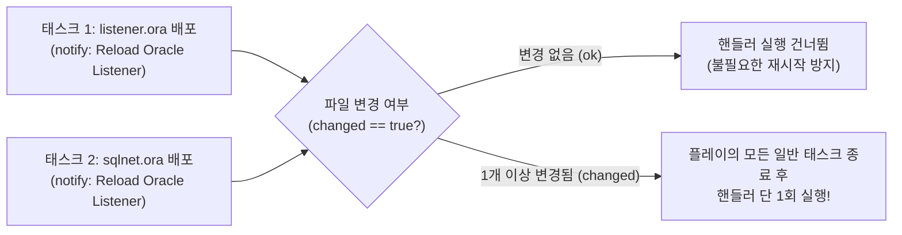

- 알림을 보낸 태스크에서 **실제 변경(`changed: true`)이 발생했을 때만** 핸들러가 호출됩니다. 파일 내용이 동일하여 `ok`(`changed: false`)가 나오면 핸들러는 절대 실행되지 않습니다.
- 한 플레이 안에서 여러 태스크(`listener.ora` 복사, `sqlnet.ora` 복사)가 동시에 같은 핸들러에 `notify`를 보내더라도, 핸들러는 모든 일반 태스크가 끝난 맨 마지막에 **단 한 번만** 실행되어 중복 재시작을 막아 줍니다.

---

## 6. 플레이북 실행, 사전 검증 및 트러블슈팅

운영 데이터베이스 서버에 플레이북을 적용하기 전에는 반드시 **3단계 안전 검증 절차(문법 검사 → 드라이 런 → 개발 서버 제한 실행)**를 거쳐야 합니다.

| 실행 단계 | 명령어 옵션 | 동작 및 검증 내용 |
| :--- | :--- | :--- |
| **Step 1. 문법 검사** | `ansible-playbook --syntax-check play.yml` | YAML 들여쓰기 오류, 모듈명 오타 등을 실행 전에 정적 검사 |
| **Step 2. 드라이 런 (Dry Run)** | `ansible-playbook --check --diff play.yml` | 원격 서버를 실제로 변경하지 않고, 어떤 파일과 설정이 바뀔지(`--diff`) 시뮬레이션 |
| **Step 3. 대상 제한 실행** | `ansible-playbook play.yml --limit dev` | 전체 서버 대신 개발(`dev`) 그룹이나 단일 호스트(`devdb`)에만 먼저 실제 적용 |
| **Step 4. 운영 전체 배포** | `ansible-playbook play.yml` | 검증 완료 후 테스트(`test`) 및 운영(`prod`) 환경으로 확대 적용 |

> ⚠️ **주의(Caution): 체크 모드(`--check`) 사용 시 알아둘 점**
> `file`, `copy`, `package`, `service` 같은 선언적 모듈은 체크 모드(`--check`)에서 실제 변경 없이도 무엇이 바뀔지 완벽하게 예측합니다. 하지만 `command`나 `shell` 모듈은 부작용(Side-effect)을 예측할 수 없으므로 체크 모드에서는 아예 실행을 건너뜁니다(`skipped`). 따라서 `command`/`shell` 태스크의 결과(`register`)를 뒤따르는 태스크의 `when` 조건에서 참조한다면, 체크 모드에서는 첫 태스크가 생략되어 변수가 비어 있을 수 있음을 염두에 두어야 합니다.

---

## 7. 마스터 프로젝트: 오라클 19c 서버 운영 및 일일 점검 자동화 플레이북 실습

이제 `chapter_3` 컨테이너 환경(`ansible-control-ch3` → `devdb`, `testdb`, `proddb`)에서 본 장의 모든 핵심 개념(외부 변수 파일, `loop` 디렉터리 생성, `copy` + `notify` 핸들러, `register` + `changed_when`/`failed_when`, 보고서 자동 생성)을 하나로 통합한 마스터 프로젝트를 직접 구현하고 실행합니다.

### 7.1 Step 1: 외부 변수 파일(`vars/oracle_env_vars.yml`) 및 네트워크 설정 파일 준비

먼저 제어 노드의 `/home/oracle/ansible-oracle-adhoc` 디렉터리 아래에 공통 변수 파일과 배포할 `tnsnames.ora` 파일을 생성합니다. 원본 슬라이드(12.8절)에서 지적된 누락 변수(`oracle_sid`, 표준 `oracle_home` 경로 등)를 모두 완벽하게 보완한 구성입니다.

```bash
cat << 'EOF' > vars/oracle_env_vars.yml
---
# vars/oracle_env_vars.yml
oracle_user: oracle
oracle_group: oinstall
oracle_base: /u01/app/oracle
oracle_home: /u01/app/oracle/product/19.3.0/dbhome_1
oracle_sid: ORCL19C
listener_port: 1521

# 반복문(loop)으로 일괄 생성할 표준 디렉터리 목록
oracle_standard_dirs:
  - /u01/app/oracle/admin
  - /u01/app/oracle/oradata
  - /u01/app/oracle/fast_recovery_area
  - /u01/app/oracle/product/19.3.0/dbhome_1/network/admin
  - /u01/app/oracle/scripts
  - /u01/reports

# 딕셔너리 반복문(dict2items)으로 점검할 핵심 초기화 파라미터
oracle_init_params:
  processes: 500
  sessions: 772
  open_cursors: 1000
EOF
```

이어서 원격 서버들에 배포할 표준 `files/tnsnames.ora` 파일과 점검용 SQL 스크립트(`files/db_health_check.sql`)를 생성합니다.

```bash
cat << 'EOF' > files/tnsnames.ora
# Standard Oracle 19c TNS Configuration Managed by Ansible
ORCL19C =
  (DESCRIPTION =
    (ADDRESS = (PROTOCOL = TCP)(HOST = localhost)(PORT = 1521))
    (CONNECT_DATA =
      (SERVER = DEDICATED)
      (SERVICE_NAME = ORCL19C)
    )
  )
EOF

cat << 'EOF' > files/db_health_check.sql
SET PAGESIZE 50 LINESIZE 120 FEEDBACK OFF
SELECT instance_name, host_name, version, status, database_status FROM v$instance;
SELECT name, open_mode, log_mode, database_role FROM v$database;
EXIT;
EOF
```

### 7.2 Step 2: 마스터 운영 플레이북(`playbooks/oracle_dba_operations.yml`) 작성

이제 디렉터리 생성(`loop`), 설정 파일 배포(`copy` + `backup: yes`), 핸들러 알림(`notify`), 시스템 리소스 및 오라클 환경 검증(`register` + `when`), 그리고 서버별 헬스 체크 리포트 생성까지 한 번에 수행하는 마스터 플레이북을 작성합니다.

```bash
cat << 'EOF' > playbooks/oracle_dba_operations.yml
---
# ========================================================
# Playbook: playbooks/oracle_dba_operations.yml
# Description: Chapter 3 Master Project - Structured Oracle 19c Operations
# Targets: db_servers (devdb, testdb, proddb)
# ========================================================
- name: Automated Oracle 19c Server Operations & Health Reporting
  hosts: db_servers
  gather_facts: yes
  become: yes
  vars_files:
    - ../vars/oracle_env_vars.yml

  tasks:
    # --------------------------------------------------------
    # 1. 반복문(loop)을 활용한 오라클 19c 표준 디렉터리 일괄 생성
    # --------------------------------------------------------
    - name: 1. Create standard Oracle 19c directories using loop
      ansible.builtin.file:
        path: "{{ item }}"
        state: directory
        owner: "{{ oracle_user }}"
        group: "{{ oracle_group }}"
        mode: '0755'
      loop: "{{ oracle_standard_dirs }}"
      tags:
        - dirs

    # --------------------------------------------------------
    # 2. 설정 파일 및 SQL 스크립트 배포 (변경 시에만 핸들러 notify)
    # --------------------------------------------------------
    - name: 2. Deploy tnsnames.ora with automatic backup and handler notify
      ansible.builtin.copy:
        src: ../files/tnsnames.ora
        dest: "{{ oracle_home }}/network/admin/tnsnames.ora"
        owner: "{{ oracle_user }}"
        group: "{{ oracle_group }}"
        mode: '0644'
        backup: yes
      notify: Reload Oracle Listener
      tags:
        - config

    - name: 3. Deploy SQL health check script to /u01/app/oracle/scripts
      ansible.builtin.copy:
        src: ../files/db_health_check.sql
        dest: /u01/app/oracle/scripts/db_health_check.sql
        owner: "{{ oracle_user }}"
        group: "{{ oracle_group }}"
        mode: '0644'
      tags:
        - config

    # --------------------------------------------------------
    # 3. 딕셔너리 반복(dict2items)을 활용한 파라미터 스크립트 생성
    # --------------------------------------------------------
    - name: 4. Verify recommended init.ora parameters using dict2items
      ansible.builtin.debug:
        msg: "[{{ inventory_hostname }}] Recommended SQL: ALTER SYSTEM SET {{ item.key }}={{ item.value }} SCOPE=SPFILE;"
      loop: "{{ oracle_init_params | dict2items }}"
      tags:
        - params

    # --------------------------------------------------------
    # 4. register + changed_when + failed_when 기반 환경 및 스토리지 점검
    # --------------------------------------------------------
    - name: 5. Collect /u01 storage and memory status
      ansible.builtin.shell: |
        echo "=== Host: $(uname -n) | SID: {{ oracle_sid }} ==="
        echo "[1] Oracle User Info: $(id {{ oracle_user }})"
        echo "[2] /u01 Mount Usage:"
        df -h /u01
        echo "[3] Memory Usage:"
        free -h
      register: health_check_out
      changed_when: false
      failed_when: health_check_out.rc != 0
      tags:
        - health

    # --------------------------------------------------------
    # 5. 조건문(when)을 결합한 서버별 점검 보고서 파일 저장
    # --------------------------------------------------------
    - name: 6. Save health check report on remote server if check succeeded
      ansible.builtin.copy:
        content: "{{ health_check_out.stdout }}\n"
        dest: "/u01/reports/health_report_{{ inventory_hostname }}.txt"
        owner: "{{ oracle_user }}"
        group: "{{ oracle_group }}"
        mode: '0644'
      when: health_check_out.rc == 0
      tags:
        - health
        - report

    - name: 7. Display health report lines
      ansible.builtin.debug:
        var: health_check_out.stdout_lines
      tags:
        - health

  # ----------------------------------------------------------
  # Handlers: 설정 파일이 실제로 변경(changed)되었을 때만 플레이 끝에 1회 실행
  # ----------------------------------------------------------
  handlers:
    - name: Reload Oracle Listener
      ansible.builtin.debug:
        msg: "[HANDLER TRIGGERED on {{ inventory_hostname }}] tnsnames.ora changed -> Executing Listener Reload Check (SID: {{ oracle_sid }}, Port: {{ listener_port }})"
EOF
```

### 7.3 Step 3: 문법 검사 → 개발 서버 드라이 런 → 전체 배포 및 멱등성 확인

작성한 마스터 플레이북을 앞서 배운 4단계 안전 검증 절차에 따라 실행합니다.

#### (1) 문법 검사 (`--syntax-check`) 및 개발 서버 드라이 런 (`--limit dev --check --diff`)

```bash
# 1. YAML 구문 및 경로 오류 정적 검사
[oracle@ansible-control ansible-oracle-adhoc]$ ansible-playbook --syntax-check playbooks/oracle_dba_operations.yml

playbook: playbooks/oracle_dba_operations.yml

# 2. 개발 서버(devdb) 1대에만 체크 모드 + 변경 비교(--diff) 실행
[oracle@ansible-control ansible-oracle-adhoc]$ ansible-playbook playbooks/oracle_dba_operations.yml --limit dev --check --diff
```

드라이 런 결과에서 어떤 디렉터리와 파일이 새로 생성될지 미리 확인한 후, 이상이 없으면 전체 서버(`devdb`, `testdb`, `proddb`)에 본 배포를 실행합니다.

#### (2) 전체 서버 본 배포 (1차 실행: 핸들러 트리거 확인)

```bash
[oracle@ansible-control ansible-oracle-adhoc]$ ansible-playbook playbooks/oracle_dba_operations.yml
```

1차 실행 시에는 `tnsnames.ora`가 새로 배포되면서 `changed`가 발생하므로, 플레이의 맨 마지막에 **`RUNNING HANDLER [Reload Oracle Listener]`**가 정확히 트리거되는 것을 확인할 수 있습니다.

```text
PLAY [Automated Oracle 19c Server Operations & Health Reporting] ***************

TASK [Gathering Facts] *********************************************************
ok: [devdb]
ok: [testdb]
ok: [proddb]

TASK [1. Create standard Oracle 19c directories using loop] ********************
changed: [devdb] => (item=/u01/app/oracle/admin)
changed: [testdb] => (item=/u01/app/oracle/admin)
changed: [proddb] => (item=/u01/app/oracle/admin)
... (6개 디렉터리 일괄 생성 완료) ...

TASK [2. Deploy tnsnames.ora with automatic backup and handler notify] *********
changed: [devdb]
changed: [testdb]
changed: [proddb]

TASK [3. Deploy SQL health check script to /u01/app/oracle/scripts] ************
changed: [devdb]
changed: [testdb]
changed: [proddb]

TASK [4. Verify recommended init.ora parameters using dict2items] **************
ok: [devdb] => (item={'key': 'processes', 'value': 500}) => {
    "msg": "[devdb] Recommended SQL: ALTER SYSTEM SET processes=500 SCOPE=SPFILE;"
}
...

TASK [5. Collect /u01 storage and memory status] *******************************
ok: [devdb]
ok: [testdb]
ok: [proddb]

TASK [6. Save health check report on remote server if check succeeded] *********
changed: [devdb]
changed: [testdb]
changed: [proddb]

RUNNING HANDLER [Reload Oracle Listener] ***************************************
ok: [devdb] => {
    "msg": "[HANDLER TRIGGERED on devdb] tnsnames.ora changed -> Executing Listener Reload Check (SID: ORCL19C, Port: 1521)"
}
ok: [testdb] => {
    "msg": "[HANDLER TRIGGERED on testdb] tnsnames.ora changed -> Executing Listener Reload Check (SID: ORCL19C, Port: 1521)"
}
ok: [proddb] => {
    "msg": "[HANDLER TRIGGERED on proddb] tnsnames.ora changed -> Executing Listener Reload Check (SID: ORCL19C, Port: 1521)"
}

PLAY RECAP *********************************************************************
devdb                      : ok=8    changed=4    unreachable=0    failed=0    skipped=0    rescued=0    ignored=0   
proddb                     : ok=8    changed=4    unreachable=0    failed=0    skipped=0    rescued=0    ignored=0   
testdb                     : ok=8    changed=4    unreachable=0    failed=0    skipped=0    rescued=0    ignored=0   
```

#### (3) 플레이북 재실행 (2차 실행: 완벽한 멱등성 및 핸들러 생략 검증)

이제 동일한 명령을 즉시 한 번 더 실행해 봅니다.

```bash
[oracle@ansible-control ansible-oracle-adhoc]$ ansible-playbook playbooks/oracle_dba_operations.yml
```

```text
PLAY RECAP *********************************************************************
devdb                      : ok=7    changed=0    unreachable=0    failed=0    skipped=0    rescued=0    ignored=0   
proddb                     : ok=7    changed=0    unreachable=0    failed=0    skipped=0    rescued=0    ignored=0   
testdb                     : ok=7    changed=0    unreachable=0    failed=0    skipped=0    rescued=0    ignored=0   
```

모든 디렉터리, 설정 파일(`tnsnames.ora`), 리포트 파일의 내용이 이미 원하는 상태와 일치하므로, 3대 서버 모두 **`changed=0`**을 기록하며 `Reload Oracle Listener` 핸들러도 실행되지 않고 깔끔하게 종료됩니다.

또한 특정 태그(예: `--tags "health"`)나 명령줄 추가 변수(`-e "oracle_sid=PROD19C"`)를 조합하여 원하는 작업만 선택적으로 실행할 수도 있습니다.

```bash
# 운영 서버(proddb)만을 대상으로 SID를 PROD19C로 덮어쓰며 헬스 체크 태그만 실행
[oracle@ansible-control ansible-oracle-adhoc]$ ansible-playbook playbooks/oracle_dba_operations.yml \
  --limit prod --tags "health" -e "oracle_sid=PROD19C"
```

실습을 모두 마쳤다면 제어 노드를 종료하고 도커 컨테이너를 정리합니다.

```bash
exit
docker compose down -v
```

---

## 핵심 요약

1. **코드로서의 표준 운영 절차(SOP)**: 플레이북은 여러 태스크를 YAML 파일로 구조화하여 개발·테스트·운영 서버에 일관되고 재사용 가능한 오라클 DBA 자동화를 구현합니다.
2. **FQCN 및 문법 규격 준수**: 공백 2칸 들여쓰기, `mode: '0755'` 작은따옴표 처리, 그리고 `ansible.builtin.file`과 같은 정규화된 컬렉션 이름(FQCN) 사용을 표준화합니다.
3. **`register`와 상태 판단 제어**: 명령 실행 결과는 `register`로 캡처하여 `stdout`, `stdout_lines`, `rc`를 활용하고, 단순 조회 태스크에는 `changed_when: false`를, SQL 오류 판별에는 `failed_when`을 지정하여 정확한 실행 상태를 기록합니다.
4. **지능형 흐름 제어 (`when`, `loop`, `handlers`)**: `when`으로 조건부 자가 치유를 구현하고, `loop`와 `dict2items`로 다중 디렉터리·파라미터 반복 코드를 제거하며, `notify`와 `handlers`로 설정 파일이 변경되었을 때만 서비스를 재로드합니다.
5. **안전한 배포 라이프사이클**: 운영 환경에 적용하기 전 반드시 `--syntax-check`(문법 검사) → `--check --diff`(드라이 런) → `--limit dev`(개발 서버 선검증) 순서를 지키는 것이 무중단 DBA 자동화의 핵심입니다.


---

# Chapter 4. 오라클 DBA를 위한 앤서블 변수(Variables) 아키텍처와 동적 환경 제어

<!-- [Style Guide Mapping]
- 본문 / 표 / 캡션 / 영문 기술 용어: Noto Sans KR
- 장/절 제목 (Heading 1~4): Noto Sans KR Bold
- 코드 블록 (YAML, INI, Bash, SQL, Console Output): DejaVu Sans Mono
- 수식 기호 / 변수: Cambria Math
-->

## 1. 왜 오라클 DBA에게 변수(Variables) 아키텍처가 중요한가?

오라클 데이터베이스를 관리하다 보면 동일한 작업(백업 디렉터리 생성, 리스너 상태 점검, 초기화 파라미터 변경, 패치 적용)이라도 개발(`dev`), 테스트(`test`), 운영(`prod`) 환경에 따라 세부 설정값이 달라집니다. 예를 들어 데이터베이스 이름(`DB_NAME`), 오라클 홈 경로(`ORACLE_HOME`), 리스너 포트(`LISTENER_PORT`), 백업 경로(`BACKUP_DIR`)는 서버마다 제각각입니다.

만약 플레이북 코드 안에 `/u01/app/oracle/prod`나 `ORCL_PROD` 같은 값을 직접 적어 넣는 **하드코딩(Hardcoding)** 방식을 사용하면 어떻게 될까요? 환경이 추가될 때마다 플레이북 파일을 복사하여 `playbook_dev.yml`, `playbook_test.yml`, `playbook_prod.yml`처럼 여러 벌로 쪼개서 관리해야 합니다. 이처럼 파일이 파편화되면 작업 절차 하나를 수정할 때마다 모든 파일을 일일이 고쳐야 하고, 자칫 운영 플레이북에서 개발용 경로를 미처 수정하지 못해 대형 장애로 이어질 위험이 커집니다.

앤서블의 **변수(Variables)**는 **"자동화 로직(Playbook)과 환경 데이터(Variables)의 완벽한 분리"**를 실현하는 핵심 메커니즘입니다. 플레이북 코드는 단 하나로 유지하면서, 실행 대상 서버나 명령줄 옵션에 따라 적절한 변수 값만 동적으로 주입하여 재사용성과 안정성을 극대화할 수 있습니다.

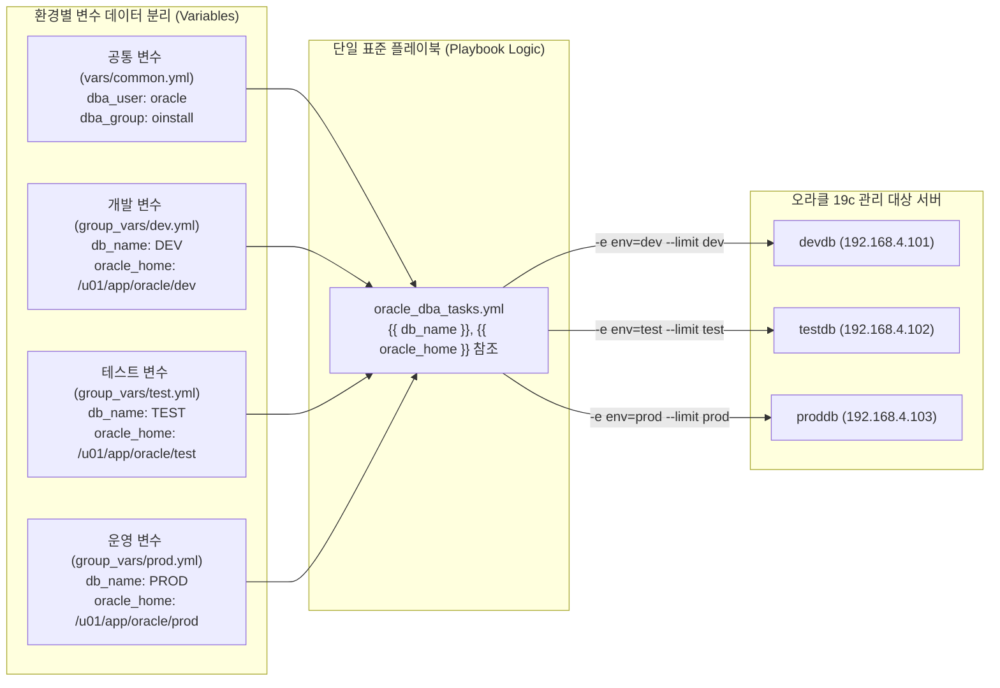

이번 장에서는 변수의 명명 규칙과 데이터 타입부터 플레이북·인벤토리·외부 변수 파일(`vars_files`)·명령줄 추가 변수(`--extra-vars`)를 아우르는 **변수 우선순위(Variable Precedence)**, 그리고 실행 전 필수 변수를 검증하는 **단언문(`assert`)** 기법까지 실습 중심으로 완벽하게 마스터합니다.

---

## 2. 실습 아키텍처 및 컨테이너 환경 구성 (`chapter_4`)

Chapter 4의 모든 실습은 `chapter_4` 디렉터리에 구성된 4대의 도커 컨테이너 환경(`192.168.4.0/24` 대역)에서 진행합니다. 제어 노드(`ansible-control-ch4`) 내부의 `/home/oracle/ansible-oracle-project` 디렉터리에는 계층형 변수 아키텍처가 사전 구성되어 있습니다.

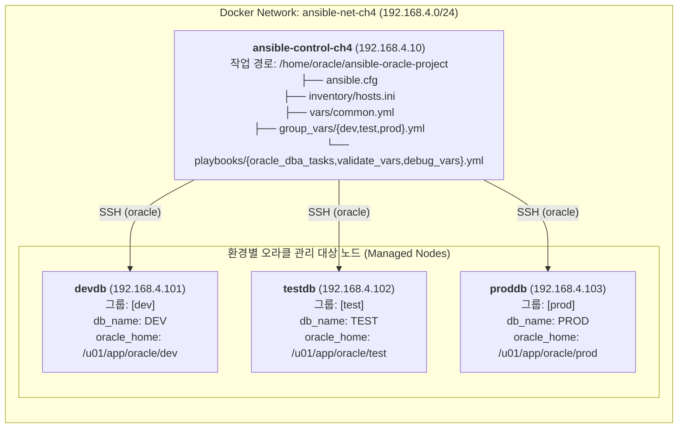

### 2.1 실습 컨테이너 기동 및 프로젝트 구조 확인

터미널을 열고 `chapter_4` 디렉터리로 이동하여 컨테이너를 기동한 뒤 제어 노드에 접속합니다.

```bash
cd chapter_4
docker compose up -d --build
docker exec -it ansible-control-ch4 bash
```

제어 노드(`ansible-control-ch4`)에 접속하면 기본 작업 디렉터리인 `/home/oracle/ansible-oracle-project`에 위치하게 됩니다. 현재 디렉터리 구조와 `ansible.cfg`, `inventory/hosts.ini` 파일의 내용을 확인해 봅니다.

```ini
# ansible.cfg
[defaults]
inventory = inventory/hosts.ini
host_key_checking = False
remote_user = oracle
interpreter_python = auto_silent
```

```ini
# inventory/hosts.ini
[dev]
devdb ansible_host=devdb oracle_home=/u01/app/oracle/dev listener_port=1521

[test]
testdb ansible_host=testdb oracle_home=/u01/app/oracle/test listener_port=1521

[prod]
proddb ansible_host=proddb oracle_home=/u01/app/oracle/prod listener_port=1521
```

---

## 3. 앤서블 변수의 기본 문법, 명명 규칙 및 데이터 구조

앤서블에서 변수를 정의하고 진자2(Jinja2) 표현식(`{{ 변수명 }}`)으로 참조할 때는 명확한 명명 규칙과 YAML 따옴표 규칙을 지켜야 합니다.

### 3.1 변수 명명 규칙 (Variable Naming Rules)

앤서블 변수 이름은 **영문자(A-Z, a-z), 숫자(0-9), 밑줄(`_`)**만 사용할 수 있으며, 반드시 **영문자 또는 밑줄(`_`)로 시작**해야 합니다. 현업 오라클 DBA 환경에서는 소문자와 밑줄을 조합하는 **스네이크 표기법(Snake Case)**을 표준으로 사용합니다.

| 구분 | 변수명 예시 | 유효 여부 | 사유 및 설명 |
| :--- | :--- | :---: | :--- |
| **올바른 변수명** | `oracle_home`, `db_unique_name`, `listener_port_1521` | **O (유효)** | 소문자, 숫자, 밑줄(`_`)만 사용하며 영문자로 시작 |
| **잘못된 변수명 1** | `oracle-home`, `db-name` | **X (불가)** | 하이픈(`-`)은 진자2에서 뺄셈 연산자로 해석되어 문법 오류 발생 |
| **잘못된 변수명 2** | `19c_oracle_home`, `1st_node` | **X (불가)** | 숫자로 시작하는 변수명은 허용되지 않음 |
| **잘못된 변수명 3** | `oracle.home`, `oracle home` | **X (불가)** | 마침표(`.`)는 딕셔너리 속성 접근자로 해석되며 공백은 포함 불가 |
| **잘못된 변수명 4** | `hosts`, `tasks`, `vars`, `environment` | **X (권장 안 함)** | 앤서블 및 파이썬 예약어와 충돌할 수 있으므로 접두어(`ora_`) 부여 권장 |

### 3.2 진자2(`{{ }}`) 참조와 YAML 따옴표 규칙

변수를 정의할 때는 `키: 값` 형태로 작성하고, 태스크에서 해당 변수의 값을 꺼내 쓸 때는 **`{{ 변수명 }}`** 형태로 감싸 줍니다. 이때 YAML 문법 특성상 콜론(`:`) 뒤에 중괄호(`{`)가 바로 오면 YAML 파서가 이를 문자열이 아닌 **딕셔너리(Dictionary) 객체**의 시작으로 오해하여 문법 에러를 발생시킵니다.

```yaml
# [잘못된 작성 예] 값의 맨 앞이 {{ 로 시작하는데 따옴표가 없는 경우 -> YAML 구문 오류!
dest: {{ oracle_home }}/network/admin/tnsnames.ora

# [올바른 작성 예 1] 값의 시작이 {{ 인 경우 반드시 전체를 큰따옴표("")로 감쌉니다.
dest: "{{ oracle_home }}/network/admin/tnsnames.ora"

# [올바른 작성 예 2] 일반 문자열로 시작하고 중간에 {{ }}가 들어가는 경우에도 큰따옴표 권장
msg: "Connecting to {{ db_name }} on port {{ listener_port }}"
```

> 💡 **노트(Note)**: 변수가 포함된 모든 문자열은 위치에 상관없이 항상 **큰따옴표(`"..."`)**로 감싸는 습관을 들이면 YAML 파싱 오류를 100% 예방할 수 있습니다. 단, Chapter 3에서 살펴본 것처럼 `when:`이나 `assert:`의 `that:` 조건식 내부에서는 이미 진자2 평가 컨텍스트가 열려 있으므로 `{{ }}` 없이 변수명만 그대로 적어야 합니다.

### 3.3 오라클 관리를 위한 3가지 변수 데이터 타입

오라클 DBA 자동화에서는 단순 값(문자열, 숫자, 불리언)뿐만 아니라 **리스트(List)**와 **딕셔너리(Dictionary)** 구조를 적극 활용합니다.

```yaml
# 1. 스칼라(Scalar) 변수: 문자열, 정수, 불리언(true/false)
db_name: PROD
listener_port: 1521
is_rac: true

# 2. 리스트(List) 변수: 여러 테이블스페이스나 디렉터리 목록 정의
tablespaces:
  - USERS
  - SYSAUX
  - UNDOTBS1

# 3. 딕셔너리(Dictionary) 변수: 구조화된 DB 설정이나 초기화 파라미터 묶음
oracle_db_config:
  sid: PROD19C
  home: /u01/app/oracle/prod
  memory_target: 8G
```

리스트의 특정 요소에 접근할 때는 `{{ tablespaces[0] }}`(`USERS`)처럼 인덱스를 사용하고, 딕셔너리의 속성에 접근할 때는 점 표기법(`{{ oracle_db_config.sid }}`)이나 대괄호 표기법(`{{ oracle_db_config['sid'] }}`)을 사용합니다.

---

## 4. 변수 정의 위치(Scope)와 계층형 디렉터리 설계

앤서블에서는 변수를 정의할 수 있는 위치가 매우 다양합니다. 실무에서는 관리 목적과 재사용 범위에 따라 다음 5가지 위치에 변수를 배치합니다.

### 4.1 플레이북 내부 `vars` 블록

플레이북 파일 상단의 `vars:` 섹션에 직접 변수를 선언하는 방식입니다. 단일 파일 안에서 모든 것을 확인할 수 있어 간단한 테스트에는 편리하지만, 여러 플레이북에서 변수를 공유할 수 없으므로 규모가 커지면 외부 파일로 분리하는 것이 좋습니다.

```yaml
- name: Configure Oracle environment
  hosts: db_servers
  vars:
    oracle_home: /u01/app/oracle/product/19.0.0/dbhome_1
    oracle_sid: ORCL
```

### 4.2 인벤토리 파일(`hosts.ini`) 및 `group_vars` / `host_vars`

인벤토리 파일의 호스트 라인에 직접 변수를 적거나, `group_vars/<그룹명>.yml` 및 `host_vars/<호스트명>.yml` 파일로 분리하여 관리하는 방식입니다. `chapter_4` 프로젝트의 `group_vars/` 디렉터리에 정의된 개발(`dev.yml`), 테스트(`test.yml`), 운영(`prod.yml`) 변수 파일을 살펴보겠습니다.

```yaml
# group_vars/dev.yml (개발 환경 전용 변수)
db_name: DEV
db_unique_name: DEV_DG
oracle_home: /u01/app/oracle/dev
listener_port: 1521
backup_dir: /backup/dev
env: dev
is_rac: false
data_guard: false
```

```yaml
# group_vars/test.yml (테스트 환경 전용 변수)
db_name: TEST
db_unique_name: TEST_DG
oracle_home: /u01/app/oracle/test
listener_port: 1521
backup_dir: /backup/test
env: test
is_rac: false
data_guard: false
```

```yaml
# group_vars/prod.yml (운영 환경 전용 변수)
db_name: PROD
db_unique_name: PROD_DG
oracle_home: /u01/app/oracle/prod
listener_port: 1521
oracle_sid: PROD
backup_dir: /backup/prod
asm_diskgroup: DATA
env: prod
is_rac: true
data_guard: true
```

### 4.3 외부 변수 파일 명시적 로드 (`vars_files`)

모든 환경에서 공통으로 사용하는 표준 변수(예: `dba_user`, `dba_group`, 임계치 등)를 별도 디렉터리(`vars/common.yml`)에 모아 두고, 플레이북의 **`vars_files:`** 지시자로 불러오는 방식입니다. 특히 경로 이름에 `{{ env }}` 같은 변수를 넣으면 실행 시점에 로드할 변수 파일을 동적으로 바꿀 수 있습니다.

```yaml
# vars/common.yml (전사 공통 DBA 표준 변수)
dba_user: oracle
dba_group: oinstall
backup_base_dir: /backup
log_dir: /var/log/ansible
script_dir: /u01/scripts
notification_email: dba-team@company.com
check_disk_threshold: 80
check_session_threshold: 100
```

```yaml
# playbooks/oracle_dba_tasks.yml 에서 vars_files로 동적 로드
  vars_files:
    - ../vars/common.yml
    - ../group_vars/{{ env }}.yml
```

> ⚠️ **주의(Caution): 동적 `vars_files` 경로 사용 시 필수 숙지 사항**
> `vars_files`에서 `- ../group_vars/{{ env }}.yml`처럼 파일 경로 자체에 `{{ env }}` 변수를 사용할 때, 해당 파일이 열리기 전까지는 파일 내부에 적힌 `env: dev` 값을 알 수 없습니다(닭과 달걀의 문제). 또한 앤서블이 인벤토리 기준 `group_vars/`를 자동 로드하는 시점보다 플레이북 수준 `vars_files` 경로 평가가 먼저 이루어지므로, 이 패턴을 사용할 때는 반드시 명령줄에서 **`-e env=dev`**(또는 플레이 상단 `vars:`)로 `env` 값을 명시적으로 전달해야 합니다.

### 4.4 명령줄 추가 변수 (`--extra-vars` / `-e`)

플레이북 코드를 전혀 수정하지 않고도 실행 시점에 `ansible-playbook` 명령줄에서 **`-e` (또는 `--extra-vars`)** 옵션으로 변수 값을 즉석에서 주입하거나 덮어쓸 수 있습니다.

```bash
# 1. 키=값(key=value) 형태로 전달
ansible-playbook playbooks/oracle_dba_tasks.yml -e "env=dev db_name=DEV_HOTFIX" --limit dev

# 2. JSON 문자열 형태로 전달 (불리언, 정수, 리스트 타입을 명확히 전달할 때 유용)
ansible-playbook playbooks/oracle_dba_tasks.yml -e '{"env": "prod", "listener_port": 1522, "is_rac": true}' --limit prod

# 3. 외부 JSON 또는 YAML 파일을 통째로 전달 (@ 기호 사용)
ansible-playbook playbooks/oracle_dba_tasks.yml -e "@vars/emergency_override.yml" --limit prod
```

---

## 5. 앤서블 변수 우선순위(Variable Precedence) 완벽 마스터

만약 똑같은 변수 이름인 `oracle_home`이 인벤토리 파일(`hosts.ini`), 그룹 변수(`group_vars/dev.yml`), 공통 변수 파일(`vars/common.yml`), 그리고 명령줄 옵션(`-e`)에 모두 정의되어 있다면 앤서블은 어떤 값을 최종적으로 선택할까요?

앤서블은 **"범위가 좁고 구체적일수록, 그리고 실행 시점(런타임)에 가까울수록 우선순위가 높다"**는 명확한 규칙을 따릅니다. 오라클 DBA가 실무에서 반드시 기억해야 할 핵심 우선순위 계층을 정리하면 다음과 같습니다.

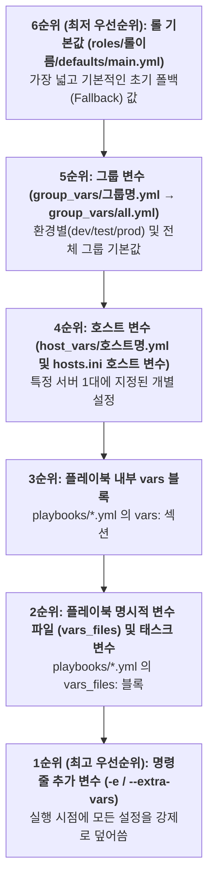

| 우선순위 (높음 → 낮음) | 변수 정의 위치 | `chapter_4` 대응 파일 및 옵션 | 실무 활용 목적 |
| :---: | :--- | :--- | :--- |
| **1순위 (최고)** | 명령줄 추가 변수 (`-e`, `--extra-vars`) | `-e "env=dev db_name=TESTDB"` | 긴급 작업 시 일회성 오버라이드 및 동적 환경(`env`) 주입 |
| **2순위** | 플레이북 `vars_files` | `vars_files: [../vars/common.yml, ../group_vars/{{ env }}.yml]` | 플레이북이 명시적으로 불러오는 외부 변수 파일 |
| **3순위** | 플레이북 `vars` | 플레이북 상단 `vars:` 블록 | 해당 플레이북 전용 고정 변수 |
| **4순위** | 호스트 변수 (`host_vars` / 인벤토리 호스트) | `inventory/hosts.ini`의 `oracle_home=...` | 특정 DB 서버 1대에만 적용할 고유 경로 및 포트 |
| **5순위** | 그룹 변수 (`group_vars/<group>.yml`) | `group_vars/dev.yml`, `test.yml`, `prod.yml` | 환경별(`dev`/`test`/`prod`) 표준 DB 설정 |
| **6순위 (최저)** | 전체 그룹 변수 (`group_vars/all.yml`) 및 롤 기본값 | `group_vars/all.yml`, `roles/*/defaults/main.yml` | 전사 기본값 (다른 곳에서 재정의하지 않았을 때만 사용) |

> 💡 **노트(Note): `vars_files`에서 리스트 순서에 따른 덮어쓰기 규칙**
> 하나의 `vars_files:` 블록 안에 여러 파일이 나열되어 있을 때는 **아래쪽(나중)에 적힌 파일의 변수가 위쪽(먼저)에 적힌 파일의 동일 변수를 덮어씁니다.** 예를 들어 `vars/common.yml`을 먼저 적고 `group_vars/{{ env }}.yml`을 그 아래에 적으면, 공통 기본값을 먼저 로드한 뒤 환경별 특수 값으로 자연스럽게 덮어쓰는 구조를 만들 수 있습니다.

---

## 6. 실무 트러블슈팅 인사이트: 변수 검증(`assert`)과 원격 셸(`$`) 이스케이프

운영 데이터베이스 자동화에서 변수와 관련하여 가장 빈번하게 발생하는 2가지 치명적 실수와 그 해결책을 살펴봅니다.

### 6.1 `ansible.builtin.assert`를 활용한 사전 실패(Fail-Fast) 방어막 구축

만약 DBA가 테이블스페이스 삭제나 백업 정리 플레이북을 실행하면서 필수 변수인 `db_name`이나 `oracle_home`을 빠뜨렸거나 빈 문자열(`""`)로 넘겼다면 어떻게 될까요? 최악의 경우 `rm -rf {{ oracle_home }}/log` 같은 명령이 `rm -rf /log`로 둔갑하여 시스템 장애를 유발할 수 있습니다.

따라서 중요한 플레이북의 맨 첫 번째 태스크에는 반드시 **`ansible.builtin.assert`** 모듈을 배치하여, 필수 변수가 정의되어 있는지(`is defined`), 값이 비어 있지 않은지(`| length > 0`), 허용된 값 범위에 속하는지 검증하는 **사전 실패(Fail-Fast)** 방어막을 세워야 합니다.

```yaml
    - name: Check if db_name and oracle_home are defined
      ansible.builtin.assert:
        that:
          - db_name is defined
          - db_name | length > 0
          - oracle_home is defined
          - oracle_home | length > 0
        fail_msg: "Required variables (db_name, oracle_home) are missing or empty!"
        success_msg: "Variables validated: db_name={{ db_name }}, oracle_home={{ oracle_home }}"
```

### 6.2 `shell` 모듈에서 SQL*Plus `v$database` 조회 시 `$` 기호 충돌 주의

앤서블의 진자2 변수는 `{{ oracle_home }}` 형태를 쓰지만, 리눅스 배시(Bash) 셸 스크립트 안에서는 `$ORACLE_HOME`처럼 달러(`$`) 기호를 변수로 인식합니다.

만약 아래와 같이 `shell` 모듈에서 쌍따옴표나 기본 히어독(`<<EOF`)으로 오라클 동적 성능 뷰인 `v$database`나 `v$instance`를 조회하면 어떤 일이 벌어질까요?

```yaml
# [잘못된 예시] 원격 리눅스 셸이 $database 를 셸 환경변수로 오인하여 빈 값("")으로 치환함!
- name: Query open_mode from v$database (WRONG)
  ansible.builtin.shell: |
    export ORACLE_HOME={{ oracle_home }}
    export ORACLE_SID={{ db_name }}
    $ORACLE_HOME/bin/sqlplus -s / as sysdba <<EOF
    SELECT open_mode FROM v$database;
    EXIT;
    EOF
```

원격 서버의 배시 셸은 `v$database`에서 `$database`를 셸 환경변수로 해석합니다. `database`라는 셸 변수는 존재하지 않으므로 빈 문자열로 치환되어, 결국 SQL*Plus에는 **`SELECT open_mode FROM v;`**라는 엉뚱한 쿼리가 전달되고 `ORA-00942: table or view does not exist` 에러가 발생합니다!

> ⚠️ **주의(Caution): 오라클 `v$` 뷰 조회 시 반드시 `v\$`로 이스케이프하거나 `'EOF'`를 사용하십시오**
> `shell` 모듈 내부에서 오라클 동적 성능 뷰(`v$instance`, `v$database`, `v$session` 등)를 직접 쿼리할 때는 달러 기호 앞에 백슬래시(`\`)를 붙여 **`v\$database`**로 이스케이프하거나, 히어독 구분자를 작은따옴표로 감싼 **`<< 'EOF'`** 형태로 작성하여 셸이 `$` 기호를 임의로 치환하지 못하도록 막아야 합니다.

```yaml
# [올바른 예시] v\$database 로 이스케이프하여 SQL*Plus에 v$database가 온전히 전달됨
- name: Query open_mode from v$database (CORRECT)
  ansible.builtin.shell: |
    export ORACLE_HOME={{ oracle_home }}
    export ORACLE_SID={{ db_name }}
    $ORACLE_HOME/bin/sqlplus -s / as sysdba <<EOF
    SELECT open_mode FROM v\$database;
    EXIT;
    EOF
```

---

## 7. 마스터 프로젝트: 다중 환경(`dev`/`test`/`prod`) 변수 제어 및 검증 실습

이제 `chapter_4`의 제어 노드(`ansible-control-ch4`)에서 실제 구성된 3개의 플레이북(`oracle_dba_tasks.yml`, `validate_vars.yml`, `debug_vars.yml`)을 단계별로 실행하며 환경별 동적 변수 주입, 명령줄 변수 오버라이드, 필수 변수 검증(`assert`), 그리고 미정의 변수 에러 트러블슈팅까지 전 과정을 직접 확인합니다.

### 7.1 Step 1: 환경 인식형 플레이북(`playbooks/oracle_dba_tasks.yml`) 분석 및 환경별 실행

먼저 `/home/oracle/ansible-oracle-project/playbooks/oracle_dba_tasks.yml` 파일의 코드를 확인합니다.

```yaml
---
- name: Environment-aware Oracle DBA automation
  hosts: all
  gather_facts: no
  vars_files:
    - ../vars/common.yml
    - ../group_vars/{{ env }}.yml
  tasks:
    - name: Display environment info
      debug:
        msg:
          - "Environment: {{ env }}"
          - "DB Name: {{ db_name }}"
          - "Oracle Home: {{ oracle_home }}"
```

이 플레이북은 단 14줄이지만, 실행 시 전달하는 `-e env=<환경>`과 `--limit <환경>` 조합에 따라 개발, 테스트, 운영 서버의 설정을 완벽하게 분리하여 로드합니다.

#### (1) 개발 환경(`dev`) 실행

```bash
[oracle@ansible-control ansible-oracle-project]$ ansible-playbook -i inventory/hosts.ini playbooks/oracle_dba_tasks.yml -e env=dev --limit dev
```

```text
PLAY [Environment-aware Oracle DBA automation] *********************************

TASK [Display environment info] ************************************************
ok: [devdb] => {
    "msg": [
        "Environment: dev",
        "DB Name: DEV",
        "Oracle Home: /u01/app/oracle/dev"
    ]
}

PLAY RECAP *********************************************************************
devdb                      : ok=1    changed=0    unreachable=0    failed=0    skipped=0    rescued=0    ignored=0   
```

#### (2) 테스트 환경(`test`) 실행

```bash
[oracle@ansible-control ansible-oracle-project]$ ansible-playbook -i inventory/hosts.ini playbooks/oracle_dba_tasks.yml -e env=test --limit test
```

```text
PLAY [Environment-aware Oracle DBA automation] *********************************

TASK [Display environment info] ************************************************
ok: [testdb] => {
    "msg": [
        "Environment: test",
        "DB Name: TEST",
        "Oracle Home: /u01/app/oracle/test"
    ]
}

PLAY RECAP *********************************************************************
testdb                     : ok=1    changed=0    unreachable=0    failed=0    skipped=0    rescued=0    ignored=0   
```

#### (3) 운영 환경(`prod`) 실행

```bash
[oracle@ansible-control ansible-oracle-project]$ ansible-playbook -i inventory/hosts.ini playbooks/oracle_dba_tasks.yml -e env=prod --limit prod
```

```text
PLAY [Environment-aware Oracle DBA automation] *********************************

TASK [Display environment info] ************************************************
ok: [proddb] => {
    "msg": [
        "Environment: prod",
        "DB Name: PROD",
        "Oracle Home: /u01/app/oracle/prod"
    ]
}

PLAY RECAP *********************************************************************
proddb                     : ok=1    changed=0    unreachable=0    failed=0    skipped=0    rescued=0    ignored=0   
```

> ⚠️ **주의(Caution): `hosts: all` 플레이북에서 `--limit` 누락 주의**
> `playbooks/oracle_dba_tasks.yml`의 대상이 `hosts: all`로 지정되어 있으므로, 만약 `--limit dev` 없이 `-e env=dev`만 주고 실행하면 `testdb`와 `proddb` 서버까지 모두 `group_vars/dev.yml`의 변수를 읽어서 실행하게 됩니다. 따라서 특정 환경만 대상으로 작업할 때는 반드시 **`--limit <그룹명>`**을 함께 지정하거나, 플레이북의 `hosts:` 자체를 `hosts: "{{ env }}"`로 작성하여 대상 그룹이 변수에 맞춰 자동으로 제한되도록 설계하는 것이 안전합니다.

### 7.2 Step 2: 명령줄 추가 변수(`-e`)를 통한 최우선순위 오버라이드 검증

이번에는 `group_vars/dev.yml` 파일에 `db_name: DEV`로 정의되어 있는 상태에서, 명령줄 `-e` 옵션으로 `db_name=TESTDB`를 함께 전달하여 **변수 우선순위 1위(`--extra-vars`)**가 실제로 파일 변수를 덮어쓰는지 확인합니다.

```bash
[oracle@ansible-control ansible-oracle-project]$ ansible-playbook -i inventory/hosts.ini playbooks/oracle_dba_tasks.yml -e "env=dev db_name=TESTDB" --limit dev
```

```text
PLAY [Environment-aware Oracle DBA automation] *********************************

TASK [Display environment info] ************************************************
ok: [devdb] => {
    "msg": [
        "Environment: dev",
        "DB Name: TESTDB",
        "Oracle Home: /u01/app/oracle/dev"
    ]
}

PLAY RECAP *********************************************************************
devdb                      : ok=1    changed=0    unreachable=0    failed=0    skipped=0    rescued=0    ignored=0   
```

출력 결과를 보면 `Oracle Home`은 `group_vars/dev.yml`에 정의된 `/u01/app/oracle/dev`를 그대로 유지하면서, `DB Name`만 명령줄에서 전달한 **`TESTDB`**로 즉시 덮어써진 것을 확인할 수 있습니다.

### 7.3 Step 3: `assert` 모듈을 활용한 필수 변수 유효성 검증 (`playbooks/validate_vars.yml`)

이제 필수 변수(`db_name`, `oracle_home`)의 존재 여부와 길이를 사전 검증하는 `playbooks/validate_vars.yml` 플레이북을 확인하고 실행합니다.

```yaml
---
- name: Validate required variables
  hosts: all
  gather_facts: no
  vars_files:
    - ../vars/common.yml
    - ../group_vars/{{ env }}.yml
  tasks:
    - name: Check if db_name and oracle_home are defined
      assert:
        that:
          - db_name is defined
          - db_name | length > 0
          - oracle_home is defined
          - oracle_home | length > 0
        fail_msg: "Required variables (db_name, oracle_home) are missing or empty!"
        success_msg: "Variables validated: db_name={{ db_name }}, oracle_home={{ oracle_home }}"

    - name: Display environment info
      debug:
        msg:
          - "Environment: {{ env }}"
          - "DB Name: {{ db_name }}"
          - "Oracle Home: {{ oracle_home }}"
```

#### (1) 정상 변수 검증 통과 테스트

```bash
[oracle@ansible-control ansible-oracle-project]$ ansible-playbook -i inventory/hosts.ini playbooks/validate_vars.yml -e env=dev --limit dev
```

```text
PLAY [Validate required variables] *********************************************

TASK [Check if db_name and oracle_home are defined] ****************************
ok: [devdb] => {
    "changed": false,
    "msg": "Variables validated: db_name=DEV, oracle_home=/u01/app/oracle/dev"
}

TASK [Display environment info] ************************************************
ok: [devdb] => {
    "msg": [
        "Environment: dev",
        "DB Name: DEV",
        "Oracle Home: /u01/app/oracle/dev"
    ]
}

PLAY RECAP *********************************************************************
devdb                      : ok=2    changed=0    unreachable=0    failed=0    skipped=0    rescued=0    ignored=0   
```

#### (2) 빈 변수(`db_name=""`) 주입 시 사전 차단(Fail-Fast) 테스트

이번에는 실수로 `db_name`에 빈 문자열(`""`)이 들어갔을 때 `assert` 모듈이 후속 태스크 실행을 어떻게 차단하는지 확인해 봅니다.

```bash
[oracle@ansible-control ansible-oracle-project]$ ansible-playbook -i inventory/hosts.ini playbooks/validate_vars.yml -e "env=dev db_name=''" --limit dev
```

```text
PLAY [Validate required variables] *********************************************

TASK [Check if db_name and oracle_home are defined] ****************************
fatal: [devdb]: FAILED! => {
    "assertion": "db_name | length > 0",
    "changed": false,
    "evaluated_to": false,
    "msg": "Required variables (db_name, oracle_home) are missing or empty!"
}

PLAY RECAP *********************************************************************
devdb                      : ok=0    changed=0    unreachable=0    failed=1    skipped=0    rescued=0    ignored=0   
```

`db_name | length > 0` 조건이 거짓(`evaluated_to: false`)으로 판별되면서 우리가 지정한 `fail_msg`를 출력하고 첫 번째 태스크에서 즉시 실행을 멈췄습니다. 덕분에 잘못된 변수로 인해 뒤따르는 DB 작업 태스크가 오작동하는 사고를 완벽하게 예방할 수 있습니다.

### 7.4 Step 4: 존재하지 않는 변수 파일 및 미정의 변수 트러블슈팅 (`playbooks/debug_vars.yml`)

마지막으로 전체 변수를 한눈에 출력하여 점검하는 `playbooks/debug_vars.yml` 플레이북과, 존재하지 않는 환경(`staging`)을 호출했을 때 발생하는 에러를 분석합니다.

#### (1) 존재하지 않는 환경(`-e env=staging`) 전달 시 오류 확인

```bash
[oracle@ansible-control ansible-oracle-project]$ ansible-playbook -i inventory/hosts.ini playbooks/oracle_dba_tasks.yml -e env=staging --limit dev
```

```text
PLAY [Environment-aware Oracle DBA automation] *********************************
ERROR! vars file ../group_vars/staging.yml was not found
Could not find file on the Ansible Controller.
If you are using a module and expect the file to exist on the remote, see the remote_src option
```

`../group_vars/staging.yml` 파일이 제어 노드에 존재하지 않으므로 앤서블이 플레이 시작과 동시에 `vars file ... was not found` 에러를 출력하며 안전하게 중단합니다. 만약 `vars_files`를 쓰지 않고 미정의 변수를 태스크에서 참조했다면 `'db_name' is undefined` 에러가 발생하게 됩니다.

#### (2) 전체 변수 병합 결과 상세 디버깅 (`playbooks/debug_vars.yml`)

`vars/common.yml`(공통 변수)과 `group_vars/dev.yml`(개발 환경 변수)이 하나로 합쳐져 태스크에 어떻게 전달되는지 `playbooks/debug_vars.yml`을 실행하여 확인합니다.

```yaml
---
- name: Debug variable values
  hosts: all
  gather_facts: no
  vars_files:
    - ../vars/common.yml
    - ../group_vars/{{ env }}.yml
  tasks:
    - name: Show all important variables
      debug:
        msg:
          - "DB Name: {{ db_name }}"
          - "DB Unique Name: {{ db_unique_name }}"
          - "Oracle Home: {{ oracle_home }}"
          - "Listener Port: {{ listener_port }}"
          - "Backup Dir: {{ backup_dir }}"
          - "Environment: {{ env }}"
          - "DBA User: {{ dba_user }}"
          - "DBA Group: {{ dba_group }}"
```

```bash
[oracle@ansible-control ansible-oracle-project]$ ansible-playbook -i inventory/hosts.ini playbooks/debug_vars.yml -e env=dev --limit dev
```

```text
PLAY [Debug variable values] ***************************************************

TASK [Show all important variables] ********************************************
ok: [devdb] => {
    "msg": [
        "DB Name: DEV",
        "DB Unique Name: DEV_DG",
        "Oracle Home: /u01/app/oracle/dev",
        "Listener Port: 1521",
        "Backup Dir: /backup/dev",
        "Environment: dev",
        "DBA User: oracle",
        "DBA Group: oinstall"
    ]
}

PLAY RECAP *********************************************************************
devdb                      : ok=1    changed=0    unreachable=0    failed=0    skipped=0    rescued=0    ignored=0   
```

결과를 보면 `group_vars/dev.yml`에서 가져온 환경별 변수(`DEV`, `DEV_DG`, `/u01/app/oracle/dev`, `/backup/dev`)와 `vars/common.yml`에서 가져온 전사 공통 변수(`oracle`, `oinstall`)가 하나의 컨텍스트로 매끄럽게 통합된 것을 확인할 수 있습니다.

실습을 모두 마쳤다면 제어 노드 셸을 빠져나와 컨테이너를 정리합니다.

```bash
exit
docker compose down -v
```

---

## 핵심 요약

1. **로직과 데이터의 분리**: 플레이북 안에 환경별 경로와 SID를 하드코딩하지 않고 변수(`Variables`)로 분리하면, 단 하나의 표준 플레이북으로 개발(`dev`), 테스트(`test`), 운영(`prod`) 환경을 모두 안전하게 관리할 수 있습니다.
2. **변수 명명 및 따옴표 규칙**: 변수 이름은 영문자, 숫자, 밑줄(`_`)만 사용하는 스네이크 표기법(`oracle_home`)으로 작성하며, YAML 값에서 `{{ 변수명 }}`을 사용할 때는 항상 큰따옴표(`"..."`)로 감싸 파싱 오류를 예방합니다.
3. **계층형 변수 설계 (`vars/common.yml` + `group_vars/{{ env }}.yml`)**: 모든 서버에 공통 적용되는 계정은 `vars/common.yml`에, 환경별로 달라지는 DB 설정은 `group_vars/<env>.yml`에 분리하여 중복을 제거합니다.
4. **변수 우선순위 (Precedence)**: 명령줄 추가 변수(`-e` / `--extra-vars`)가 가장 높은 우선순위를 가지며, 이어서 플레이북의 `vars_files` / `vars`, 호스트 변수(`host_vars`), 그룹 변수(`group_vars`), 롤 기본값(`defaults`) 순으로 적용됩니다.
5. **사전 검증(`assert`)과 원격 셸(`v\$`) 보호**: `ansible.builtin.assert` 모듈로 필수 변수의 정의 여부와 길이를 플레이 시작 시점에 검증하고, `shell` 모듈에서 오라클 동적 성능 뷰를 조회할 때는 `v\$database`처럼 `$` 기호를 이스케이프하여 셸 변수 치환 충돌을 방지합니다.


---

# Chapter 5. 오라클 DBA를 위한 앤서블 반복문(Loops): 다중 인스턴스·다중 객체 일괄 자동화

<!-- [Style Guide Mapping]
- 본문 / 표 / 캡션 / 영문 기술 용어: Noto Sans KR
- 장/절 제목 (Heading 1~4): Noto Sans KR Bold
- 코드 블록 (YAML, INI, Bash, SQL, Console Output): DejaVu Sans Mono
- 수식 기호 / 변수: Cambria Math
-->

## 1. 왜 오라클 DBA에게 반복문(Loops)이 필수적인가?

엔터프라이즈 환경의 오라클 데이터베이스 관리자(DBA)는 단일 인스턴스만 관리하지 않습니다. 한 대의 물리 서버 안에 여러 버전의 오라클 홈(`19c`, `12.1.0`)이 공존하거나, 하나의 클러스터에서 수십 개의 데이터베이스 인스턴스(`ORCL`, `TEST`, `DEV`), 여러 개의 리스너(`LISTENER`, `LISTENER_SCAN1`), 다수의 테이블스페이스(`SYSTEM`, `SYSAUX`, `USERS`) 및 애플리케이션 계정을 동시에 운영합니다.

만약 5개의 백업 디렉터리를 생성하거나 10개의 인스턴스에서 헬스 체크 SQL을 실행하기 위해 동일한 태스크를 5번, 10번 복사해서 붙여넣는다면 플레이북은 금세 수백 줄로 비대해집니다. 게다가 디렉터리 권한(`mode`)이나 SQL 스크립트 경로가 바뀔 때마다 복사된 모든 태스크를 일일이 찾아 수정해야 하므로 휴먼 에러가 발생할 가능성이 급격히 높아집니다.

앤서블의 **반복문(Loops)**은 단 하나의 태스크 정의만으로 리스트(List)나 딕셔너리(Dictionary)에 담긴 수십 개의 대상을 순회(Iterate)하며 일괄 처리하는 핵심 제어 구조입니다.

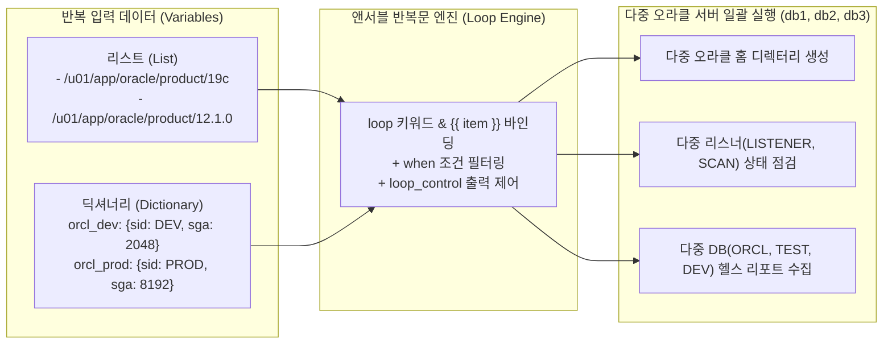

| 비교 항목 | 반복문 미사용 (태스크 복사·붙여넣기) | 반복문(`loop`) 사용 |
| :--- | :--- | :--- |
| **태스크 개수** | 대상 항목 수($N$개)만큼 태스크를 중복 작성 | **단 1개의 태스크**로 모든 항목 처리 |
| **코드 길이 및 가독성** | 항목이 늘어날수록 플레이북이 길어지고 가독성 저하 | 코드가 간결하며 작업 의도가 한눈에 파악됨 |
| **유지보수성** | 옵션 변경 시 $N$개의 태스크를 모두 수정해야 함 | 태스크 1곳 또는 변수 목록만 수정하면 즉시 반영 |
| **확장성** | 신규 DB나 디렉터리 추가 시 플레이북 코드 수정 필요 | 변수 리스트에 항목 1줄만 추가하면 자동 확장 |

이번 장에서는 기본 리스트·딕셔너리 반복(`dict2items`)부터 조건문(`when`) 결합, 다중 리스트 카테시안 곱(`product`), 출력 제어(`loop_control`), 반복 실행 결과 캡처(`register`와 `.results` 배열), 그리고 방어적 코딩 기법(`default` 필터)까지 `chapter_5` 실습 환경을 통해 완벽하게 마스터합니다.

---

## 2. 실습 아키텍처 및 컨테이너 환경 구성 (`chapter_5`)

Chapter 5의 모든 실습은 `chapter_5` 디렉터리에 구성된 4대의 도커 컨테이너 환경(`192.168.5.0/24` 대역)에서 진행합니다. 제어 노드(`ansible-control-ch5`)와 3대의 오라클 데이터베이스 서버(`db1`, `db2`, `db3`)로 구성되어 있으며, 각 대상 서버에는 `lsnrctl`과 `sqlplus` 시뮬레이터 및 진단 스크립트(`/scripts/health_report.sql`, `/scripts/health_check.sql`)가 내장되어 있습니다.

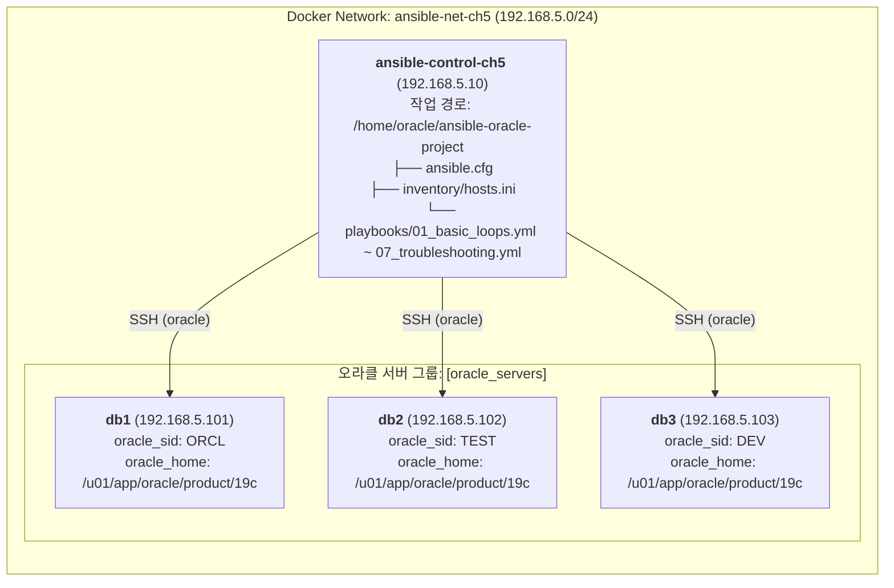

### 2.1 실습 컨테이너 기동 및 노드 연결성 점검 (실습 1)

호스트 터미널에서 `chapter_5` 디렉터리로 이동하여 컨테이너를 빌드 및 기동한 후, 제어 노드(`ansible-control-ch5`)에 접속합니다.

```bash
cd chapter_5
docker compose up -d --build
docker exec -it ansible-control-ch5 bash
```

제어 노드의 기본 작업 경로(`/home/oracle/ansible-oracle-project`)에 구성된 `inventory/hosts.ini` 파일의 내용을 확인하고, `ping` 모듈로 3대의 오라클 서버와 정상적으로 통신하는지 점검합니다.

```ini
# inventory/hosts.ini
[oracle_servers]
db1 ansible_host=db1 oracle_sid=ORCL oracle_home=/u01/app/oracle/product/19c
db2 ansible_host=db2 oracle_sid=TEST oracle_home=/u01/app/oracle/product/19c
db3 ansible_host=db3 oracle_sid=DEV  oracle_home=/u01/app/oracle/product/19c

[all:vars]
ansible_user=oracle
ansible_ssh_private_key_file=~/.ssh/id_rsa
```

```bash
[oracle@ansible-control ansible-oracle-project]$ ansible all -m ping
```

```text
db1 | SUCCESS => {
    "ansible_facts": {
        "discovered_interpreter_python": "/usr/bin/python3.9"
    },
    "changed": false,
    "ping": "pong"
}
db2 | SUCCESS => {
    "ansible_facts": {
        "discovered_interpreter_python": "/usr/bin/python3.9"
    },
    "changed": false,
    "ping": "pong"
}
db3 | SUCCESS => {
    "ansible_facts": {
        "discovered_interpreter_python": "/usr/bin/python3.9"
    },
    "changed": false,
    "ping": "pong"
}
```

---

## 3. 기본 반복문(`loop`)과 리스트·딕셔너리 순회

앤서블 2.5 버전부터 도입된 **`loop`** 키워드는 과거의 `with_items`를 대체하는 현대적인 표준 반복문 문법입니다. `loop:`에 리스트를 전달하면 앤서블은 리스트의 첫 번째 요소부터 마지막 요소까지 차례대로 꺼내어 기본 반복 변수인 **`{{ item }}`**에 바인딩한 뒤 태스크를 실행합니다.

### 3.1 문자열, 숫자, 리스트 변수 반복 (실습 2: `playbooks/01_basic_loops.yml`)

가장 기본적인 형태는 문자열 목록(서버 이름), 숫자 목록(리스너 포트 번호), 또는 `vars:`에 정의한 리스트 변수를 순회하는 것입니다. 제어 노드에서 `playbooks/01_basic_loops.yml`의 내용을 확인하고 실행해 봅니다.

```yaml
---
# playbooks/01_basic_loops.yml
- name: Practice basic loops (Strings, Numbers, Variables)
  hosts: localhost
  gather_facts: no
  vars:
    oracle_environments:
      - dev
      - test
      - prod
  tasks:
    - name: 1. Loop through string items
      ansible.builtin.debug:
        msg: "Processing target node: {{ item }}"
      loop:
        - db1
        - db2
        - db3

    - name: 2. Loop through numeric ports
      ansible.builtin.debug:
        msg: "Oracle Listener Port: {{ item }}"
      loop:
        - 1521
        - 1522
        - 1523

    - name: 3. Loop through variable list
      ansible.builtin.debug:
        msg: "Managing Environment: {{ item }}"
      loop: "{{ oracle_environments }}"
```

```bash
[oracle@ansible-control ansible-oracle-project]$ ansible-playbook playbooks/01_basic_loops.yml
```

```text
PLAY [Practice basic loops (Strings, Numbers, Variables)] **********************

TASK [1. Loop through string items] ********************************************
ok: [localhost] => (item=db1) => {
    "msg": "Processing target node: db1"
}
ok: [localhost] => (item=db2) => {
    "msg": "Processing target node: db2"
}
ok: [localhost] => (item=db3) => {
    "msg": "Processing target node: db3"
}

TASK [2. Loop through numeric ports] *******************************************
ok: [localhost] => (item=1521) => {
    "msg": "Oracle Listener Port: 1521"
}
ok: [localhost] => (item=1522) => {
    "msg": "Oracle Listener Port: 1522"
}
ok: [localhost] => (item=1523) => {
    "msg": "Oracle Listener Port: 1523"
}

TASK [3. Loop through variable list] *******************************************
ok: [localhost] => (item=dev) => {
    "msg": "Managing Environment: dev"
}
ok: [localhost] => (item=test) => {
    "msg": "Managing Environment: test"
}
ok: [localhost] => (item=prod) => {
    "msg": "Managing Environment: prod"
}

PLAY RECAP *********************************************************************
localhost                  : ok=3    changed=0    unreachable=0    failed=0    skipped=0    rescued=0    ignored=0   
```

### 3.2 딕셔너리 반복과 `dict2items` 필터 (실습 3: `playbooks/02_list_and_dict.yml`)

오라클 DBA 실무에서는 단순 문자열 리스트보다 데이터베이스별 IP 주소 매핑이나 인스턴스별 상세 스펙(`port`, `sid`, `sga_mb`)처럼 키-값 쌍으로 이루어진 **딕셔너리(Dictionary)** 데이터를 다루는 경우가 훨씬 많습니다.

`loop` 키워드는 기본적으로 리스트(배열)를 입력으로 받기 때문에, 딕셔너리를 순회할 때는 진자2(Jinja2)의 **`| dict2items`** 필터를 파이프로 연결해야 합니다. `dict2items` 필터는 딕셔너리의 각 항목을 `{'key': ..., 'value': ...}` 형태의 리스트로 자동 변환해 주며, 태스크 안에서는 **`{{ item.key }}`**와 **`{{ item.value }}`**로 접근할 수 있습니다.

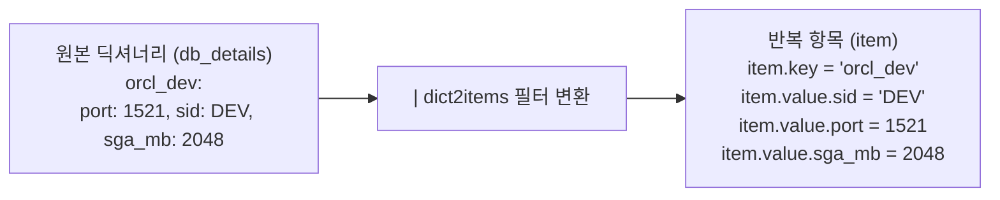

`playbooks/02_list_and_dict.yml` 파일을 확인하고 실행하여 단순 딕셔너리와 중첩 딕셔너리를 순회하는 방법을 검증합니다.

```yaml
---
# playbooks/02_list_and_dict.yml
- name: Practice list and dictionary loops
  hosts: localhost
  gather_facts: no
  vars:
    # 리스트 반복용 데이터
    db_services:
      - oracle-db
      - oracle-listener
      - oracle-cron

    # 1차원 딕셔너리 반복용 데이터
    db_instances:
      DEV: "192.168.5.101"
      TEST: "192.168.5.102"
      PROD: "192.168.5.103"

    # 중첩 딕셔너리(Nested Dictionary) 반복용 데이터
    db_details:
      orcl_dev:
        port: 1521
        sid: DEV
        sga_mb: 2048
      orcl_test:
        port: 1521
        sid: TEST
        sga_mb: 4096
      orcl_prod:
        port: 1521
        sid: PROD
        sga_mb: 8192

  tasks:
    - name: 1. Simple list loop
      ansible.builtin.debug:
        msg: "Checking service: {{ item }}"
      loop: "{{ db_services }}"

    - name: 2. Dictionary loop using dict2items
      ansible.builtin.debug:
        msg: "Database {{ item.key }} is hosted at {{ item.value }}"
      loop: "{{ db_instances | dict2items }}"

    - name: 3. Nested dictionary attribute access
      ansible.builtin.debug:
        msg: "Target {{ item.key }} -> SID: {{ item.value.sid }}, Port: {{ item.value.port }}, SGA: {{ item.value.sga_mb }}MB"
      loop: "{{ db_details | dict2items }}"
```

```bash
[oracle@ansible-control ansible-oracle-project]$ ansible-playbook playbooks/02_list_and_dict.yml
```

```text
PLAY [Practice list and dictionary loops] **************************************

TASK [1. Simple list loop] *****************************************************
ok: [localhost] => (item=oracle-db) => {
    "msg": "Checking service: oracle-db"
}
ok: [localhost] => (item=oracle-listener) => {
    "msg": "Checking service: oracle-listener"
}
ok: [localhost] => (item=oracle-cron) => {
    "msg": "Checking service: oracle-cron"
}

TASK [2. Dictionary loop using dict2items] *************************************
ok: [localhost] => (item={'key': 'DEV', 'value': '192.168.5.101'}) => {
    "msg": "Database DEV is hosted at 192.168.5.101"
}
ok: [localhost] => (item={'key': 'TEST', 'value': '192.168.5.102'}) => {
    "msg": "Database TEST is hosted at 192.168.5.102"
}
ok: [localhost] => (item={'key': 'PROD', 'value': '192.168.5.103'}) => {
    "msg": "Database PROD is hosted at 192.168.5.103"
}

TASK [3. Nested dictionary attribute access] ***********************************
ok: [localhost] => (item={'key': 'orcl_dev', 'value': {'port': 1521, 'sid': 'DEV', 'sga_mb': 2048}}) => {
    "msg": "Target orcl_dev -> SID: DEV, Port: 1521, SGA: 2048MB"
}
ok: [localhost] => (item={'key': 'orcl_test', 'value': {'port': 1521, 'sid': 'TEST', 'sga_mb': 4096}}) => {
    "msg": "Target orcl_test -> SID: TEST, Port: 1521, SGA: 4096MB"
}
ok: [localhost] => (item={'key': 'orcl_prod', 'value': {'port': 1521, 'sid': 'PROD', 'sga_mb': 8192}}) => {
    "msg": "Target orcl_prod -> SID: PROD, Port: 1521, SGA: 8192MB"
}

PLAY RECAP *********************************************************************
localhost                  : ok=3    changed=0    unreachable=0    failed=0    skipped=0    rescued=0    ignored=0   
```

---

## 4. 앤서블 핵심 모듈과 반복문의 결합 패턴 및 성능 최적화

반복문은 `file`, `copy`, `user`, `service`, `dnf`/`yum`, `shell` 등 모든 앤서블 모듈과 결합하여 사용할 수 있습니다. 이때 모듈의 특성에 따라 알아두어야 할 실무 주의사항이 있습니다.

### 4.1 모듈별 반복문 활용 표준 패턴

```yaml
    # 1. file 모듈: 여러 오라클 디렉터리 일괄 생성
    - name: Create multiple backup directories
      ansible.builtin.file:
        path: "{{ item }}"
        state: directory
        owner: oracle
        group: oinstall
        mode: '0755'
      loop:
        - /backup/prod
        - /backup/test
        - /backup/dev

    # 2. copy 모듈: 여러 SQL 및 셸 스크립트 일괄 배포
    - name: Deploy DBA scripts to remote server
      ansible.builtin.copy:
        src: "{{ item }}"
        dest: /u01/app/oracle/scripts/
        owner: oracle
        group: oinstall
        mode: '0750'
      loop:
        - health_check.sql
        - rman_backup.sh
        - tablespace_alert.sql

    # 3. service 모듈: 딕셔너리 리스트를 순회하며 서비스 상태 차등 제어
    - name: Manage multiple services with target state
      ansible.builtin.service:
        name: "{{ item.name }}"
        state: "{{ item.state }}"
      loop:
        - { name: "oracle-listener", state: "started" }
        - { name: "oracle-db", state: "started" }
```

> ⚠️ **주의(Caution): `service` 모듈의 `state` 값과 `user` 모듈의 비밀번호 해시 규칙**
> 1. `ansible.builtin.service` 모듈의 `state` 파라미터에는 `start`나 `stop`이라는 동사 원형이 아니라 **`started`, `stopped`, `restarted`, `reloaded`** 같은 과거분사형 상태 값을 지정해야 합니다.
> 2. `ansible.builtin.user` 모듈과 반복문을 결합하여 여러 OS 계정을 생성할 때 `password:` 속성에 평문 비밀번호(예: `"pass1"`)를 그대로 넣으면 리눅스 `/etc/shadow`에 해시되지 않은 문자열이 들어가 로그인이 불가능해집니다. 반드시 `password: "{{ item.password | password_hash('sha512') }}"` 필터를 적용하고, 비밀번호 원문은 앤서블 볼트(`ansible-vault`)로 암호화해야 합니다.

> 💡 **노트(Note): 패키지 설치 모듈(`dnf` / `yum`)에서는 `loop` 대신 리스트 직접 전달이 훨씬 빠릅니다!**
> `oracle-database-preinstall-19c`, `unzip`, `wget`, `net-tools` 등 여러 RPM 패키지를 설치할 때 `loop:`를 사용하면 패키지마다 `dnf` 트랜잭션을 개별 실행하므로 시간이 오래 걸립니다. `dnf`와 `yum` 모듈은 `name:` 파라미터에 리스트를 직접 받는 기능을 지원하므로, 아래와 같이 작성하면 **단 한 번의 트랜잭션**으로 모든 패키지를 초고속 설치합니다.
> ```yaml
>     - name: Install required packages in a single transaction (Fastest)
>       ansible.builtin.dnf:
>         name:
>           - oracle-database-preinstall-19c
>           - unzip
>           - wget
>           - net-tools
>         state: present
> ```

---

## 5. 조건문(`when`) 결합과 고급 반복문 패턴

반복문에 조건문(`when`)이나 중첩 반복 필터(`product`, `subelements`), 그리고 반복 제어자(`loop_control`)를 결합하면 정교한 DBA 워크플로를 구현할 수 있습니다.

### 5.1 반복문과 `when` 조건의 결합 동작 원리 (실습 4: `playbooks/03_loop_when.yml`)

하나의 태스크에 `loop:`와 `when:`을 함께 작성하면 어떻게 동작할까요? 앤서블은 태스크 전체를 건너뛰는 것이 아니라, **반복문의 개별 항목(`item`)마다 `when:` 조건식을 일일이 평가**합니다. 조건이 참(`true`)인 항목만 실행하고 거짓(`false`)인 항목은 건너뜁니다(`skipping`).

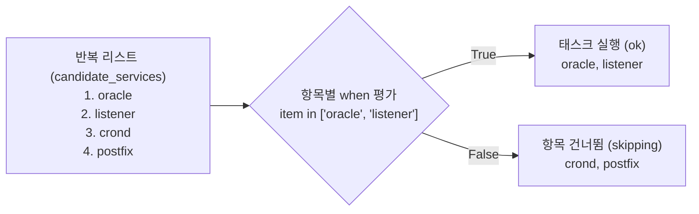

`playbooks/03_loop_when.yml` 파일을 실행하여 리스트 포함 여부(`in`) 조건과 딕셔너리 속성(`item.status == 'active'`) 조건이 각 항목을 어떻게 필터링하는지 확인합니다.

```yaml
---
# playbooks/03_loop_when.yml
- name: Practice loops combined with when conditions
  hosts: localhost
  gather_facts: no
  vars:
    candidate_services:
      - oracle
      - listener
      - crond
      - postfix

    db_environments:
      - dev
      - test
      - staging
      - prod

    dba_users:
      - name: ora_admin
        status: active
        role: dba
      - name: test_user
        status: inactive
        role: developer
      - name: sec_auditor
        status: active
        role: auditor

  tasks:
    - name: 1. Filter services using 'in' condition
      ansible.builtin.debug:
        msg: "Oracle core service identified: {{ item }}"
      loop: "{{ candidate_services }}"
      when: item in ['oracle', 'listener']

    - name: 2. Filter environments (prod and test only)
      ansible.builtin.debug:
        msg: "Executing critical maintenance for: {{ item }}"
      loop: "{{ db_environments }}"
      when: item in ['prod', 'test']

    - name: 3. Filter dictionary items by attribute status == active
      ansible.builtin.debug:
        msg: "Provisioning user '{{ item.name }}' with role '{{ item.role }}'"
      loop: "{{ dba_users }}"
      when: item.status == 'active'
```

```bash
[oracle@ansible-control ansible-oracle-project]$ ansible-playbook playbooks/03_loop_when.yml
```

```text
PLAY [Practice loops combined with when conditions] ****************************

TASK [1. Filter services using 'in' condition] *********************************
ok: [localhost] => (item=oracle) => {
    "msg": "Oracle core service identified: oracle"
}
ok: [localhost] => (item=listener) => {
    "msg": "Oracle core service identified: listener"
}
skipping: [localhost] => (item=crond) 
skipping: [localhost] => (item=postfix) 

TASK [2. Filter environments (prod and test only)] *****************************
skipping: [localhost] => (item=dev) 
ok: [localhost] => (item=test) => {
    "msg": "Executing critical maintenance for: test"
}
skipping: [localhost] => (item=staging) 
ok: [localhost] => (item=prod) => {
    "msg": "Executing critical maintenance for: prod"
}

TASK [3. Filter dictionary items by attribute status == active] ****************
ok: [localhost] => (item={'name': 'ora_admin', 'status': 'active', 'role': 'dba'}) => {
    "msg": "Provisioning user 'ora_admin' with role 'dba'"
}
skipping: [localhost] => (item={'name': 'test_user', 'status': 'inactive', 'role': 'developer'}) 
ok: [localhost] => (item={'name': 'sec_auditor', 'status': 'active', 'role': 'auditor'}) => {
    "msg": "Provisioning user 'sec_auditor' with role 'auditor'"
}

PLAY RECAP *********************************************************************
localhost                  : ok=3    changed=0    unreachable=0    failed=0    skipped=0    rescued=0    ignored=0   
```

### 5.2 중첩 반복문(`product`, `subelements`)과 `loop_control`

두 개 이상의 리스트를 조합하여 다차원 디렉터리 구조(예: `/backup/<환경>/<DB이름>`)를 만들거나, 사용자별 다중 권한(`roles`)을 부여할 때는 다음 고급 패턴을 사용합니다.

| 패턴 구분 | 문법 표현식 | 항목 참조 방법 | 오라클 DBA 주요 활용 사례 |
| :--- | :--- | :--- | :--- |
| **다중 리스트 조합 (Cartesian Product)** | `loop: "{{ envs \| product(dbs) \| list }}"` | 첫 번째 리스트: `{{ item.0 }}`<br/>두 번째 리스트: `{{ item.1 }}` | 환경(`dev`, `prod`) × DB(`orcl`, `hr`) 조합으로 `/backup/{{ item.0 }}/{{ item.1 }}` 생성 |
| **하위 리스트 순회 (Subelements)** | `loop: "{{ users \| subelements('roles') }}"` | 상위 객체: `{{ item.0.name }}`<br/>하위 리스트 요소: `{{ item.1 }}` | 여러 DBA 계정(`dba1`, `dba2`)에 각각 여러 DB 롤(`dba`, `backup`)을 반복 부여 |
| **출력 레이블 및 인덱스 제어 (`loop_control`)** | `loop_control:`<br/>`  label: "{{ item.name }}"`<br/>`  index_var: idx` | 현재 인덱스(0부터 시작): `{{ idx }}` | 거대한 딕셔너리나 `register.results`를 순회할 때 콘솔 출력 폭주를 막고 핵심 식별자만 깔끔하게 표시 |

```yaml
    # 1. product 필터를 활용한 중첩 반복문 (환경 x 데이터베이스 백업 디렉터리 생성)
    - name: Create multi-dimensional backup directories
      ansible.builtin.file:
        path: "/backup/{{ item.0 }}/{{ item.1 }}"
        state: directory
        mode: '0755'
      vars:
        envs: ["dev", "test", "prod"]
        dbs: ["orcl", "hr"]
      loop: "{{ envs | product(dbs) | list }}"

    # 2. loop_control을 활용한 콘솔 출력 정돈 및 순번(index_var) 추적
    - name: Check multiple listeners with clean output label
      ansible.builtin.shell: "lsnrctl status {{ item }}"
      loop:
        - LISTENER
        - LISTENER_SCAN1
      loop_control:
        index_var: lsnr_idx
        label: "[{{ lsnr_idx + 1 }}] Listener: {{ item }}"
```

> 💡 **노트(Note): 왜 실무에서 `loop_control.label`이 필수적인가요?**
> 딕셔너리 리스트나 `register`된 결과 배열(`results`)을 `loop`로 순회하면, 앤서블은 기본적으로 각 반복마다 해당 딕셔너리 전체 내용(`stdout`, `stderr`, `cmd` 등 수십 줄)을 화면의 `(item={...})` 영역에 전부 쏟아냅니다. 이때 `loop_control:` 아래에 `label: "{{ item.item }}"`처럼 핵심 이름만 지정하면 콘솔 로그가 한 줄로 깔끔하게 요약되며, 딕셔너리 안에 포함된 민감 정보가 화면에 노출되는 것도 방지할 수 있습니다.

---

## 6. 오라클 DBA 실무 활용 주의사항 및 방어적 코딩

본격적인 마스터 프로젝트 실습에 앞서, 오라클 다중 DB 스크립트 실행 및 딕셔너리 반복 시 자주 겪는 트러블슈팅 포인트를 짚어 봅니다.

### 6.1 다중 DB SQL 스크립트 실행 시 `{{ item }}` 바인딩 누락 주의

여러 데이터베이스(`ORCL`, `TEST`, `DEV`)를 대상으로 SQL*Plus 스크립트를 반복 실행할 때, 명령줄 안에서 `{{ item }}`을 실제로 사용하지 않으면 똑같은 기본 DB에 대해서만 스크립트가 3번 중복 실행되는 실수가 발생합니다. 반드시 아래와 같이 **`ORACLE_SID={{ item }}`으로 환경변수를 전환**하거나 **스크립트 인자로 `{{ item }}`을 전달**해야 합니다.

```yaml
    # 올바른 다중 DB SQL 실행: ORACLE_SID에 {{ item }}을 바인딩하고 스크립트 인자로도 전달
    - name: Execute health check SQL on each database instance
      ansible.builtin.shell: |
        export ORACLE_HOME=/u01/app/oracle/product/19c
        export ORACLE_SID={{ item }}
        $ORACLE_HOME/bin/sqlplus -s / as sysdba @/scripts/health_check.sql {{ item }}
      loop:
        - ORCL
        - TEST
        - DEV
```

> ⚠️ **주의(Caution): `dba_tablespace_usage_metrics` 뷰 조회 시 단위 주의**
> 오라클의 `dba_tablespace_usage_metrics` 뷰에 있는 `tablespace_size`와 `used_space` 컬럼은 바이트(`Bytes`)가 아니라 **오라클 블록 수(`Blocks`)** 단위입니다. 따라서 기가바이트(GB) 단위로 사용량을 계산하려면 `v$parameter`의 `db_block_size`(보통 8192 바이트)를 곱하거나, 바이트 단위를 직접 제공하는 `dba_data_files` 및 `dba_free_space` 뷰를 조인하여 조회해야 정확한 용량이 산출됩니다.

### 6.2 방어적 반복문 패턴: `default` 필터와 `is defined` 검증 (실습 8: `playbooks/07_troubleshooting.yml`)

여러 대의 DB 정보를 담은 딕셔너리 리스트를 순회할 때, 특정 항목(예: 신규 추가된 `DEV` DB)에 `role` 키가 누락되어 있으면 앤서블은 `'dict object' has no attribute 'role'`이라는 치명적 오류를 내며 멈춰 버립니다.

이를 방지하는 두 가지 방어적 코딩 기법이 `playbooks/07_troubleshooting.yml`에 구현되어 있습니다.

1. **`{{ item.role | default('UNKNOWN') }}`**: 해당 키가 없을 때 에러를 내는 대신 지정한 기본값(`'UNKNOWN'`)으로 안전하게 대체합니다.
2. **`when: item.role is defined`**: 해당 키가 정의된 항목만 골라서 실행하고, 키가 누락된 항목은 에러 없이 건너뜁니다(`skipping`).

```yaml
---
# playbooks/07_troubleshooting.yml
- name: Practice troubleshooting and defensive loop patterns
  hosts: localhost
  gather_facts: no
  vars:
    # 안전한 기본값(default) 및 검증 테스트
    safe_db_list:
      - SID: ORCL
        role: PRIMARY
      - SID: TEST
        role: STANDBY
      - SID: DEV
        # role 키가 의도적으로 누락된 경우

  tasks:
    - name: 1. Validate list definition before loop execution
      ansible.builtin.debug:
        msg: "Processing DB: {{ item.SID }} (Role: {{ item.role | default('UNKNOWN') }})"
      loop: "{{ safe_db_list }}"
      loop_control:
        label: "SID: {{ item.SID }}"

    - name: 2. Demonstrate safe dictionary key access with default filter
      ansible.builtin.debug:
        msg: "DB {{ item.SID }} is running with role {{ item.role | default('STANDBY_DEFAULT') }}"
      loop: "{{ safe_db_list }}"
      when: item.role is defined
```

제어 노드에서 `playbooks/07_troubleshooting.yml`을 실행하여 결과를 확인합니다.

```bash
[oracle@ansible-control ansible-oracle-project]$ ansible-playbook playbooks/07_troubleshooting.yml
```

```text
PLAY [Practice troubleshooting and defensive loop patterns] ********************

TASK [1. Validate list definition before loop execution] ***********************
ok: [localhost] => (item=SID: ORCL) => {
    "msg": "Processing DB: ORCL (Role: PRIMARY)"
}
ok: [localhost] => (item=SID: TEST) => {
    "msg": "Processing DB: TEST (Role: STANDBY)"
}
ok: [localhost] => (item=SID: DEV) => {
    "msg": "Processing DB: DEV (Role: UNKNOWN)"
}

TASK [2. Demonstrate safe dictionary key access with default filter] ***********
ok: [localhost] => (item={'SID': 'ORCL', 'role': 'PRIMARY'}) => {
    "msg": "DB ORCL is running with role PRIMARY"
}
ok: [localhost] => (item={'SID': 'TEST', 'role': 'STANDBY'}) => {
    "msg": "DB TEST is running with role STANDBY"
}
skipping: [localhost] => (item={'SID': 'DEV'}) 

PLAY RECAP *********************************************************************
localhost                  : ok=2    changed=0    unreachable=0    failed=0    skipped=0    rescued=0    ignored=0   
```

첫 번째 태스크에서는 `DEV` 항목의 누락된 `role`이 `default('UNKNOWN')`에 의해 `UNKNOWN`으로 안전하게 출력되었고, 두 번째 태스크에서는 `when: item.role is defined` 조건에 의해 `DEV` 항목만 깔끔하게 건너뛰어(`skipping`) 플레이북이 중단 없이 완료되었습니다.

---

## 7. 마스터 프로젝트: 반복문 기반 다중 오라클 서버 운영 및 헬스 리포트 수집 자동화

이제 3대의 원격 오라클 서버(`db1`, `db2`, `db3`)를 대상으로 멀티 오라클 홈 디렉터리 일괄 생성(`04_master_create_dirs.yml`), 다중 리스너 상태 점검(`05_check_listeners.yml`), 그리고 다중 DB 헬스 리포트 생성 및 파일 검증(`06_collect_reports.yml`)을 수행하는 마스터 프로젝트를 진행합니다.

### 7.1 Step 1: 멀티 오라클 홈 디렉터리 일괄 생성 (`playbooks/04_master_create_dirs.yml`)

각 오라클 서버에 `19c`와 `12.1.0` 두 개의 오라클 홈이 존재할 때, 각 홈 아래에 `admin/scripts` 디렉터리를 일괄 생성하는 플레이북입니다.

```yaml
---
# playbooks/04_master_create_dirs.yml
- name: Master Project - Create directories on multiple Oracle homes
  hosts: oracle_servers
  gather_facts: no
  vars:
    oracle_homes:
      - /u01/app/oracle/product/19c
      - /u01/app/oracle/product/12.1.0
  tasks:
    - name: Create admin and scripts directory structure using loop
      ansible.builtin.file:
        path: "{{ item }}/admin/scripts"
        state: directory
        owner: oracle
        group: oinstall
        mode: '0755'
      loop: "{{ oracle_homes }}"
```

#### (1) 문법 검사(`--syntax-check`) 및 드라이 런(`--check`)

```bash
[oracle@ansible-control ansible-oracle-project]$ ansible-playbook --syntax-check playbooks/04_master_create_dirs.yml
[oracle@ansible-control ansible-oracle-project]$ ansible-playbook --check playbooks/04_master_create_dirs.yml
```

```text
PLAY [Master Project - Create directories on multiple Oracle homes] ************

TASK [Create admin and scripts directory structure using loop] *****************
changed: [db1] => (item=/u01/app/oracle/product/19c)
changed: [db2] => (item=/u01/app/oracle/product/19c)
changed: [db3] => (item=/u01/app/oracle/product/19c)
changed: [db1] => (item=/u01/app/oracle/product/12.1.0)
changed: [db2] => (item=/u01/app/oracle/product/12.1.0)
changed: [db3] => (item=/u01/app/oracle/product/12.1.0)

PLAY RECAP *********************************************************************
db1                        : ok=1    changed=1    unreachable=0    failed=0    skipped=0    rescued=0    ignored=0   
db2                        : ok=1    changed=1    unreachable=0    failed=0    skipped=0    rescued=0    ignored=0   
db3                        : ok=1    changed=1    unreachable=0    failed=0    skipped=0    rescued=0    ignored=0   
```

#### (2) 실제 배포 실행, 디렉터리 권한 확인 및 멱등성 재검증

```bash
# 1. 실제 디렉터리 일괄 생성
[oracle@ansible-control ansible-oracle-project]$ ansible-playbook playbooks/04_master_create_dirs.yml

# 2. 애드혹 명령으로 3대 서버에 생성된 디렉터리 확인
[oracle@ansible-control ansible-oracle-project]$ ansible oracle_servers -m shell -a "ls -ld /u01/app/oracle/product/*/admin/scripts"
```

```text
db1 | CHANGED | rc=0 >>
drwxr-xr-x 2 oracle oinstall 4096 Oct 10 04:36 /u01/app/oracle/product/12.1.0/admin/scripts
drwxr-xr-x 2 oracle oinstall 4096 Oct 10 04:36 /u01/app/oracle/product/19c/admin/scripts
db2 | CHANGED | rc=0 >>
drwxr-xr-x 2 oracle oinstall 4096 Oct 10 04:36 /u01/app/oracle/product/12.1.0/admin/scripts
drwxr-xr-x 2 oracle oinstall 4096 Oct 10 04:36 /u01/app/oracle/product/19c/admin/scripts
db3 | CHANGED | rc=0 >>
drwxr-xr-x 2 oracle oinstall 4096 Oct 10 04:36 /u01/app/oracle/product/12.1.0/admin/scripts
drwxr-xr-x 2 oracle oinstall 4096 Oct 10 04:36 /u01/app/oracle/product/19c/admin/scripts
```

동일한 플레이북을 한 번 더 실행하면 이미 디렉터리가 모두 존재하므로 3대 서버 모두 **`changed=0`**으로 멱등성이 완벽히 보장되는 것을 확인할 수 있습니다.

### 7.2 Step 2: 다중 리스너 상태 점검 및 `register.results` 파싱 (`playbooks/05_check_listeners.yml`)

이번에는 각 서버에서 로컬 리스너(`LISTENER`)와 SCAN 리스너(`LISTENER_SCAN1`)의 상태를 `loop`로 점검하고, **`register: listener_results`**에 저장된 `.results` 배열을 순회하며 서버별·리스너별 반환 코드(`item.rc`)와 상태를 한 줄 요약으로 출력합니다.

```yaml
---
# playbooks/05_check_listeners.yml
- name: Master Project - Check listener status and register output
  hosts: oracle_servers
  gather_facts: no
  vars:
    listeners:
      - LISTENER
      - LISTENER_SCAN1
  tasks:
    - name: Check listener status using loop and register
      ansible.builtin.shell: "lsnrctl status {{ item }}"
      register: listener_results
      loop: "{{ listeners }}"
      loop_control:
        label: "Checking Listener: {{ item }}"

    - name: Display summary of listener status results
      ansible.builtin.debug:
        msg: "Host: {{ inventory_hostname }} | Target: {{ item.item }} | RC: {{ item.rc }} | Status: {{ 'OK' if item.rc == 0 else 'FAILED' }}"
      loop: "{{ listener_results.results }}"
      loop_control:
        label: "{{ item.item }}"
```

```bash
[oracle@ansible-control ansible-oracle-project]$ ansible-playbook playbooks/05_check_listeners.yml
```

```text
PLAY [Master Project - Check listener status and register output] **************

TASK [Check listener status using loop and register] ***************************
changed: [db1] => (item=Checking Listener: LISTENER)
changed: [db3] => (item=Checking Listener: LISTENER)
changed: [db2] => (item=Checking Listener: LISTENER)
changed: [db2] => (item=Checking Listener: LISTENER_SCAN1)
changed: [db1] => (item=Checking Listener: LISTENER_SCAN1)
changed: [db3] => (item=Checking Listener: LISTENER_SCAN1)

TASK [Display summary of listener status results] ******************************
ok: [db1] => (item=LISTENER) => {
    "msg": "Host: db1 | Target: LISTENER | RC: 0 | Status: OK"
}
ok: [db1] => (item=LISTENER_SCAN1) => {
    "msg": "Host: db1 | Target: LISTENER_SCAN1 | RC: 0 | Status: OK"
}
ok: [db2] => (item=LISTENER) => {
    "msg": "Host: db2 | Target: LISTENER | RC: 0 | Status: OK"
}
ok: [db2] => (item=LISTENER_SCAN1) => {
    "msg": "Host: db2 | Target: LISTENER_SCAN1 | RC: 0 | Status: OK"
}
ok: [db3] => (item=LISTENER) => {
    "msg": "Host: db3 | Target: LISTENER | RC: 0 | Status: OK"
}
ok: [db3] => (item=LISTENER_SCAN1) => {
    "msg": "Host: db3 | Target: LISTENER_SCAN1 | RC: 0 | Status: OK"
}

PLAY RECAP *********************************************************************
db1                        : ok=2    changed=1    unreachable=0    failed=0    skipped=0    rescued=0    ignored=0   
db2                        : ok=2    changed=1    unreachable=0    failed=0    skipped=0    rescued=0    ignored=0   
db3                        : ok=2    changed=1    unreachable=0    failed=0    skipped=0    rescued=0    ignored=0   
```

### 7.3 Step 3: 다중 DB 헬스 리포트 생성 및 `stat` 검증 (`playbooks/06_collect_reports.yml`)

마지막으로 3대의 서버에서 3개의 데이터베이스(`ORCL`, `TEST`, `DEV`)에 대해 `sqlplus` 헬스 리포트 스크립트(`/scripts/health_report.sql`)를 실행하여 `/tmp/health_<DB>.log` 파일을 생성하고, `ansible.builtin.stat` 모듈과 반복문으로 생성된 9개 리포트 파일의 존재 여부(`item.stat.exists`)와 파일 크기(`item.stat.size`)를 자동 검증합니다.

```yaml
---
# playbooks/06_collect_reports.yml
- name: Master Project - Collect health reports from multiple databases
  hosts: oracle_servers
  gather_facts: no
  vars:
    target_dbs:
      - ORCL
      - TEST
      - DEV
  tasks:
    - name: Generate health reports via sqlplus execution loop
      ansible.builtin.shell: |
        /usr/local/bin/sqlplus -s / as sysdba @/scripts/health_report.sql {{ item }} > /tmp/health_{{ item }}.log
      loop: "{{ target_dbs }}"
      loop_control:
        label: "Generating report for DB: {{ item }}"

    - name: Verify generated report log files
      ansible.builtin.stat:
        path: "/tmp/health_{{ item }}.log"
      register: report_files
      loop: "{{ target_dbs }}"
      loop_control:
        label: "/tmp/health_{{ item }}.log"

    - name: Display report file status and sizes
      ansible.builtin.debug:
        msg: "Server: {{ inventory_hostname }} | File: {{ item.stat.path }} | Exists: {{ item.stat.exists }} | Size: {{ item.stat.size }} bytes"
      loop: "{{ report_files.results }}"
      loop_control:
        label: "{{ item.item }}"
```

```bash
[oracle@ansible-control ansible-oracle-project]$ ansible-playbook playbooks/06_collect_reports.yml
```

```text
PLAY [Master Project - Collect health reports from multiple databases] *********

TASK [Generate health reports via sqlplus execution loop] **********************
changed: [db2] => (item=Generating report for DB: ORCL)
changed: [db3] => (item=Generating report for DB: ORCL)
changed: [db1] => (item=Generating report for DB: ORCL)
changed: [db3] => (item=Generating report for DB: TEST)
changed: [db2] => (item=Generating report for DB: TEST)
changed: [db1] => (item=Generating report for DB: TEST)
changed: [db3] => (item=Generating report for DB: DEV)
changed: [db2] => (item=Generating report for DB: DEV)
changed: [db1] => (item=Generating report for DB: DEV)

TASK [Verify generated report log files] ***************************************
ok: [db2] => (item=/tmp/health_ORCL.log)
ok: [db1] => (item=/tmp/health_ORCL.log)
ok: [db3] => (item=/tmp/health_ORCL.log)
ok: [db2] => (item=/tmp/health_TEST.log)
ok: [db3] => (item=/tmp/health_TEST.log)
ok: [db1] => (item=/tmp/health_TEST.log)
ok: [db2] => (item=/tmp/health_DEV.log)
ok: [db3] => (item=/tmp/health_DEV.log)
ok: [db1] => (item=/tmp/health_DEV.log)

TASK [Display report file status and sizes] ************************************
ok: [db1] => (item=ORCL) => {
    "msg": "Server: db1 | File: /tmp/health_ORCL.log | Exists: True | Size: 570 bytes"
}
ok: [db1] => (item=TEST) => {
    "msg": "Server: db1 | File: /tmp/health_TEST.log | Exists: True | Size: 570 bytes"
}
ok: [db1] => (item=DEV) => {
    "msg": "Server: db1 | File: /tmp/health_DEV.log | Exists: True | Size: 569 bytes"
}
... (db2, db3 결과 동일) ...

PLAY RECAP *********************************************************************
db1                        : ok=3    changed=1    unreachable=0    failed=0    skipped=0    rescued=0    ignored=0   
db2                        : ok=3    changed=1    unreachable=0    failed=0    skipped=0    rescued=0    ignored=0   
db3                        : ok=3    changed=1    unreachable=0    failed=0    skipped=0    rescued=0    ignored=0   
```

이제 원격 서버들에 실제로 생성된 `/tmp/health_ORCL.log` 리포트의 내용을 확인해 봅니다.

```bash
[oracle@ansible-control ansible-oracle-project]$ ansible oracle_servers -m shell -a "cat /tmp/health_ORCL.log"
```

```text
db1 | CHANGED | rc=0 >>
==========================================================
ORACLE INSTANCE HEALTH REPORT - 2026-10-10 04:37:27
Database Name   : ORCL
Instance Status : OPEN (READ WRITE)
Database Role   : PRIMARY
Log Mode        : ARCHIVELOG
Active Sessions : 14
SGA Total Size  : 4096 MB (Used: 2150 MB, Free: 1946 MB)
Tablespace Info : SYSTEM (42%), SYSAUX (55%), USERS (18%)
Listener Status : LISTENER (PORT 1521) - READY
Alert Log Status: 0 ORA- errors detected in last 24h
Health Status   : HEALTHY (PASSED ALL DBA CHECKS)
==========================================================
```

실습을 모두 마쳤다면 제어 노드를 종료하고 도커 컨테이너를 정리합니다.

```bash
exit
docker compose down -v
```

---

## 핵심 요약

1. **단일 태스크로 다중 객체 일괄 처리**: `loop` 키워드와 `{{ item }}` 변수를 사용하면 다중 오라클 홈 디렉터리, 다중 리스너, 다중 DB 인스턴스에 대한 반복 코드를 제거하고 플레이북의 유지보수성을 극대화할 수 있습니다.
2. **딕셔너리 순회 (`| dict2items`)**: 키-값 구조의 딕셔너리 변수는 `loop: "{{ dict_var | dict2items }}"` 필터로 변환하여 `{{ item.key }}`와 `{{ item.value }}`로 참조합니다.
3. **항목별 조건 필터링 (`loop` + `when`)**: 반복문과 `when`을 함께 사용하면 전체 태스크가 아닌 개별 반복 항목(`item`)마다 조건을 평가하여 일치하는 대상만 선택적으로 실행합니다.
4. **반복 결과 캡처와 출력 제어 (`register.results` & `loop_control`)**: 반복 태스크에 `register`를 지정하면 각 항목의 실행 결과가 `<변수명>.results` 리스트에 저장되며, `loop_control: label:`을 사용하면 콘솔 출력 폭주를 방지할 수 있습니다.
5. **방어적 반복문 코딩**: 딕셔너리 리스트에서 특정 키가 누락될 가능성에 대비하여 `{{ item.attr | default('기본값') }}` 필터나 `when: item.attr is defined` 조건을 습관화하면 런타임 중단 사고를 예방할 수 있습니다.


---

# Chapter 6. 오라클 DBA를 위한 앤서블 조건문(Conditions): 상태 인식형 지능화 운영

<!-- [Style Guide Mapping]
- 본문 / 표 / 캡션 / 영문 기술 용어: Noto Sans KR
- 장/절 제목 (Heading 1~4): Noto Sans KR Bold
- 코드 블록 (YAML, INI, Bash, SQL, Console Output): DejaVu Sans Mono
- 수식 기호 / 변수: Cambria Math
-->

## 1. 왜 오라클 DBA에게 조건문(Conditions)이 필수적인가?

오라클 데이터베이스 운영 환경에서는 모든 서버에 똑같은 명령을 무조건 실행해서는 안 됩니다. 이미 정상적으로 열려(`READ WRITE`) 서비스 중인 운영 데이터베이스에 `STARTUP` 명령을 날리거나, 이미 가동 중인 리스너에 `lsnrctl start`를 실행하거나, 오라클 데이터 가드(Oracle Data Guard)의 스탠바이(Standby) DB에서 프라이머리(Primary) 전용 백업·패치 스크립트를 실행하면 불필요한 에러나 서비스 장애가 발생할 수 있습니다.

앤서블의 **조건문(Conditions)**은 **`when`** 키워드를 사용하여 대상 서버의 실시간 상태, 운영체제 및 하드웨어 사양, 또는 환경 변수 조건이 **참(`True`)일 때만 태스크를 실행**하고 거짓(`False`)이면 안전하게 건너뛰도록(`skipping`) 제어하는 핵심 장치입니다.

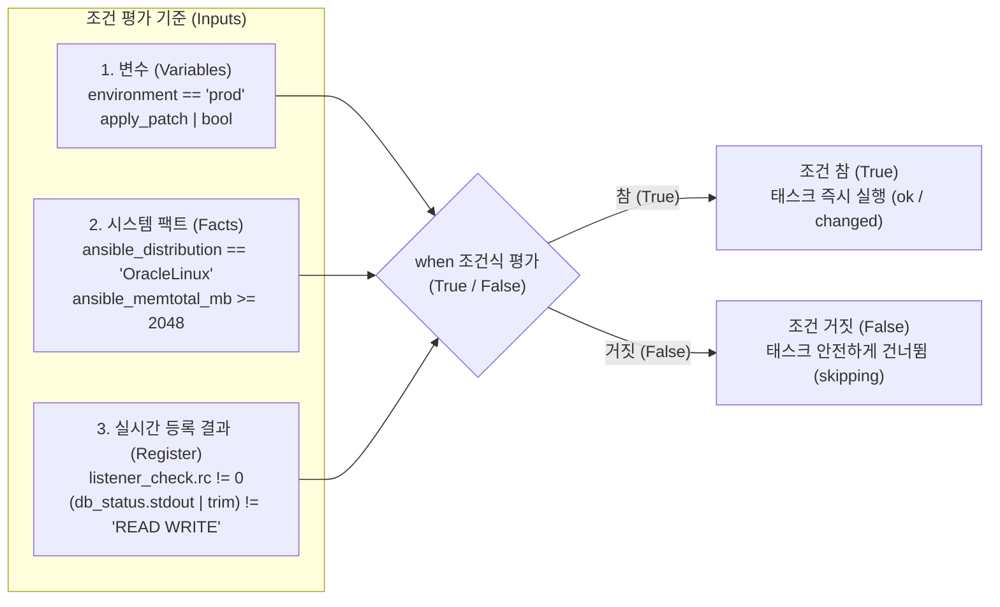

이번 장에서는 `when` 조건문의 기본 문법부터 시스템 팩트(`ansible_facts`) 활용, 문자열·숫자 비교와 논리 연산자(`and`, `or`, `not`), **선 확인 후 조치(Check-then-Act) 2단계 패턴**, 방어적 조건문 작성법(`is defined`, `default`), 그리고 모듈식 태스크 분리(`import_tasks`) 기반의 마스터 프로젝트까지 `chapter_6` 실습 환경을 통해 완벽하게 마스터합니다.

---

## 2. 실습 아키텍처 및 컨테이너 환경 구성 (`chapter_6`)

Chapter 6의 모든 실습은 `chapter_6` 디렉터리에 구성된 3대의 도커 컨테이너 환경(`192.168.6.0/24` 대역)에서 진행합니다. 조건 분기 동작을 명확하게 검증할 수 있도록 두 대의 오라클 관리 대상 서버(`db01`, `db02`)의 초기 상태가 서로 다르게 설계되어 있습니다.

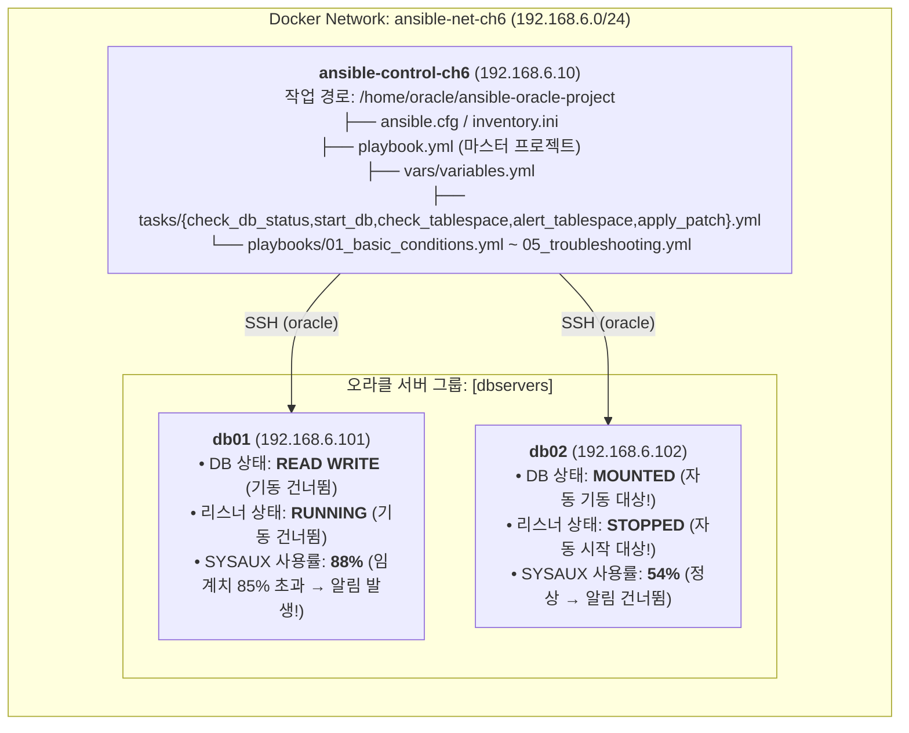

### 2.1 실습 컨테이너 기동 및 노드 연결성 점검 (실습 1)

터미널에서 `chapter_6` 디렉터리로 이동하여 컨테이너를 빌드 및 기동한 후, 제어 노드(`ansible-control-ch6`)에 접속합니다.

```bash
cd chapter_6
docker compose up -d --build
docker exec -it ansible-control-ch6 bash
```

제어 노드의 기본 작업 디렉터리(`/home/oracle/ansible-oracle-project`)에서 `inventory.ini` 설정을 확인하고 `ping` 모듈로 두 서버와의 연결 상태를 점검합니다.

```ini
# inventory.ini
[dbservers]
db01 ansible_host=db01
db02 ansible_host=db02

[dbservers:vars]
ansible_user=oracle
ansible_ssh_private_key_file=~/.ssh/id_rsa
ansible_python_interpreter=/usr/bin/python3.9
```

```bash
[oracle@ansible-control ansible-oracle-project]$ ansible dbservers -m ping
```

```text
db01 | SUCCESS => {
    "changed": false,
    "ping": "pong"
}
db02 | SUCCESS => {
    "changed": false,
    "ping": "pong"
}
```

---

## 3. `when` 조건문의 기본 문법과 시스템 팩트(Facts) 활용

앤서블에서 조건문은 태스크 수준에 **`when:`** 키워드를 추가하여 작성합니다.

### 3.1 `when` 기본 문법과 이중 중괄호(`{{ }}`) 금지 원칙 (실습 2: `playbooks/01_basic_conditions.yml`)

`when:` 뒤에는 참(`True`) 또는 거짓(`False`)으로 평가되는 진자2(Jinja2) 표현식을 작성합니다. 이때 가장 중요한 문법 규칙은 **`when:` 조건식 안에서는 변수 이름을 중괄호(`{{ }}`)로 감싸지 않고 변수명 그대로 작성한다**는 점입니다.

```yaml
---
# playbooks/01_basic_conditions.yml
- name: Practice basic condition syntax and skipping
  hosts: dbservers
  gather_facts: no
  vars:
    maintenance_mode: true
    is_production: false
  tasks:
    - name: 1. Task executed when maintenance_mode is true
      ansible.builtin.debug:
        msg: "Executing pre-maintenance checks on {{ inventory_hostname }}"
      when: maintenance_mode

    - name: 2. Task skipped when is_production is false
      ansible.builtin.debug:
        msg: "CRITICAL: Running strictly on production environment!"
      when: is_production
```

제어 노드에서 `playbooks/01_basic_conditions.yml`을 실행하여 참인 태스크는 `ok`로 실행되고 거짓인 태스크는 `skipping`으로 건너뛰는 과정을 확인합니다.

```bash
[oracle@ansible-control ansible-oracle-project]$ ansible-playbook playbooks/01_basic_conditions.yml
```

```text
PLAY [Practice basic condition syntax and skipping] ****************************

TASK [1. Task executed when maintenance_mode is true] **************************
ok: [db01] => {
    "msg": "Executing pre-maintenance checks on db01"
}
ok: [db02] => {
    "msg": "Executing pre-maintenance checks on db02"
}

TASK [2. Task skipped when is_production is false] *****************************
skipping: [db01]
skipping: [db02]

PLAY RECAP *********************************************************************
db01                       : ok=1    changed=0    unreachable=0    failed=0    skipped=1    rescued=0    ignored=0   
db02                       : ok=1    changed=0    unreachable=0    failed=0    skipped=1    rescued=0    ignored=0   
```

### 3.2 시스템 팩트(`ansible_facts`) 기반 조건 분기 (실습 3: `playbooks/02_facts_and_vars.yml`)

플레이북 상단에 `gather_facts: yes`(기본값)가 설정되어 있으면, 앤서블은 본 태스크를 실행하기 전에 대상 서버의 OS 종류, 버전, 메모리 크기, CPU 코어 수, 아키텍처 정보를 자동으로 수집합니다. 오라클 DBA가 조건문에서 가장 자주 활용하는 핵심 팩트는 다음과 같습니다.

| 팩트 변수명 | 의미 및 설명 | 오라클 리눅스 8 서버 예시 값 | 조건문(`when`) 활용 예시 |
| :--- | :--- | :--- | :--- |
| `ansible_os_family` | 운영체제 상위 계열 | `"RedHat"` | `when: ansible_os_family == "RedHat"` |
| `ansible_distribution` | 구체적인 배포판 이름 | `"OracleLinux"` | `when: ansible_distribution == "OracleLinux"` |
| `ansible_distribution_version` | 배포판 상세 버전 | `"8.10"` | `when: ansible_distribution_major_version \| int >= 8` |
| `ansible_architecture` | CPU 아키텍처 | `"x86_64"` | `when: ansible_architecture == "x86_64"` |
| `ansible_memtotal_mb` | 전체 물리 메모리(MB) | `7640` (또는 `8192`) | `when: ansible_memtotal_mb >= 2048` |
| `ansible_processor_vcpus` | 가용 가상 CPU 코어 수 | `4` | `when: ansible_processor_vcpus >= 4` |

> ⚠️ **주의(Caution): `ansible_os_family`와 `ansible_distribution` 혼동 주의**
> 실무에서 가장 흔히 범하는 실수가 오라클 리눅스 서버만 골라내기 위해 `when: ansible_os_family == "OracleLinux"`라고 작성하는 것입니다. 오라클 리눅스(Oracle Linux), 레드햇(RHEL), 록키 리눅스(Rocky Linux)의 `ansible_os_family` 값은 모두 **`"RedHat"`**입니다! 따라서 오라클 리눅스 배포판만 정확히 지정하려면 반드시 **`when: ansible_distribution == "OracleLinux"`**를 사용해야 합니다.

`playbooks/02_facts_and_vars.yml`을 실행하여 OS 배포판 검증, 최소 메모리(`min_ram_mb: 2048`) 검증, 그리고 호스트명(`'db01' in inventory_hostname`) 기반 분기를 확인합니다.

```yaml
---
# playbooks/02_facts_and_vars.yml
- name: Practice conditions with facts and variables
  hosts: dbservers
  gather_facts: yes
  vars:
    required_oracle_release: "19c"
    min_ram_mb: 2048
  tasks:
    - name: 1. Verify OS Distribution is OracleLinux
      ansible.builtin.debug:
        msg: "Verified Oracle Linux environment: {{ ansible_distribution }} {{ ansible_distribution_version }}"
      when: ansible_distribution == "OracleLinux"

    - name: 2. Check system memory threshold using ansible_facts
      ansible.builtin.debug:
        msg: "Server {{ inventory_hostname }} has sufficient memory ({{ ansible_memtotal_mb }} MB >= {{ min_ram_mb }} MB)"
      when: ansible_memtotal_mb >= min_ram_mb

    - name: 3. Conditional message based on hostname
      ansible.builtin.debug:
        msg: "Primary DB Server Node 1 identified"
      when: "'db01' in inventory_hostname"
```

```bash
[oracle@ansible-control ansible-oracle-project]$ ansible-playbook playbooks/02_facts_and_vars.yml
```

```text
PLAY [Practice conditions with facts and variables] ****************************

TASK [Gathering Facts] *********************************************************
ok: [db02]
ok: [db01]

TASK [1. Verify OS Distribution is OracleLinux] ********************************
ok: [db01] => {
    "msg": "Verified Oracle Linux environment: OracleLinux 8.10"
}
ok: [db02] => {
    "msg": "Verified Oracle Linux environment: OracleLinux 8.10"
}

TASK [2. Check system memory threshold using ansible_facts] ********************
ok: [db01] => {
    "msg": "Server db01 has sufficient memory (7640 MB >= 2048 MB)"
}
ok: [db02] => {
    "msg": "Server db02 has sufficient memory (7640 MB >= 2048 MB)"
}

TASK [3. Conditional message based on hostname] ********************************
ok: [db01] => {
    "msg": "Primary DB Server Node 1 identified"
}
skipping: [db02]

PLAY RECAP *********************************************************************
db01                       : ok=4    changed=0    unreachable=0    failed=0    skipped=0    rescued=0    ignored=0   
db02                       : ok=3    changed=0    unreachable=0    failed=0    skipped=1    rescued=0    ignored=0   
```

---

## 4. 비교 연산자 및 다중 논리 조건(`and`, `or`, `not`) 조합

오라클 패치나 백업처럼 민감한 작업은 단일 조건이 아니라 여러 조건을 동시에 만족할 때만 실행되어야 합니다.

### 4.1 문자열·숫자 비교 연산자 및 형변환 필터(`| int`, `| bool`)

| 구분 | 주요 연산자 및 메서드 | 조건식 작성 예시 | 실무 주의사항 |
| :--- | :--- | :--- | :--- |
| **문자열 비교** | `==`, `!=`, `in`, `not in`, `.startswith()` | `when: "'READ WRITE' in db_status.stdout"` | `sqlplus` 출력 비교 시 앞뒤 공백 제거를 위해 `\| trim` 필터 권장 |
| **숫자 비교** | `==`, `!=`, `>`, `<`, `>=`, `<=` | `when: (ts_pct.stdout \| int) >= 85` | `stdout`이나 명령줄 `-e` 변수는 문자열이므로 반드시 **`\| int`**로 정수 변환 후 비교 |
| **불리언 평가** | `true`, `false`, `\| bool` | `when: apply_patch \| bool` | 문자열 `"true"`/`"yes"`로 들어와도 안전하게 평가되도록 **`\| bool`** 필터 권장 |
| **논리 결합** | `and`, `or`, `not`, `(...)` | `when: (env == 'prod' or env == 'uat') and not is_rac` | `when:` 아래에 리스트(`-`)로 여러 줄을 나열하면 자동으로 **`and` 결합**으로 동작 |

```yaml
    # 리스트 형태(암묵적 AND)와 괄호(OR 그룹핑)를 결합한 실무 패치 조건 예시
    - name: Run OPatch only on OracleLinux 8+ Primary 19c/21c non-RAC servers
      ansible.builtin.shell: /u01/patch/run_opatch.sh
      when:
        - ansible_distribution == "OracleLinux"
        - ansible_distribution_major_version | int >= 8
        - db_version in ['19c', '21c']
        - db_role == 'PRIMARY'
        - not (is_rac | default(false) | bool)
```

---

## 5. 실시간 상태 점검 2단계 패턴(Check-then-Act)과 방어적 조건문

### 5.1 왜 `register`와 `when`을 같은 태스크에 쓰면 안 되는가? (2단계 패턴의 핵심)

초급자가 가장 많이 실수하는 안티패턴은 하나의 태스크 안에 `when: listener_status.rc != 0`과 `register: listener_status`를 동시에 적는 것입니다. 앤서블은 **태스크를 실행하기 전에 `when` 조건식을 먼저 평가**하므로, 아직 실행되지도 않은 자기 자신의 `register` 변수를 참조하면 `'listener_status' is undefined` 에러가 발생합니다.

따라서 실시간 상태를 확인하고 조치할 때는 반드시 **2단계 패턴(Step 1: 상태 확인 및 `register` → Step 2: `when` 조건 평가 후 조치)**으로 나누어 작성해야 합니다.

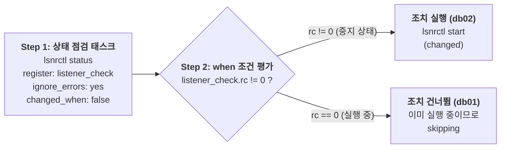

#### (1) 리스너 2단계 조건부 기동 실습 (실습 4: `playbooks/03_listener_conditional.yml`)

`db01`(리스너 실행 중)과 `db02`(리스너 중지 상태)를 대상으로 `playbooks/03_listener_conditional.yml`을 실행합니다.

```yaml
---
# playbooks/03_listener_conditional.yml
- name: Practice two-step pattern - Check and start listener conditionally
  hosts: dbservers
  gather_facts: no
  tasks:
    - name: 1. Step 1 - Check current listener status
      ansible.builtin.shell: "lsnrctl status"
      register: listener_check
      ignore_errors: yes
      changed_when: false

    - name: 2. Step 2 - Start listener only if check failed (rc != 0)
      ansible.builtin.shell: "lsnrctl start"
      when: listener_check.rc != 0
      register: listener_start

    - name: 3. Report listener status action
      ansible.builtin.debug:
        msg: >-
          Host: {{ inventory_hostname }} |
          Initial Status: {{ 'RUNNING' if listener_check.rc == 0 else 'STOPPED' }} |
          Action: {{ 'Started Listener' if (listener_start is defined and listener_start.changed | default(false)) else 'Already running (Skipped start)' }}
```

```bash
[oracle@ansible-control ansible-oracle-project]$ ansible-playbook playbooks/03_listener_conditional.yml
```

```text
PLAY [Practice two-step pattern - Check and start listener conditionally] ******

TASK [1. Step 1 - Check current listener status] *******************************
ok: [db01]
fatal: [db02]: FAILED! => {"changed": false, "cmd": "lsnrctl status", "rc": 1, ...}
...ignoring

TASK [2. Step 2 - Start listener only if check failed (rc != 0)] ***************
skipping: [db01]
changed: [db02]

TASK [3. Report listener status action] ****************************************
ok: [db01] => {
    "msg": "Host: db01 | Initial Status: RUNNING | Action: Already running (Skipped start)"
}
ok: [db02] => {
    "msg": "Host: db02 | Initial Status: STOPPED | Action: Started Listener"
}

PLAY RECAP *********************************************************************
db01                       : ok=2    changed=0    unreachable=0    failed=0    skipped=1    rescued=0    ignored=0   
db02                       : ok=3    changed=1    unreachable=0    failed=0    skipped=0    rescued=0    ignored=1   
```

1차 실행에서 `db02`의 중지된 리스너가 자동으로 기동되었으므로, 즉시 한 번 더 플레이북을 실행(2차 실행)하면 두 서버 모두 `rc == 0`을 반환하여 2단계 기동 태스크가 모두 `skipping` 처리(`changed=0`)됩니다.

#### (2) 반복문(`stat`)과 조건문 결합 실습 (실습 5: `playbooks/04_loop_with_conditions.yml`)

여러 디렉터리 목록을 `stat` 모듈과 `loop`로 먼저 점검(`register: dir_stats`)한 뒤, `when: not item.stat.exists` 조건으로 존재하지 않는 디렉터리만 골라 생성하는 플레이북(`playbooks/04_loop_with_conditions.yml`)을 실행합니다.

```yaml
---
# playbooks/04_loop_with_conditions.yml
- name: Practice loops combined with conditions (stat check before creation)
  hosts: dbservers
  gather_facts: no
  vars:
    required_directories:
      - /backup/data
      - /backup/archivelog
      - /u01/app/oracle/admin
  tasks:
    - name: 1. Check directory existence using stat loop
      ansible.builtin.stat:
        path: "{{ item }}"
      register: dir_stats
      loop: "{{ required_directories }}"

    - name: 2. Create directory only when it does not exist
      ansible.builtin.file:
        path: "{{ item.item }}"
        state: directory
        owner: oracle
        group: oinstall
        mode: '0755'
      loop: "{{ dir_stats.results }}"
      when: not item.stat.exists
      loop_control:
        label: "{{ item.item }}"
```

```bash
# 1차 실행 시 없는 디렉터리 생성 후, 2차 실행 시 전 항목 skipping 확인
[oracle@ansible-control ansible-oracle-project]$ ansible-playbook playbooks/04_loop_with_conditions.yml
[oracle@ansible-control ansible-oracle-project]$ ansible-playbook playbooks/04_loop_with_conditions.yml
```

```text
TASK [2. Create directory only when it does not exist] *************************
skipping: [db01] => (item=/backup/data) 
skipping: [db01] => (item=/backup/archivelog) 
skipping: [db01] => (item=/u01/app/oracle/admin) 
skipping: [db02] => (item=/backup/data) 
skipping: [db02] => (item=/backup/archivelog) 
skipping: [db02] => (item=/u01/app/oracle/admin) 
```

### 5.2 방어적 조건문 패턴: 미정의 변수 에러 예방 (실습 8: `playbooks/05_troubleshooting.yml`)

조건문에서 특정 호스트에 정의되지 않은 변수나 딕셔너리 키(예: `defined_roles['db02']`)를 직접 비교하면 `'dict object' has no attribute 'db02'` 에러가 발생합니다. 이를 방어하기 위해 `is defined` 또는 `| default(...)` 필터를 사용하는 `playbooks/05_troubleshooting.yml`을 실행합니다.

```yaml
---
# playbooks/05_troubleshooting.yml
- name: Practice defensive condition patterns and troubleshooting
  hosts: dbservers
  gather_facts: no
  vars:
    # db01에만 역할 정의, db02는 의도적으로 누락
    defined_roles:
      db01: PRIMARY

  tasks:
    - name: 1. Defensive condition using is defined
      ansible.builtin.debug:
        msg: "Role for {{ inventory_hostname }} is {{ defined_roles[inventory_hostname] }}"
      when:
        - defined_roles[inventory_hostname] is defined

    - name: 2. Defensive condition using default filter
      ansible.builtin.debug:
        msg: "Safe execution with fallback: {{ defined_roles[inventory_hostname] | default('STANDBY_FALLBACK') }}"
      when: (defined_roles[inventory_hostname] | default('STANDBY_FALLBACK')) == 'STANDBY_FALLBACK'
```

```bash
[oracle@ansible-control ansible-oracle-project]$ ansible-playbook playbooks/05_troubleshooting.yml
```

```text
PLAY [Practice defensive condition patterns and troubleshooting] ***************

TASK [1. Defensive condition using is defined] *********************************
ok: [db01] => {
    "msg": "Role for db01 is PRIMARY"
}
skipping: [db02]

TASK [2. Defensive condition using default filter] *****************************
skipping: [db01]
ok: [db02] => {
    "msg": "Safe execution with fallback: STANDBY_FALLBACK"
}

PLAY RECAP *********************************************************************
db01                       : ok=1    changed=0    unreachable=0    failed=0    skipped=1    rescued=0    ignored=0   
db02                       : ok=1    changed=0    unreachable=0    failed=0    skipped=1    rescued=0    ignored=0   
```

---

## 6. 마스터 프로젝트: 조건 기반 모듈식 오라클 서버 운영 자동화 (`playbook.yml`)

이제 본 장의 핵심인 마스터 프로젝트를 살펴봅니다. 현업에서는 모든 태스크를 하나의 거대한 파일에 넣지 않고 기능별 하위 태스크 파일(`tasks/*.yml`)로 쪼갠 뒤 메인 플레이북(`playbook.yml`)에서 **`ansible.builtin.import_tasks`**로 조립하는 모듈식 아키텍처를 사용합니다.

```mermaid
flowchart TD
    MAIN["<b>메인 플레이북 (playbook.yml)</b><br/>vars_files: vars/variables.yml"]
    T1["<b>1. tasks/check_db_status.yml</b><br/>SELECT open_mode FROM v\$database;<br/>register: db_status"]
    T2{"<b>2. tasks/start_db.yml</b><br/>when: (db_status.stdout | trim) != 'READ WRITE'"}
    T2_RUN["db02 (MOUNTED) → STARTUP 실행!"]
    T2_SKIP["db01 (READ WRITE) → skipping"]
    T3["<b>3. tasks/check_tablespace.yml</b><br/>테이블스페이스 사용률(%) SQL 조회<br/>register: ts_usage"]
    T4{"<b>4. tasks/alert_tablespace.yml</b><br/>when: regex_search('(8[5-9]|9[0-9]|100)')"}
    T4_RUN["db01 (SYSAUX 88%) → ALERT 발생!"]
    T4_SKIP["db02 (최대 60%) → skipping"]
    T5["<b>5. tasks/apply_patch.yml</b><br/>when: apply_patch | bool<br/>패치 아카이브 배포"]

    MAIN --> T1 --> T2
    T2 -- "True" --> T2_RUN --> T3
    T2 -- "False" --> T2_SKIP --> T3
    T3 --> T4
    T4 -- "True (85% 이상)" --> T4_RUN --> T5
    T4 -- "False (85% 미만)" --> T4_SKIP --> T5
```

### 6.1 마스터 프로젝트 구성 파일 상세 코드 확인

`chapter_6/ansible-oracle-project`에 구성된 변수 파일(`vars/variables.yml`), 5개의 하위 태스크 파일(`tasks/*.yml`), 그리고 메인 플레이북(`playbook.yml`)의 코드를 확인합니다. 원본 초안(12장)의 잠재적 버그였던 공백 문제(`| trim` 추가), 임계값 정규식 비교(`(8[5-9]|9[0-9]|100)`), 미정의 핸들러 제거 등이 모두 완벽하게 정제된 실무형 코드입니다.

```yaml
# vars/variables.yml
oracle_home: /u01/app/oracle/product/19c
db_name: ORCL
tablespace_threshold: 85
patch_file: /u01/patch/19c_patch.zip
apply_patch: true
perform_backup: true
```

```yaml
# tasks/check_db_status.yml (1. DB 오픈 모드 조회)
- name: Check database status
  ansible.builtin.shell: |
    . {{ oracle_home }}/bin/oraenv <<< {{ db_name }}
    sqlplus -s / as sysdba <<EOF
    set heading off feedback off
    select open_mode from v\$database;
    EOF
  register: db_status
  changed_when: false
```

```yaml
# tasks/start_db.yml (2. READ WRITE가 아닐 때만 조건부 기동)
- name: Start database if not running
  ansible.builtin.shell: |
    . {{ oracle_home }}/bin/oraenv <<< {{ db_name }}
    sqlplus -s / as sysdba <<EOF
    startup
    EOF
  when: (db_status.stdout | trim) != "READ WRITE"
  register: start_db
```

> 💡 **노트(Note): 왜 `(db_status.stdout | trim) != "READ WRITE"`처럼 `| trim` 필터를 사용하나요?**
> SQL*Plus에서 `set heading off feedback off`를 주더라도 쿼리 결과 문자열 앞뒤에 줄바꿈 문자(`\n`)나 공백이 포함되는 경우가 많습니다. `| trim` 필터를 적용하여 양끝 공백을 제거한 뒤 비교하면 문자열 불일치로 인해 이미 열린 DB를 다시 시작하려는 오류를 완벽히 방지할 수 있습니다.

```yaml
# tasks/check_tablespace.yml (3. 테이블스페이스 사용률 조회)
- name: Get tablespace usage
  ansible.builtin.shell: |
    . {{ oracle_home }}/bin/oraenv <<< {{ db_name }}
    sqlplus -s / as sysdba <<EOF
    set heading off feedback off
    select tablespace_name, round((1-(bytes_free/bytes_total))*100)
    from (select a.tablespace_name,
                 sum(a.bytes) bytes_total,
                 sum(a.bytes)-sum(nvl(b.bytes,0)) bytes_free
          from dba_data_files a left join dba_free_space b
            on a.file_id = b.file_id
          group by a.tablespace_name);
    EOF
  register: ts_usage
  changed_when: false
```

```yaml
# tasks/alert_tablespace.yml (4. 사용률 85% 이상일 때만 조건부 알림)
- name: Send alert for high tablespace usage
  ansible.builtin.debug:
    msg: "ALERT: High tablespace usage detected on {{ inventory_hostname }} (Exceeding {{ tablespace_threshold }}%)! Usage details: {{ ts_usage.stdout_lines }}"
  when:
    - ts_usage is defined
    - ts_usage.stdout is defined
    - (ts_usage.stdout | regex_search('(8[5-9]|9[0-9]|100)')) is not none
```

```yaml
# tasks/apply_patch.yml (5. apply_patch 플래그가 참일 때만 패치 파일 압축 해제)
- name: Apply Oracle patch if requested
  ansible.builtin.unarchive:
    src: "{{ patch_file }}"
    dest: /u01/patch
    remote_src: yes
  when: apply_patch | bool
  register: patch_result
```

```yaml
---
# playbook.yml (마스터 프로젝트 메인 플레이북)
- name: Conditional Oracle Server Operations
  hosts: dbservers
  gather_facts: yes
  vars_files:
    - vars/variables.yml
  tasks:
    - name: 1. Check database open mode
      ansible.builtin.import_tasks: tasks/check_db_status.yml

    - name: 2. Conditionally start database if not READ WRITE
      ansible.builtin.import_tasks: tasks/start_db.yml

    - name: 3. Check tablespace usage
      ansible.builtin.import_tasks: tasks/check_tablespace.yml

    - name: 4. Conditionally alert on high tablespace usage
      ansible.builtin.import_tasks: tasks/alert_tablespace.yml

    - name: 5. Conditionally apply patch archive
      ansible.builtin.import_tasks: tasks/apply_patch.yml
```

### 6.2 마스터 프로젝트 실행 및 노드별 지능형 분기 검증 (실습 6 & 7)

먼저 문법 검사(`--syntax-check`)를 수행한 뒤 마스터 플레이북(`playbook.yml`)을 실행합니다.

```bash
[oracle@ansible-control ansible-oracle-project]$ ansible-playbook --syntax-check playbook.yml
[oracle@ansible-control ansible-oracle-project]$ ansible-playbook playbook.yml
```

```text
PLAY [Conditional Oracle Server Operations] ************************************

TASK [Gathering Facts] *********************************************************
ok: [db01]
ok: [db02]

TASK [Check database status] ***************************************************
ok: [db02]
ok: [db01]

TASK [Start database if not running] *******************************************
skipping: [db01]
changed: [db02]

TASK [Get tablespace usage] ****************************************************
ok: [db01]
ok: [db02]

TASK [Send alert for high tablespace usage] ************************************
ok: [db01] => {
    "msg": "ALERT: High tablespace usage detected on db01 (Exceeding 85%)! Usage details: ['SYSTEM 65', 'SYSAUX 88', 'USERS 72']"
}
skipping: [db02]

TASK [Apply Oracle patch if requested] *****************************************
changed: [db02]
changed: [db01]

PLAY RECAP *********************************************************************
db01                       : ok=5    changed=1    unreachable=0    failed=0    skipped=1    rescued=0    ignored=0   
db02                       : ok=5    changed=2    unreachable=0    failed=0    skipped=1    rescued=0    ignored=0   
```

실행 결과를 살펴보면 단 하나의 플레이북이 두 서버의 상태를 스스로 파악하여 정반대의 지능형 조치를 수행한 것을 확인할 수 있습니다.

1. **`Start database if not running`**: 이미 `READ WRITE` 상태인 `db01`은 건너뛰고(`skipping`), `MOUNTED` 상태였던 `db02`만 정확히 기동(`changed`)했습니다.
2. **`Send alert for high tablespace usage`**: `SYSAUX` 사용률이 `88%`인 `db01`에서만 경고 알림을 출력하고, 사용률이 여유로운 `db02`는 건너뛰었습니다(`skipping`).
3. **2차 실행 시 멱등성 검증**: 이어서 `ansible-playbook playbook.yml`을 한 번 더 실행하면, 1차 실행에서 기동된 `db02` 역시 `READ WRITE` 상태가 되었으므로 두 서버 모두 DB 기동 태스크를 건너뛰며 **`changed=0`**으로 완료됩니다.

실습을 모두 마쳤다면 제어 노드를 종료하고 컨테이너를 정리합니다.

```bash
exit
docker compose down -v
```

---

## 핵심 요약

1. **상태 인식형 자동화 (`when`)**: `when` 조건문을 사용하면 대상 서버의 OS·메모리 사양이나 DB·리스너의 실시간 가동 상태에 따라 꼭 필요한 작업만 선택적으로 실행할 수 있습니다.
2. **이중 중괄호 금지와 팩트 구분**: `when:` 조건식 안에서는 `{{ }}` 없이 변수명을 직접 작성하며, 오라클 리눅스 배포판을 특정할 때는 `ansible_os_family`(`RedHat`)가 아닌 **`ansible_distribution == "OracleLinux"`**를 사용합니다.
3. **선 확인 후 조치 (2단계 패턴)**: 실시간 명령 결과를 조건에 쓰려면 반드시 1단계 태스크에서 상태를 조회해 `register`에 담고(`changed_when: false`), 2단계 태스크의 `when`에서 해당 결과를 평가해야 합니다.
4. **안전한 문자열·숫자 필터 결합**: SQL*Plus 출력 문자열을 비교할 때는 **`| trim`**으로 공백을 제거하고, 숫자 비교 시에는 **`| int`**, 불리언 평가 시에는 **`| bool`** 필터를 결합하여 데이터 타입 불일치 오류를 예방합니다.
5. **방어적 조건문과 모듈화 (`import_tasks`)**: 미정의 변수 에러를 막기 위해 `is defined`와 `| default()`를 습관화하고, 기능별 태스크를 `tasks/*.yml`로 분리하여 재사용성과 가독성을 높입니다.
